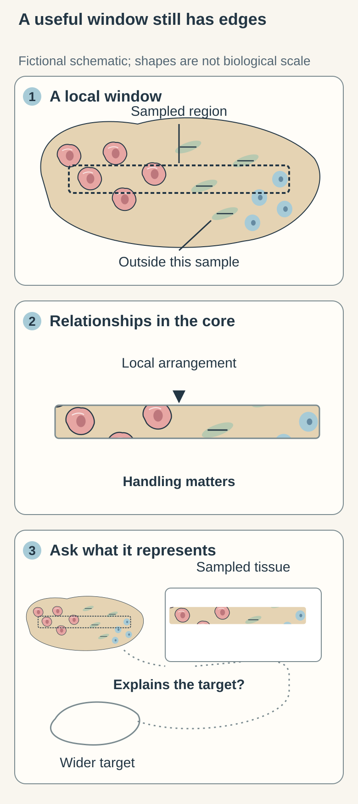
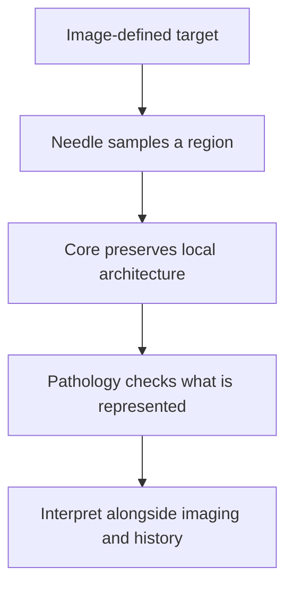

# Core needle biopsy: a small piece of tissue architecture

## In one sentence

A core needle biopsy removes narrow cylinders of tissue that preserve some local cell arrangement while sampling only part of the target.

## The intuition

Imagine removing a narrow plug from a layered cake. The plug shows how the layers meet where you sampled. It cannot show every corner of the cake. A tissue core has the same advantage and limitation: nearby cells remain in relationship, but the sample has a location and a boundary. Living tissue is also more irregular than a cake, and handling can damage its structure.

## How it works

A hollow cutting needle removes a **core**, usually with imaging used to locate the intended area. The laboratory records the site and prepares the material for examination. Thin sections let a pathologist inspect [[wiki/education/concepts/measurement/pathology-readouts/h-and-e-morphology|cell shape and tissue organization]]. Where represented, that architecture helps distinguish cells contained within a structure from cells extending into surrounding tissue.

A [[wiki/education/concepts/measurement/specimens/fine-needle-aspiration|fine needle aspiration]] mainly collects cells and fluid; a core more often retains tissue relationships. Neither collection method guarantees that the relevant interface, most abnormal region, or every tumor population was sampled.

Preparation then determines which additional questions remain possible. [[wiki/education/concepts/measurement/specimens/ffpe-vs-fresh-frozen-vs-viable|Fixed, frozen and viable material]] are different inputs. A core placed in formalin is not a living-cell bank merely because it came from a living tumor.

<!-- BEGIN SUCCESSOR PROSPECTIVE brief-260-A: scratch SVG candidate, independent G3 pending, not adopted -->
<!-- BEGIN INDEPENDENT INSERTION PROOF brief-260: scratch SVG candidate, independent G3 pending, not adopted -->
A core can give you a close view of neighboring cells. That is useful: their arrangement can answer questions that isolated cells cannot. But a close view is still a view from somewhere. Follow the sampled strip in this picture. The enlarged piece keeps some relationships from that strip; it does not suddenly include the regions around it.

When you read a result, keep two questions beside each other: “Can this material be read?” and “Does this material explain the target?” A beautifully preserved piece can still be the wrong window. The imaging and tissue findings need to be interpreted together. [ACR/RSNA biopsy information](https://www.radiologyinfo.org/en/info/breastbius)

A core preserves some local tissue relationships within a sampled window; its interpretation still depends on what was sampled and whether the finding explains the imaging target. This sketch shows no patient's tissue and makes no claim about adequate sample number or complete removal.

**Try it beside the picture:** The sample is easy to read, but it contains only benign fat. Does good preservation prove that a suspicious imaging target is benign?  
**Answer:** No. Good preservation helps with reading the submitted material. Whether it explains the imaging target is a separate question. The example does not choose a follow-up procedure.
<!-- END INDEPENDENT INSERTION PROOF brief-260 -->

For the other two sampling questions, compare [recovered cells and fragments](fine-needle-aspiration.md#a-piece-of-tissue-or-recovered-cells) with the local core, then compare [selected tissue pieces with a mapped outer boundary](vacuum-assisted-biopsy.md#several-pieces-are-not-a-mapped-outer-boundary). These connected comparisons keep useful local findings separate from whole-lesion representation and margin assessment.

<!-- END SUCCESSOR PROSPECTIVE brief-260-A -->

## Why it matters in cancer

A core can support diagnosis and selected biomarker tests without removing the whole lesion. Its small size makes [[wiki/education/concepts/measurement/specimens/tissue-is-non-renewable|tissue allocation]] important. **Radiology–pathology concordance** means asking whether the tissue finding plausibly explains the imaging target. A technically readable slide and a representative sample are separate requirements.

## How it is measured

| Assay-card field | What to retain |
|---|---|
| Measures | Tissue features in the sampled region, followed by named tests |
| How | Locate target → collect cores → preserve → section and examine |
| Input and tissue cost | Cylinders from a named site; sectioning and extraction use finite material |
| Output and units | Diagnosis, described architecture and assay-specific results; core count is an inventory measure |
| Thresholds | Adequacy depends on represented tissue and the intended assay, not a universal core count |
| Failure modes | Missed target, too few relevant cells, damaged cores, necrosis or incompatible preservation |
| Cannot show alone | Whole-lesion composition, complete surgical margins or treatment benefit |
| Validation context | Diagnostic interpretation integrates clinical and imaging information; each added assay needs its own validated input |

## Common confusions

- A long core can contain mostly normal tissue or scar. Length is not tumor-cell content.
- More cores do not automatically make different tumor regions equally represented.
- An adequate diagnostic core may be inadequate for another test.
- “No tumor seen” describes the submitted material; its wider meaning depends on sampling and concordance.

## Try it

A fictional imaging target looks suspicious. The core contains benign fat and is technically well preserved. A learner concludes, “The imaging target is definitely benign.” What is missing?

**Answer:** Whether the sampled tissue explains the target. Preservation supports reading the slide; it does not prove the needle sampled the relevant lesion. The team must assess concordance before drawing the broader conclusion. This exercise does not specify which follow-up procedure is appropriate.

## Explain it back

Why can a core preserve architecture yet still miss a cancer? **One answer:** Architecture describes relationships within the removed piece; representativeness asks whether that piece captured the relevant part of the lesion.

## Takeaway

A core provides a structured window into tissue, and every interpretation should retain the window's location and limits.

## Related concepts

- [[wiki/education/concepts/measurement/specimens/vacuum-assisted-biopsy|Vacuum-assisted tissue sampling]]
- [[wiki/education/concepts/cancer-biology/what-cancer-is/tumor-heterogeneity|Variation within a tumor]]

## Sources and scope

Source check: October 10, 2026. General sampling education, with breast biopsy as the example; expert and learner review remain pending.

- [NCI: how breast cancer is diagnosed](https://www.cancer.gov/types/breast/diagnosis) — official descriptions of needle sampling.
- [ACR/RSNA: ultrasound-guided breast biopsy](https://www.radiologyinfo.org/en/info/breastbius) — collection methods, sampling limitations and concordance.

<!-- BEGIN GENERATED USED IN -->
## Used in

- [Place the specimen in time](/wiki/education/guides/reading-pathology-and-surgery-results/01-place-the-specimen-in-time)
- [Read a tumor report without skipping its limits](/wiki/education/reading-a-tumor/index)
<!-- END GENERATED USED IN -->
