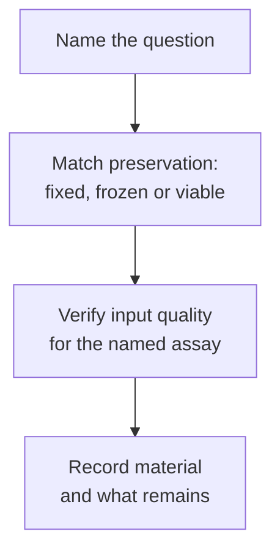

# Fixed, fresh-frozen and viable tissue: different kinds of input

## In one sentence

Fixed, fresh-frozen and viable preparations preserve different properties of tissue, so the preparation must fit the intended assay before material is committed.

## The intuition

A photograph, a preserved ingredient and a living plant can all come from the same garden, but they support different questions. You can inspect the photograph, analyze the ingredient or test how the plant grows. Tissue preservation creates a similar distinction. The analogy is imperfect: fixed tissue still contains measurable molecules, and freezing may preserve living cells when a specifically designed recovery protocol is used.

## How it works

**Formalin-fixed, paraffin-embedded (FFPE)** tissue is chemically stabilized, processed and embedded in wax for thin sections. It supports detailed [[wiki/education/concepts/measurement/pathology-readouts/h-and-e-morphology|morphology]], many [[wiki/education/concepts/measurement/pathology-readouts/immunohistochemistry|immunohistochemistry]] assays and molecular tests validated for that input. Fixation changes molecular chemistry; extracting measurable DNA or RNA does not restore a living cell. [Masuda et al.](https://pubmed.ncbi.nlm.nih.gov/10536153/) demonstrated RNA chemical modifications and assay effects in an experimental fixation study.

**Fresh-frozen tissue** is tissue frozen without prior formalin fixation, often to preserve molecules for analysis. Snap-freezing for DNA, RNA or protein measurement is not automatically a procedure for recovering viable cells. The [NCI snap-freezing protocol](https://dctd.cancer.gov/data-tools-biospecimens/snap-freeze-bebp.pdf) explicitly places viability, cell sorting, culture and drug-sensitivity applications outside its scope.

**Viable material** contains living cells suitable for a specified downstream workflow. It may be processed promptly or cryopreserved using a protocol intended to support recovery. Actual recovery, relevant cell identity and function must then be checked. A sample can contain live cells yet fail to establish a useful [[wiki/education/concepts/measurement/functional-models/organoid|organoid model]].

These categories describe preparation, not tumor content. Each aliquot still needs a site, collection time, treatment context and assessment of what cells it contains.

## Why it matters in cancer

Preservation can close future options. A fixed block cannot later supply the original living cells for a growth experiment. Separate allocations made before processing may preserve different options, but they also divide [[wiki/education/concepts/measurement/specimens/tissue-is-non-renewable|finite tissue]]. Preparation is therefore part of the scientific question, rather than a shipping detail added afterward.

## How it is measured

| Assay-card field | What to retain |
|---|---|
| Measures | Input suitability for a named assay or living-cell workflow |
| How | Document preservation → assess represented cells → check assay-specific quality |
| Input and tissue cost | Sections, tissue pieces or cell aliquots; destructive quality checks also use material |
| Output and units | Yield/quality metrics appropriate to the analyte; viable-cell recovery and function where relevant |
| Thresholds | Defined by the receiving method; no preservation label guarantees a pass |
| Failure modes | Delayed stabilization, incompatible fixative, degraded analyte, poor thaw recovery or missing target cells |
| Cannot show alone | Clinical accuracy, tumor-wide representation or patient drug response |
| Validation context | An assay validated on fixed tissue does not automatically transfer to frozen or cultured material |

## Common confusions

- “Frozen” does not always mean “viably cryopreserved.”
- “Fresh” describes handling history, not a verified percentage of living tumor cells.
- Fixed tissue is useful for molecular testing when methods are suitable; it is not universally unusable.
- A culture changes the measurement system and may select which cells survive.

## Try it

A fictional archive contains a fixed block, a snap-frozen piece and a vial labeled “viable.” A team wants to test cell growth under an experimental perturbation. Which label answers whether this is possible?

**Answer:** None alone. The fixed block cannot recover the original living cells. The snap-frozen piece was not necessarily preserved for viability. The viable vial needs its protocol, recovery, cell identity and model suitability checked before the experiment is justified.

## Explain it back

Why choose preparation before collection? **One answer:** Some preservation steps permanently change what can be measured, so future assay needs must inform allocation.

## Takeaway

Match the assay to what the material actually preserves, and verify suitability rather than trusting its label.

## Related concepts

- [[wiki/education/concepts/measurement/specimens/rna-integrity|RNA quality and assay suitability]]
- [[wiki/education/concepts/measurement/specimens/surgical-resection-specimen|Documenting tissue regions]]

## Sources and scope

Source check: October 10, 2026. Preparation principles, not a laboratory operating protocol; expert and learner review remain pending.

- [NCI: snap-freezing post-surgical tissue, revision 1.0 (2025)](https://dctd.cancer.gov/data-tools-biospecimens/snap-freeze-bebp.pdf) — molecular scope and explicit viable-application exclusions.
- [Masuda et al., 1999: chemical modification of RNA from formalin-fixed samples](https://pubmed.ncbi.nlm.nih.gov/10536153/) — primary experimental molecular evidence; not a modern clinical assay performance estimate.
- [Neal et al., 2018: organoid modeling of the tumor immune microenvironment](https://pubmed.ncbi.nlm.nih.gov/30550791/) — a particular viable culture system, not guaranteed growth or treatment prediction for every specimen.

<!-- BEGIN GENERATED USED IN -->
## Used in

- [Match each measurement to its claim](/wiki/education/local-treatment-modalities/05-tissue-and-sample-budget)
- [Read single-cell data after treatment](/wiki/education/molecular-profiling/08-profile-residual-tumor)
- [Read a tumor report without skipping its limits](/wiki/education/reading-a-tumor/index)
- [Overlap and sequencing](/wiki/education/targeted-therapy-modalities/03-overlap-and-sequencing)
- [Match a specimen to the test before spending tissue](/wiki/education/targeted-therapy-modalities/05-tissue-and-sample-budget)
<!-- END GENERATED USED IN -->
