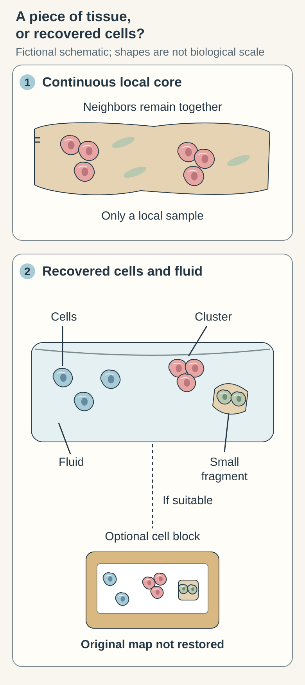
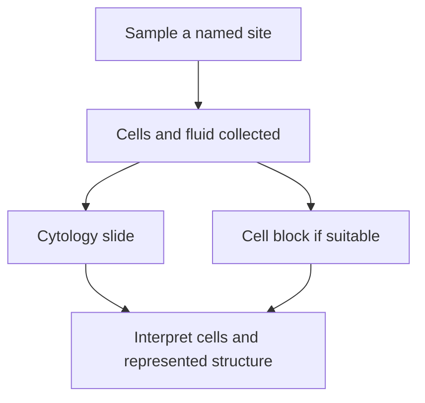

# Fine needle aspiration: learning from collected cells

## In one sentence

Fine needle aspiration collects cells and fluid through a thin needle for cytologic examination, usually with less preserved tissue architecture than a core biopsy.

## The intuition

Think of meeting people from a building without receiving a floor plan. You can learn a great deal about the people, but their original arrangement is harder to reconstruct. Aspiration often provides that kind of cellular view. The analogy has a limit: cell clusters and small tissue fragments may retain useful local structure, especially in a prepared cell block.

## How it works

A thin needle obtains cells or fluid from a selected site. **Cytology** is the examination of cells, including their shapes, nuclei and groupings. Material may be spread on slides or processed in liquid. A **cell block** concentrates recovered cells and fragments into material that can be sectioned, sometimes enabling additional staining or molecular testing.

<!-- BEGIN SUCCESSOR PROSPECTIVE brief-260-B: scratch SVG candidate, independent G3 pending, not adopted -->
### A piece of tissue, or recovered cells?

A continuous core keeps some neighboring cells in their local arrangement. A fine needle aspiration (FNA) collects cells and fluid; it can also contain cell clusters and small tissue fragments. Those are useful findings, not an empty substitute for a core. A suitable cell block can prepare recovered material for sections or added tests. It does not restore the original lesion's full spatial map. Suitability still depends on the question and preparation.

Compare a continuous local core with recovered cells, fluid, clusters and fragments. An optional cell block can support suitable examination without recreating the original lesion's oriented architecture. The sketch is fictional and does not rank diagnostic accuracy or establish adequacy.

**Try it:** A cell block contains a small cluster and supports a suitable additional stain. Does that establish the original lesion's complete boundary? **Answer:** No. Useful cell and local-fragment evidence can coexist with missing wider architecture.

[Return to the local sampling window](core-needle-biopsy.md#how-it-works).
<!-- END SUCCESSOR PROSPECTIVE brief-260-B -->

This differs from [[wiki/education/concepts/measurement/specimens/core-needle-biopsy|core needle biopsy]], which more often preserves a continuous piece of tissue. An aspiration can identify malignant cells in an appropriate setting. In a breast lesion, however, dispersed cells generally cannot establish the full relationship between a duct boundary and surrounding tissue needed to distinguish in-situ from invasive disease. A cell block does not recreate the whole original lesion.

**Adequacy** asks whether enough suitable material was obtained for the question. Rapid assessment during collection can sometimes help assess this; it does not guarantee that all later tests will succeed. Imaging, clinical context and the final laboratory interpretation still matter.

## Why it matters in cancer

An aspiration may help diagnose or investigate a mass, fluid collection or lymph node. The question determines its usefulness. Detecting tumor cells in a sampled node is different from mapping every node, and identifying malignant cells is different from establishing the complete local extent of a primary tumor.

## How it is measured

| Assay-card field | What to retain |
|---|---|
| Measures | Features of recovered cells and any represented fragments |
| How | Locate → collect → prepare slides or cell block → interpret |
| Input and tissue cost | Cells/fluid from a named site; preparation and ancillary tests use this finite sample |
| Output and units | Cytologic diagnostic category, adequacy and assay-specific measurements |
| Thresholds | Cellularity and suitability criteria depend on the laboratory, organ and test |
| Failure modes | Too few relevant cells, blood dilution, poor preservation or missed target |
| Cannot show alone | Unsampled tissue boundaries, entire lesion extent or every lymph node |
| Validation context | Clinical cytology and ancillary tests need appropriate preparation and validation; research performance does not transfer automatically |

## Common confusions

- “Less architecture” does not mean “no diagnostic information.”
- A cell block can support additional tests, but suitability must be checked rather than assumed.
- A negative aspirate and an inadequate aspirate are different findings.
- Performance from one hospital's breast series is not a universal accuracy estimate for every organ or collection team.

## Try it

A fictional aspirate contains malignant epithelial cells. Someone says, “We now know exactly how far this breast lesion invades.” Is that conclusion supported?

**Answer:** No. The cells support a malignancy interpretation in context, but the aspirate does not establish the lesion's entire tissue boundary or extent. Additional architectural and clinical information answers that separate question. Conversely, the architectural limit does not erase the value of finding malignant cells.

## Explain it back

What is the difference between asking “What cells are here?” and “Where have these cells grown?” **One answer:** Cytology emphasizes cell identity and appearance; preserved tissue architecture helps place those cells in their original surroundings.

## Takeaway

Aspiration can provide valuable cellular evidence, provided its preparation and architectural limits stay attached to the result.

## Related concepts

- [[wiki/education/concepts/measurement/pathology-readouts/immunohistochemistry|Protein staining on suitable preparations]]
- [[wiki/education/concepts/measurement/specimens/surgical-resection-specimen|A mapped surgical specimen]]

## Sources and scope

Source check: October 10, 2026. General cytology teaching; expert and learner review remain pending.

- [ACR/RSNA: ultrasound-guided breast biopsy](https://www.radiologyinfo.org/en/info/breastbius) — official aspiration/core distinctions.
- [Chen et al., 2022: breast fine needle aspiration in a large academic hospital](https://pubmed.ncbi.nlm.nih.gov/35869577/) — a retrospective breast cohort; includes limited cell-block receptor testing, not universal performance.
- [NCI: pathology reports](https://www.cancer.gov/about-cancer/diagnosis-staging/diagnosis/pathology-reports-fact-sheet) — cell, tissue and fluid examination in diagnostic context.

<!-- BEGIN GENERATED USED IN -->
## Used in

- [Place the specimen in time](/wiki/education/guides/reading-pathology-and-surgery-results/01-place-the-specimen-in-time)
<!-- END GENERATED USED IN -->
