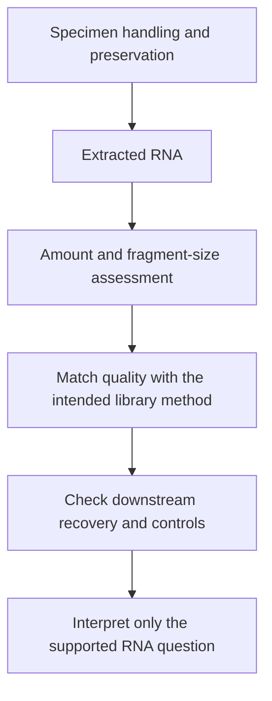

# RNA integrity

## In one sentence

RNA integrity describes the condition and fragmentation of extracted RNA, helping determine which measurement workflows can recover useful information from a specimen.

## The intuition

Imagine receiving a letter with torn pages. You might still identify the author from short phrases, but reconstructing the full letter is harder. RNA assays also need different lengths and features. The analogy stops at chemical damage: an apparently suitable fragment can contain modifications that interfere with copying or capture.

## How it works

RNA extraction releases molecules from their tissue context. Handling, preservation, enzymes that degrade RNA, and chemical processing can change the recovered material. **Integrity** concerns molecular condition; **yield** concerns how much was recovered. Plenty of RNA is not necessarily suitable RNA.

An **electropherogram**, a trace separating molecules by size, helps characterize the fragment distribution. The **RNA integrity number (RIN)** summarizes multiple features of such a trace on a scale from 1, most degraded, to 10, most intact. It is not a percentage of intact messenger RNA, viable cells or tumor cells. The [original RIN study](https://pmc.ncbi.nlm.nih.gov/articles/PMC1413964/) developed the score from electrophoretic patterns rather than testing every transcript individually.

**DV200** is the percentage of measured RNA fragments longer than 200 nucleotides. It describes a size distribution, not whether each fragment can be successfully assayed. Other fragment-length metrics may be more informative in particularly degraded material. A primary study of older fixed ovarian tumors found that RIN and DV200 did not capture every limitation of those samples; it evaluated shorter-fragment metrics and downstream library performance in its own protocol.

## Why it matters in cancer

[Formalin-fixed, paraffin-embedded (FFPE)](/about/Terminology#ffpe) tissue can support RNA measurements when the assay is appropriate and validated for it. Its suitability cannot be decided from the word “fixed” alone. Fresh-frozen tissue can also vary with handling and storage. Neither preparation automatically provides viable cells for a functional experiment.

A method targeting short captured regions may answer a gene-expression question from fragmented material while leaving full-length transcript or splice questions unresolved. A low-quality negative result may mean failed recovery rather than biological absence. Match the input assessment with the exact question and check the library's performance after preparation.

## Assay card

| Field | What to retain |
|---|---|
| Measures and method | Fragment-size distribution and a method-specific quality summary, followed by assay recovery checks |
| Input and tissue cost | An aliquot of extracted RNA; extraction consumes specimen material and quality assessment uses part of that extract |
| Output and units | RIN on its 1–10 scale, DV200 as a percentage, RNA amount in nanograms, and downstream recovery metrics |
| Thresholds | Laboratory acceptance criteria for the particular preservation, input amount and library method; no universal RIN or DV200 pass cutoff |
| Failure modes | Poor extraction, degradation, chemical damage, contaminants, insufficient quantity or an uninterpretable trace |
| Limits | Integrity does not measure tumor purity, transcript function, cell viability or protein abundance |
| Validation context | Acceptance rules must support the intended RNA assay and specimen; a research suitability metric is not a diagnostic result |

## Common confusions

- **Integrity versus quantity:** a large yield can contain short or unsuitable fragments.
- **RIN versus DV200:** one summarizes a trace; the other describes a specified size fraction.
- **Passing input QC versus passing the assay:** library complexity and gene recovery still need evaluation.

## Try it

A fictional FFPE extract has low RIN. A laboratory accepts it for a validated short-target expression assay, but not for its full-length transcript workflow. Is that inconsistent?

**Answer:** No. The two assays need different molecular evidence. State which question the accepted assay can answer; do not infer intact transcripts from its gene counts.

## Related concepts

- [Bulk RNA sequencing](../transcriptomics/bulk-rna-seq.md): messages recovered from a mixture.
- [Batch effects](../transcriptomics/batch-effects.md): systematic preparation differences between samples.

## Sources

Source check: October 9, 2026. Expert and learner review remain pending. Examples are fictional.

- [Schroeder et al., development of RIN (2006)](https://pmc.ncbi.nlm.nih.gov/articles/PMC1413964/).
- [Hatzis et al., handling and RNA measurements in resected breast cancers (2011)](https://pmc.ncbi.nlm.nih.gov/articles/PMC3243675/).
- [Robustness of RNA sequencing in older FFPE ovarian tumors (2019)](https://doi.org/10.1371/journal.pone.0216050).

<!-- BEGIN GENERATED USED IN -->
## Used in

- [Use RNA to test the message and its source](/wiki/education/molecular-profiling/02-rna-the-activity-layer)
- [Understand multi-omics, one question at a time](/wiki/education/reading-a-tumor/omics-and-multi-omics)
<!-- END GENERATED USED IN -->
