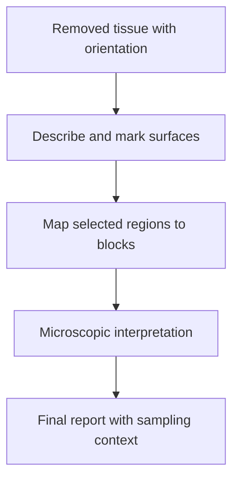

# Surgical resection specimen: a tissue map with boundaries

## In one sentence

A surgical resection specimen is removed tissue whose orientation, boundaries and sampled regions must be documented to interpret pathology and allocate remaining material.

## The intuition

Think of a map delivered with pieces cut out for closer inspection. The pieces are useful only if you can trace them back to the map. A resection specimen similarly connects the surgeon's removed tissue, its outer surfaces and the blocks selected by pathology. Tissue is deformable, however, so this is not an exact rigid model of the body.

## How it works

The laboratory receives the specimen with its site, procedure and relevant clinical history. **Orientation** establishes which surfaces correspond to which directions, using documented sutures, clips or other communication. An unfamiliar stitch or ink color has no universal meaning; the team's recorded key supplies that meaning.

A **margin** is a boundary of the removed tissue. Ink can mark a surface so its relationship to tumor is recognizable on microscopic sections. Ink that seeps into a crack can create an apparent internal “edge,” so gross handling and microscopic interpretation must agree. Separately submitted margin pieces also need a clear relationship to the main specimen.

**Gross examination** documents visible features and dimensions. Selected regions go into labeled cassettes and tissue blocks. Microscopic findings must remain tied to this sampling map. A large specimen is not necessarily examined cell by cell in its entirety, and the number of slides does not tell you how completely a region was represented.

## Why it matters in cancer

The mapped specimen supports questions about tumor extent, margins, sampled nodes and [[wiki/education/concepts/breast-cancer/surgery-and-pathology-results/treatment-effect-in-pathology|treatment effect]]. The collection time and any preceding therapy determine what biological time point it represents. A post-treatment resection is not interchangeable with a pretreatment biopsy.

Allocation for additional tests must fit the diagnostic needs and [[wiki/education/concepts/measurement/specimens/ffpe-vs-fresh-frozen-vs-viable|preservation requirements]]. Cutting a research piece out first without preserving its location could compromise both diagnostic mapping and research interpretation.

## How it is measured

| Assay-card field | What to retain |
|---|---|
| Measures | Features of submitted and examined tissue, including mapped boundaries |
| How | Receive/orient → grossly describe → map blocks → microscopically examine → integrate |
| Input and tissue cost | Named surgical specimen and separately submitted parts; sectioning/extraction consumes finite material |
| Output and units | Diagnoses, dimensions/distances in mm, described margins and sampled-node counts as applicable |
| Thresholds | Reporting and clinical interpretation depend on cancer type, specimen and treatment setting |
| Failure modes | Lost orientation, fragmentation, ink penetration, incomplete mapping or unsuitable preservation |
| Cannot show alone | Every tissue left in the body, every unsampled node or a personal recurrence probability |
| Validation context | Diagnostic pathology uses applicable protocols and clinical correlation; a research aliquot needs its own provenance |

## Common confusions

- A specimen's gross dimensions are not automatically its invasive tumor dimensions.
- A clear examined margin does not mean every cancer-related question is settled.
- Ink color is a documented local identifier, not a universal anatomical code.
- A block selected for molecular analysis may represent only one region of the specimen.

## Try it

In a fictional resection, block A is labeled “central lesion” and block B “superior surface.” A sequencing report lists only “surgery tissue,” without its block identifier. Can you connect the variant directly to the superior margin?

**Answer:** No. You need the tested block and sampling map. An assay on central tissue cannot be assigned to another region merely because both came from the same operation.

## Explain it back

Why preserve a block map? **One answer:** It connects each microscopic or molecular result to the tissue location that produced it.

## Takeaway

A resection becomes interpretable evidence through orientation, documented sampling and a preserved link from each result to its tissue.

## Related concepts

- [[wiki/education/concepts/measurement/specimens/tissue-is-non-renewable|Finite specimen allocation]]
- [[wiki/education/concepts/breast-cancer/surgery-and-pathology-results/lumpectomy-vs-mastectomy|Different breast operations]]

## Sources and scope

Source check: October 10, 2026. General specimen teaching with breast examples; expert and learner review remain pending.

- [CAP: Practical Guide to Specimen Handling in Surgical Pathology, breast grossing excerpt](https://documents-cloud.cap.org/pdf/Grossing_Sample.pdf) — orientation, surface ink and mapped sections.
- [CAP: June 2026 breast protocol compilation](https://documents-cloud.cap.org/appdocs/learning/MBP/MBPOnlineActivities/CAP_Breast_Cancer_Protocols_June_2026_Update.pdf) — invasive resection protocol 4.11.0.0, especially final margins and explanatory Note L; no treatment cutoff is proposed here.
- [NCI: biospecimen and biorepository basics](https://dctd.cancer.gov/data-tools-biospecimens/biospecimens-biobanks/basics) — handling and residual research material.

<!-- BEGIN GENERATED USED IN -->
## Used in

- [Place the specimen in time](/wiki/education/guides/reading-pathology-and-surgery-results/01-place-the-specimen-in-time)
- [Read a tumor report without skipping its limits](/wiki/education/reading-a-tumor/index)
<!-- END GENERATED USED IN -->
