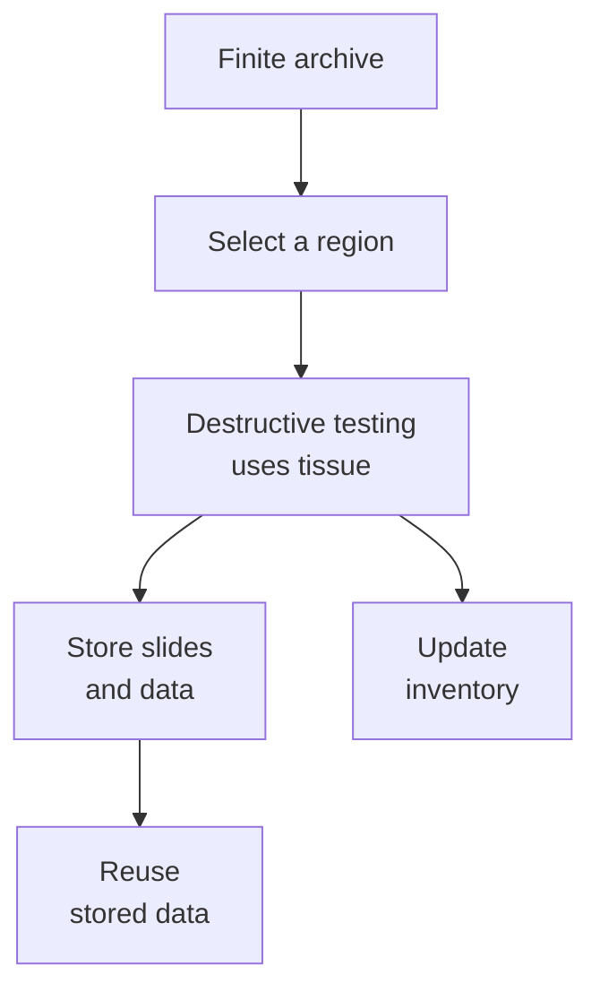

# Tissue is non-renewable: planning a finite specimen budget

## In one sentence

An archived tissue specimen is finite: sections, extractions and other destructive tests consume material that cannot be recreated from its stored results.

## The intuition

Think of a library with one original manuscript. You can reuse a photograph many times, but cutting a page from the original uses something you cannot replace with the photograph. Tissue has this distinction too. The analogy stops at copying: biological cells may grow in a culture, but that culture is a changed system, not a replenishment of the original archived specimen.

## How it works

A paraffin block contains a finite volume of tissue. Cutting sections moves material from that block onto slides. Further levels may expose different cells because tissue composition changes with depth. Extracting DNA, RNA or protein uses a portion and removes its original architecture. The resulting dataset can often be reanalyzed, but reanalysis does not return the tissue.

An **aliquot** is an allocated portion of a specimen. A useful inventory connects each portion to its site, date, treatment context, preservation, location within the specimen, quantity, previous use and remaining material. A block list alone does not establish which blocks contain the cells needed for a particular test.

The allocation plan should distinguish required diagnostic work from optional additional testing. Pathology assesses represented tissue and preservation requirements before material is committed. Research permission and institutional custody also matter; a biologically suitable block is not automatically available for every proposed use.

## Why it matters in cancer

Several attractive tests can compete for the same small region. Different regions may contain different proportions of malignant cells, immune cells, scar or necrosis. Prioritizing requires the question, its likely information value and input needs. There is no universal allocation percentage or section count that works for every tumor and laboratory.

A new biopsy might provide more tissue, but it is a new procedure with burdens and risks, and a new time point. It cannot recreate the exact old specimen. Likewise, an expanded [[wiki/education/concepts/measurement/functional-models/organoid|organoid]] may support experiments while changing the cell mixture and biological environment.

## How it is measured

| Assay-card field | What to retain |
|---|---|
| Measures | Available suitable material and the cost of proposed testing |
| How | Identify portions → assess tissue → estimate method-specific use → record consumption |
| Input and tissue cost | Blocks, slides, frozen pieces or cell aliquots; counts alone do not capture adequacy |
| Output and units | Remaining portions, section thickness/area or analyte amounts with their context |
| Thresholds | Receiving laboratory requirements and diagnostic priorities; no universal test budget |
| Failure modes | Outdated inventory, unrecognized exhaustion, unsuitable region or duplicated destructive work |
| Cannot show alone | Whether a test changes care or whether another procedure is appropriate |
| Validation context | Specimen governance supports reliable assays; it is not a clinical biomarker itself |

## Common confusions

- Reusing an existing image may cost no additional section, but creating that image used a prepared slide.
- “Ten slides left” does not tell you how much relevant tissue is on them.
- Returning a block does not return material already extracted from it.
- Cultured cells can multiply; the original archive still cannot be reconstructed from them.

## Try it

A fictional small block can support one proposed extraction after diagnostic needs are protected. Two teams request overlapping RNA analyses. What should happen before both requests are dispatched?

**Answer:** Compare their questions, validated input requirements, reuse options, permissions and expected tissue use with pathology. Existing data might answer part of one request, or a coordinated allocation might avoid unnecessary duplication. The exercise does not assign a clinical priority or a universal number of sections.

## Explain it back

Why is a data budget different from a tissue budget? **One answer:** A stored dataset can be copied and reanalyzed; a consumed tissue portion cannot be copied back into the original specimen.

## Takeaway

Record what remains, ask what each test needs, and treat every destructive use as an allocation decision.

## Related concepts

- [[wiki/education/concepts/measurement/pathology-readouts/digital-pathology|Reusing slide images]]
- [[wiki/education/concepts/measurement/specimens/blood-as-a-renewable-sample|Repeated blood collections are new samples]]

## Sources and scope

Source check: October 10, 2026. General specimen planning, not a personal tissue-allocation recommendation; expert and learner review remain pending.

- [NCI: biospecimen and biorepository basics](https://dctd.cancer.gov/data-tools-biospecimens/biospecimens-biobanks/basics) — residual specimens, preparation variables and use context.
- [CAP: breast grossing excerpt](https://documents-cloud.cap.org/pdf/Grossing_Sample.pdf) — selection and mapping of finite tissue sections.
- [NCI: snap-freezing post-surgical tissue](https://dctd.cancer.gov/data-tools-biospecimens/snap-freeze-bebp.pdf) — fit-for-purpose aliquots and preservation.

<!-- BEGIN GENERATED USED IN -->
## Used in

- [Match each measurement to its claim](/wiki/education/local-treatment-modalities/05-tissue-and-sample-budget)
- [Read a tumor report without skipping its limits](/wiki/education/reading-a-tumor/index)
<!-- END GENERATED USED IN -->
