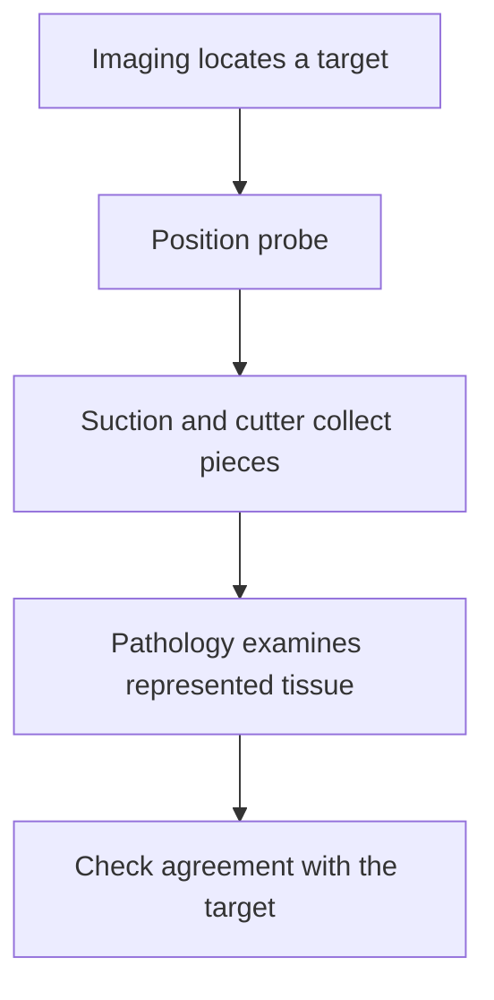

# Vacuum-assisted biopsy: collecting several tissue pieces

## In one sentence

Vacuum-assisted biopsy uses suction and a cutting device to collect tissue pieces through a probe, preserving sampled architecture without guaranteeing complete lesion representation.

## The intuition

Imagine a sampling tool that can gather several plugs from nearby parts of a material without being removed after each plug. That is the practical attraction of a vacuum-assisted system. More material can widen the view, but the view still comes from selected locations. The analogy does not capture how compressible tissue moves or how imaging guides the actual procedure.

## How it works

An image-guided probe is positioned near the target. Suction draws tissue into its sampling opening, and a cutter separates a piece for collection. Multiple pieces can be obtained through the positioned probe. They are then prepared for pathology, much like other [[wiki/education/concepts/measurement/specimens/core-needle-biopsy|core tissue samples]].

The vacuum helps acquire material; it does not identify which cells are malignant. That requires examination of the collected tissue. Imaging may help document that the intended abnormality was sampled. For targets defined by calcifications, checking the collected material against that target can be important to radiology–pathology concordance: does the tissue finding explain the image?

Collection method and [[wiki/education/concepts/measurement/specimens/ffpe-vs-fresh-frozen-vs-viable|preservation method]] remain separate choices. Vacuum-collected tissue placed in formalin becomes fixed material. The word “vacuum” does not imply that living cells were banked for a functional experiment.

## Why it matters in cancer

A larger collection may support diagnosis and additional testing. Yet lesion size, uneven tumor distribution and the actual sampled positions still matter. A biopsy procedure and a therapeutic excision are different questions: removing visible abnormality on imaging does not by itself establish microscopic clearance or interpretable surgical margins.

## How it is measured

| Assay-card field | What to retain |
|---|---|
| Measures | Features in collected tissue, followed by any named biomarker assays |
| How | Image guidance → probe sampling → tissue preparation → pathology correlation |
| Input and tissue cost | Multiple pieces from a documented site; the collected material and subsequent sections are finite |
| Output and units | Tissue diagnosis, sample inventory and assay-specific results |
| Thresholds | No universal piece count proves adequacy or complete removal |
| Failure modes | Missed or incompletely represented target, bleeding, damaged tissue, necrosis or inadequate analyte |
| Cannot show alone | Whole-lesion biology, surgical clearance or future treatment response |
| Validation context | Procedure performance and diagnostic interpretation depend on the intended lesion and workflow; each ancillary assay has separate input requirements |

## Common confusions

- Vacuum assistance is a collection technique, not a molecular test.
- More tissue can help without making a heterogeneous lesion uniform.
- A marker placed at a biopsy site identifies a location; it does not certify that every abnormal cell was removed.
- A collection that supports diagnosis may still need careful allocation before research testing.

## Try it

A fictional vacuum-assisted biopsy samples an imaging abnormality. Several pieces show a consistent lesion, and the image now shows little remaining visible abnormality. A learner writes, “All microscopic disease is gone, with negative margins.” What crossed the evidence boundary?

**Answer:** The learner converted imaging and sampled pathology into a complete excision claim. The pieces demonstrate what was collected. They do not automatically supply an oriented outer boundary or exclude microscopic disease beyond the sampled region.

## Explain it back

Why can collecting several pieces improve sampling without proving complete removal? **One answer:** The pieces expand the observed material, but they still cover selected locations rather than every microscopic edge.

## Takeaway

Vacuum assistance can collect useful tissue efficiently; diagnosis, representativeness and clearance remain separate claims.

## Related concepts

- [[wiki/education/concepts/measurement/specimens/tissue-is-non-renewable|Budgeting finite tissue]]
- [[wiki/education/concepts/measurement/specimens/surgical-resection-specimen|Orientation and margins in resection specimens]]

## Sources and scope

Source check: October 10, 2026. General sampling education; expert and learner review remain pending.

- [NCI: vacuum-assisted core biopsy](https://www.cancer.gov/publications/dictionaries/cancer-terms/def/vacuum-assisted-core-biopsy) — official collection mechanism.
- [ACR/RSNA: ultrasound-guided breast biopsy](https://www.radiologyinfo.org/en/info/breastbius) — multiple samples, targeting, limitations and tissue–imaging correlation.

<!-- BEGIN GENERATED USED IN -->
## Used in

- [Place the specimen in time](/wiki/education/guides/reading-pathology-and-surgery-results/01-place-the-specimen-in-time)
<!-- END GENERATED USED IN -->
