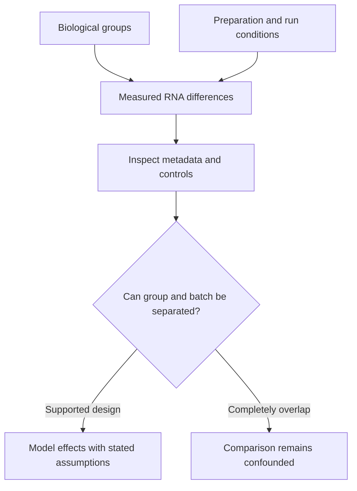

# Batch effects

## In one sentence

A batch effect is a systematic measurement difference associated with preparation, processing or analysis conditions that can be mistaken for a biological difference between samples.

## The intuition

Photograph two groups under different lamps and one group may look warmer because of the lighting. In RNA measurement, a laboratory, extraction method or library run can similarly influence a comparison. The analogy has limits: effects may differ by gene, so one adjustment to the whole image may not recover the true pattern.

## How it works

A **batch** groups samples by some shared technical condition: preparation day, reagent lot, library protocol, sequencing run or processing pipeline. Not every batch label creates a meaningful effect, and more than one technical variable can matter.

Differences in extraction, RNA condition and transcript capture can change which messages are recovered. Sequencing and analysis choices can add further differences. A biological comparison then combines genuine sample differences with technical effects. The same issue also occurs in protein and other measurements.

**Normalization** adjusts defined aspects of the data, such as RNA library size or composition. It does not automatically remove gene-specific technical differences. Statistical models can include recorded batch variables when the design contains information that separates them from the biological groups. Control genes, shared reference samples or repeated preparations can help assess unwanted variation, but each approach has assumptions.

When every sample in group A uses one method and every sample in group B uses another, **confounding** means the effects cannot be separately identified from that comparison alone. A correction algorithm cannot supply the missing experiment. Better designs distribute biological groups across batches and include relevant controls before results are seen.

## Why it matters in cancer

A pre-treatment and post-treatment RNA difference could reflect treatment, a changed cell mixture, different tissue regions, technical processing or several of these. Cell mixture and treatment response can be real biology; erasing them as “batch” may remove the signal of interest.

A pathway score or subtype comparison needs preparation and reference context. Multi-laboratory reproducibility work shows why recording those conditions matters. A visually tidy corrected plot is not by itself proof that the remaining differences are biologically valid.

## Assay card

| Field | What to retain |
|---|---|
| Measures and method | Assess unwanted technical variation using sample metadata, controls and an explicit comparison model |
| Input and tissue cost | Existing expression data need no new tissue; new technical preparations use extract, while repeated sequencing may use an existing library |
| Output and units | Diagnostic plots, batch labels, model estimates and adjusted comparisons in the original analysis's units |
| Thresholds | No universal size of “acceptable batch”; evaluate effects against the intended comparison and predefined quality criteria |
| Failure modes | Missing metadata, complete group–batch overlap, unsuitable controls, or removal of genuine biology |
| Limits | Correction cannot establish causality, recover unmeasured transcripts, or rescue an unidentified comparison |
| Validation context | Check the design, software and assumptions, then test reproducibility using suitable independent or shared controls |

## Common confusions

- **Batch versus biology:** different cell proportions are not automatically a technical artifact.
- **Normalization versus correction:** adjusting library size does not solve every method difference.
- **Technical versus biological replicate:** reprocessing one extract does not add another independent tumor.

## Try it

All fictional baseline tumors were sequenced in laboratory A; all follow-up tumors were sequenced in laboratory B. A stress-program score rises. Has a batch-corrected plot shown a treatment effect?

**Answer:** No. Laboratory and time point overlap completely. The plot does not identify their separate contributions. A design with groups represented across methods or appropriate bridge samples could add the missing information.

## Related concepts

- [RNA integrity](../specimens/rna-integrity.md): input condition can influence recovery.
- [Bulk RNA sequencing](bulk-rna-seq.md): comparison units and cell mixtures.

## Sources

Source check: October 9, 2026. Expert and learner review remain pending. Examples are fictional.

- [’t Hoen et al., RNA-sequencing reproducibility across laboratories (2013)](https://doi.org/10.1038/nbt.2702).
- [Risso et al., control-based RNA-seq normalization (2014)](https://pmc.ncbi.nlm.nih.gov/articles/PMC4404308/).
- [Bioconductor edgeR User's Guide, batch variables and experimental design](https://bioconductor.org/packages/release/bioc/vignettes/edgeR/inst/doc/edgeRUsersGuide.pdf).

<!-- BEGIN GENERATED USED IN -->
## Used in

- [Use RNA to test the message and its source](/wiki/education/molecular-profiling/02-rna-the-activity-layer)
- [Understand multi-omics, one question at a time](/wiki/education/reading-a-tumor/omics-and-multi-omics)
<!-- END GENERATED USED IN -->
