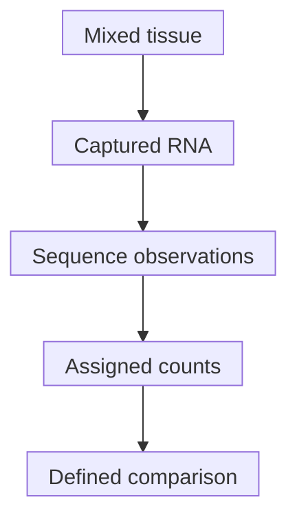

# Bulk RNA sequencing: a tissue mixture of messages

## In one sentence

Bulk RNA sequencing measures captured ribonucleic acid (RNA) from a sample as one combined profile, without directly assigning each message to its cell of origin.

## The intuition

If you record a choir with one microphone, you hear the combined voices. A louder part might mean more singers, louder singers or a different microphone response. Bulk RNA sequencing has the same mixture problem. The analogy ends at the measurement: it samples molecular messages, not continuous sound.

## How it works

A laboratory extracts [RNA](/wiki/education/concepts/biology-basics/molecules/rna-and-mrna) and prepares a **library**, the material presented to the sequencer. Many workflows convert RNA into complementary DNA (cDNA), a deoxyribonucleic acid copy, before sequencing. The protocol may select messenger RNA, remove abundant ribosomal RNA, or capture particular transcript regions. “Bulk” does not mean every molecule was captured equally.

Analysis assigns usable [sequence reads](/wiki/education/concepts/measurement/sequencing-basics/sequencing-reads) or estimated fragments to genes or transcripts. Shared sequences can make assignment ambiguous. [Count normalization](/wiki/education/concepts/measurement/transcriptomics/counts-normalization) then defines the comparison and denominator. A count table is already shaped by preparation and analysis.

Each arrow introduces choices; it does not recover all messages in the original tissue.

Cancer cells, normal epithelial cells, immune cells and supporting cells contribute different amounts and kinds of RNA. A high signal can reflect more cells of one kind, more expression within those cells, or both. [Immune deconvolution](/wiki/education/concepts/measurement/transcriptomics/immune-deconvolution) estimates mixture contributions under a model; it does not physically separate cells.

A **transcript** is an RNA product. [Alternative splicing](/wiki/education/concepts/biology-basics/genetics/splicing) can produce different versions from one gene. Gene-level counts may hide those differences. A mutant sequence or splice product needs the relevant sequence or junction evidence.

## Why it matters in cancer

Bulk RNA can nominate expressed targets and summarize programs through [RNA pathway scores](/wiki/education/concepts/measurement/transcriptomics/rna-pathway-scoring). These are useful questions to investigate. They do not directly establish cell origin, surface protein, pathway flux or drug dependence.

## How it is measured

| Assay card | What to record |
|---|---|
| Measures | Captured RNA abundance and sequence features in a combined sample. |
| How | Extract RNA; prepare a library; sequence; assign observations; compare with stated rules. |
| Input and tissue cost | Fresh-frozen or fixed tissue accepted by the protocol; extraction consumes material. Record sampled region and [RNA integrity](/wiki/education/concepts/measurement/specimens/rna-integrity). |
| Time and controls | Preparation and analysis times vary. Reference material, processing controls and suitable replicates test different parts of the workflow. |
| Output and units | Assigned read/fragment counts, normalized quantities and transcript calls; name the counting unit. |
| Thresholds | Quality and expression cutoffs belong to a specified assay and purpose. |
| Failure modes | Degradation, contamination, ambiguous mapping, annotation differences, [batch effects](/wiki/education/concepts/measurement/transcriptomics/batch-effects) and changing cell mixtures. |
| What it cannot tell you | Every cell's expression, protein amount, biological absence from zero reads, or treatment benefit. |
| Validation tier | Research profiling is distinct from a validated clinical RNA test with a defined intended use. |

## Common confusions

- **High RNA versus functional protein:** production, turnover and localization also matter.
- **Zero detected versus absent:** capture, depth and mapping can miss a message.
- **Many genes versus many replicates:** thousands of genes from one biopsy are not thousands of independent patients.
- **Gene count versus transcript identity:** pooling can conceal isoforms.

## Try it

Two fictional pieces contain 100 cells each. The first has 20 lymphocytes; the second has 40. Assume equal RNA contribution per cell, the same preparation, and an immune marker expressed identically by lymphocytes and not by cancer cells. Does a higher bulk marker signal prove cancer-cell activation?

**Answer:** No. The lymphocyte share rose from 20% to 40%. Under these deliberately simple assumptions, mixture alone can raise the marker signal. Real cells need not contribute equal RNA. Cell-specific evidence would test origin.

## Explain it back

“A bulk signal can change because ______ or ______.”

One answer: “the mixture changed, or expression within a contributing population changed.”

## Takeaway

**Read bulk RNA as a sampled mixture of messages, then test the biological interpretation separately.**

## Related concepts

- [Single-cell and single-nucleus RNA sequencing](/wiki/education/concepts/measurement/transcriptomics/single-cell-and-single-nucleus-rna-seq)
- [Protein measurement in tissue](/wiki/education/concepts/measurement/pathology-readouts/immunohistochemistry)

## Sources and scope

Source check: October 10, 2026. General assay teaching and fictional practice; expert and learner review remain pending.

- [NHGRI RNA fact sheet](https://www.genome.gov/about-genomics/educational-resources/fact-sheets/ribonucleic-acid-fact-sheet) — RNA classes and message processing.
- [Conesa et al., RNA-seq methods and design](https://doi.org/10.1186/s13059-016-0881-8) — a methods review; preparation, assignment and comparison choices.
- [GEUVADIS technical-variation study](https://www.nature.com/articles/nbt.2702) — primary lymphoblastoid-cell study, not a universal tissue-quality rule.
- [SEQC primary reference-RNA comparison](https://pubmed.ncbi.nlm.nih.gov/25150838/) — annotation, depth and pipeline effects in its tested materials.

<!-- BEGIN GENERATED USED IN -->
## Used in

- [Autophagy: traffic, flow, and dependence](/wiki/education/guides/from-variant-to-drug/05-autophagy-flux-and-dependence)
- [Match each measurement to its claim](/wiki/education/local-treatment-modalities/05-tissue-and-sample-budget)
- [Use RNA to test the message and its source](/wiki/education/molecular-profiling/02-rna-the-activity-layer)
- [Ask whether protein is present, placed and active](/wiki/education/molecular-profiling/03-protein-expression-and-activation)
- [Lipid supply and mTOR: measuring resource control](/wiki/education/molecular-profiling/evee-pathways/02-lipid-and-mtor)
- [Oxidative metabolism and stress: energy, damage, and dependence](/wiki/education/molecular-profiling/evee-pathways/05-oxidative-metabolism-and-stress)
- [Separate cell identity from cell state](/wiki/education/multi-omics-foundations/02-cell-identity-and-state)
- [Read RNA counts without counting proteins](/wiki/education/multi-omics-foundations/03-reading-rna-counts)
- [Choose the comparison before interpreting the signal](/wiki/education/multi-omics-foundations/07-comparisons-and-evidence)
- [Read an immune map without overreading it](/wiki/education/reading-a-tumor/immune-hot-vs-cold)
- [Understand multi-omics, one question at a time](/wiki/education/reading-a-tumor/omics-and-multi-omics)
<!-- END GENERATED USED IN -->
