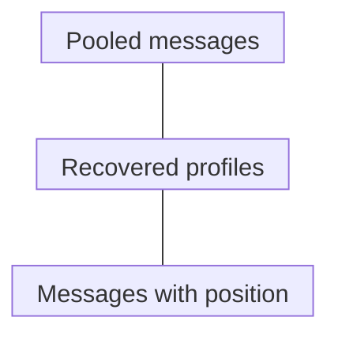

# Bulk vs single-cell vs spatial RNA

## In one sentence

Comparing bulk, single-cell and spatial ribonucleic acid (RNA) methods means choosing between a pooled sample, recovered cell or nucleus profiles, and measurements tied to tissue coordinates.

## What they share

All three examine captured [RNA messages](/wiki/education/concepts/biology-basics/molecules/rna-and-mrna). They need a defined specimen, preparation, detection method and quality checks. None reads every original message, directly measures all protein, or proves that a treatment will work.

## The intuition

Imagine studying a choir. You could record its combined sound, record recovered singers separately, or record sounds with their positions on stage. Each answers a different question. The analogy stops at biology: RNA recovery varies across cells and messages, and removing cells from tissue can change what you recover.

## The axis that differs

**What is the measured unit, and what context remains attached to it?**

*Three measurement units, not a sequence or a ranking. Cell and nucleus preparations belong to the middle category but sample different compartments.*

| Question | Bulk | Single-cell or single-nucleus | Spatial |
|---|---|---|---|
| What is attached to a measurement? | Pooled specimen | Recovered cell or nucleus profile | Capture position or decoded molecule coordinates |
| Which question fits? | How does pooled abundance differ? | Which recovered populations carry a message? | Where is a measured message found? |
| What context can be lost? | Individual source and position | Original tissue position; unrecovered populations | Depends on capture size, panel and cell assignment |

## When each is useful

[Bulk RNA sequencing](/wiki/education/concepts/measurement/transcriptomics/bulk-rna-seq) can compare pooled expression under a defined workflow. A larger immune-related signal could reflect more immune cells, more message per cell, or both. Estimating cell sources from a mixture requires assumptions and reference information; it is not direct cell counting.

[Single-cell RNA sequencing and single-nucleus RNA sequencing](/wiki/education/concepts/measurement/transcriptomics/single-cell-and-single-nucleus-rna-seq) separate recovered profiles using identifying tags called barcodes. Whole-cell preparations capture nuclear and cytoplasmic RNA; nuclei predominantly sample nuclear RNA. Dissociation, meaning tissue breakup, and filtering affect recovery. Bakken's matched mouse-cortex comparison illustrates these compartment differences; it does not rank every tumor workflow. Profile-based cell identities are assignments, not independent proof that a cell is malignant.

[Spatial transcriptomics](/wiki/education/concepts/measurement/proteins-and-spatial/spatial-transcriptomics) retains position through tissue capture or imaging. A capture spot or bin can include several cells. Imaging can locate decoded RNA molecules, but [cell segmentation](/wiki/education/concepts/measurement/proteins-and-spatial/cell-segmentation), the assignment of cell boundaries, affects cell-level interpretation. An observed molecule, an assigned cell and an **imputed** value estimated by a model are different outputs.

These methods can complement one another when specimens, regions, times and preparation are compatible. Adjacent sections or split aliquots—separate portions of a sample—are not the same cells. Agreement across methods needs those differences considered.

## Measurement card

| Check | What to record |
|---|---|
| Input and consumption | Tissue amount, preservation and region; extraction or dissociation consumes material, and section-based assays use finite sections |
| Output and units | Gene counts or [normalized abundance](/wiki/education/concepts/measurement/transcriptomics/counts-normalization); profiles per recovered cell/nucleus; counts per spatial unit or decoded molecule coordinates |
| Resolution and coverage | Physical capture size in micrometers, measured genes, recovery/filtering and boundary-assignment method; “spatial” is not one resolution |
| Quality and cost | Assay-specific acceptance criteria, processing, imaging/sequencing and analysis costs; no universal threshold or cheapest method |
| Replication and validation | Independent specimens for biological comparisons; repeated libraries test technical variation. Intended-use validation is separate from attractive maps |

Thousands of cells from one specimen do not become thousands of independent biological replicates. Squair's differential-expression benchmarks show why accounting for variation between biological samples matters.

## Common confusions

- Higher resolution does not automatically mean broader gene coverage or better recovery.
- A missing count can reflect detection or preparation limits, rather than biological absence.
- An inferred cell source or protein activity should not be presented as directly measured RNA, protein or function.

## Try it

A fictional team splits one biopsy into three portions. Bulk analysis shows higher relative abundance of gene Q than a matched comparison specimen. Of 300 recovered nuclei, 60 are assigned to an immune population. A spatial assay that measures Q finds its molecules near a tissue boundary.

Which result answers pooled abundance, recovered source composition and location? Does 60/300 establish that immune cells occupy 20% of the tissue?

**Answer:** Bulk addresses pooled abundance; nucleus profiles address recovered sources; spatial measurement addresses location. The recovered immune fraction is 60/300 = 20%, not a tissue-area or original-cell fraction. Recovery and identity assignments matter. These portions also do not establish that the same cells produced every result. Two libraries from one portion remain technical repeats of one biological specimen.

## Explain it back

“I would choose ___ to answer ___, report the unit as ___, and still check ___.”

**One answer:** spatial measurement; where measured Q appears; decoded molecule coordinates; gene coverage, tissue quality and any cell-boundary assignment.

## Takeaway

**Choose the question, name the measured unit, and keep the lost context visible.**

## Sources and scope

Source check: October 10, 2026. The exercise is fictional; expert and learner review remain pending.

- [Shen-Orr et al., 2010](https://pubmed.ncbi.nlm.nih.gov/20208531/) — mixture/deconvolution logic in microarray experiments; not an RNA-sequencing accuracy benchmark.
- [Bakken et al., 2018](https://journals.plos.org/plosone/article?id=10.1371/journal.pone.0209648) — matched cell/nucleus profiles in mouse cortex; preparation and compartment scope.
- [Ståhl et al., 2016](https://pubmed.ncbi.nlm.nih.gov/27365449/) — positional tissue capture in mouse brain and human breast-cancer specimens.
- [Chen et al., 2015](https://pmc.ncbi.nlm.nih.gov/articles/PMC4662681/) — probe-based multiplex RNA imaging, decoding and molecule coordinates.
- [Squair et al., 2021](https://pubmed.ncbi.nlm.nih.gov/34584091/) — biological-replicate variation in differential-expression benchmarks.
