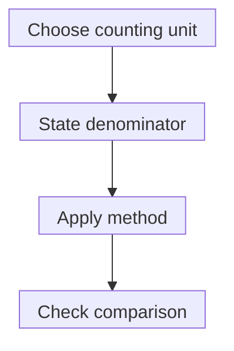

# RNA count normalization: name the denominator

## In one sentence

RNA count normalization adjusts captured ribonucleic acid (RNA) observations using stated rules to make a defined comparison.

## The intuition

Two ticket offices sell different numbers of tickets. Comparing one event's ticket count without asking about total sales can mislead. RNA counts also need a denominator. The analogy has limits: transcript length, capture and amplification affect the observations before normalization begins.

## How it works

Start with the counting unit. A [bulk RNA](/wiki/education/concepts/measurement/transcriptomics/bulk-rna-seq) table might contain assigned reads, fragments or estimated counts. A **unique molecular identifier (UMI)** is a sequence tag added before amplification. Grouping observations with compatible tags and mapping information can reduce duplicate counting of captured molecules. Errors and tag collisions need handling. A UMI is a counting aid, not itself normalization; uncaptured original molecules remain unobserved.

**Counts per million (CPM)** divide a feature's count by a stated library denominator and multiply by one million. Simple CPM uses a total count; some workflows use an adjusted library size. Always ask which denominator was used.

**Transcripts per million (TPM)** first adjust counts for transcript length, then scale these length-adjusted values to sum to one million across the included transcripts. Modern quantifiers can use **effective length**, accounting for fragment sampling and modeled biases. This suits particular sequencing models; it is not a drop-in rule for three-prime tag or UMI workflows that count captured molecules near one end.

The same count can mean different things after different denominators or length rules.

Between-sample methods also address **composition**: a few abundant messages can take up more of the library, making other relative counts fall. One approach, the trimmed mean of M-values (TMM), trims and averages selected log expression ratios. TMM and DESeq2 size factors estimate scaling under specified assumptions. They do more than divide each sample by its total. Broad biological shifts can challenge those assumptions. Normalization does not automatically repair [batch effects](/wiki/education/concepts/measurement/transcriptomics/batch-effects).

## Why it matters in cancer

A normalized increase can reflect expression, cell mixture or changed composition. Neither CPM nor TPM directly counts proteins or all RNA molecules per original cell. Keep assay preparation and biological replication in view before interpreting a change.

## How it is measured

| Assay card | What to record |
|---|---|
| Measures | A relative abundance or comparison scale defined by the normalization rule. |
| How | Define features and counting units; choose denominators and any length correction; apply scaling; examine controls and assumptions. |
| Input and tissue cost | An existing count table and library metadata; no extra tissue for computation. UMI counting requires tags introduced during library preparation. |
| Time and controls | Computing time varies; inspect reference material, replicates and composition-sensitive comparisons. |
| Output and units | CPM, TPM, adjusted counts or model inputs; these units are not interchangeable. |
| Thresholds | Expression filters and cutoffs require the method, feature set and purpose. |
| Failure modes | Wrong counting unit, inconsistent annotations, unsuitable length correction, tag errors and composition shifts. |
| What it cannot tell you | Absolute original molecules, cell origin, protein activity or treatment benefit. |
| Validation tier | Routine analysis still needs task-specific validation; normalization alone does not validate a clinical test. |

## Common confusions

- **UMI versus read:** many amplified reads may represent one captured tagged molecule.
- **CPM versus TPM:** only the latter includes the stated length adjustment.
- **Fixed total versus stable biology:** scaling values to one million does not make the tissue composition identical.
- **Normalized value versus statistical evidence:** a difference still needs a suitable design and model.

## Try it

A fictional full-length library contains only two transcripts. Each has 100 assigned fragments. Use lengths of one and two kilobases, uniform sampling and no other biases.

What are simple CPM and TPM?

**Answer:** Both CPM values are 100/200 × 1,000,000 = 500,000. Length-adjusted rates are 100/1 = 100 and 100/2 = 50. Dividing by their sum, 150, gives approximately 666,667 and 333,333 TPM. This idealized calculation explains the denominator; real quantifiers may use effective lengths and ambiguous-read models. It is not the rule for every UMI table.

## Explain it back

“Before comparing normalized RNA values, I need ______.”

One answer: “the counting unit, denominator, length rule, preparation and comparison design.”

## Takeaway

**Normalization defines a comparison; it does not recover everything the assay missed.**

## Related concepts

- [Single-cell and single-nucleus RNA sequencing](/wiki/education/concepts/measurement/transcriptomics/single-cell-and-single-nucleus-rna-seq)
- [RNA pathway scoring](/wiki/education/concepts/measurement/transcriptomics/rna-pathway-scoring)

## Sources and scope

Source check: October 10, 2026. Fictional arithmetic illustrates a simplified model. Expert and learner review remain pending.

- [Wagner et al., 2012](https://pubmed.ncbi.nlm.nih.gov/22872506/) — relative abundance and TPM rationale.
- [Robinson and Oshlack, 2010](https://pubmed.ncbi.nlm.nih.gov/20196867/) — TMM and RNA composition effects.
- [Love et al., 2014](https://pubmed.ncbi.nlm.nih.gov/25516281/) — DESeq2 count models and size factors.
- [Smith et al., 2017](https://pubmed.ncbi.nlm.nih.gov/28100584/) — UMI errors and molecule-counting methods.
- [Salmon output documentation](https://salmon.readthedocs.io/en/latest/file_formats.html) — effective length, TPM and estimated fragment counts.

<!-- BEGIN GENERATED USED IN -->
## Used in

- [Use RNA to test the message and its source](/wiki/education/molecular-profiling/02-rna-the-activity-layer)
- [Read RNA counts without counting proteins](/wiki/education/multi-omics-foundations/03-reading-rna-counts)
<!-- END GENERATED USED IN -->
