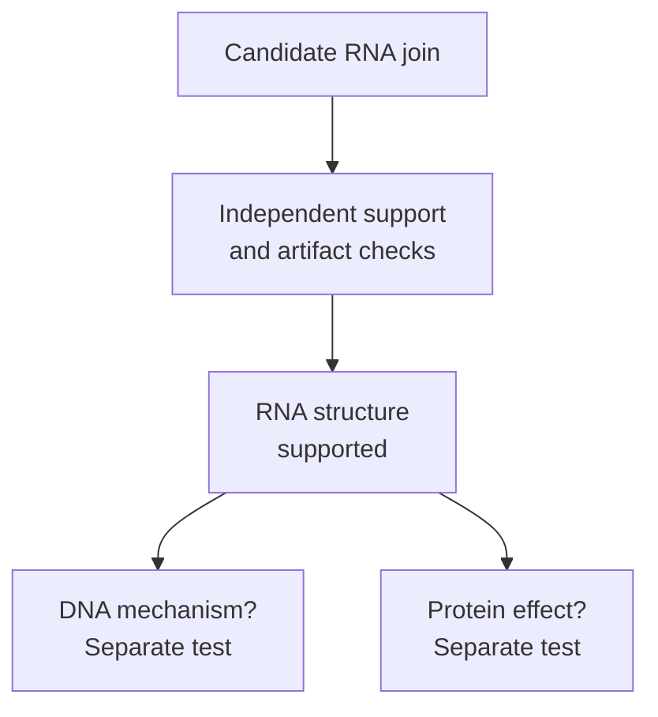

# RNA fusion and splice detection

## In one sentence

RNA fusion and splice detection tests which sequence joins are supported in captured RNA, without automatically establishing the underlying DNA change or protein consequence.

## The intuition

Knowing how often a message appears is different from checking how its sentences were joined. A gene count measures abundance; a junction observation examines structure. The analogy stops at sequence: the assay must distinguish true molecular joins from ambiguous mapping and preparation artifacts.

## How it works

[Ribonucleic acid (RNA)](/wiki/education/concepts/biology-basics/molecules/rna-and-mrna) **splice junctions** join retained transcript regions. Many are normal products of [alternative splicing](/wiki/education/concepts/biology-basics/genetics/splicing). A **fusion transcript** contains sequence assigned to different genes. A deoxyribonucleic acid (DNA) rearrangement can produce such a message, but an RNA junction does not itself establish the DNA mechanism. Transcription across neighboring genes can also produce joined messages; these have been observed in tumor and reference tissues. [Nacu 2011](https://pubmed.ncbi.nlm.nih.gov/21261984/).

A **split read** maps across a junction. A **spanning pair** has its two reads on opposite sides of a candidate fusion. Analysis evaluates support, alignment quality, similar sequences and the reference version. Repeated amplified copies are not independent original molecules. Fusion-caller benchmarks show that read length, expression and filtering affect detection; their optimal benchmark thresholds are not universal clinical cutoffs. [Haas 2019](https://link.springer.com/article/10.1186/s13059-019-1842-9).

Splice analysis can compare the fraction of eligible observations supporting alternative joins. A **percent spliced in (PSI)** estimate describes inclusion under a defined event and denominator. Local junction evidence may identify a changed choice without reconstructing a complete transcript. Unfinished nuclear RNA containing introns is not automatically pathological intron retention. [Vaquero-Garcia 2016](https://pubmed.ncbi.nlm.nih.gov/26829591/).

*Evidence for a message's join leaves separate questions about its origin and consequence.*

The assay must cover the join. Whole-transcriptome sequencing, short-end counting and targeted panels recover different information. **Anchored multiplex polymerase chain reaction (PCR)** can search from a targeted gene end toward a partner not known in advance. Its reach still depends on the selected targets and validated preparation. The original method included testing in [formalin-fixed, paraffin-embedded (FFPE) specimens](/wiki/education/concepts/measurement/specimens/ffpe-vs-fresh-frozen-vs-viable); that does not validate every later panel or junction. [Zheng 2014](https://pubmed.ncbi.nlm.nih.gov/25384085/).

Some fixed-RNA expression methods sequence ligated synthetic probes rather than original transcript-derived sequences. Their gene counts cannot be repurposed as unrestricted fusion or splice-sequence evidence. [Official probe-chemistry documentation, version 7.2](https://www.10xgenomics.com/support/software/cell-ranger/7.2/getting-started/cr-flex-what-is-frp).

## Why it matters in cancer

RNA can test whether a candidate DNA change has an expressed product. Mixed tissue still needs cell attribution. A supported junction may alter a protein's sequence or expression, but function, target dependence and clinical benefit require further evidence. Failure to detect a join is informative only within the assay's coverage and sensitivity.

## Assay card

| Field | What to retain |
|---|---|
| Measures and how | RNA joins: prepare a suitable library, sequence, align/assemble, count support and evaluate candidate-specific artifacts |
| Input and tissue cost | Protocol-compatible fresh, frozen or fixed material; extraction/library preparation consume allocated RNA or tissue; required input and [RNA integrity](/wiki/education/concepts/measurement/specimens/rna-integrity) are assay-specific |
| Output and units | Gene partners, reference/transcript version, junction coordinates and supporting reads or deduplicated molecules; PSI or another splice fraction requires its defined denominator |
| Thresholds | Validated support, coverage, mapping and detection criteria for the exact event class and specimen; no universal minimum read count |
| Failure modes | Poor RNA, uncaptured regions, low expression, similar sequences, duplicate support and library/assembly artifacts |
| Limits | No automatic DNA rearrangement, malignant-cell origin, intact protein, functional effect or drug benefit |
| Validation tier | Research calls differ from clinical fusion assays; verify the panel, event classes, specimen validation and confirmation policy; a caller name is not clinical validation |

## Common confusions

- **Gene expression versus junction evidence:** total counts can hide altered products.
- **RNA fusion versus DNA fusion:** a junction observation answers an RNA question.
- **Independent confirmation versus rerunning software:** another analysis of the same reads does not create new molecular evidence.

## Try it

A fictional RNA library has a candidate A–B junction supported by three identical amplified reads. The report calls it a confirmed DNA rearrangement and an effective drug target. What is missing?

**Answer:** Assess independent molecular support, coverage and artifacts first. DNA confirmation addresses the genomic mechanism; protein/function and disease-specific clinical evidence address the proposed treatment. Three copied reads cannot fill those gaps.

## Explain it back

What can junction reads add beyond a gene count?

**One possible answer:** Evidence about a captured message's structure, with uncertainty about its source and downstream effect.

## Takeaway

**Authenticate the RNA join, then test the separate DNA, protein and clinical claims.**

## Related concepts

- [Mutation types](/wiki/education/concepts/biology-basics/genetics/mutation-types).
- [Single-cell and single-nucleus RNA sequencing](/wiki/education/concepts/measurement/transcriptomics/single-cell-and-single-nucleus-rna-seq).

## Sources and scope

Source check: October 10, 2026. The practice is fictional. Expert and learner review remain pending. Published method benchmarks do not establish a universal clinical threshold or a treatment recommendation.

- [Nacu et al., readthrough transcripts in prostate and reference samples (2011)](https://pubmed.ncbi.nlm.nih.gov/21261984/).
- [Haas et al., fusion-caller benchmark and artifact filtering (2019)](https://link.springer.com/article/10.1186/s13059-019-1842-9).
- [Vaquero-Garcia et al., local splicing variation measurement (2016)](https://pubmed.ncbi.nlm.nih.gov/26829591/).
- [Zheng et al., anchored multiplex PCR (2014)](https://pubmed.ncbi.nlm.nih.gov/25384085/).
- [Official documentation: fixed-RNA probe chemistry, version 7.2](https://www.10xgenomics.com/support/software/cell-ranger/7.2/getting-started/cr-flex-what-is-frp).

<!-- BEGIN GENERATED USED IN -->
## Used in

- [Use RNA to test the message and its source](/wiki/education/molecular-profiling/02-rna-the-activity-layer)
- [What does multi-omics tell us about a tumor?](/wiki/education/reading-a-tumor/omics-and-multi-omics)
<!-- END GENERATED USED IN -->
