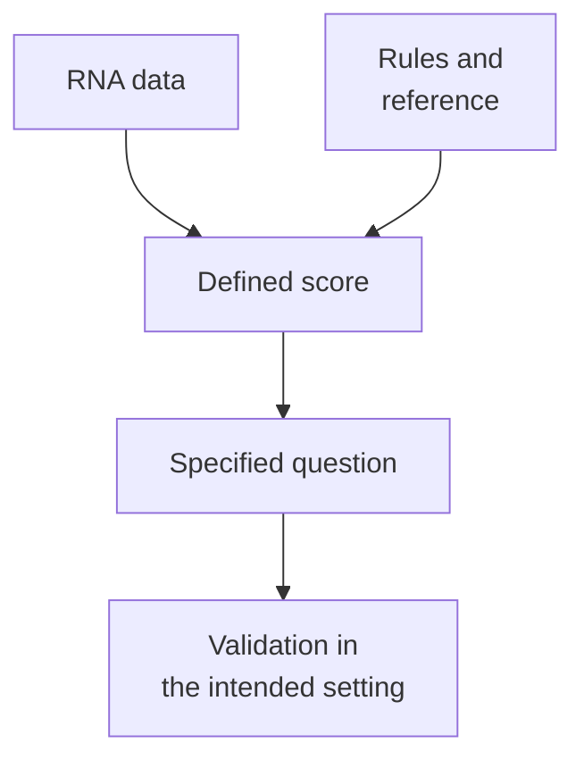

# Gene-expression signatures

## In one sentence

A gene-expression signature combines selected RNA measurements using defined rules to describe a biological pattern or predict a specified outcome.

## The intuition

A weather index combines several readings into one useful number. You need to know its formula and the question it answers. The same applies to a gene-expression signature. The analogy has limits: RNA patterns depend on specimen mixture and assay preparation, and a biological label does not make a score a direct measurement of that process.

## How it works

Start with [ribonucleic acid (RNA)](/wiki/education/concepts/biology-basics/molecules/rna-and-mrna) measurements for a chosen gene set. The **algorithm** specifies how those measurements are prepared, weighted, compared and combined. The reference data and software version are part of the definition. A gene list alone is not a reproducible test.

Different signatures answer different questions:

| Kind | Question | Boundary |
|---|---|---|
| Pattern or module score | Do chosen messages show a specified pattern? | A summary of messages does not directly measure pathway flux |
| Subtype classifier | Which reference pattern is most similar? | A category depends on the classifier and reference |
| Outcome predictor | How does the model predict a defined endpoint? | Performance belongs to a population, endpoint and time horizon |

For example, the original [PAM50 work](/wiki/education/concepts/breast-cancer/receptors-and-subtypes/intrinsic-subtype) used a defined 50-gene method to assign [intrinsic breast-cancer subtypes](/wiki/education/concepts/breast-cancer/receptors-and-subtypes/intrinsic-subtype) and develop particular risk models. It does not validate every later score carrying a similar label. [Parker 2009](https://pubmed.ncbi.nlm.nih.gov/19204204/).

Scoring methods also differ. One module-score implementation subtracts expression of matched control genes from the selected genes' average expression. **Gene set enrichment analysis (GSEA)** instead tests whether a gene set accumulates toward one end of a ranked list in its defined comparison. These outputs cannot share a cutoff just because they use the same genes. [Official module-score documentation](https://satijalab.org/seurat/reference/addmodulescore), [Subramanian 2005](https://pubmed.ncbi.nlm.nih.gov/16199517/).

*The rules and reference are part of the test; a score's usefulness needs separate validation.*

For a clinical predictor, the complete procedure should be **locked**: specimen requirements, measurement, preprocessing, algorithm and decision threshold are fixed before validation. Changing them creates a new version requiring evidence. Analytical repeatability asks whether the test measures consistently. Clinical validity asks whether its result relates to the intended outcome. Clinical utility asks whether using it improves a clinical decision or outcome. [McShane 2013](https://link.springer.com/article/10.1186/1741-7015-11-220).

## Why it matters in cancer

A bulk inflammatory signature can rise because there are more immune cells, because those cells change state, or both. [Single-cell profiles](/wiki/education/concepts/measurement/transcriptomics/single-cell-and-single-nucleus-rna-seq) can help examine origin, with their own sampling limits.

A stress score can support a hypothesis about a program. It cannot establish protein activation, metabolic rate or dependence on a drug target. Outcome prediction also needs [calibration](/wiki/education/concepts/evidence-and-statistics/tests-and-prediction/calibration) in the intended setting; the original treatment era and endpoint matter.

## Assay card

| Field | What to retain |
|---|---|
| Measures and how | A defined composite: obtain RNA data, apply fixed preprocessing, compute the specified algorithm and interpret against its reference |
| Input and tissue cost | The underlying RNA assay consumes material according to its protocol; rescoring an existing data table consumes no additional tissue, but may be incompatible with the model |
| Output and units | Named subtype, unitless score, rank or predicted probability; retain exact scale, model version, endpoint and horizon |
| Thresholds | The validated cutoff for that complete test and intended population; a percentile or another model's cutoff is not interchangeable |
| Failure modes | Missing genes, changed normalization, [batch effects](/wiki/education/concepts/measurement/transcriptomics/batch-effects), specimen mixture and population shift |
| Limits | No automatic cell attribution, protein-function measurement or universal therapy-selection rule |
| Validation tier | Exploratory scores, research predictors and clinically validated tests are different; regulatory/laboratory status must be checked for the exact test and intended use |

## Common confusions

- **Gene list versus test:** computation and reference define the output.
- **Association versus treatment prediction:** a prognostic pattern need not identify who benefits from a therapy.
- **Higher score versus stronger dependence:** the score summarizes measured messages under chosen rules.

## Try it

A fictional laboratory replaces a signature's normalization method. It retains the old “high” cutoff and recommends a treatment. Is that justified?

**Answer:** No. First establish whether the new implementation reproduces the validated test. Treatment selection then requires evidence for that test, disease and setting. The old cutoff cannot supply the missing validation.

## Explain it back

Complete: “To interpret this signature, I need the genes, _____ and _____.”

**One possible answer:** The complete algorithm and its validated reference/intended question.

## Takeaway

**Interpret a signature as a defined test answering a defined question, with evidence tied to that version and setting.**

## Related concepts

- [Bulk RNA sequencing](/wiki/education/concepts/measurement/transcriptomics/bulk-rna-seq).
- [Clinical evidence and uncertainty](/wiki/education/guides/reading-cancer-evidence/03-check-applicability-and-uncertainty).

## Sources and scope

Source check: October 10, 2026. Examples are fictional. Expert and learner review remain pending. The cited methods illustrate different algorithms; they are not an inventory of currently approved clinical tests.

- [Parker et al., original intrinsic-subtype and risk-predictor study (2009)](https://pubmed.ncbi.nlm.nih.gov/19204204/).
- [Subramanian et al., original GSEA method (2005)](https://pubmed.ncbi.nlm.nih.gov/16199517/).
- [Seurat authors: AddModuleScore algorithm documentation](https://satijalab.org/seurat/reference/addmodulescore).
- [McShane et al., criteria for omics predictors in clinical trials (2013)](https://link.springer.com/article/10.1186/1741-7015-11-220).

<!-- BEGIN GENERATED USED IN -->
## Used in

- [Use RNA to test the message and its source](/wiki/education/molecular-profiling/02-rna-the-activity-layer)
- [Read RNA counts without counting proteins](/wiki/education/multi-omics-foundations/03-reading-rna-counts)
- [Understand multi-omics, one question at a time](/wiki/education/reading-a-tumor/omics-and-multi-omics)
<!-- END GENERATED USED IN -->
