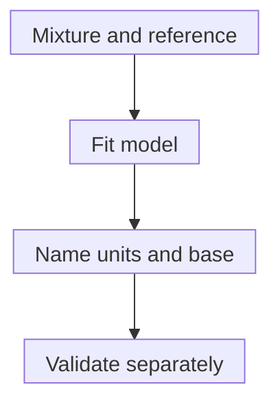

# Immune deconvolution: estimating a tissue mixture

## In one sentence

Immune deconvolution uses a model and reference profiles to estimate immune-cell contributions to a mixed molecular measurement.

## The intuition

Imagine trying to reconstruct a paint mixture from its final color and a reference palette. The answer depends on which colors are available and whether they match the originals. For RNA, cells can also change their “color” as their expression changes. A plausible fit is useful evidence, not a direct cell count.

## How it works

In RNA deconvolution, **ribonucleic acid (RNA)** [expression profiles](/wiki/education/concepts/measurement/transcriptomics/bulk-rna-seq) from known cell types supply reference patterns. A model fits their contributions to the mixed profile. Similar cell types, missing populations and different tissue states can make several explanations fit.

The first quantity may be a share of RNA, not a share of cells. Cells need not produce equal amounts of RNA. EPIC, for example, uses RNA-content assumptions to convert modeled contributions into estimated cell fractions and allows an uncharacterized component. Those assumptions and reference signatures belong in the interpretation.

“Base” means the population or quantity used as the denominator.

**Relative estimates** may sum to one across the represented immune populations, leaving total immune content unknown. An **absolute mode** does not have one universal meaning. CIBERSORT's described absolute mode supplies an expression-based abundance score; it is not a direct number of cells per square millimeter. Other methods report estimated whole-sample cell fractions. Read the method's definition before comparing values.

Some approaches, including CIBERSORTx, also infer cell-type-specific expression and modeled states. These are computational reconstructions, rather than individual-cell measurements. A state estimate can be informative without proving suppressive function, a genetic clone or a cell's physical location.

## Why it matters in cancer

Deconvolution helps ask which populations might contribute to a bulk signal. It can support research on a [tumor microenvironment](/wiki/education/concepts/cancer-biology/tumor-microenvironment/tumor-microenvironment). It does not directly establish whether immune cells reach malignant cells, recognize them or improve treatment outcome. More immune signal is not automatically more effective immunity.

Compare estimates with suitable [flow cytometry](/wiki/education/concepts/measurement/immune-monitoring/flow-cytometry), pathology or spatial measurements when available. Each comparator has sampling and recovery biases. Validation should match tissue, preparation, populations and reporting units, including populations omitted from the reference.

## How it is measured

| Assay card | What to record |
|---|---|
| Measures | Modeled cell-type contributions or cell-type-specific expression in a mixture. |
| How | Prepare suitable expression data; select references; fit the mixture; name units and denominator; validate the intended interpretation. |
| Input and tissue cost | Existing mixed RNA profiles and references; computation consumes no additional tissue. New comparator assays may consume material. |
| Time and controls | Runtime varies. Known mixtures, held-out samples and matched measurements test distinct assumptions. |
| Output and units | Relative immune fractions, estimated whole-sample fractions, abundance scores or inferred expression; report which. |
| Thresholds | Fit filters and decision cutoffs are method- and task-specific. A global fit test does not certify every cell-type estimate. |
| Failure modes | Missing references, correlated signatures, altered cell states, platform differences and unequal RNA per cell. |
| What it cannot tell you | Exact cell locations, every rare population, functional killing, target engagement or clinical benefit. |
| Validation tier | A research estimate requires separate validation for any proposed clinical use. |

## Common confusions

- **RNA share versus cell share:** conversion requires assumptions.
- **Relative immune fraction versus all-cell fraction:** the denominator can change the answer.
- **Modeled state versus observed function:** reconstructed expression is not a killing assay.
- **Good fit versus complete palette:** omitted cell types can still distort the estimate.

## Try it

Two fictional samples each contain 100 cells. Sample A has 20 immune cells, including 10 T cells. Sample B has 60 immune cells, including 30 T cells. A report gives only the T-cell fraction within the immune population. What changes?

**Answer:** Both fractions are 50%: 10/20 and 30/60. The known whole-sample T-cell fractions differ, 10% and 30%. A relative 50% estimate alone cannot recover those totals, locations or functions. Here the true counts were supplied for teaching; they are not guaranteed by deconvolution.

## Explain it back

“An immune fraction is interpretable only after I name ______.”

One answer: “its denominator, reference, model and validation context.”

## Takeaway

**Deconvolution estimates a mixture under assumptions; keep the units and the unmeasured biology visible.**

## Related concepts

- [Single-cell and single-nucleus RNA sequencing](/wiki/education/concepts/measurement/transcriptomics/single-cell-and-single-nucleus-rna-seq)
- [Hot, excluded and cold tumors](/wiki/education/concepts/immunology/tumor-immunology/hot-excluded-cold-tumor)

## Sources and scope

Source check: October 10, 2026. Model-specific research teaching; the primary studies' validation populations do not establish universal clinical accuracy. Expert and learner review remain pending.

- [Newman et al., 2015 CIBERSORT](https://pubmed.ncbi.nlm.nih.gov/25822800/) — reference-based mixture estimation and relative fractions.
- [CIBERSORT protocol](https://pubmed.ncbi.nlm.nih.gov/29344893/) — relative denominators and expression-based absolute-mode scores.
- [Racle et al., 2017 EPIC](https://pubmed.ncbi.nlm.nih.gov/29130882/) — RNA-content adjustment and uncharacterized components in the tested tumor settings.
- [Newman et al., 2019 CIBERSORTx](https://pubmed.ncbi.nlm.nih.gov/31061481/) — cell-type abundance and expression reconstruction with method-specific validation.

<!-- BEGIN GENERATED USED IN -->
## Used in

- [Use RNA to test the message and its source](/wiki/education/molecular-profiling/02-rna-the-activity-layer)
<!-- END GENERATED USED IN -->
