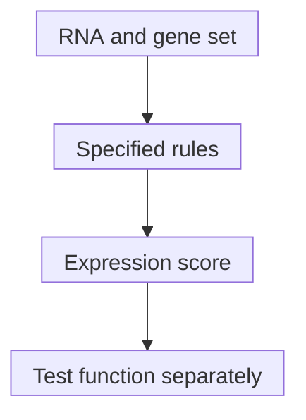

# RNA pathway scoring: a program of messages

## In one sentence

RNA pathway scoring summarizes a chosen gene set in an expression profile using a specified algorithm and comparison context.

## The intuition

A playlist tells you which songs were selected, not how loudly the musicians performed. A pathway score similarly summarizes selected messages. The analogy breaks because genes can participate in several programs, and regulators can have opposing effects. A pathway name is not a direct activity meter.

## How it works

The inputs are [ribonucleic acid (RNA)](/wiki/education/concepts/biology-basics/molecules/rna-and-mrna) expression data, a **gene set** and scoring rules. A gene set is a defined list associated with a process or signature. Its members may include enzymes, regulators or responses to that process. Shared genes make different pathway scores related.

**Single-sample gene set enrichment analysis (ssGSEA)** compares the rank distributions of genes inside and outside a set within a sample. Weighting and normalization depend on the implementation. Although the name says “single-sample,” optional scaling can involve the supplied collection of scores.

**Gene set variation analysis (GSVA)** first estimates each gene's expression distribution across supplied samples, then uses transformed expression and ranks to score sets. Changing that sample collection can change the comparison. The GSVA software package also implements ssGSEA and other methods; the package name alone does not identify the algorithm.

The final arrow requires another measurement; the score does not supply it.

Record the gene-set version, gene identifiers, input scale, measured gene universe and software parameters. Missing genes, filtering and [cell mixtures](/wiki/education/concepts/measurement/transcriptomics/immune-deconvolution) can change the result. Two numbers called “pathway score” are not necessarily comparable.

A score is commonly unitless. It is not automatically a statistical significance test or a probability. A percentile ranks the score against a defined comparison group; the 90th percentile does not mean “90% pathway activity.” Statistical associations require their own design, uncertainty estimates and [multiplicity handling](/wiki/education/concepts/evidence-and-statistics/effect-measures/p-values-and-multiple-testing).

## Why it matters in cancer

RNA scores can organize many genes into hypotheses about cell programs. They do not directly measure protein abundance, [phosphorylation](/wiki/education/concepts/biology-basics/signaling/phosphorylation), metabolic flux or drug dependence. Feedback may raise a pathway's messages while its biochemical output falls. A treatment-response classifier needs its own locked model and clinical validation; a generic pathway score does not inherit that evidence.

## How it is measured

| Assay card | What to record |
|---|---|
| Measures | Expression patterns for selected genes under a specified scoring method. |
| How | Define genes and identifiers; prepare compatible expression data; choose algorithm and parameters; score; compare with a stated reference. |
| Input and tissue cost | Existing RNA data and gene sets; no extra tissue for scoring. Testing biological function may require another assay. |
| Time and controls | Runtime varies. Replicates, reference samples and sensitivity checks for gene filtering or mixtures test robustness. |
| Output and units | Unitless score, normalized score or reference percentile, named explicitly. |
| Thresholds | No universal activation cutoff; any decision threshold requires the exact task, model and validation population. |
| Failure modes | Missing genes, mixed platforms, unsuitable input scaling, overlapping sets, composition changes and altered comparison cohorts. |
| What it cannot tell you | Protein activity, pathway flux, cell origin, causal dependence or treatment benefit by itself. |
| Validation tier | Research summaries are distinct from validated predictors with a defined intended use. |

## Common confusions

- **Pathway label versus function:** a gene set is an annotation, not a biochemical measurement.
- **ssGSEA versus GSVA:** related summaries have different transformations and context.
- **Score versus p-value:** a scoring algorithm need not test a hypothesis.
- **High rank versus high absolute amount:** rank depends on the other measured genes.

## Try it

A fictional sample ranks five genes from highest to lowest expression: A, B, C, D, E. A set contains A, C and E. For a deliberately simple teaching score, calculate their mean rank. Does the result measure pathway activity?

**Answer:** (1 + 3 + 5)/3 = 3. This mean-rank illustration is neither ssGSEA nor GSVA. It shows how a set summary depends on selected genes and their ordering. It supplies no activity percentage, significance test or treatment prediction. Adding measured genes could change the ranks without changing these three genes' absolute expression.

## Explain it back

“A pathway score summarizes ______; to establish function I would need ______.”

One answer: “chosen RNA messages under stated rules; a suitable independent functional measurement.”

## Takeaway

**Use RNA pathway scores to frame a biological question, then measure the function the question asks about.**

## Related concepts

- [Gene-expression signatures](/wiki/education/concepts/measurement/transcriptomics/gene-expression-signatures)
- [Perturbations and controls](/wiki/education/concepts/evidence-and-statistics/study-design/perturbation-and-controls)

## Sources and scope

Source check: October 10, 2026. Fictional mean-rank practice is explicitly a teaching calculation. Expert and learner review remain pending.

- [Hänzelmann et al., 2013 GSVA](https://pubmed.ncbi.nlm.nih.gov/23323831/) — gene-set transformations, ssGSEA comparison and separate downstream testing.
- [Official GSVA vignette](https://bioconductor.org/packages/release/bioc/vignettes/GSVA/inst/doc/GSVA.html) — method objects, input choices and normalization parameters; record the installed version.
- [Subramanian et al., 2005 GSEA](https://pubmed.ncbi.nlm.nih.gov/16199517/) — cohort-level enrichment framework; it is not interchangeable with every per-sample score.

<!-- BEGIN GENERATED USED IN -->
## Used in

- [Use RNA to test the message and its source](/wiki/education/molecular-profiling/02-rna-the-activity-layer)
- [Read RNA counts without counting proteins](/wiki/education/multi-omics-foundations/03-reading-rna-counts)
<!-- END GENERATED USED IN -->
