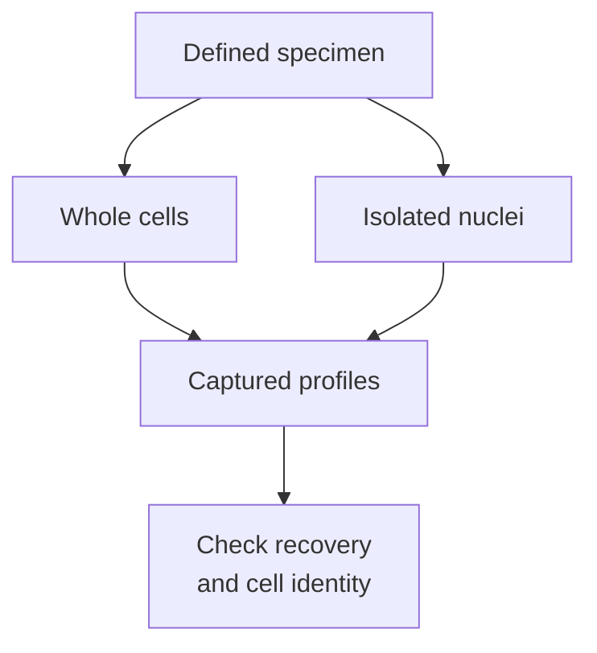

# Single-cell and single-nucleus RNA sequencing

## In one sentence

Single-cell and single-nucleus RNA sequencing profile captured RNA assigned to cells or nuclei, whose different compartments and recovery biases shape the result.

## The intuition

A whole cell is like a house; its nucleus is one room. Reading papers from the room gives a different view from collecting papers throughout the house. Neither collection is a complete inventory. The analogy stops there: molecular capture, rather than deliberate selection, determines which [ribonucleic acid (RNA)](/wiki/education/concepts/biology-basics/molecules/rna-and-mrna) messages become observations.

## How it works

In many single-cell RNA sequencing workflows, separated cells enter small reaction compartments. A **barcode** labels material from a compartment. A **unique molecular identifier (UMI)** helps distinguish captured molecules from their amplified copies. Sequencing and analysis produce a gene-by-barcode count table. A barcode does not guarantee that exactly one intact cell contributed material. [Zheng 2017](https://pubmed.ncbi.nlm.nih.gov/28091601/).

Single-nucleus RNA sequencing starts with isolated nuclei. It samples nuclear RNA, including unfinished transcripts with **introns**, regions normally removed during [RNA splicing](/wiki/education/concepts/biology-basics/genetics/splicing). Whole-cell methods also capture cytoplasmic messages. A matched mouse-cortex study found different gene recovery between these compartments. Its results explain why comparing methods needs care; they do not prove nuclei are better for every tumor. [Bakken 2018](https://journals.plos.org/plosone/article?id=10.1371/journal.pone.0209648).

Preparation matters too. Dissociation can preferentially lose fragile cells. Nuclei can be recovered from suitable frozen tissue. Fixed-material methods also exist: some count ligated probe pairs targeting RNA rather than sequence the original transcript-derived material. Such counts cannot reveal every variant or splice product. Ask which chemistry generated the table. [Official fixed-RNA chemistry documentation, version 7.2](https://www.10xgenomics.com/support/software/cell-ranger/7.2/getting-started/cr-flex-what-is-frp).

*The two preparations sample different compartments; a profile still needs quality and identity checks.*

Sparse capture means a zero can reflect a missed molecule rather than biological absence. This sampling loss is often called **dropout**; not every zero is a dropout. **Ambient RNA**, material released outside cells, can contaminate profiles. A **doublet** combines more than one cell or nucleus. Correction and filtering help, but do not certify every barcode's identity. [Young and Behjati 2020](https://pubmed.ncbi.nlm.nih.gov/33367645/).

## Why it matters in cancer

These assays can separate cell populations hidden in a [bulk RNA mixture](/wiki/education/concepts/measurement/transcriptomics/bulk-rna-seq). A **cluster** groups similar profiles under an analysis method; it does not by itself prove malignancy, lineage or a genetic clone. Cancer-cell identification needs supporting evidence.

Thousands of captured cells from one biopsy remain observations nested within one biological sample. Splitting it into two technical libraries does not create two patients. Comparisons must respect the independent biological units; replicate-level aggregation is one approach. [Squair 2021](https://pubmed.ncbi.nlm.nih.gov/34584091/).

## Assay card

| Field | What to retain |
|---|---|
| Measures and how | Captured RNA profiles: isolate cells/nuclei, barcode and prepare a library, sequence, assign observations and apply quality checks |
| Input and tissue cost | Assay-compatible viable, frozen or fixed material; dissociation, nuclei isolation and library preparation consume allocated material; input and expected recovery are protocol-specific |
| Output and units | Genes by barcode; UMI counts for UMI-based methods, or defined read/probe counts; normalized values are not universal molecules per original cell |
| Thresholds | Chemistry-specific cell calling, low-quality and doublet criteria; retain software version and rules, not a universal gene-count cutoff |
| Failure modes | Selective recovery, degraded RNA, sparse capture, ambient RNA, doublets and [batch effects](/wiki/education/concepts/measurement/transcriptomics/batch-effects) |
| Limits | No complete cell census, guaranteed cell identity, full transcript structure or direct protein-function measurement |
| Validation tier | Usually research profiling; verify analytical performance and clinical intended-use evidence for the exact workflow; a platform name does not establish clinical validity |

## Common confusions

- **Read versus molecule:** amplification can generate multiple reads from one captured molecule.
- **Zero versus absent:** sparse observation leaves uncertainty.
- **Cell count versus sample count:** cells within one biopsy are not independent patient replicates.

## Try it

A fictional biopsy yields 6,000 nuclei across two technical libraries. An analyst calls this a two-patient experiment. What should change?

**Answer:** Keep one biological sample and two technical libraries in the design. More nuclei improve its description, but cannot establish between-patient reproducibility.

## Explain it back

Why might whole-cell and nuclear counts differ without a biological change?

**One possible answer:** They sample different RNA compartments and recover different material under different preparation methods.

## Takeaway

**Count captured profiles carefully, and keep their compartment, identity and biological sample of origin attached.**

## Related concepts

- [RNA integrity](/wiki/education/concepts/measurement/specimens/rna-integrity).
- [Cell lineage and differentiation](/wiki/education/concepts/biology-basics/cells/cell-lineage-and-differentiation).

## Sources and scope

Source check: October 10, 2026. The exercise is fictional. Expert and learner review remain pending. The mouse-cortex comparison is a method example, not a universal tumor-performance benchmark.

- [Zheng et al., droplet-based digital transcriptional profiling (2017)](https://pubmed.ncbi.nlm.nih.gov/28091601/).
- [Bakken et al., matched cell/nucleus cortical comparison (2018)](https://journals.plos.org/plosone/article?id=10.1371/journal.pone.0209648).
- [Young and Behjati, ambient RNA correction with SoupX (2020)](https://pubmed.ncbi.nlm.nih.gov/33367645/).
- [Squair et al., biological replication and false discoveries (2021)](https://pubmed.ncbi.nlm.nih.gov/34584091/).
- [Official documentation: fixed-RNA probe-ligation chemistry, version 7.2](https://www.10xgenomics.com/support/software/cell-ranger/7.2/getting-started/cr-flex-what-is-frp).

<!-- BEGIN GENERATED USED IN -->
## Used in

- [Use RNA to test the message and its source](/wiki/education/molecular-profiling/02-rna-the-activity-layer)
- [Read single-cell data after treatment](/wiki/education/molecular-profiling/08-profile-residual-tumor)
- [Read RNA counts without counting proteins](/wiki/education/multi-omics-foundations/03-reading-rna-counts)
- [Understand multi-omics, one question at a time](/wiki/education/reading-a-tumor/omics-and-multi-omics)
<!-- END GENERATED USED IN -->
