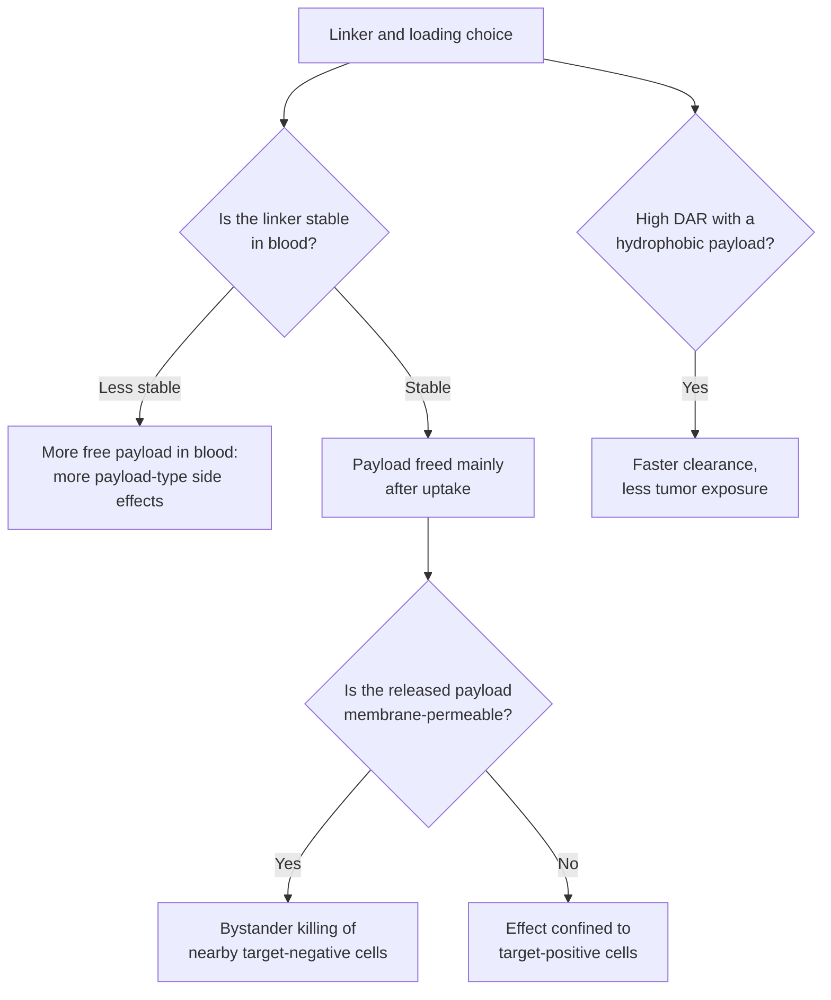

# ADC conjugation chemistry

## In one sentence

ADC conjugation chemistry is how a payload is attached to an antibody: the linker that frees it, the attachment sites and the number loaded, which together set how much drug reaches tumor cells versus healthy tissue.

## The intuition

Think of cargo taped to a delivery drone. Strong tape that only scissors at the destination can cut keeps the cargo on board in flight. Tape that slowly peels drops some cargo along the route, which helps if the route runs through the target neighborhood and hurts if it runs over a school. Loading more boxes carries more cargo per trip but makes the drone heavier and shortens its flight. The analogy breaks because an ADC's "route" is the whole bloodstream, and dropped cargo cannot be recalled.

## How it works

An [antibody-drug conjugate (ADC)](/wiki/education/concepts/therapeutics/antibody-based/antibody-drug-conjugate) design makes three chemistry decisions.

**1. How the linker lets go.**

| Linker type | How the payload is freed | Example on a US label | What it changes |
|---|---|---|---|
| **Protease-cleavable peptide** | Lysosomal enzymes cut a short peptide inside the cell | Tetrapeptide on trastuzumab deruxtecan and datopotamab deruxtecan; valine–citrulline on the "vedotin" MMAE drugs [1] | A free, membrane-permeable payload can reach neighbors (bystander effect) |
| **Hydrolyzable** | Water slowly breaks the bond | CL2A on sacituzumab govitecan [1] | SN-38 is released gradually, also outside cells, in the tumor and in blood [2] |
| **Disulfide** | Reducing conditions inside cells break the bond | Sulfo-SPDB on mirvetuximab soravtansine (DM4) [1] | Cleavage depends on the reducing chemistry inside the cell |
| **Noncleavable** | None; the antibody is digested and the payload leaves with a linker and amino-acid stub | Thioether (MCC) on trastuzumab emtansine (T-DM1) [1] | The charged fragment mostly stays in the cell that took it up; little bystander effect |

**2. Where the payload is attached.** Older ADCs attach payloads at whatever lysines or opened disulfide cysteines are available (*stochastic* conjugation), giving a mixture of molecules carrying different numbers of payloads at different positions. T-DM1's main breakdown product is lysine–MCC–DM1, which records that it was attached to lysines [3]. *Site-specific* methods, such as engineered cysteines, put a fixed number of payloads at chosen positions. In one study, a site-specific MMAE conjugate was as active as the conventional mixture in mice and tolerated at higher doses in rats and monkeys, widening the [therapeutic index](/wiki/education/concepts/therapeutics/how-drugs-work/therapeutic-index) [4].

**3. How many payloads are loaded.** The **drug-to-antibody ratio (DAR)** is the average number of payloads per antibody.

| Product | Payload | Average DAR (label) |
|---|---|---|
| Trastuzumab deruxtecan | DXd | About 8 |
| Sacituzumab govitecan | SN-38 | 7 to 8 |
| Datopotamab deruxtecan | DXd | About 4 |
| Enfortumab vedotin | MMAE | About 3.8 (the same label section also rounds this to about 4) |
| Trastuzumab emtansine | DM1 | 3.5 |
| Loncastuximab tesirine | PBD dimer | 2.3 |

Source for all rows: US prescribing information, section 11 [1]. The pattern follows potency: moderately potent topoisomerase I (TOP1) payloads are loaded at 4 to 8, while ultra-potent pyrrolobenzodiazepine (PBD) dimers are loaded at about 2; see [ADC payload classes](/wiki/education/concepts/therapeutics/antibody-based/adc-payload-classes).

*Tendencies observed across products and models, not rules; each conjugate is measured on its own.*

## Why it matters in cancer

- **Linker stability moves toxicity.** When trastuzumab–maytansinoid conjugates were compared in models, the noncleavable thioether version (later T-DM1) stayed in blood longer, worked better and was less toxic than versions with disulfide linkers, and was chosen for development for that reason [3]. Payload released early in the blood causes side effects that depend on the payload, not the target; see [ADC payload toxicities](/wiki/education/concepts/therapeutics/toxicities-and-supportive-care/adc-payload-toxicity).
- **Loading moves exposure.** In mice, an anti-CD30 MMAE conjugate with eight payloads cleared three times faster than the four-payload version and five times faster than the two-payload version; the lower-loaded forms had the wider therapeutic index [5]. Clearance was later traced to the payload's water-repelling (hydrophobic) chemistry; more water-loving drug-linkers, including ones carrying a polyethylene glycol (PEG) chain, allowed uniform high loading with better performance in animals [6]. That is one reason DAR 8 is workable for some TOP1 drugs.
- **The same antibody can make very different drugs.** T-DM1 and trastuzumab deruxtecan share trastuzumab. Their linkers, payloads and DARs differ, and so do their bystander effects and the HER2 levels at which they work.

## Common confusions

- **DAR is an average, not a count on every molecule.** A DAR of 4 can be a mixture of molecules with 0 to 8 payloads.
- **Cleavable does not mean unstable.** A protease-cleavable linker is meant to stay intact in blood and open only inside cells.
- **Higher DAR is not more effective by default.** Loading also changes clearance, aggregation and toxicity.
- **The dose on the label is the whole conjugate.** Milligrams per kilogram of ADC are not milligrams of payload; payload delivered depends on DAR and molecular weights.
- **Site-specific is not automatically safer in patients.** The better-tolerated site-specific conjugate above was tested in animals.

## How it is measured

Average DAR and the spread of loading are measured by hydrophobic interaction chromatography and mass spectrometry. Attachment sites are mapped by digesting the antibody and sequencing the fragments. Linker stability is measured as free payload released in plasma over time, in the laboratory and in patients, where intact conjugate, total antibody and free payload are reported separately [7].

## Related concepts

- [Antibody-drug conjugate](/wiki/education/concepts/therapeutics/antibody-based/antibody-drug-conjugate)
- [ADC payload classes](/wiki/education/concepts/therapeutics/antibody-based/adc-payload-classes)
- [ADC payload toxicities](/wiki/education/concepts/therapeutics/toxicities-and-supportive-care/adc-payload-toxicity)
- [Pharmacokinetics and half-life](/wiki/education/concepts/therapeutics/how-drugs-work/pharmacokinetics-and-half-life)
- [Therapeutic index](/wiki/education/concepts/therapeutics/how-drugs-work/therapeutic-index)

## Sources and scope

Source check: November 7, 2026. Linker types and loading values come from US labels; design tradeoffs come from preclinical studies and are limited to the conjugates tested. Expert and learner review remain pending.

1. US prescribing information (DailyMed), section 11: [trastuzumab deruxtecan](https://dailymed.nlm.nih.gov/dailymed/drugInfo.cfm?setid=7e67e73e-ddf4-4e4d-8b50-09d7514910b6), [datopotamab deruxtecan](https://dailymed.nlm.nih.gov/dailymed/drugInfo.cfm?setid=2950227c-6230-4ca4-a135-46e44d9424a0), [sacituzumab govitecan](https://dailymed.nlm.nih.gov/dailymed/drugInfo.cfm?setid=57a597d2-03f0-472e-b148-016d7169169d), [trastuzumab emtansine](https://dailymed.nlm.nih.gov/dailymed/drugInfo.cfm?setid=23f3c1f4-0fc8-4804-a9e3-04cf25dd302e), [mirvetuximab soravtansine](https://dailymed.nlm.nih.gov/dailymed/drugInfo.cfm?setid=00c424b5-6ccd-48ab-9e88-1986451120e2), [enfortumab vedotin](https://dailymed.nlm.nih.gov/dailymed/drugInfo.cfm?setid=b5631d3e-4604-4363-8f20-11dfc5a4a8ed) and [loncastuximab tesirine](https://dailymed.nlm.nih.gov/dailymed/drugInfo.cfm?setid=af54af12-3edf-4301-8bc5-0446bc813c1d).
2. [Goldenberg et al., 2015](https://pubmed.ncbi.nlm.nih.gov/26101915/) — sacituzumab govitecan design: gradual SN-38 release, DAR 7.6 (company authors).
3. [Lewis Phillips et al., 2008](https://pubmed.ncbi.nlm.nih.gov/19010901/) — thioether versus disulfide trastuzumab–maytansinoid conjugates; [Tomabechi et al., 2022](https://pubmed.ncbi.nlm.nih.gov/36741448/) — lysine–MCC–DM1 as T-DM1's main catabolite.
4. [Junutula et al., 2008](https://pubmed.ncbi.nlm.nih.gov/18641636/) — engineered-cysteine site-specific conjugation and therapeutic index in animals.
5. [Hamblett et al., 2004](https://pubmed.ncbi.nlm.nih.gov/15501986/) — effects of drug loading on clearance, activity and tolerability.
6. [Lyon et al., 2015](https://pubmed.ncbi.nlm.nih.gov/26076429/) — hydrophobicity drives fast clearance of high-DAR conjugates.
7. [FDA, 2024: clinical pharmacology considerations for ADCs](https://www.fda.gov/media/155997/download) — separate measurement of conjugate, antibody and payload.

<!-- BEGIN GENERATED USED IN -->
## Used in

- [Match the payload to the failure](/wiki/education/guides/aiming-a-drug-at-a-surface-target/04-match-the-payload-to-the-failure)
- [Aiming a drug at a surface target](/wiki/education/guides/aiming-a-drug-at-a-surface-target/index)
- [Separate the address from the killing mechanism](/wiki/education/targeted-therapy-modalities/01-mechanism)
- [Follow delivery, exposure, and the treatment clock](/wiki/education/targeted-therapy-modalities/02-timing)
<!-- END GENERATED USED IN -->
