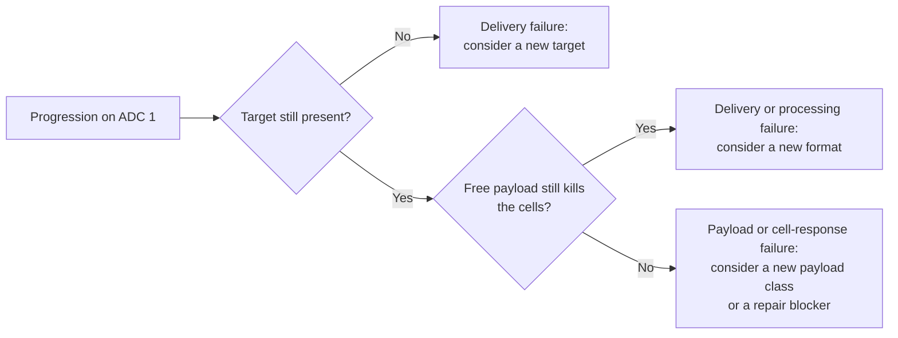

# Cross-resistance between ADCs

## In one sentence

Cross-resistance between ADCs occurs when the change that let a cancer survive one antibody-drug conjugate also blunts the next, most often because the two share a payload class rather than a target.

## The intuition

A burglar who learns to pick one brand of lock can open every door with that lock, whatever the address. If a cancer has learned to survive the **drug** inside an ADC, sending the same kind of drug to a different address may meet the same defense. If the cancer instead stopped displaying the **address**, a new address may work. The useful question is which of those happened.

## How it works

An [antibody-drug conjugate (ADC)](/wiki/education/concepts/therapeutics/antibody-based/antibody-drug-conjugate) must succeed at three levels. Resistance can arise at any of them, and each predicts a different fix:

| Level | What fails | Examples | What might still work |
|---|---|---|---|
| **Delivery** | The target protein falls, internalization slows, or the payload is not released from the lysosome | Lower target expression; loss of SLC46A3, the transporter that moves T-DM1's breakdown product (lysine-linked DM1) out of the lysosome [1] | A different target, or a design that internalizes better, such as a [bispecific ADC](/wiki/education/concepts/therapeutics/antibody-based/bispecific-adc) |
| **Payload** | The released drug no longer reaches or harms its target | More [efflux pumping](/wiki/education/concepts/therapeutics/how-drugs-work/drug-efflux-transporters); mutations in the payload's target enzyme | A different [payload class](/wiki/education/concepts/therapeutics/antibody-based/adc-payload-classes) |
| **Cell response** | The cell tolerates or repairs the damage | Stronger checkpoint signaling, better repair, a higher threshold for cell death | A drug that blocks the repair, or a payload that kills by another route |

**Cross-resistance follows the shared level** [4]. Two ADCs aimed at different targets share the payload and response levels. Two ADCs aimed at the same target with different payloads share the delivery level; they can still share a pump that moves both payloads, or a general resistance to cell death.

Two breast cancer studies point to the payload level for today's TOP1 ADCs:

- **Laboratory models.** Breast cancer cell lines made resistant to trastuzumab deruxtecan or sacituzumab govitecan kept their target proteins; resistance came mainly from efflux transporters. ADCs with different payload classes, including microtubule inhibitors, restored activity in cells and mice [2].
- **Patients.** In plasma testing after progression on an ADC, 4 of 31 people with metastatic breast cancer (12.9%) had mutations in topoisomerase I, the enzyme TOP1 payloads trap; in three of the four, the mutation was undetectable before ADC treatment. The rate was 3 of 420 (0.7%) in people never treated with an ADC. Among the four patients with TOP1 mutations, median time on the first ADC was 455 days versus 52 days on the second; one patient who stopped early for side effects was excluded [3]. This is a small selected group, not a population rate.

*A research reasoning map, not a treatment algorithm: in patients, these questions are rarely answered directly, and causes can coexist in different cells.*

## Why it matters in cancer

- In metastatic triple-negative breast cancer, the approved ADCs all carry TOP1 payloads. Sorted by what each change alters: sacituzumab govitecan to datopotamab deruxtecan keeps the target (TROP2) and the payload class; a move to trastuzumab deruxtecan changes the target (to HER2) but keeps the class. Neither switch changes the payload class, so a payload-level resistance could carry over. Prospective evidence on either sequence is limited.
- Trials that enroll people after a prior ADC should report **which** ADC and payload class they received. Without that, a response rate after "prior ADC" cannot be interpreted.
- The idea organizes drug development: switching payload class (for example, to a microtubule inhibitor), engineering TOP1 payloads that evade pumps and mutations, and pairing two payloads on one antibody each target a different level.

## Common confusions

- **A new target is not a fresh start.** If the payload is the problem, a new address carrying the same drug class may fail similarly.
- **Shorter benefit on a second ADC does not prove cross-resistance.** Later lines of therapy generally work for shorter periods; only a comparison that accounts for line of therapy can separate the two.
- **One mechanism does not explain every patient.** Different cells in one tumor can resist in different ways.
- **Laboratory switching results are hypotheses for patients.** Restored activity in resistant cell lines needs clinical confirmation.

## How it is measured

Fresh tissue can show whether the target protein remains. Plasma or tissue sequencing can detect payload-target mutations such as TOP1 changes. In the laboratory, comparing the intact ADC, the free payload and a pump inhibitor on the same cells separates delivery failure from payload failure. None of these is yet a validated clinical test for choosing the next ADC.

## In Diana's case

How this applies to her is owned by the [drug-panel preferences](/wiki/diagnostics/drug-panel-preferences) page.

## Related concepts

- [ADC payload classes](/wiki/education/concepts/therapeutics/antibody-based/adc-payload-classes)
- [Topoisomerase I inhibitors](/wiki/education/concepts/therapeutics/chemotherapy/topoisomerase-i-inhibitors)
- [Drug efflux transporters](/wiki/education/concepts/therapeutics/how-drugs-work/drug-efflux-transporters)
- [Drug resistance](/wiki/education/concepts/therapeutics/how-drugs-work/drug-resistance)
- [Line of therapy](/wiki/education/concepts/breast-cancer/treatment-setting/line-of-therapy)
- [Target expression versus ADC response](/wiki/education/concepts/therapeutics/antibody-based/target-expression-vs-adc-response)
- [Tumor heterogeneity](/wiki/education/concepts/cancer-biology/what-cancer-is/tumor-heterogeneity)

## Sources and scope

Source check: November 7, 2026. Mechanism framework plus one laboratory and one clinical breast cancer study; neither establishes a sequencing rule. Expert and learner review remain pending. For the drug-development landscape, see [the plain-language payload summary](/wiki/research/reviews/2026-11-new-adc-payloads-short-version).

1. [Kinneer et al., 2018](https://pubmed.ncbi.nlm.nih.gov/30131388/) — SLC46A3 loss and resistance to noncleavable maytansinoid and PBD conjugates, including acquired T-DM1 resistance, in models.
2. [Rampa et al., 2026](https://pubmed.ncbi.nlm.nih.gov/41591991/) — payload-specific, efflux-driven resistance to trastuzumab deruxtecan and sacituzumab govitecan, reversed by payload switching in breast cancer models.
3. [Abelman et al., 2025](https://pubmed.ncbi.nlm.nih.gov/39745368/) — TOP1 mutations and clinical cross-resistance after ADC progression in metastatic breast cancer.
4. [Drago, Modi and Chandarlapaty, 2021](https://pubmed.ncbi.nlm.nih.gov/33558752/) — ADC resistance mechanisms across delivery, processing and payload.

<!-- BEGIN GENERATED USED IN -->
## Used in

- [Match the payload to the failure](/wiki/education/guides/aiming-a-drug-at-a-surface-target/04-match-the-payload-to-the-failure)
- [Aiming a drug at a surface target](/wiki/education/guides/aiming-a-drug-at-a-surface-target/index)
- [Compare formats with evidence and normal-tissue risk](/wiki/education/targeted-therapy-modalities/06-comparisons)
<!-- END GENERATED USED IN -->
