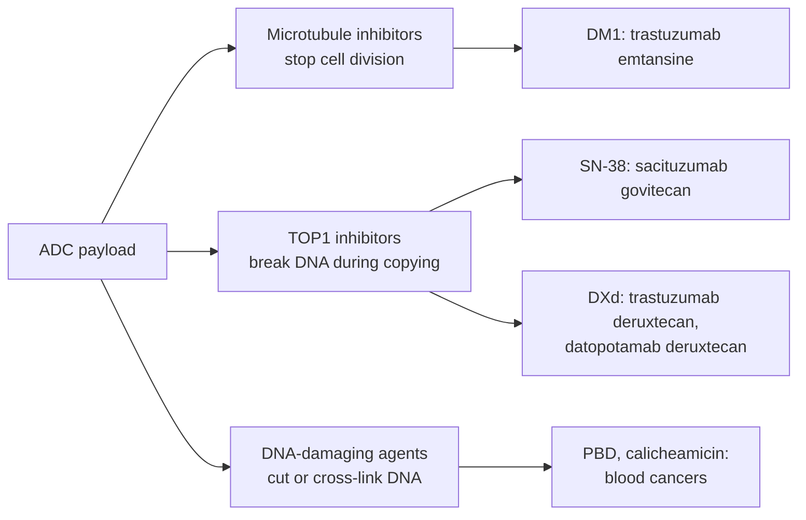

# ADC payload classes

## In one sentence

ADC payload classes group the drugs that antibody-drug conjugates deliver by the cellular process they disrupt, which shapes their potency, side effects, effect on nearby cells and cross-resistance.

## The intuition

An [antibody-drug conjugate (ADC)](/wiki/education/concepts/therapeutics/antibody-based/antibody-drug-conjugate) is a delivery vehicle with cargo. Changing the antibody changes **where** the vehicle goes. Changing the payload changes **what happens** when it arrives. Two vehicles with different addresses but the same kind of cargo can fail for the same reason. The analogy breaks in one place: the vehicle is not neutral. The antibody, linker and number of payloads also change how much drug reaches each cell.

## How it works

A payload class is defined by its cellular target, not by the company or the antibody that carries it.

| Class | What it disrupts | Examples in approved ADCs | Characteristic concerns |
|---|---|---|---|
| **Microtubule inhibitors** | The spindle a cell needs to divide: auristatins (such as MMAE) and maytansinoids (such as DM1) | Enfortumab vedotin, brentuximab vedotin, trastuzumab emtansine (T-DM1) | Nerve damage (neuropathy) with MMAE; eye toxicity with some, including DM4, MMAF and the MMAE product tisotumab vedotin; low platelets and liver injury with T-DM1 |
| **[Topoisomerase I (TOP1) inhibitors](/wiki/education/concepts/therapeutics/chemotherapy/topoisomerase-i-inhibitors)** | The enzyme that relieves DNA twisting; trapped enzyme breaks DNA during copying | Sacituzumab govitecan (SN-38), trastuzumab deruxtecan and datopotamab deruxtecan (deruxtecan, DXd) | Low white-cell counts, diarrhea; lung inflammation with the deruxtecan products |
| **DNA-damaging agents** | DNA itself, by cutting or cross-linking it: calicheamicin, pyrrolobenzodiazepines (PBDs) | Gemtuzumab ozogamicin, loncastuximab tesirine | Very high potency, so fewer payloads per antibody; marrow and liver injury (including veno-occlusive disease with calicheamicin); fluid retention and skin reactions with PBDs |
| **Emerging classes** | [Transcription](/wiki/education/concepts/therapeutics/antibody-based/transcription-inhibitor-payloads) (amanitin), [DNA-damage-response enzymes](/wiki/education/concepts/therapeutics/antibody-based/ddr-inhibitor-payloads) (ATR, CHK1, PARP1), [immune alarms](/wiki/education/concepts/therapeutics/antibody-based/immune-stimulating-adc) (STING, TLR agonists), protein degraders | None approved | Human benefit and repeat-dose safety largely unproven |

*The breast-cancer ADCs on US labels, sorted by payload class. Three of the four carry a TOP1 inhibitor.*

Radiation is a separate cargo with its own physics; see [radioligand therapy](/wiki/education/concepts/therapeutics/antibody-based/radioligand-therapy) and [ADC versus radioligand therapy](/wiki/education/concepts/therapeutics/antibody-based/adc-vs-radioligand-therapy).

Three properties follow from the class and the specific molecule:

1. **Potency sets loading.** Very potent payloads are attached at fewer copies per antibody. The average [drug-to-antibody ratio](/wiki/education/concepts/therapeutics/antibody-based/adc-conjugation-chemistry) is about 8 for trastuzumab deruxtecan, 7 to 8 for sacituzumab govitecan and 3.5 for T-DM1, but only 2.3 for the ultra-potent PBD conjugate loncastuximab tesirine [9].
2. **Membrane permeability sets reach.** A released payload that crosses membranes can kill neighboring cells that lack the target, a bystander effect shown for DXd in mixed preclinical models [2]. A charged payload or breakdown product, such as the lysine-linked DM1 released from T-DM1, tends to stay in the cell that took it up. The linker decides where release happens; see [ADC conjugation chemistry](/wiki/education/concepts/therapeutics/antibody-based/adc-conjugation-chemistry).
3. **Pump handling sets one kind of resistance.** Some payloads are substrates of [drug efflux transporters](/wiki/education/concepts/therapeutics/how-drugs-work/drug-efflux-transporters), which push them out of the cell. Chemists now tune all three properties within the TOP1 class; see [next-generation TOP1 payloads](/wiki/education/concepts/therapeutics/antibody-based/next-generation-top1-payloads).

**[Dual-payload ADCs](/wiki/education/concepts/therapeutics/antibody-based/dual-payload-adc)** carry two payloads from different classes on one antibody, for example a TOP1 inhibitor with a microtubule inhibitor, or a TOP1 inhibitor with an ATR inhibitor that blocks the cell's response to the damage it causes. Their aim is to kill cells that survive one mechanism. Their burden is that two payloads need two loading ratios, two exposure measurements and evidence that the second payload adds benefit [3].

## Why it matters in cancer

- The class largely predicts the side-effect profile, so prior toxicity on one class informs the next choice; see [ADC payload toxicities](/wiki/education/concepts/therapeutics/toxicities-and-supportive-care/adc-payload-toxicity).
- When an ADC stops working, a new ADC with the **same payload class** may meet the same resistance. This is [cross-resistance between ADCs](/wiki/education/concepts/therapeutics/antibody-based/adc-cross-resistance).
- In breast cancer, every ADC approved for triple-negative disease carries a TOP1 payload. The first approvals rested on randomized trials in previously treated metastatic disease [4, 5]; In 2026, both drugs gained new triple-negative approvals based on trials in untreated metastatic disease [7, 8]. Each is labeled for people who are not candidates for checkpoint inhibitors that block programmed cell death protein 1 (PD-1) or programmed death-ligand 1 (PD-L1). Sacituzumab govitecan is also labeled with pembrolizumab when the tumor expresses PD-L1 (combined positive score of 10 or more). That concentration is why switching payload class is an active research question.

## Common confusions

- **A new target is not a new payload.** Two ADCs aimed at different proteins can carry closely related TOP1 drugs.
- **Two TOP1 drugs are not two classes.** SN-38, DXd and exatecan differ in potency and pump handling but share a mechanism. (Deruxtecan is the drug-linker; DXd is the payload it releases, itself an exatecan derivative.)
- **More potent is not automatically better.** Potency changes loading, exposure and harm together.
- **A dual-payload ADC is not a combination regimen.** The two drugs are loaded at a fixed ratio and delivered to the same cells, although the ratio reaching the tumor can drift over repeated cycles. A combination of separate drugs lets each dose be adjusted.
- **"Payload toxicity" includes payload released outside the tumor.** Free payload in blood and healthy tissue contributes to side effects.

## How it is measured

Payload identity and loading are measured by mass spectrometry and chromatography of the product. Payload exposure in patients is measured separately from antibody exposure, because the two can follow different time courses [6]. Whether a tumor resists a payload class is tested in the laboratory by comparing the intact ADC with the free payload on the same cells.

## In Diana's case

How this applies to her is owned by the [drug-panel preferences](/wiki/diagnostics/drug-panel-preferences) page.

## Related concepts

- [Antibody-drug conjugate](/wiki/education/concepts/therapeutics/antibody-based/antibody-drug-conjugate)
- [Topoisomerase I inhibitors](/wiki/education/concepts/therapeutics/chemotherapy/topoisomerase-i-inhibitors)
- [Taxanes](/wiki/education/concepts/therapeutics/chemotherapy/taxanes), another microtubule drug class
- [Cross-resistance between ADCs](/wiki/education/concepts/therapeutics/antibody-based/adc-cross-resistance)
- [Bispecific ADC](/wiki/education/concepts/therapeutics/antibody-based/bispecific-adc)
- [Therapeutic index](/wiki/education/concepts/therapeutics/how-drugs-work/therapeutic-index)
- [ADC conjugation chemistry](/wiki/education/concepts/therapeutics/antibody-based/adc-conjugation-chemistry)
- [ADC payload toxicities](/wiki/education/concepts/therapeutics/toxicities-and-supportive-care/adc-payload-toxicity)
- [Dual-payload ADC](/wiki/education/concepts/therapeutics/antibody-based/dual-payload-adc)
- [Next-generation TOP1 payloads](/wiki/education/concepts/therapeutics/antibody-based/next-generation-top1-payloads)
- [DNA-damage-response inhibitor payloads](/wiki/education/concepts/therapeutics/antibody-based/ddr-inhibitor-payloads)
- [Transcription-inhibitor payloads](/wiki/education/concepts/therapeutics/antibody-based/transcription-inhibitor-payloads)
- [Immune-stimulating ADC](/wiki/education/concepts/therapeutics/antibody-based/immune-stimulating-adc)

## Sources and scope

Source check: November 7, 2026. General mechanisms and approved-product examples; emerging classes are named as categories, not as validated options. Expert and learner review remain pending. For program-level evidence, see [the plain-language payload summary](/wiki/research/reviews/2026-11-new-adc-payloads-short-version).

1. [Drago, Modi and Chandarlapaty, 2021: Unlocking the potential of antibody–drug conjugates for cancer therapy](https://pubmed.ncbi.nlm.nih.gov/33558752/) — payload classes, linkers and loading across approved products.
2. [Ogitani et al., 2016](https://pubmed.ncbi.nlm.nih.gov/27166974/) — DXd bystander killing in mixed HER2-positive and HER2-negative preclinical models.
3. [Ravenstijn et al., 2026: clinical pharmacology of dual-payload ADCs](https://pubmed.ncbi.nlm.nih.gov/42089685/) — exposure and development considerations specific to two payloads.
4. [Bardia et al., 2021: ASCENT](https://pubmed.ncbi.nlm.nih.gov/33882206/) — sacituzumab govitecan versus chemotherapy in previously treated metastatic triple-negative breast cancer.
5. [Modi et al., 2022: DESTINY-Breast04](https://pubmed.ncbi.nlm.nih.gov/35665782/) — trastuzumab deruxtecan in previously treated HER2-low advanced breast cancer, including a hormone-receptor-negative cohort.
6. [FDA, 2024: ADC clinical pharmacology guidance](https://www.fda.gov/media/155997/download) — separate measurement of conjugate, antibody and payload.
7. [Sacituzumab govitecan prescribing information, June 2026](https://dailymed.nlm.nih.gov/dailymed/drugInfo.cfm?setid=57a597d2-03f0-472e-b148-016d7169169d) — current triple-negative indications, including first-line use.
8. [Datopotamab deruxtecan prescribing information, revised May 2026](https://dailymed.nlm.nih.gov/dailymed/drugInfo.cfm?setid=2950227c-6230-4ca4-a135-46e44d9424a0) — current triple-negative indication.
9. US prescribing information, section 11: [trastuzumab deruxtecan](https://dailymed.nlm.nih.gov/dailymed/drugInfo.cfm?setid=7e67e73e-ddf4-4e4d-8b50-09d7514910b6), [sacituzumab govitecan](https://dailymed.nlm.nih.gov/dailymed/drugInfo.cfm?setid=57a597d2-03f0-472e-b148-016d7169169d), [trastuzumab emtansine](https://dailymed.nlm.nih.gov/dailymed/drugInfo.cfm?setid=23f3c1f4-0fc8-4804-a9e3-04cf25dd302e), [loncastuximab tesirine](https://dailymed.nlm.nih.gov/dailymed/drugInfo.cfm?setid=af54af12-3edf-4301-8bc5-0446bc813c1d) — average payloads per antibody.

<!-- BEGIN GENERATED USED IN -->
## Used in

- [Separate the address from the killing mechanism](/wiki/education/guides/aiming-a-drug-at-a-surface-target/01-mechanism)
- [Follow delivery, exposure, and the treatment clock](/wiki/education/guides/aiming-a-drug-at-a-surface-target/02-timing)
- [Compare formats with evidence and normal-tissue risk](/wiki/education/guides/aiming-a-drug-at-a-surface-target/03-comparisons)
- [Match the payload to the failure](/wiki/education/guides/aiming-a-drug-at-a-surface-target/04-match-the-payload-to-the-failure)
- [Read a new payload strategy](/wiki/education/guides/aiming-a-drug-at-a-surface-target/05-read-a-new-payload-strategy)
- [Aiming a drug at a surface target](/wiki/education/guides/aiming-a-drug-at-a-surface-target/index)
<!-- END GENERATED USED IN -->
