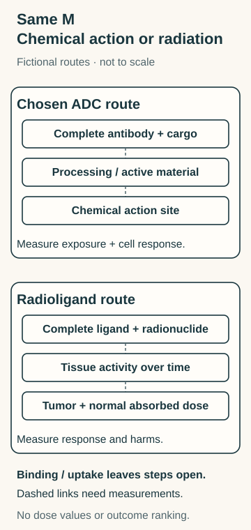

# ADC versus radioligand therapy

## In one sentence

A cytotoxic antibody-drug conjugate supplies active chemical material, while a radioligand product delivers radiation whose tissue exposure depends on distribution, retention and radioactive decay.

**Before you start:** An [antibody-drug conjugate (ADC)](/wiki/education/concepts/therapeutics/antibody-based/antibody-drug-conjugate) links an antibody to chemical cargo. [Radioligand therapy (RLT)](/wiki/education/concepts/therapeutics/antibody-based/radioligand-therapy) uses a target-binding molecule carrying a radionuclide, an unstable radioactive atom.

## What they share

Both use a molecular address to steer a toxic cargo toward tumor cells, and both reach healthy tissue that carries the same address or clears the product. A shared target does not mean a shared binder, distribution or safety profile.

## The intuition: chemistry versus a radiation source

An ADC is a parcel of poison that must be opened inside the cell and must find a vulnerable process there. A radioligand is a small radiation source that does not need to be opened: it harms whatever lies within range of its particles for as long as it stays put. The ADC asks *did the drug get in and work?* The radioligand asks *where did the radiation land, and for how long?*

## How it works: the axis is chemical action versus radiation

*Left: an ADC must be taken in and processed before its payload acts. Right: a radioligand acts wherever it sits, and its dose builds up over time as it decays. Schematic, not measured amounts.*

## Side by side

| Question | Cytotoxic ADC | Radioligand |
|---|---|---|
| Real examples | Sacituzumab govitecan (SN-38), trastuzumab deruxtecan (DXd) in breast cancer [1] | Lutetium-177 (¹⁷⁷Lu)-PSMA-617 in prostate cancer; ¹⁷⁷Lu-dotatate in neuroendocrine tumors [2, 3] |
| Typical vehicle | A full-size antibody, which circulates for days | Often a small molecule or peptide, which reaches tissue and clears quickly |
| What kills | A chemical payload acting on one process, such as DNA copying | Energy deposited by beta or alpha particles, which damages DNA directly |
| Must it enter the cell? | Usually, to release payload | No; it can act from the surface |
| Reach beyond the target cell | Bystander effect if the payload crosses membranes | Crossfire: beta particles travel up to millimeters, alpha particles only a few cell widths |
| What dose means | Milligrams per kilogram of conjugate; payload exposure measured separately | Activity in becquerels; absorbed dose in gray, estimated by imaging over time |
| Typical healthy-tissue concern | Payload-class effects: low blood counts, diarrhea, lung disease, nerve or eye toxicity | Organs that clear or hold the product; for example, kidney, salivary glands or marrow, depending on the product |
| Resistance it can bypass | Cells that ignore the payload class | Possibly some chemotherapy-resistant cells, since radiation damages DNA by another route; cells that tolerate DNA damage or resist cell death can resist both |

**Activity** counts radioactive decays per second (becquerels). **Absorbed dose** is energy deposited per kilogram of tissue (gray). Neither is a drug concentration, and neither is a benefit estimate.

## Why it matters in cancer: when each wins

- **An ADC fits** when the target is taken into the cell efficiently, the tumor is sensitive to the payload class, and disease is spread widely enough that a drug circulating for days helps. This describes the ADCs approved in breast cancer.
- **A radioligand fits** when the target can be imaged before treatment, tumor uptake is high relative to normal organs, and chemical payloads have stopped working for a reason radiation might avoid, such as a drug pump. VISION, for example, enrolled only men whose tumors were positive on a PSMA scan [2].
- **Neither fits** when the target is also abundant in a critical healthy organ, or when the tumor sample shows the target but living tumors do not take up the product.

## Worked example: two early signals

Both products recognize the same fictional surface protein M:

| Field | ADC A1 | Radioligand R1 |
|---|---|---|
| Observation | Antibody signal is detected inside cells after uptake | An early scan shows radioactivity in tumors |
| Not yet measured | Released payload at its action site; cell killing | Later distribution, normal-organ dose, cell killing |

**Try it:** If A1 turns out to release little payload, does R1's bright early scan show that radiation will work instead?

Show the answer

No. A1's result points to a processing problem in that ADC. R1 still needs repeated images to estimate how much dose tumors and normal organs receive over time, and evidence of response. The two early signals have different units and cannot rank the products.

## Common confusions

- **A bright scan is not a dose or a benefit.** One time point misses how long the product stays.
- **Activity is not absorbed dose.** Becquerels count decays; gray measures energy deposited in tissue.
- **Not every radioligand is an antibody.** Radiolabeled antibodies are called radioimmunotherapy and circulate much longer.
- **Bystander killing is not crossfire.** One is a chemical diffusing to neighbors; the other is particles traveling through tissue. Neither proves immune priming.
- **Chemical resistance does not prove radiation sensitivity.** It removes one route of failure, not all of them.

## Explain it back

"After binding, an ADC still needs ___; a radioligand still needs ___."

**One answer:** to be taken in, release its payload and find a vulnerable process; to stay in the tumor long enough to deliver a damaging dose while sparing the organs that clear it.

## Takeaway

**One-line mental model: an ADC is poison that must be opened inside the cell; a radioligand is a radiation source that works wherever it sits.**

## Related concepts

- [Target versus therapeutic format](/wiki/education/concepts/therapeutics/antibody-based/target-vs-chassis)
- [ADC payload classes](/wiki/education/concepts/therapeutics/antibody-based/adc-payload-classes)
- [Theranostics](/wiki/education/concepts/therapeutics/local-therapies/theranostics)
- [Target PET and theranostic imaging](/wiki/education/concepts/measurement/imaging/target-pet-and-theranostic-imaging)

## Sources and scope

Source check: November 7, 2026. Mechanism comparison with approved examples from different cancers; no cross-format efficacy ranking is implied. Expert and learner review remain pending.

1. [Sacituzumab govitecan](https://dailymed.nlm.nih.gov/dailymed/drugInfo.cfm?setid=57a597d2-03f0-472e-b148-016d7169169d) and [trastuzumab deruxtecan](https://dailymed.nlm.nih.gov/dailymed/drugInfo.cfm?setid=7e67e73e-ddf4-4e4d-8b50-09d7514910b6) US prescribing information — payload, mechanism and indications.
2. [Sartor et al., 2021: VISION](https://pubmed.ncbi.nlm.nih.gov/34161051/) — ¹⁷⁷Lu-PSMA-617 in PSMA-PET-positive metastatic castration-resistant prostate cancer.
3. [Strosberg et al., 2017: NETTER-1](https://pubmed.ncbi.nlm.nih.gov/28076709/) — ¹⁷⁷Lu-dotatate in metastatic midgut neuroendocrine tumors.
4. [Sgouros et al.: Medical Internal Radiation Dose pamphlet 22](https://pmc.ncbi.nlm.nih.gov/articles/PMC5680544/) — alpha and beta particle ranges and dosimetry.
5. [Ogitani et al., 2016](https://pubmed.ncbi.nlm.nih.gov/27166974/) — ADC payload bystander killing in mixed models.

<!-- BEGIN GENERATED USED IN -->
## Used in

- [Compare related ideas](/wiki/education/comparisons/index)
- [Aiming a drug at a surface target](/wiki/education/guides/aiming-a-drug-at-a-surface-target/index)
<!-- END GENERATED USED IN -->
