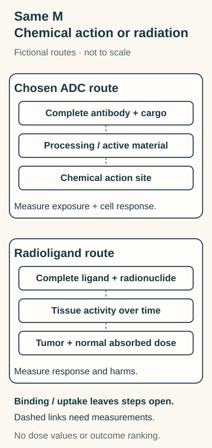

# ADC versus radioligand therapy

## In one sentence

A cytotoxic antibody-drug conjugate supplies active chemical material, while a radioligand product delivers radiation whose tissue exposure depends on distribution, retention and radioactive decay.

## What they share

Both use a molecular address to influence where a product goes. That address can also occur in healthy tissue. A shared target does not establish the same binder, distribution, action or safety window.

**Before you start:** An [antibody-drug conjugate (ADC)](/wiki/education/concepts/therapeutics/antibody-based/antibody-drug-conjugate) links an antibody to chemical cargo. [Radioligand therapy (RLT)](/wiki/education/concepts/therapeutics/antibody-based/radioligand-therapy) uses a target-binding molecule carrying a radionuclide, an unstable radioactive isotope.

## The intuition

One addressed product carries a chemical tool. The other carries a source of radiation. Finding the address is useful, but it leaves different unfinished questions: did active chemical material reach its action site, or where did radiation deposit energy over time?

Chemical material can sometimes reach neighbors; radiation can reach nearby tissue depending on its emissions. Neither local effect proves immune memory.

## How it works: the axis is chemical action versus radiation exposure

In the fictional comparison, both recognize accessible surface feature **M**. A1 is an internalizing ADC whose specified processing route is intended to make active chemical material available. R1 is a small-ligand radioactive product. The shared M label does not make their binding geometries or exposure equivalent.

*Binding leaves different measurements unfinished: active chemical material and cellular response for A1; changing tissue radioactivity, absorbed dose and response for R1. This is one chosen ADC route, with schematic symbols rather than measured amounts or radiation ranges.*

ADC processing and active products vary. RLT vectors can be small molecules or peptides; a radioactive antibody is a related **radioimmunotherapy** format. Their distributions are not interchangeable.

## Compare the complete products

| Question | Cytotoxic ADC | Radioligand product |
|---|---|---|
| What is supplied? | A specified antibody, linker and chemical payload | A specified binding vector, attachment chemistry and radionuclide |
| What acts? | Active payload or an active processing product at a susceptible molecular process | Energy deposited by radiation as the radionuclide decays |
| What exposure matters? | Intact conjugate, active material, compartments and time | Radioactivity in tissues over time, emissions, geometry and tissue mass |
| What does uptake miss? | Whether active material reaches its action site | Time-integrated activity and absorbed radiation dose |
| What about normal tissue? | Binding, released material and its biological effects | Product distribution and energy deposited in vulnerable tissues |
| What follows a failure? | Identify the failed step; another format creates a new hypothesis | Test radiation exposure and response; chemical resistance supplies no answer |

**Activity** describes radioactive decays per second, measured in becquerels. **Absorbed dose** describes energy deposited per mass, measured in gray. Integrating tissue activity over time helps estimate dose, but emission energies and spatial geometry still matter. Neither quantity is a chemical-payload concentration or a clinical-benefit estimate.

## Worked example: two early signals

Both cards concern the same fictional M-positive model:

| Field | ADC A1 | Radioligand R1 |
|---|---|---|
| Complete product | Specified antibody/linker/payload | Specified small ligand/radionuclide |
| Observation | Antibody-associated signal is detected after uptake | An early calibrated image measures therapeutic-product radioactivity |
| Not measured | Active material at its action site or target-cell response | Later distribution, normal-tissue activity, absorbed dose or target-cell response |

**Try it:** Which unfinished measurement belongs to each product? If later A1 testing finds little active payload after binding, does the early R1 image establish that radiation bypasses the failure safely?

**Answer:** For A1, distinguish intact/processed material, verify active chemical exposure and measure response with suitable controls. For R1, follow radioactivity over time in tumor and normal tissues, estimate absorbed dose using the specified emissions and geometry, and measure biological effects. A1's finding identifies a chemical-delivery problem to investigate; it proves neither R1's radiation response nor safety or benefit. The two early signals even have different units and cannot rank the products.

If the image used a different diagnostic tracer, first establish what that tracer can tell you about the therapeutic product. [Target imaging](/wiki/education/concepts/measurement/imaging/target-pet-and-theranostic-imaging) and therapeutic dosimetry are related questions, not interchangeable measurements.

## Why it matters in cancer: choose the evidence question

To investigate a chemical-processing bottleneck, start with the existing [ADC Models A and B](/wiki/education/concepts/therapeutics/antibody-based/antibody-drug-conjugate#worked-example). To investigate radiation exposure, use the [equal-early-uptake exercise](/wiki/education/concepts/therapeutics/antibody-based/radioligand-therapy#try-it).

## Common confusions

- A bright image is not a complete delivery, dose or benefit result.
- Radioactivity and absorbed dose are different quantities.
- Not every radioligand is an antibody.
- Chemical resistance does not demonstrate radiation sensitivity.
- Local chemical bystander effects and radiation crossfire are different mechanisms; neither is proof of immune priming.

## Explain it back

“After binding, A1 still needs ___; R1 still needs ___.”

**One answer:** active chemical material at its action site and a measured response; distribution over time, absorbed dose and a measured response. Both need normal-tissue and clinical evidence.

## Takeaway

**The same address can lead to chemical action or radiation exposure; each route needs its own completed measurements.**

## Related concepts

- [Target versus therapeutic format](/wiki/education/concepts/therapeutics/antibody-based/target-vs-chassis)
- [Theranostics](/wiki/education/concepts/therapeutics/local-therapies/theranostics)

## Sources and scope

Author source check: October 12, 2026. Fictional matched-address cards; no isotope, dose, indication or clinical ranking. Independent scientific/visual and expert/learner review remain pending.

- [Ogitani et al., 2016](https://pmc.ncbi.nlm.nih.gov/articles/PMC4946713/) — selected full-text processing, permeability and model Methods/Results; effects depend on the tested conjugate. No clinical efficacy or universal release route is inferred.
- [Violet et al., 2019](https://jnm.snmjournals.org/content/60/4/517.full) — selected full-text imaging/dosimetry method for one lutetium-177 product in metastatic prostate cancer; serial activity, tumor and normal-tissue regions remain distinct. No published dose or response threshold is transferred to the fictional cards.

<!-- BEGIN GENERATED USED IN -->
## Used in

- [Compare related ideas](/wiki/education/comparisons/index)
<!-- END GENERATED USED IN -->
