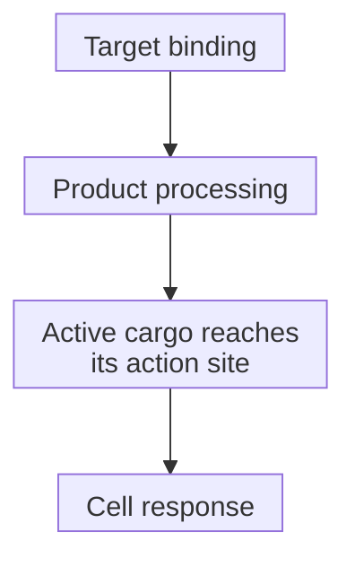
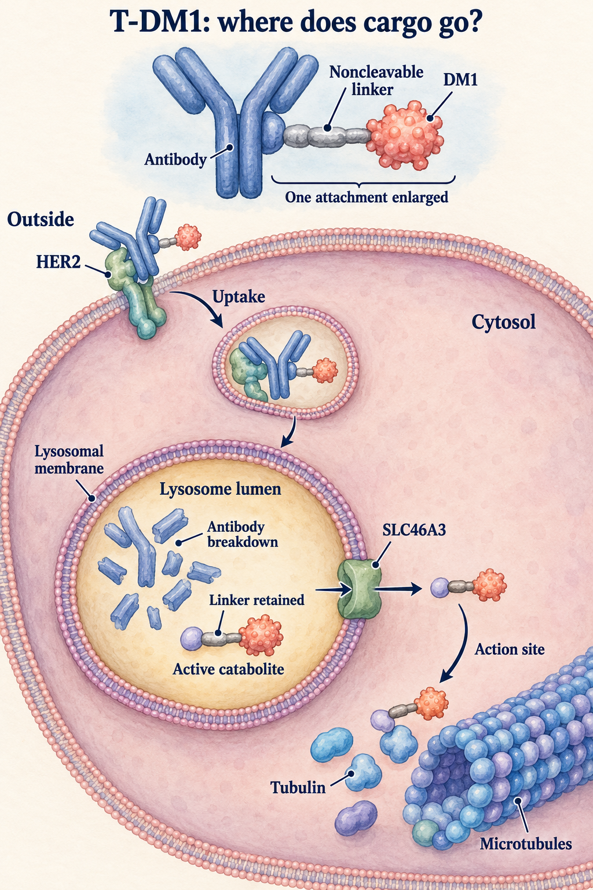
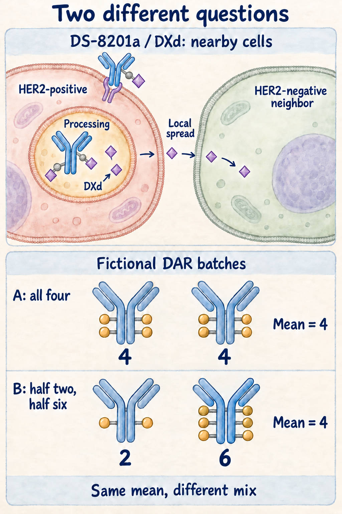

# ADC (antibody-drug conjugate)

## In one sentence

An antibody-drug conjugate links a targeting antibody to a drug payload so binding and product-specific processing can deliver chemical damage.

## The intuition

Think of an addressed package. The antibody helps find an address; the linker attaches the cargo; the payload supplies a chemical effect. Finding the address does not prove the package reached the right room or that its cargo became usable. Molecules also circulate and encounter healthy tissues; delivery is not confined to the intended recipient.

## How it works

This page focuses on cytotoxic antibody-drug conjugates (ADCs), whose payloads damage cells. Three components do connected but different jobs:

| Component | Main job | What remains to test |
|---|---|---|
| Antibody | Recognize an accessible [epitope](/wiki/education/concepts/immunology/antigen-presentation/antigen-and-epitope) | Reach and binding on living cells |
| Linker | Attach cargo and govern its processing | Where active material becomes available |
| Payload | Disrupt a susceptible cellular process | Exposure at its action site and response |

For many products, binding is followed by **internalization**, movement into the cell. Processing generates active payload or an active breakdown product. A noncleavable linker can require antibody degradation rather than cleavage of the linker itself. Uptake and release are separate events.

Active material may still need to leave a [lysosome](/wiki/education/concepts/biology-basics/cells/organelles-overview), a compartment that digests material. Experiments with trastuzumab emtansine showed that solute carrier family 46 member 3 (SLC46A3) transports a particular active breakdown product. This illustrates a delivery bottleneck; it is not a universal ADC biomarker.

**Drug-to-antibody ratio (DAR)** counts attached payload molecules per antibody. An average can hide a distribution. In a fictional batch, every antibody carries four payloads. In another, half carry two and half carry six. Both average four, but they contain different species. Conjugation sites also matter. Hamblett's 2004 experiments found that loading changed potency, clearance and tolerability in one conjugate's mouse models; they did not establish a universal best DAR.

Some released payloads cross membranes and affect nearby cells: a **bystander effect**. Ogitani's mixed preclinical models demonstrated a payload-dependent local effect. Other payloads behave differently. This does not establish killing at distant tumors or lasting immune memory.

A common delivery route, with a testable requirement at each arrow. Binding and DAR do not establish completion of the route.

*An ADC has an antibody, a linker and a payload. This trastuzumab emtansine (T-DM1) example follows HER2 binding, enclosed uptake and lysosomal antibody breakdown. The noncleavable linker remains with a DM1-containing active catabolite. Experiments support an SLC46A3-dependent route across the lysosomal boundary toward cytosolic tubulin. One attachment is enlarged; the drawing is not a measured loading distribution. Each transition depends on the product and cell, so binding alone does not demonstrate completed delivery or benefit.*

*The upper scene is a separate DS-8201a/DXd preclinical example: released membrane-permeable cargo can affect a nearby HER2-negative cell. That local bystander question differs from distant tumors or immune memory. The lower batches are fictional: two antibodies with four payloads each and a mixture of one with two and one with six both average four payloads per antibody. Equal averages conceal different distributions. Attachment sites are schematic; this supplies no universal optimum, efficacy ranking or measurement of either product.*

## Why it matters in cancer

A surface protein can serve as an address even if cancer does not depend on its signaling. [Target heterogeneity](/wiki/education/concepts/cancer-biology/what-cancer-is/tumor-heterogeneity), processing, payload sensitivity and exposure can each limit activity. Healthy-tissue recognition and unconjugated payload can contribute to harm. Sharing a target or an average DAR does not make two products equivalent.

## How it is measured

| Observation card | Record and interpret |
|---|---|
| Product | Actual conjugate, linker, payload and batch; aliquots are consumed in characterization |
| Loading | Average DAR, distribution and attachment sites, using suitable separation/mass measurements; units are payloads per antibody |
| Exposure and function | Named conjugate/payload concentrations, sampling times, trafficking and timed cell survival; antibody fluorescence does not measure active cargo |
| Controls and limits | Target-negative cells, appropriate payload controls and relevant healthy cells; no universal assay cutoff or dish-to-clinic conversion |

[Immunohistochemistry](/wiki/education/concepts/measurement/pathology-readouts/immunohistochemistry) measures tissue protein signal. A product-specific clinical assay role cannot be transferred to every ADC.

## Worked example

Fictional Models A and B both bind an ADC against surface protein M and take antibody-associated material into cells. A has measurable active payload product and fewer surviving cells; B has little active product and unchanged survival. This supports a difference after binding, without identifying its cause. Compare processing and transport; separately test payload sensitivity with verified exposure.

## Common confusions

- **Staining is not complete delivery.** Access, trafficking and payload action need their own measurements.
- **Internalization is not release.** Material may remain attached, trapped or inactive.
- **Targeted is not tumor-exclusive.** Correct recognition can harm healthy tissue.
- **Higher DAR is not automatically better.** Distribution, exposure and safety also change.
- **Bystander killing is not systemic immunity.** Local chemical exposure and immune memory are different mechanisms.

## Try it

The two fictional batches average DAR 4. Can you choose the more effective batch from that number alone?

**Answer:** No. Equal averages conceal different distributions. Test product stability, delivery, exposure, payload response and harms.

## Explain it back

“An ADC needs more than binding because ___.”

**One answer:** active material must reach a susceptible process; loading and each delivery step need separate evidence.

## Takeaway

**Inspect the complete conjugate, its loading distribution and its delivery chain before making an activity or benefit claim.**

## Related concepts

- [Antibody structure](/wiki/education/concepts/immunology/antibodies-and-b-cells/antibody-structure)
- [Pharmacokinetics and half-life](/wiki/education/concepts/therapeutics/how-drugs-work/pharmacokinetics-and-half-life)

## Sources and scope

Source check: October 10, 2026. General mechanisms and fictional practice; primary examples are limited to their conjugates and experimental models. Expert and learner review remain pending.

- [FDA, 2024: ADC clinical pharmacology](https://www.fda.gov/media/155997/download) — constituent parts and their separate exposure measures.
- [Hamblett et al., 2004](https://pubmed.ncbi.nlm.nih.gov/15501986/) — loading, clearance and tolerability in one conjugate's laboratory/mouse models.
- [Tomabechi et al., 2022](https://pubmed.ncbi.nlm.nih.gov/36741448/) — transport of a specified active catabolite.
- [Ogitani et al., 2016](https://pubmed.ncbi.nlm.nih.gov/27166974/) — local bystander killing in mixed models.
- [SLC46A3 resistance experiments, 2018](https://pubmed.ncbi.nlm.nih.gov/30131388/) — loss/rescue studies with specified noncleavable conjugates, not a universally validated selection test.

Visual source check: October 11, 2026. The [official T-DM1 mechanism](https://dailymed.nlm.nih.gov/dailymed/lookup.cfm?setid=23f3c1f4-0fc8-4804-a9e3-04cf25dd302e&version=34) and [official DXd-product mechanism](https://dailymed.nlm.nih.gov/dailymed/drugInfo.cfm?setid=7e67e73e-ddf4-4e4d-8b50-09d7514910b6), section 12.1, support the distinct product identities. The existing Tomabechi and Ogitani primary sources bound the transport and local-neighbor examples; the DAR illustration is fictional arithmetic. These schematics specify neither atomic structures nor completed delivery, clinical selection or comparative benefit. Expert and learner review remain pending.

<!-- BEGIN GENERATED USED IN -->
## Used in

- [Aiming a drug at a surface target](/wiki/education/guides/aiming-a-drug-at-a-surface-target/index)
- [Separate the address from the killing mechanism](/wiki/education/targeted-therapy-modalities/01-mechanism)
- [Follow delivery, exposure, and the treatment clock](/wiki/education/targeted-therapy-modalities/02-timing)
- [Questions for a targeted-therapy proposal](/wiki/education/targeted-therapy-modalities/04-decision-questions)
- [Compare formats with evidence and normal-tissue risk](/wiki/education/targeted-therapy-modalities/06-comparisons)
- [Targeted therapy mechanisms and comparisons](/wiki/education/targeted-therapy-modalities/index)
<!-- END GENERATED USED IN -->
