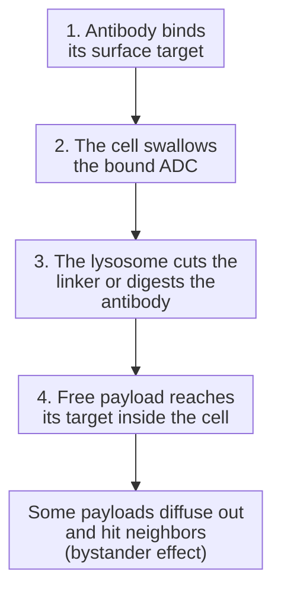
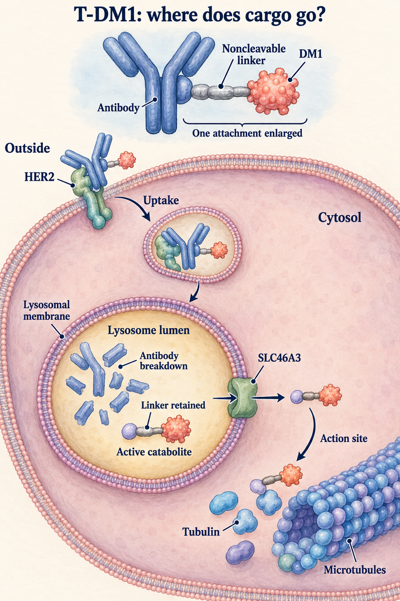
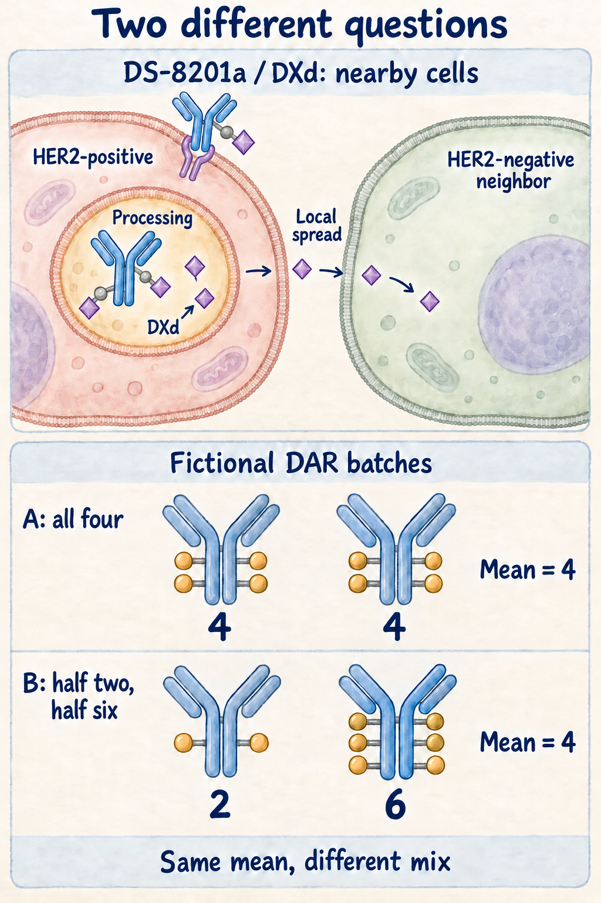

# ADC (antibody-drug conjugate)

## In one sentence

An antibody-drug conjugate links a targeting antibody to a drug payload so binding and product-specific processing can deliver chemical damage.

## The intuition

Think of an addressed package. The antibody reads the address, the linker is the tape that holds the cargo, and the payload is the cargo: a chemotherapy drug too toxic to give on its own at the same dose. The package should open only after it is delivered. The analogy breaks in two places. Packages also circulate past healthy cells that carry the same address, and some tape gives way in transit, so a little cargo leaks into the blood.

## How it works

This page covers cytotoxic antibody-drug conjugates (ADCs), whose payloads damage cells. Three parts do different jobs:

| Part | Main job | What it decides |
|---|---|---|
| **Antibody** | Binds a surface protein (the target) on the cell | Which cells the drug reaches, and how fast it is taken inside |
| **Linker** | Holds the payload in the blood, then releases it | Where and when the payload comes free |
| **Payload** | Damages a process the cell needs, such as DNA copying or division | How the cell dies, which side effects follow, and which resistance applies |

A typical route has four steps:

*Each arrow can fail on its own, so binding alone never proves delivery.*

The target does not need to drive the cancer; it is an address. After uptake, the [lysosome](/wiki/education/concepts/biology-basics/cells/organelles-overview), a compartment that digests material, cuts the linker or digests the antibody, as set by [conjugation chemistry](/wiki/education/concepts/therapeutics/antibody-based/adc-conjugation-chemistry). The freed payload then acts according to its [class](/wiki/education/concepts/therapeutics/antibody-based/adc-payload-classes); most breast-cancer ADCs carry a [topoisomerase I inhibitor](/wiki/education/concepts/therapeutics/chemotherapy/topoisomerase-i-inhibitors) that breaks DNA during copying.

**Drug-to-antibody ratio (DAR)** is the average number of payload molecules per antibody, an average over a mixture. Higher loading delivers more drug per binding event but can speed clearance and narrow the [therapeutic index](/wiki/education/concepts/therapeutics/how-drugs-work/therapeutic-index) [4]; [conjugation chemistry](/wiki/education/concepts/therapeutics/antibody-based/adc-conjugation-chemistry) owns the details.

**The bystander effect** is killing of nearby cells that lack the target. It happens when the released payload can cross membranes. In mixed models of HER2-positive and HER2-negative cells, the deruxtecan payload (DXd) killed the HER2-negative neighbors; a payload that stays charged after release does this less [5]. Bystander killing is local chemistry. It is not killing of distant tumors and not immune memory.

*Trastuzumab emtansine (T-DM1): HER2 binding, uptake, lysosomal digestion, then transport of the DM1 fragment out through SLC46A3. Losing that transporter caused resistance in models [6], a step that can fail after binding.*

*Top: DXd released from trastuzumab deruxtecan (DS-8201a) crosses into a HER2-negative neighbor. Bottom, fictional: two loading mixtures that both average a DAR of 4.*

## Breast-cancer examples

From US labels [1]. Indications change; the [ADC therapies page](/wiki/treatment/therapeutics/adc-therapies) owns trials and approvals.

| Drug | Target | Linker | Payload (class) | Average DAR | Breast-cancer use on the label |
|---|---|---|---|---|---|
| Trastuzumab emtansine (T-DM1) | HER2 | Noncleavable thioether | DM1 (microtubule) | 3.5 | HER2-positive, early and metastatic [1] |
| Trastuzumab deruxtecan (T-DXd) | HER2 | Protease-cleavable tetrapeptide | DXd (TOP1) | About 8 | HER2-positive early and metastatic; HER2-low and HER2-ultralow metastatic (ultralow only when hormone-receptor-positive) [1] |
| Sacituzumab govitecan | TROP2 | Hydrolyzable (CL2A) | SN-38 (TOP1) | 7 to 8 | Metastatic triple-negative and hormone-receptor-positive [1] |
| Datopotamab deruxtecan (Dato-DXd) | TROP2 | Protease-cleavable tetrapeptide | DXd (TOP1) | About 4 | Metastatic triple-negative and hormone-receptor-positive [1] |

TOP1 means topoisomerase I; TROP2 is trophoblast cell-surface antigen 2. Two pairs teach the main lesson. T-DM1 and T-DXd use the same antibody, trastuzumab, against the same target. T-DXd lengthened survival in [HER2-low](/wiki/education/concepts/breast-cancer/receptors-and-subtypes/her2) metastatic breast cancer in DESTINY-Breast04 [7], while T-DM1 is labeled only for HER2-positive disease and, unlike T-DXd, showed no antitumor activity in several HER2-low breast tumor models [8]. Sacituzumab govitecan and Dato-DXd share a target but differ in linker, payload and loading. **The target name does not define the drug.** Why expression levels predict benefit only weakly is covered in [target expression versus ADC response](/wiki/education/concepts/therapeutics/antibody-based/target-expression-vs-adc-response).

## Why it matters in cancer

- **ADCs widen what counts as a target.** A protein can serve as an address even when the cancer does not depend on its signaling, which is why HER2-low and TROP2 became useful in triple-negative disease.
- **Side effects follow the payload and its release.** Payload freed outside the tumor, and healthy cells carrying the target, both cause harm; see [ADC payload toxicities](/wiki/education/concepts/therapeutics/toxicities-and-supportive-care/adc-payload-toxicity).
- **Resistance can sit at any step.** Target loss, slow uptake, a pump that removes the payload, or a mutated payload target each points to a different next drug; see [cross-resistance between ADCs](/wiki/education/concepts/therapeutics/antibody-based/adc-cross-resistance).
- **ADCs are often combined with immunotherapy.** Dying cells can release immune signals ([immunogenic cell death](/wiki/education/concepts/cancer-biology/cell-death-and-survival/immunogenic-cell-death)), but whether TOP1 payloads add immune benefit in patients is not established.

## Common confusions

- **Staining is not delivery.** Target staining shows the address; uptake, release and payload action each need their own evidence.
- **Targeted is not tumor-only.** Correct binding can harm healthy tissue that carries the same protein.
- **Higher DAR is not automatically better.** More loading changes clearance, stability and toxicity along with potency.
- **Bystander killing is not systemic immunity.** Local chemical spread and immune memory are different mechanisms.
- **A new target is not a new payload.** Two ADCs aimed at different proteins can carry the same payload class and share its resistance.

## How it is measured

In patients, intact conjugate, total antibody and free payload are measured separately, because they follow different time courses [2]. In tumors, the target is usually measured by [immunohistochemistry](/wiki/education/concepts/measurement/pathology-readouts/immunohistochemistry). Only some ADCs require a target test, and a [companion diagnostic](/wiki/education/concepts/access-and-regulation/approval/companion-diagnostics) validated for one ADC does not transfer to another.

## Try it

Two fictional batches of the same ADC both average a DAR of 4. Can you choose the more effective one from that number?

Show the answer

No. Equal averages can hide different mixtures, and loading changes clearance and toxicity as well as potency. Compare loading distribution, stability, delivery to tumor cells and harm.

## Explain it back

"An ADC needs more than binding because ___."

**One answer:** the payload must still be taken in, released and reach its target, and each step can fail on its own.

## Takeaway

**An ADC is three decisions, not one: the antibody picks the cells, the linker picks when the drug comes free, and the payload picks how the cell dies.**

## Related concepts

- [Antibody structure](/wiki/education/concepts/immunology/antibodies-and-b-cells/antibody-structure)
- [ADC conjugation chemistry](/wiki/education/concepts/therapeutics/antibody-based/adc-conjugation-chemistry)
- [ADC payload classes](/wiki/education/concepts/therapeutics/antibody-based/adc-payload-classes)
- [Target expression versus ADC response](/wiki/education/concepts/therapeutics/antibody-based/target-expression-vs-adc-response)
- [ADC payload toxicities](/wiki/education/concepts/therapeutics/toxicities-and-supportive-care/adc-payload-toxicity)
- [Cross-resistance between ADCs](/wiki/education/concepts/therapeutics/antibody-based/adc-cross-resistance)
- [Bispecific ADC](/wiki/education/concepts/therapeutics/antibody-based/bispecific-adc)
- [Pharmacokinetics and half-life](/wiki/education/concepts/therapeutics/how-drugs-work/pharmacokinetics-and-half-life)

## Sources and scope

Source check: November 7, 2026. General mechanism, approved-product facts from US labels, and preclinical examples limited to their models. Expert and learner review remain pending. Artwork: the T-DM1 route follows the label mechanism (section 12.1) and the Tomabechi and Kinneer transport studies; the DAR rows are fictional arithmetic; no source figure was copied.

1. US prescribing information (DailyMed), sections 1 and 11: [trastuzumab emtansine](https://dailymed.nlm.nih.gov/dailymed/drugInfo.cfm?setid=23f3c1f4-0fc8-4804-a9e3-04cf25dd302e), [trastuzumab deruxtecan](https://dailymed.nlm.nih.gov/dailymed/drugInfo.cfm?setid=7e67e73e-ddf4-4e4d-8b50-09d7514910b6), [sacituzumab govitecan](https://dailymed.nlm.nih.gov/dailymed/drugInfo.cfm?setid=57a597d2-03f0-472e-b148-016d7169169d), [datopotamab deruxtecan](https://dailymed.nlm.nih.gov/dailymed/drugInfo.cfm?setid=2950227c-6230-4ca4-a135-46e44d9424a0) — linker, payload, average loading and indications.
2. [FDA, 2024: clinical pharmacology considerations for ADCs](https://www.fda.gov/media/155997/download) — separate exposure measures for conjugate, antibody and payload.
3. [Drago, Modi and Chandarlapaty, 2021](https://pubmed.ncbi.nlm.nih.gov/33558752/) — review of ADC design, payloads and resistance.
4. [Hamblett et al., 2004](https://pubmed.ncbi.nlm.nih.gov/15501986/) — loading, clearance and therapeutic index for one MMAE conjugate in mice.
5. [Ogitani et al., 2016](https://pubmed.ncbi.nlm.nih.gov/27166974/) — DXd bystander killing in mixed HER2-positive and HER2-negative models.
6. [Kinneer et al., 2018](https://pubmed.ncbi.nlm.nih.gov/30131388/) and [Tomabechi et al., 2022](https://pubmed.ncbi.nlm.nih.gov/36741448/) — SLC46A3 transport of noncleavable maytansinoid catabolites and resistance when it is lost, in models.
7. [Modi et al., 2022: DESTINY-Breast04](https://pubmed.ncbi.nlm.nih.gov/35665782/) — trastuzumab deruxtecan versus chemotherapy in previously treated HER2-low metastatic breast cancer.
8. [Ogitani et al., 2016, Clinical Cancer Research](https://pubmed.ncbi.nlm.nih.gov/27026201/) — trastuzumab deruxtecan, but not T-DM1, active in HER2-low breast cancer patient-derived xenografts.

<!-- BEGIN GENERATED USED IN -->
## Used in

- [Separate the address from the killing mechanism](/wiki/education/guides/aiming-a-drug-at-a-surface-target/01-mechanism)
- [Follow delivery, exposure, and the treatment clock](/wiki/education/guides/aiming-a-drug-at-a-surface-target/02-timing)
- [Compare formats with evidence and normal-tissue risk](/wiki/education/guides/aiming-a-drug-at-a-surface-target/03-comparisons)
- [Match the payload to the failure](/wiki/education/guides/aiming-a-drug-at-a-surface-target/04-match-the-payload-to-the-failure)
- [Read a new payload strategy](/wiki/education/guides/aiming-a-drug-at-a-surface-target/05-read-a-new-payload-strategy)
- [Aiming a drug at a surface target](/wiki/education/guides/aiming-a-drug-at-a-surface-target/index)
- [Ask the questions a therapy format demands](/wiki/education/guides/judging-a-test-or-vendor-claim/04-ask-product-specific-questions)
<!-- END GENERATED USED IN -->
