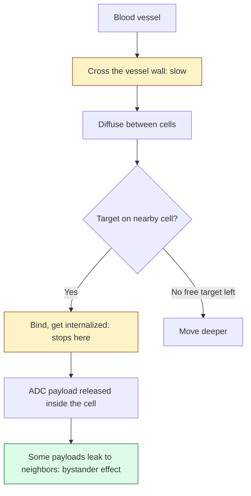

# Antibody penetration into tumors

## In one sentence

Antibody penetration is how far an antibody or antibody-drug conjugate travels from a blood vessel into tumor tissue; it is often uneven because the drug binds the first target-bearing cells it meets.

## The intuition

Hand out flyers at the door of a crowded hall. The people near the door take them all, and the back of the hall gets none, unless you bring far more flyers than the front rows can hold. An antibody leaving a blood vessel meets the same problem: cells next to the vessel capture it before it can move deeper. The analogy breaks because cells also swallow and destroy the antibody they capture, so the front rows keep taking flyers.

## How it works

An antibody is a large protein, about 150 kilodaltons, roughly 300 times the mass of a typical chemotherapy molecule. Four steps decide where it ends up.

1. **Leaving the vessel.** Tumor vessels are leaky but irregular, and pressure inside tumors is high. Crossing the vessel wall is slow and is usually the main bottleneck.
2. **Diffusing through tissue.** Large molecules move slowly between tightly packed cells and through dense [matrix](/wiki/education/concepts/cancer-biology/tumor-microenvironment/extracellular-matrix).
3. **Binding the target.** Each antibody that binds a cell near the vessel is one that goes no further. With a tight-binding antibody and an abundant target, the drug piles up around vessels. This is the **binding-site barrier**.
4. **Being taken up and cleared.** Cells internalize the bound antibody. For an [antibody-drug conjugate (ADC)](/wiki/education/concepts/therapeutics/antibody-based/antibody-drug-conjugate) that is how the payload gets in, and it also removes drug that could have traveled on.

The result depends on the balance between supply and capture. More dose, lower binding strength or fewer targets per cell all push the drug deeper. This is why there is no single penetration distance.

*Capture near the vessel limits reach; a payload that can cross membranes partly makes up for it.*

Two things soften the problem for ADCs. Some payloads, including the deruxtecan payload of trastuzumab deruxtecan and the SN-38 payload of sacituzumab govitecan, can leave the cell that took them up and kill neighbors, called the bystander effect. And in mice, adding unconjugated trastuzumab to trastuzumab emtansine pushed the ADC deeper and improved survival ([Cilliers 2018](https://pubmed.ncbi.nlm.nih.gov/29217763/)).

## Why it matters in cancer

- **Uneven delivery is seen in patients.** Twenty-four patients with head and neck cancer received a fluorescently labeled therapeutic antibody before surgery. Antibody distribution inside the removed tumors was uneven within and between patients, and tumor size was the strongest predictor of how much antibody accumulated ([Lu 2020](https://pubmed.ncbi.nlm.nih.gov/31980465/)).
- **Reach varies widely in animal tumors.** In HER2-positive tumors grown in mice, bound trastuzumab was found up to about 150 µm from vessels in some regions and was absent near other vessels. The pattern did not track with HER2 level, vessel density or blood flow ([Baker 2008](https://pubmed.ncbi.nlm.nih.gov/18381959/)).
- **Whole-body imaging of delivery has early support.** In 10 women with HER2-positive metastatic breast cancer, tumor uptake of radiolabeled trastuzumab on a PET scan was higher in those who then responded to trastuzumab emtansine ([Mortimer 2022](https://pubmed.ncbi.nlm.nih.gov/34857660/)). This is a pilot study.

No measurement on a tissue section, such as the distance from tumor cells to the nearest vessel, has been validated as a predictor of response to an ADC.

## Common confusions

- **"Antibodies only reach 40 µm."** No fixed distance exists. Reach depends on dose, binding strength and target density, and published values span roughly 20 to 150 µm in animal models.
- **A stained vessel is not a working vessel.** Stains such as CD31 mark the vessel lining. They do not show whether blood flows through it or whether drug leaks out of it.
- **High target expression can reduce reach.** More targets per cell means more capture near the vessel. See [target expression versus ADC response](/wiki/education/concepts/therapeutics/antibody-based/target-expression-vs-adc-response).
- **Oxygen and antibodies follow different rules.** Oxygen is tiny and is consumed as it diffuses, giving a limit of roughly 100–200 µm from a vessel. That number says nothing about an antibody.
- **Poor reach is not the same as resistance.** A cell that never saw the drug has not resisted it. Target loss, payload resistance and delivery failure need different evidence.

## How it is measured

Direct measurement means finding the drug itself: a labeled antibody given before surgery and imaged in the removed tissue, or a radiolabeled antibody imaged by PET. Indirect measurements on an ordinary section, such as vessel counts or distances, describe the tissue the drug would have to cross. They are hypotheses about delivery, not measurements of it. [Spatial proximity metrics](/wiki/education/concepts/measurement/proteins-and-spatial/spatial-proximity-metrics) explains how such distances are computed and what limits them.

## In Diana's case

The [review of validated spatial indicators](/wiki/research/reviews/2026-11-validated-spatial-indicators) covers how delivery claims apply to the ADC questions in her care.

## Try it

A report shows that tumor cells in a sample sit a median of 300 µm from the nearest stained vessel and concludes that an ADC "could not have reached them." What is missing?

**Answer:** whether those vessels carried blood; the dose and how tightly the antibody binds; whether the payload spreads to neighbors; whether a thin slice reflects true three-dimensional distance; and any direct measurement of the drug in the tissue.

## Explain it back

"The binding-site barrier means ___, so more target can mean ___." One answer: "antibody is captured by the first target-bearing cells it meets, so more target can mean less reach."

## Takeaway

**Antibodies and ADCs spread unevenly from blood vessels, by an amount that depends on dose, binding and target density, and no section-based distance has been shown to predict whether an ADC will work.**

## Related concepts

- [Antibody-drug conjugates](/wiki/education/concepts/therapeutics/antibody-based/antibody-drug-conjugate)
- [Target expression versus ADC response](/wiki/education/concepts/therapeutics/antibody-based/target-expression-vs-adc-response)
- [ADC payload classes](/wiki/education/concepts/therapeutics/antibody-based/adc-payload-classes)
- [ADC versus radioligand therapy](/wiki/education/concepts/therapeutics/antibody-based/adc-vs-radioligand-therapy)
- [Angiogenesis](/wiki/education/concepts/cancer-biology/tumor-microenvironment/angiogenesis)
- [Hypoxia](/wiki/education/concepts/cancer-biology/tumor-microenvironment/hypoxia)

## Sources and scope

Source-checked November 9, 2026, against PubMed abstracts. Animal and patient evidence are labeled as such. Mechanism teaching, not a treatment recommendation. Expert and learner review pending.

1. [Thurber, Schmidt and Wittrup, Advanced Drug Delivery Reviews 2008](https://pubmed.ncbi.nlm.nih.gov/18541331/) — review of the factors that set antibody penetration.
2. [Baker and colleagues, Clinical Cancer Research 2008](https://pubmed.ncbi.nlm.nih.gov/18381959/) — trastuzumab distribution around vessels in mouse tumors.
3. [Cilliers and colleagues, Cancer Research 2018](https://pubmed.ncbi.nlm.nih.gov/29217763/) — co-dosing unconjugated antibody to improve ADC distribution in mice.
4. [Lu and colleagues, Clinical Cancer Research 2020](https://pubmed.ncbi.nlm.nih.gov/31980465/) — antibody delivery measured in 24 patients' head and neck tumors.
5. [Mortimer and colleagues, Journal of Nuclear Medicine 2022](https://pubmed.ncbi.nlm.nih.gov/34857660/) — trastuzumab PET uptake and response to trastuzumab emtansine, 10 patients.

<!-- BEGIN GENERATED USED IN -->
## Used in

Browse the [concept index](/wiki/education/concepts/index) for related learning paths.
<!-- END GENERATED USED IN -->
