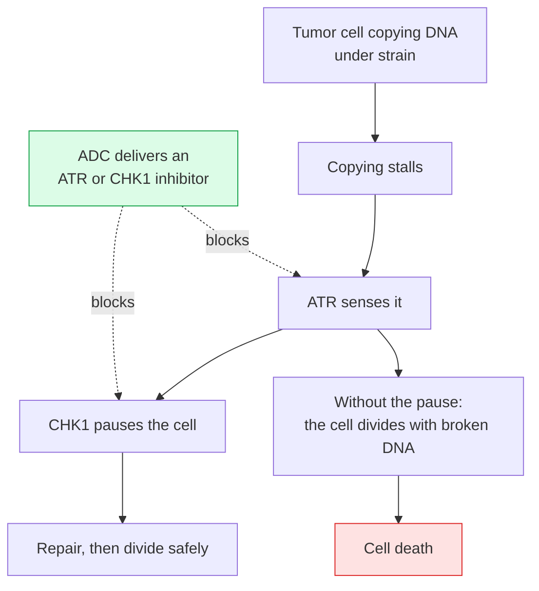

# DNA-damage-response inhibitor payloads

## In one sentence

DNA-damage-response inhibitor payloads are antibody-drug conjugate (ADC) cargoes that block a tumor cell's ability to sense or repair DNA damage, concentrating drugs whose marrow toxicity has limited them as pills.

## The intuition

Classic payloads are hammers: they break something every cell needs. A DNA-damage-response (DDR) inhibitor is more like disabling a building's fire alarm and sprinklers. A healthy building rarely notices. A building that is already full of small fires, as many cancer cells are, burns down. The trouble with giving these drugs as pills is that some healthy tissues, especially the bone marrow, also rely on their alarms. An antibody that delivers the drug mainly to tumor cells tries to switch off the alarms only where the fires are.

## How it works

Cells copy about six billion DNA letters every time they divide, and copying often stalls. A network of DDR enzymes senses the problem, pauses the cell cycle and repairs the damage; see [DNA-damage-response inhibitors](/wiki/education/concepts/therapeutics/targeted-small-molecules/ddr-inhibitors). Three enzymes are now being tried as ADC payloads:

| Payload target | Its normal job | Why tumors may depend on it more | What has limited it as a pill |
|---|---|---|---|
| **ATR** (ataxia telangiectasia and Rad3-related kinase) | Senses stalled DNA copying and pauses the cell | Cancer cells copy DNA under constant strain ([replication stress](/wiki/education/concepts/cancer-biology/genome-instability-and-repair/replication-stress)); cells lacking ATM or functional p53 lose a backup pause | Anemia: in a phase 1 trial of the ATR inhibitor camonsertib in 120 people, it was the most common side effect, grade 3 in 32% [1] |
| **CHK1** (checkpoint kinase 1) | Carries ATR's signal to stop the cell before it divides | Same reliance as ATR, at the last checkpoint before division | Low white-cell counts: in a nine-person triple-negative breast cancer pilot of the CHK1 inhibitor prexasertib, eight had grade 3–4 neutropenia [2] |
| **PARP1** (poly-ADP-ribose polymerase 1) | Marks and helps repair single-strand DNA breaks | Cells with faulty BRCA1/2 or related repair cannot fix the double-strand breaks that follow; see [synthetic lethality](/wiki/education/concepts/therapeutics/how-drugs-work/synthetic-lethality) | Blood-count toxicity, partly attributed to PARP2, which first-generation PARP inhibitors also block [3] |

*Why tumors are the bet: a cell under heavy copying strain and without a working p53 pause depends on ATR and CHK1 more than a healthy cell does.*

**The case for the antibody.** The same drugs given as pills reach the marrow at the same level as the tumor, and the marrow's own fast-dividing cells use these alarms. That limits the dose and, even more, which drugs they can be combined with. Delivering the inhibitor through an antibody aims to raise the level inside tumor cells and lower it everywhere else. Two lines of evidence frame the idea:

- For PARP, one fix came from chemistry rather than delivery: AZD5305, a pill that blocks PARP1 about 500 times more than PARP2, caused little blood-count change in rats at effective exposures [3]. ADC developers are pursuing both levers: selective payloads and targeted delivery.
- Conference reports describe preclinical ADCs with a single DDR payload: a HER2 antibody carrying a CHK1 inhibitor [4], TROP2 antibodies carrying an ATR inhibitor intended for tumors lacking ATM or BRCA1/2 function [5], and a TROP2 antibody carrying a PARP1-selective inhibitor tested in triple-negative breast cancer cell lines [6]. None has human data.

A related design places a DDR inhibitor beside a [TOP1 payload](/wiki/education/concepts/therapeutics/chemotherapy/topoisomerase-i-inhibitors) on the same antibody; see [dual-payload ADC](/wiki/education/concepts/therapeutics/antibody-based/dual-payload-adc).

## Why it matters in cancer

- Triple-negative breast cancers often lack working p53 and are under replication stress, which is the biological reason they are a natural testing ground for ATR and CHK1 strategies. This is a rationale, not a validated selection test.
- **A single DDR payload removes reliance on TOP1.** If a cancer resists TOP1 payloads, an ADC whose only cargo is an ATR inhibitor does not share that resistance. The cost is narrower use: it is likely to work only in tumors with the right repair defect.
- These payloads are the clearest example of an ADC used to **widen the therapeutic window** of a drug that works but cannot be dosed well; see [therapeutic index](/wiki/education/concepts/therapeutics/how-drugs-work/therapeutic-index).

## Common confusions

- **A DDR payload is not a classic poison.** It harms cells that depend on the blocked pathway and spares many that do not; potency is usually far lower than an ADC toxin's, so more drug must reach each cell.
- **A repair defect on a report is not proof of dependence.** An old mutation can be reversed, and a tumor can reroute repair. Current function needs testing.
- **The same target can be blocked by a pill.** The ADC's claim is a better window, which needs to be shown against the pill or the pill-plus-ADC combination.
- **Preclinical selectivity is not human safety.** Rats and mice do not predict every marrow effect in people.

## What could break the bet

- **Too little drug per cell.** Less potent payloads need more copies per antibody or more drug inside each cell, and higher loading can shorten the ADC's time in blood; see [ADC conjugation chemistry](/wiki/education/concepts/therapeutics/antibody-based/adc-conjugation-chemistry).
- **The defect is missing.** Without replication stress or a repair defect, the payload may have little to act on.
- **Bystander reach is uncertain.** Whether the released inhibitor reaches neighboring target-negative cells depends on how easily it crosses membranes.
- **Marrow exposure persists.** Some payload is released outside the tumor, and the marrow can still be the dose-limiting organ.

## How it is measured

Laboratory work compares repair-deficient and repair-proficient cell lines, and the intact ADC with the free inhibitor. Markers of blocked signaling, such as reduced CHK1 phosphorylation or high levels of the DNA-break marker γH2AX, show the payload hit its target. In people, the questions will be whether blood counts stay acceptable at doses that hit the target, and whether responses concentrate in tumors with the predicted defect.

## In Diana's case

How this applies to her is owned by the [drug-panel preferences](/wiki/diagnostics/drug-panel-preferences) page.

## Related concepts

- [DNA-damage-response inhibitors](/wiki/education/concepts/therapeutics/targeted-small-molecules/ddr-inhibitors)
- [Synthetic lethality](/wiki/education/concepts/therapeutics/how-drugs-work/synthetic-lethality)
- [Replication stress](/wiki/education/concepts/cancer-biology/genome-instability-and-repair/replication-stress)
- [Dual-payload ADC](/wiki/education/concepts/therapeutics/antibody-based/dual-payload-adc)
- [ADC payload classes](/wiki/education/concepts/therapeutics/antibody-based/adc-payload-classes)
- [Therapeutic index](/wiki/education/concepts/therapeutics/how-drugs-work/therapeutic-index)
- [Read a new payload strategy](/wiki/education/guides/aiming-a-drug-at-a-surface-target/05-read-a-new-payload-strategy)

## Sources and scope

Source check: November 7, 2026. Established DDR biology, clinical toxicity of DDR inhibitors given as pills, and preclinical conference reports of DDR-payload ADCs; no human efficacy or safety data exist for a DDR-payload ADC. Expert and learner review remain pending.

1. [Yap et al., 2023](https://pubmed.ncbi.nlm.nih.gov/37277454/) — phase 1 trial of the ATR inhibitor camonsertib in 120 patients; anemia was the most common drug-related toxicity (32% grade 3).
2. [Gatti-Mays et al., 2020](https://pubmed.ncbi.nlm.nih.gov/32510664/) — prexasertib pilot in nine people with BRCA-wild-type advanced triple-negative breast cancer.
3. [Illuzzi et al., 2022](https://pubmed.ncbi.nlm.nih.gov/35929986/) — AZD5305 is about 500-fold selective for PARP1 over PARP2, with minimal blood effects in rats; PARP2 is implicated in blood-cell survival in animal models.
4. [AACR 2026 abstract 1714](https://doi.org/10.1158/1538-7445.am2026-1714) — a trastuzumab-based ADC carrying a CHK1 inhibitor; preclinical.
5. [AACR-NCI-EORTC 2026 abstract A003](https://doi.org/10.1158/1557-3265.d32026-a003) — TROP2 ADCs with an ATR inhibitor as the sole payload, intended for ATM- or BRCA1/2-deficient tumors; preclinical.
6. [AACR 2025 abstract 5467](https://doi.org/10.1158/1538-7445.am2025-5467) — a TROP2 antibody conjugated to a PARP1-selective inhibitor in triple-negative breast cancer cell lines and a xenograft; preclinical.

<!-- BEGIN GENERATED USED IN -->
## Used in

- [Read a new payload strategy](/wiki/education/guides/aiming-a-drug-at-a-surface-target/05-read-a-new-payload-strategy)
- [Aiming a drug at a surface target](/wiki/education/guides/aiming-a-drug-at-a-surface-target/index)
<!-- END GENERATED USED IN -->
