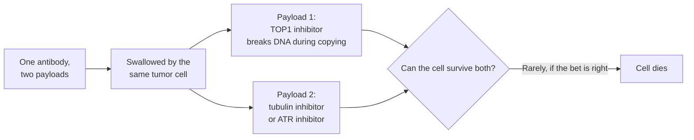

# Dual-payload ADC

## In one sentence

A dual-payload ADC carries two different drugs on one antibody, betting that a tumor cell is far less likely to survive two mechanisms delivered together than either one alone.

## The intuition

A burglar who can pick one kind of lock is stopped by a door with two different locks. A cancer cell that has learned to pump out one drug, or to repair one kind of damage, still has to beat a second, unrelated attack arriving at the same moment. The analogy breaks in one place: the second lock also makes the door heavier. Every extra drug adds its own side effects.

## How it works

An [antibody-drug conjugate (ADC)](/wiki/education/concepts/therapeutics/antibody-based/antibody-drug-conjugate) normally carries many copies of one payload. A dual-payload ADC attaches two payload types to the same antibody, each at a set number of copies. One design route uses chemically distinct attachment sites so the ratio is the same on every molecule; see [ADC conjugation chemistry](/wiki/education/concepts/therapeutics/antibody-based/adc-conjugation-chemistry).

Designs make one of two biological bets:

| Bet | Typical pairing | Biology behind it | Which failure it targets |
|---|---|---|---|
| **Independent kill routes** | A [topoisomerase I (TOP1) inhibitor](/wiki/education/concepts/therapeutics/chemotherapy/topoisomerase-i-inhibitors) with a microtubule inhibitor such as MMAE | The two drugs kill by unrelated routes: broken DNA during copying versus a blocked division spindle. A cell resistant to one is usually still sensitive to the other, and cells in different states (copying DNA, dividing) are each hit by one of them. | **Payload failure**, and mixed tumors where different cells resist different drugs |
| **Designed synergy** | A TOP1 inhibitor with an inhibitor of the DNA-damage response, such as ATR | TOP1 payloads stall DNA copying. ATR is the alarm that senses stalled copying, pauses the cell and protects the stalled site so it can be repaired. Blocking ATR at the same time leaves the cell to carry on copying broken DNA, which kills it. | **Cell-response failure**: cells that survive by repairing TOP1 damage |

*Both drugs reach the same cell at the same moment and at a fixed ratio. That is the difference from giving two drugs separately.*

**Why put both drugs on one antibody instead of giving two drugs?** Three reasons follow from the biology:

1. **Same cell.** Two separate ADCs reach different cells unevenly. In mice with breast tumors that mixed high- and low-HER2 cells, a HER2 ADC carrying two payloads worked better and prolonged survival more than the same two payloads given together on two separate ADCs [1]. Both payloads in that study were tubulin drugs (MMAE and MMAF) that differ in how far they spread, so it tests same-cell delivery, not the TOP1-plus-tubulin pairing.
2. **Same time.** Synergy between DNA damage and a blocked damage alarm depends on timing: the alarm must be off while the damage is happening.
3. **Lower doses elsewhere.** DNA-damage-response inhibitors given as pills with chemotherapy have been limited by blood-count toxicity. Delivering the chemotherapy through an antibody is one way around that. A phase 1 trial combined the TOP1 ADC sacituzumab govitecan with the ATR inhibitor berzosertib in 12 people and found no dose-limiting toxicities, which the authors contrasted with earlier chemotherapy combinations [2]. That trial gave the ATR inhibitor separately; a dual-payload ADC takes the next step of putting both on one antibody.

The synergy itself is well established in cells. In a screen of nearly 7,000 genes, losing ATR was among the top ways to make cells more sensitive to a TOP1 inhibitor; an ATR inhibitor reproduced the effect [3]. A TROP2 antibody carrying the TOP1 payload exatecan was likewise synergistic with ATR inhibitors in pancreatic cancer cells [4].

## Why it matters in cancer

- Every ADC approved for triple-negative breast cancer carries a TOP1 payload, and resistance to one TOP1 ADC can carry over to the next; see [cross-resistance between ADCs](/wiki/education/concepts/therapeutics/antibody-based/adc-cross-resistance). A second payload class on the same antibody is one direct answer to that problem.
- [Tumor heterogeneity](/wiki/education/concepts/cancer-biology/what-cancer-is/tumor-heterogeneity) means one tumor can hold cells that resist in different ways. Two mechanisms raise the odds that each cell meets a drug it cannot handle.
- No dual-payload ADC is approved [5]. First trials in people are registered, for example IBI3028, a dual-payload conjugate on an antibody aimed at both EGFR and c-MET, in a phase 1 trial in advanced solid tumors [6]. No efficacy results in breast cancer have been published.

## Common confusions

- **A dual-payload ADC is not a combination regimen.** In a combination, each drug's dose can be changed separately. Here the ratio is fixed when the drug is made, so if one payload causes the dose-limiting side effect, the other comes down with it.
- **Two payloads are not automatically twice as good.** The two drugs differ in potency; the more potent one can set the dose and leave the other below the level where it helps.
- **A dual-payload ADC is not a bispecific ADC.** A [bispecific ADC](/wiki/education/concepts/therapeutics/antibody-based/bispecific-adc) has two targets and usually one payload; a dual-payload ADC has two payloads and usually one target. Some products combine both.
- **Better results in mice do not show the second drug helps people.** Proving it requires comparing against the same antibody with one payload.

## What could break the bet

- **Toxicity adds up.** A TOP1 payload brings low blood counts and diarrhea; MMAE brings nerve damage; ATR inhibitors lower blood counts on their own. See [ADC payload toxicities](/wiki/education/concepts/therapeutics/toxicities-and-supportive-care/adc-payload-toxicity).
- **The ratio may be wrong for most tumors.** The best ratio of the two drugs is a guess made at manufacture, and the ratio reaching a tumor can change if one payload falls off the antibody faster.
- **Measuring is harder.** Developers must track the antibody, two free payloads and more possible immune reactions against the drug [5].
- **The shared step still fails.** If the cancer stops displaying the target, or stops taking the antibody in, both payloads fail together.

## How it is measured

The decisive test is a comparison against the matching single-payload ADC, in the laboratory and then in people: a dual-payload ADC should kill cells, or control tumors, that the single-payload version cannot. In trials, the key questions are responses in people whose cancer already grew on a TOP1 ADC, and whether the dose of each payload stays effective once side effects are accounted for.

## In Diana's case

How this applies to her is owned by the [drug-panel preferences](/wiki/diagnostics/drug-panel-preferences) page.

## Related concepts

- [ADC payload classes](/wiki/education/concepts/therapeutics/antibody-based/adc-payload-classes)
- [DNA-damage-response inhibitor payloads](/wiki/education/concepts/therapeutics/antibody-based/ddr-inhibitor-payloads)
- [Next-generation TOP1 payloads](/wiki/education/concepts/therapeutics/antibody-based/next-generation-top1-payloads)
- [DNA-damage-response inhibitors](/wiki/education/concepts/therapeutics/targeted-small-molecules/ddr-inhibitors)
- [Synthetic lethality](/wiki/education/concepts/therapeutics/how-drugs-work/synthetic-lethality)
- [Replication stress](/wiki/education/concepts/cancer-biology/genome-instability-and-repair/replication-stress)
- [Read a new payload strategy](/wiki/education/guides/aiming-a-drug-at-a-surface-target/05-read-a-new-payload-strategy)

## Sources and scope

Source check: November 7, 2026. Mechanism, laboratory evidence and early trial registrations; no dual-payload ADC has human efficacy results in breast cancer. Expert and learner review remain pending. For the drug-development landscape, see [the plain-language payload summary](/wiki/research/reviews/2026-11-new-adc-payloads-short-version).

1. [Yamazaki et al., 2021](https://pubmed.ncbi.nlm.nih.gov/34112795/) — a HER2 ADC carrying MMAE and MMAF outperformed co-administration of two single-payload ADCs in mouse models of HER2-heterogeneous, drug-resistant breast cancer.
2. [Abel et al., 2023](https://pubmed.ncbi.nlm.nih.gov/37227187/) — phase 1 trial of sacituzumab govitecan with the ATR inhibitor berzosertib in 12 patients; no dose-limiting toxicities.
3. [Jossé et al., 2014](https://pubmed.ncbi.nlm.nih.gov/25269479/) — a gene-silencing screen of nearly 7,000 genes identified ATR loss as synthetic lethal with camptothecin; ATR inhibitors sensitized cells to TOP1 inhibitors.
4. [Li et al., 2025](https://pubmed.ncbi.nlm.nih.gov/39874630/) — a TROP2 ADC carrying exatecan was synergistic with ATR inhibitors in pancreatic cancer cells; the ADC alone was active in xenografts.
5. [Ravenstijn et al., 2026](https://pubmed.ncbi.nlm.nih.gov/42089685/) — clinical pharmacology of dual-payload ADCs; none approved.
6. [ClinicalTrials.gov: IBI3028 phase 1](https://clinicaltrials.gov/study/NCT07589205) — an EGFR and c-MET bispecific dual-payload conjugate in advanced solid tumors; recruiting, checked November 7, 2026.

<!-- BEGIN GENERATED USED IN -->
## Used in

- [Read a new payload strategy](/wiki/education/guides/aiming-a-drug-at-a-surface-target/05-read-a-new-payload-strategy)
- [Aiming a drug at a surface target](/wiki/education/guides/aiming-a-drug-at-a-surface-target/index)
<!-- END GENERATED USED IN -->
