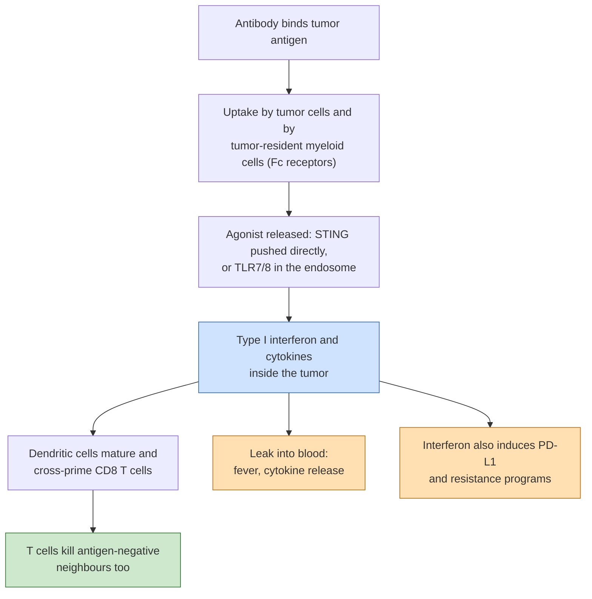

# Immune-stimulating antibody conjugates (ISACs)

## In one sentence

An immune-stimulating antibody conjugate carries an innate-immune alarm signal instead of a cell poison, so that the antibody sets off inflammation inside the tumor and recruits an immune attack rather than killing the cell directly.

## The intuition

Most [antibody-drug conjugates (ADCs)](/wiki/education/concepts/therapeutics/antibody-based/antibody-drug-conjugate) are delivery vans carrying poison. An immune-stimulating antibody conjugate (ISAC) is a van carrying a fire alarm. The point is not to kill the cells it reaches; it is to make the immune system treat that patch of tissue as an emergency, so that cells which the antibody never touched are attacked by T cells.

The analogy breaks in two places. An alarm that can be heard outside the building is dangerous: an immune alarm released into the bloodstream causes fever, low blood pressure and inflammation everywhere. And an alarm that rings constantly stops being informative — repeated or prolonged interferon signaling has its own costs, described below.

## How it works

Innate immunity has built-in sensors for molecules that should not be where they are found. Two families are used as payloads.

- **Cytosolic DNA sensing.** DNA belongs in the nucleus. When DNA appears in the cytoplasm — from a virus, from damaged mitochondria, or from a damaged nucleus — the enzyme cGAS detects it and makes a small signaling molecule, cGAMP. That molecule switches on STING (stimulator of interferon genes), an adaptor on the endoplasmic reticulum, which drives production of **type I interferon** and other inflammatory signals [1]. See [cGAS-STING](/wiki/education/concepts/immunology/innate-and-unconventional-cells/cgas-sting). A STING-agonist payload is a synthetic molecule that pushes this switch without any DNA being present.
- **Endosomal nucleic-acid sensing.** Toll-like receptors 7 and 8 (TLR7, TLR8) sit inside the endosomes of myeloid cells — macrophages, monocytes and [dendritic cells](/wiki/education/concepts/immunology/innate-and-unconventional-cells/dendritic-cells) — where they normally detect viral RNA. Small-molecule TLR7 or TLR7/8 agonists imitate that signal [2]. See [pattern recognition, DAMPs and PAMPs](/wiki/education/concepts/immunology/innate-and-unconventional-cells/pattern-recognition-damps-and-pamps).

Either signal produces [type I interferon](/wiki/education/concepts/immunology/the-immune-system/interferons) and inflammatory cytokines in the tumor. That local interferon matures dendritic cells, which pick up tumor proteins from dying cells and present them to CD8 T cells through [cross-presentation](/wiki/education/concepts/immunology/antigen-presentation/cross-presentation) — the step called cross-priming. New T-cell clones are then primed against antigens nobody had to identify in advance, which is the mechanism by which an [immunologically cold tumor](/wiki/education/concepts/immunology/tumor-immunology/hot-excluded-cold-tumor) could become hot.

**Why delivery by an antibody.** Given on their own, innate agonists activate immune cells everywhere, so the dose that inflames the tumor also inflames the patient. Attaching the agonist to a tumor-binding antibody is meant to keep the alarm inside the tumor in two ways: the antibody concentrates in antigen-expressing tissue, and the whole conjugate is taken up by tumor-resident myeloid cells through Fc-gamma receptor-dependent phagocytosis, so the agonist is released where myeloid cells and tumor cells sit together. Conjugates built this way activated myeloid cells **only** in the presence of antigen-expressing cancer cells in laboratory assays, and shrank tumors in mice at low doses [2]. One HER2-directed STING-agonist ADC acted on both cancer cells and tumor-resident immune cells, and produced less systemic inflammation than a free STING agonist in the same models [3].

*The bet is that the alarm stays local (blue to green). The two amber boxes are the ways the bet has failed so far.*

**Why some designs add a TOP1 payload.** [Topoisomerase I (TOP1) inhibitor](/wiki/education/concepts/therapeutics/chemotherapy/topoisomerase-i-inhibitors) damage is itself a cGAS-STING stimulus: trastuzumab deruxtecan activated the cGAS-STING-interferon axis inside HER2-positive gastric cancer cells, matured dendritic cells and increased killing by CD8 T cells in laboratory work [4]. Pairing a cell-killing payload with an innate agonist is meant to supply both halves of the reaction — dying cells release antigen and DNA, and the agonist guarantees the alarm — which is one rationale for [dual-payload ADCs](/wiki/education/concepts/therapeutics/antibody-based/dual-payload-adc).

## Why it matters in cancer: which failure it addresses

In the three-level frame used on [cross-resistance between ADCs](/wiki/education/concepts/therapeutics/antibody-based/adc-cross-resistance), an ISAC attacks the **cell-response** level, and from outside the cancer cell. A cell that pumps out chemotherapy, repairs DNA well or has raised its threshold for death has not, by those changes, protected itself against a T cell. The approach is also indifferent to whether every cell carries the target, because the killing is done by immune cells recruited to the area.

## What could break the bet

- **Systemic cytokine toxicity.** In the first-in-human study of a HER2-directed TLR7 conjugate, 18 patients received single escalating doses; cytokine release syndrome was a common but manageable drug-related event, while anti-drug antibodies and neuroinflammation at higher doses were reported as significant clinical challenges [5].
- **Local does not stay local.** Any payload that leaves the tumor acts on immune cells elsewhere, which caps the dose — the same therapeutic-window problem described for [ADC payload toxicity](/wiki/education/concepts/therapeutics/toxicities-and-supportive-care/adc-payload-toxicity) and [therapeutic index](/wiki/education/concepts/therapeutics/how-drugs-work/therapeutic-index), but with [cytokine release syndrome](/wiki/education/concepts/therapeutics/toxicities-and-supportive-care/cytokine-release-syndrome) rather than marrow damage as the limit.
- **Interferon cuts both ways.** Interferon signaling also induces [PD-L1 (programmed death-ligand 1)](/wiki/education/concepts/measurement/pathology-readouts/pd-l1-scoring) — it rose after the TOP1 ADC in the gastric work above [4] — and sustained tumor interferon signaling, driven chiefly by interferon-gamma (type II) and maintained by both types, sets up a multigenic program of resistance to checkpoint blockade [6]. An alarm can therefore recruit T cells and, at the same time, teach the tumor to switch them off. This is the mechanism behind [adaptive immune resistance](/wiki/education/concepts/immunology/tumor-immunology/adaptive-immune-resistance).
- **Tolerance and exhaustion.** Innate pathways are built to fire briefly. Repeated stimulation risks desensitized myeloid cells and [T-cell exhaustion](/wiki/education/concepts/immunology/t-cells/t-cell-exhaustion) rather than durable priming; translating STING agonism into the clinic has been limited by exactly these biological and delivery problems [7].
- **No T cells to prime.** Cross-priming needs antigen, functioning antigen presentation and T cells able to enter the tumor. Where antigen presentation is lost, the alarm has no audience.

## Evidence so far, graded honestly

| Rung | What has been shown | What it does not show |
|---|---|---|
| Laboratory and animal | Antigen-dependent myeloid activation; tumor regression in mice at low doses; less systemic inflammation than a free agonist; benefit when combined with anti-PD-1 and with HER2 therapies [3] | That the window holds in humans, or that mouse innate immunity predicts human innate immunity |
| Phase 1 | Payload delivery into target-expressing tumors and induction of type I interferon responses in patients, with cytokine release syndrome, anti-drug antibodies and neuroinflammation as limits (18 patients, dose escalation) [5] | Any response rate, in any tumor type |
| Randomized | None identified | — |

Programs that reached patients have mostly stopped. The trial registry check behind this page found: the HER2-directed STING-agonist ADC trial terminated after 57 participants, reason given as development discontinued; a STING-agonist conjugate aimed at a myeloid-cell receptor (CCR2) rather than a tumor antigen, terminated after 61 participants for clinical futility; both trials of a HER2-directed TLR7/8 conjugate terminated by sponsor decision; and a HER2-directed myeloid-agonist conjugate's combination trial terminated for strategic realignment, with its first-in-human trial last updated in 2022 and its status unknown [8]. **No efficacy result in triple-negative breast cancer has been reported for any ISAC.** Nothing in this record says the biology is wrong; it says no design has yet found a dose that is both safe and active.

## What evidence would settle it

A dose that raises interferon-stimulated genes and T-cell infiltration in paired tumor biopsies without raising blood cytokines to a toxic level, followed by a randomized comparison against the same antibody carrying a conventional payload. Without the paired biopsies, a negative trial cannot distinguish "the alarm never rang in the tumor" from "it rang and did not matter".

## Common confusions

- **An ISAC is not an ADC with an immune side effect.** Conventional ADCs can provoke [immunogenic cell death](/wiki/education/concepts/cancer-biology/cell-death-and-survival/immunogenic-cell-death) as a by-product. In an ISAC the immune signal is the intended payload, and the antibody may not need to kill anything.
- **Not a T-cell engager.** A [T-cell engager](/wiki/education/concepts/therapeutics/antibody-based/t-cell-engager) drags existing T cells onto a tumor cell. An ISAC asks the innate system to prime new T cells; the loop is slower and depends on antigen presentation.
- **Cold is not one problem.** A tumor can lack T cells because none were primed, because they cannot enter, or because they are suppressed once inside. An innate agonist addresses the first; the hot-excluded-cold distinction says which tumors it could help.
- **"Well tolerated in animals" is not a human claim.** Rodent and human innate receptors differ in expression and sensitivity, and the toxicity that ended several programs appeared only in people.

## In Diana's case

How this applies to her is owned by the [drug-panel preferences](/wiki/diagnostics/drug-panel-preferences) page.

## Related concepts

- [ADC payload classes](/wiki/education/concepts/therapeutics/antibody-based/adc-payload-classes)
- [Dual-payload ADCs](/wiki/education/concepts/therapeutics/antibody-based/dual-payload-adc)
- [cGAS-STING](/wiki/education/concepts/immunology/innate-and-unconventional-cells/cgas-sting)
- [Interferons](/wiki/education/concepts/immunology/the-immune-system/interferons)
- [Cross-presentation](/wiki/education/concepts/immunology/antigen-presentation/cross-presentation)
- [Hot, excluded and cold tumors](/wiki/education/concepts/immunology/tumor-immunology/hot-excluded-cold-tumor)
- [Adaptive immune resistance](/wiki/education/concepts/immunology/tumor-immunology/adaptive-immune-resistance)
- [In-situ vaccination](/wiki/education/concepts/immunology/tumor-immunology/in-situ-vaccination)
- [Cytokine release syndrome](/wiki/education/concepts/therapeutics/toxicities-and-supportive-care/cytokine-release-syndrome)
- [Tumor-associated macrophages](/wiki/education/concepts/cancer-biology/tumor-microenvironment/tumor-associated-macrophages)

## Sources and scope

Source check: November 7, 2026. Mechanism from reviews and primary preclinical reports; clinical statements from one published phase 1 study and from trial registry records. No randomized evidence and no breast cancer efficacy data exist for this class.

1. [Decout et al., 2021](https://pubmed.ncbi.nlm.nih.gov/33833439/) — review of the cGAS-STING pathway: cytosolic DNA sensing, cGAMP, STING and interferon induction.
2. [Chernyak et al., 2024](https://pubmed.ncbi.nlm.nih.gov/39235949/) — TLR7 and TLR7/8 agonist antibody conjugates; mechanism via tumor antigen recognition, Fc-gamma-receptor-dependent phagocytosis and myeloid activation only in the presence of antigen-expressing cancer cells; low drug-to-antibody ratio designs; tumor reduction in mice at low doses.
3. [Bukhalid et al., 2025](https://pubmed.ncbi.nlm.nih.gov/40029253/) — HER2-directed STING-agonist ADC acting on cancer cells and tumor-resident immune cells, with superior efficacy and reduced systemic inflammation versus a free STING agonist in preclinical models.
4. [Oh et al., 2024](https://pubmed.ncbi.nlm.nih.gov/39449023/) — a TOP1-payload ADC activates the cGAS-STING-interferon axis in cancer cells, matures dendritic cells, increases CD8 T-cell killing, and increases PD-L1.
5. [Janku et al., 2022](https://pubmed.ncbi.nlm.nih.gov/36129967/) — preclinical characterization and phase 1 study of an anti-HER2-TLR7 immune-stimulator antibody conjugate: 18 patients, payload delivery and type I interferon induction, cytokine release syndrome, anti-drug antibodies and neuroinflammation.
6. [Benci et al., 2016](https://pubmed.ncbi.nlm.nih.gov/27912061/) — sustained tumor interferon signaling regulates a multigenic resistance program to checkpoint blockade.
7. [Gehrcken et al., 2025](https://pubmed.ncbi.nlm.nih.gov/40145387/) — review of STING agonists: cold tumor rationale, and the biological and physical obstacles to clinical translation.
8. ClinicalTrials.gov records for the ISAC programs named in the text, read through the registry application programming interface: [XMT-2056](https://clinicaltrials.gov/study/NCT05514717), [TAK-500](https://clinicaltrials.gov/study/NCT05070247), [BDC-1001 single agent](https://clinicaltrials.gov/study/NCT04278144), [BDC-1001 in breast cancer](https://clinicaltrials.gov/study/NCT05954143), [SBT6050 combination](https://clinicaltrials.gov/study/NCT05091528), [SBT6050 first-in-human](https://clinicaltrials.gov/study/NCT04460456).

<!-- BEGIN GENERATED USED IN -->
## Used in

- [Read a new payload strategy](/wiki/education/guides/aiming-a-drug-at-a-surface-target/05-read-a-new-payload-strategy)
- [Aiming a drug at a surface target](/wiki/education/guides/aiming-a-drug-at-a-surface-target/index)
<!-- END GENERATED USED IN -->
