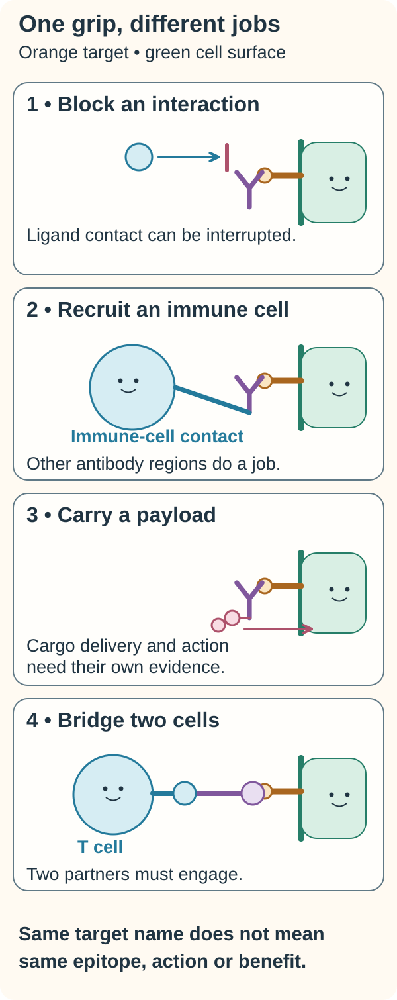

# Monoclonal antibodies: recognition with a defined design

## In one sentence

Monoclonal antibodies are laboratory-made proteins based on a defined antibody design that recognizes selected molecular features.

## The intuition

Imagine making many copies of a tool with the same gripping end. Each copy is designed to catch the same feature. That gives a more defined recognition pattern than a mixture of different tools. The analogy stops at the grip: catching something does not tell us what the tool does next.

**Before you start:** [Antibody structure](/wiki/education/concepts/immunology/antibodies-and-b-cells/antibody-structure) explains recognition regions and other functional parts. [Antigens and epitopes](/wiki/education/concepts/immunology/antigen-presentation/antigen-and-epitope) explain the target and the particular feature recognized.

## How it works

*A recognition grip can connect to different jobs. Blocking an interaction, recruiting an immune cell, carrying cargo and bridging cells require different contacts and evidence. These are examples of formats, not one interchangeable product or a benefit ranking.*

The companion [target and format comparison](/wiki/education/concepts/therapeutics/antibody-based/target-vs-chassis) covers the related shared concept.

**Read the picture:** Which scene requires a second cell to contact another antibody region, and which uses a bridge with two recognition partners?

**Answer:** Recruitment uses an immune-cell contact with another antibody region; the bridging example engages both cell partners. Binding alone proves neither action.

**Visual source scope:** [NCI: monoclonal antibodies](https://www.cancer.gov/about-cancer/treatment/types/immunotherapy/monoclonal-antibodies) and [targeted therapies](https://www.cancer.gov/about-cancer/treatment/types/targeted-therapies) distinguish recognition from later actions.

The word *monoclonal* refers to a defined antibody lineage or design. A therapeutic batch contains many molecules made from that design. Manufacturing can still produce molecular variations, so identity and quality need testing. It does not mean that every molecule in a vial is physically identical in every detail.

A conventional antibody recognizes one epitope. Engineering can combine recognition regions into a product that binds different partners. An antibody may recognize a cell-surface target or a soluble molecule. Recognition can support several different [mechanisms of action](/wiki/education/concepts/therapeutics/how-drugs-work/drug-target-and-mechanism):

| Job | What needs to happen beyond binding |
|---|---|
| Block a signal | Binding must disrupt a relevant interaction or receptor function. |
| Recruit immune effectors | Other antibody regions and available immune cells must support the intended response. |
| Carry a payload | The attachment, distribution and payload action must work in the finished product. |
| Bring two cells together | Both partners must be engaged in a geometry that supports the intended cellular response. |

[Immune-checkpoint inhibitors](/wiki/education/concepts/therapeutics/immunotherapy/immune-checkpoint-inhibitor), [antibody–drug conjugates](/wiki/education/concepts/therapeutics/antibody-based/antibody-drug-conjugate) and [T-cell engagers](/wiki/education/concepts/therapeutics/antibody-based/t-cell-engager) therefore require different follow-through tests. [NCI's overview](https://www.cancer.gov/about-cancer/treatment/types/immunotherapy/monoclonal-antibodies) illustrates these distinct antibody uses.

## Why it matters in cancer

An antibody can recognize a cancer-associated target without recognizing cancer exclusively. Target expression in healthy tissue, access to the tumor and the tumor's dependence on the affected process all matter.

For a concrete mechanism example, trastuzumab binds the extracellular region of [HER2, human epidermal growth factor receptor 2](/wiki/education/concepts/breast-cancer/receptors-and-subtypes/her2). Its June 2024 label describes inhibition of proliferation in cell and animal models, plus antibody-dependent cellular cytotoxicity in vitro. Those experiments explain mechanisms; they do not by themselves establish benefit in every HER2-expressing tumor. [The label separates mechanism from clinical studies](https://www.accessdata.fda.gov/drugsatfda_docs/label/2024/103792s5354lbl.pdf).

## How it is measured

Ask which part of the claim was tested. [Binding affinity](/wiki/education/concepts/biology-basics/molecules/enzymes-and-binding) describes an interaction under specified conditions. A cell assay may measure signal blockade or cell death. A [potency assay](/wiki/education/concepts/engineering-and-manufacturing/cmc-and-quality/potency-assays) measures a defined biological activity against a reference. Protein concentration may be reported in milligrams per milliliter; activity uses assay-specific units or a relative percentage. These are different quantities.

Identity, purity, aggregation and stability tests address product quality. They support consistent manufacture, rather than replacing clinical evidence. [FDA's Q6B guidance](https://www.fda.gov/media/71510/download) separates protein quantity, biological activity and quality characterization.

## Common confusions

- **Monoclonal does not mean patient-specific.** The same design can be manufactured for many patients.
- **An antibody is not automatically an immune stimulant.** Its mechanism depends on the target, structure and engineering.
- **Human or humanized does not mean harmless.** Product-specific adverse effects and infusion reactions remain possible.
- **Binding does not prove blocking, killing or benefit.** Each claim needs its own evidence.

## Try it

**Fictional example:** Two antibodies bind the same receptor in a purified-protein test. Only one reduces signaling in a cell assay. Can we call both receptor-blocking treatments?

**Answer:** No. Both have binding evidence. Only one has evidence of signal reduction in that cell assay. Neither result alone establishes patient benefit, safety or the best treatment.

## Explain it back

“A defined antibody design tells me what it recognizes. To explain its effect, I also need ______.”

One possible answer: “its functional parts, the relevant target biology, and evidence that the intended action occurs.”

## Takeaway

**A monoclonal antibody is a recognition design; its finished structure and tested mechanism determine what follows recognition.**

## Related concepts

- [Binder profiles](/wiki/education/concepts/engineering-and-manufacturing/binders/affinity-epitope-and-developability)
- [Antibody-guided effector mechanisms](/wiki/education/concepts/immunology/antibodies-and-b-cells/adcc-adcp-cdc)
- [On-target, off-tumor toxicity](/wiki/education/concepts/therapeutics/toxicities-and-supportive-care/on-target-off-tumor-toxicity)

## Sources and scope

Source-checked October 10, 2026. Expert and learner review remain pending. This page explains a category; it is not an approval inventory or treatment recommendation.

1. [National Cancer Institute: Monoclonal antibodies](https://www.cancer.gov/about-cancer/treatment/types/immunotherapy/monoclonal-antibodies). Substantive public overview checked for recognition, distinct mechanisms and product-dependent adverse effects.
2. [FDA: Herceptin prescribing information, June 2024](https://www.accessdata.fda.gov/drugsatfda_docs/label/2024/103792s5354lbl.pdf). Sections 11 and 12.1 checked for the named mechanism example, including its preclinical scope.
3. [FDA: Q6B specifications for biotechnological/biological products, August 1999](https://www.fda.gov/media/71510/download). Characterization and biological-activity sections checked; guidance on quality specifications, not standalone proof of efficacy.

<!-- BEGIN GENERATED USED IN -->
## Used in

- [Separate the address from the killing mechanism](/wiki/education/targeted-therapy-modalities/01-mechanism)
<!-- END GENERATED USED IN -->
