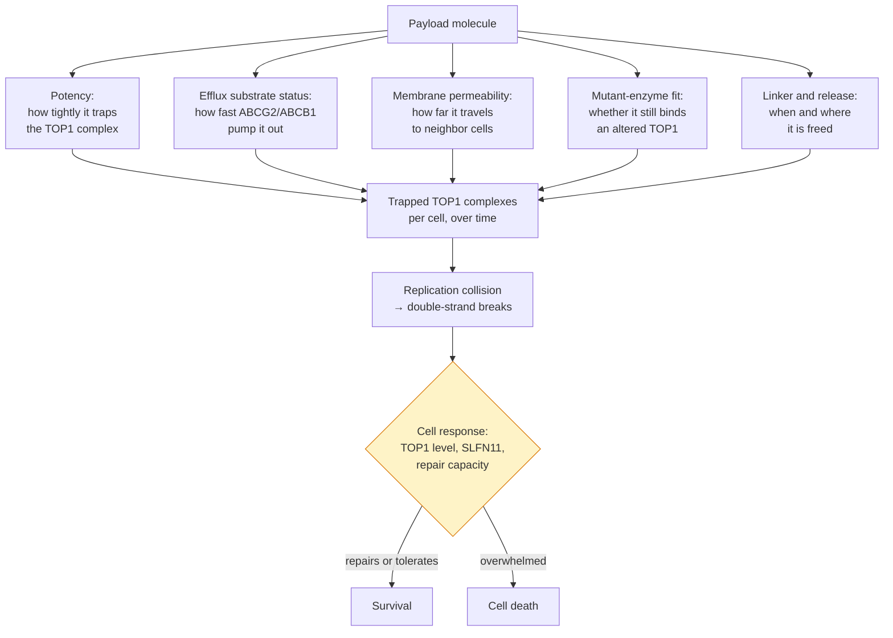

# Next-generation TOP1 payloads

## In one sentence

Next-generation topoisomerase I payloads keep the same killing mechanism as today's ADC drugs but are redesigned for higher potency, poorer handling by efflux pumps, tuned permeability and cleaner release, so the payload works where the first one failed.

## The intuition

If a key stops turning in a lock, you can try a different door or file a better key. Every [antibody-drug conjugate (ADC)](/wiki/education/concepts/therapeutics/antibody-based/antibody-drug-conjugate) approved for triple-negative breast cancer carries the same kind of key: a [topoisomerase I (TOP1) inhibitor](/wiki/education/concepts/therapeutics/chemotherapy/topoisomerase-i-inhibitors). Switching payload class is the different door; this page is the better key, because the ways the old one fails are now known in chemical terms. The analogy breaks because a filed key cannot also become more dangerous to the locksmith, and a stronger payload usually can.

## How it works

### What the payload does to the cell

TOP1 nicks one DNA strand and holds the cut open so built-up twist can spin out, then reseals it. A camptothecin-class payload wedges into that enzyme–DNA *cleavage complex* and slows resealing, so the trapped complex persists. When a replication fork collides with it, the single-strand nick becomes a double-strand break [1]. The bet is not switching an enzyme off but freezing it in an act the cell's own copying machinery turns lethal. Everything a chemist can change alters how much trapped complex forms, in which cells and for how long.

*Four of the five levers are chemistry. The last box is cell biology the chemist cannot reach, which is where this strategy runs out.*

### The levers a chemist can turn

| Lever | What it changes | The anchoring evidence |
|---|---|---|
| **Potency** | How tightly the molecule traps TOP1 on DNA | Exatecan trapped TOP1 more strongly, and killed more cells, than the approved TOP1 inhibitors in matched laboratory comparisons [2]. DXd, carried by trastuzumab deruxtecan and datopotamab deruxtecan, is an exatecan derivative [3] |
| **Pump handling** | How fast [efflux transporters](/wiki/education/concepts/therapeutics/how-drugs-work/drug-efflux-transporters), mainly ABCG2 and ABCB1, push it out | Breast cancer lines made resistant to trastuzumab deruxtecan or sacituzumab govitecan resisted mainly through raised pumps, not target loss [4]; in resistant gastric and lung models, blocking the pump restored sensitivity [5]. Payloads differ: traceless antibody–exatecan conjugates overcame matched DXd and SN-38 conjugates in multidrug-resistant mouse tumors [6, 7] |
| **Permeability** | How far freed payload travels to target-negative neighbors (the bystander effect) | DXd crosses membranes easily and killed target-negative cells beside target-positive ones in mixed tumors; a tumor on the opposite flank was unaffected, so the spread was local [8] |
| **Mutant-enzyme fit** | Whether the payload still traps an altered TOP1 | Plasma testing after ADC progression found TOP1 mutations in 4 of 31 people with metastatic breast cancer (12.9%) versus 3 of 420 ADC-naive (0.7%); three mutant enzymes resisted SN-38 and deruxtecan [9]. **No payload has been verified as active against those mutants** |
| **Linker and release** | Whether the drug is freed inside the cell, in the tumor or in blood, and whether a chemical stub stays attached | *Traceless*, self-immolative elements free the unmodified drug [7]; see [ADC conjugation chemistry](/wiki/education/concepts/therapeutics/antibody-based/adc-conjugation-chemistry) |

Two levers cut both ways. Potency buys nothing alone: the dose is set by what healthy tissue tolerates, so a stronger payload is usually dosed or loaded lower. Permeability helps against the mosaic of [tumor heterogeneity](/wiki/education/concepts/cancer-biology/what-cancer-is/tumor-heterogeneity) and uneven [target expression](/wiki/education/concepts/therapeutics/antibody-based/target-expression-vs-adc-response), but too much makes the payload act like free chemotherapy, with the harms on [ADC payload toxicities](/wiki/education/concepts/therapeutics/toxicities-and-supportive-care/adc-payload-toxicity). Pump handling is the most specifiable goal: the failure is defined, measurable and reproducible in models.

## Why it matters in cancer

- **Every ADC approved for triple-negative breast cancer carries a TOP1 payload.** (Trastuzumab emtansine, with a microtubule payload, is approved only for HER2-positive disease.) With no approved alternative class, improving the molecule inside the class is one of the few levers available; see [ADC payload classes](/wiki/education/concepts/therapeutics/antibody-based/adc-payload-classes).
- **The failure modes are now defined in chemical terms.** Efflux pumping and payload-target mutation are both measurable, which turns "a better payload" into a testable design goal.
- **It separates two questions that get confused.** Whether to change the address and whether to change the drug are different decisions; see [cross-resistance between ADCs](/wiki/education/concepts/therapeutics/antibody-based/adc-cross-resistance). What chemistry cannot reach is what the dual-payload and DNA-damage-response designs are aimed at.

## Where redesign cannot reach

Three dependencies sit beyond chemistry. **Low TOP1** leaves fewer complexes to trap. **SLFN11 loss** reduces sensitivity to the whole class: SLFN11 expression was the strongest correlate of TOP1-inhibitor response across the 60-cell-line NCI panel, and silencing it reduced cell death after DNA damage, so it is causal in those models [10]. **Repair and checkpoint capacity** — competent [homologous recombination](/wiki/education/concepts/cancer-biology/genome-instability-and-repair/homologous-recombination-and-hrd) and an intact [replication-stress](/wiki/education/concepts/cancer-biology/genome-instability-and-repair/replication-stress) checkpoint — lets a cell survive breaks it would otherwise die from.

Each points toward blocking the response instead: [DDR inhibitors](/wiki/education/concepts/therapeutics/targeted-small-molecules/ddr-inhibitors) as drugs, [DDR-inhibitor payloads](/wiki/education/concepts/therapeutics/antibody-based/ddr-inhibitor-payloads) on the antibody, or [two payloads on one antibody](/wiki/education/concepts/therapeutics/antibody-based/dual-payload-adc). Synergy of exatecan and its conjugates with ATR or PARP inhibitors has been reported in laboratory and mouse models [2, 7].

## What could break the bet

- **The failure may not be the payload.** If the target fell, uptake slowed or release failed, a better camptothecin changes nothing — the delivery level in [cross-resistance between ADCs](/wiki/education/concepts/therapeutics/antibody-based/adc-cross-resistance).
- **Potency without a window is not progress.** More trapped complexes in tumor usually means more in marrow and gut; the question is the [therapeutic index](/wiki/education/concepts/therapeutics/how-drugs-work/therapeutic-index).
- **Pumps are in normal tissue too**, so escaping ABCG2 can move where toxicity lands; and cells in one tumor can resist differently.

## Evidence so far, and what would settle it

This strategy is **mostly preclinical**: laboratory and mouse work, plus TOP1 mutations in one small patient cohort [9]. Resistance in those lines was engineered by continuous drug exposure, so human resistance may have other causes. One camptothecin payload, PBX-7016, is described in a peer-reviewed chemistry paper whose authors state its ADCs are in phase 1, with no clinical results published [11]. No human efficacy result exists for a redesigned TOP1 payload.

What would settle it: head-to-head comparisons against DXd or SN-38 conjugates in efflux-high and TOP1-mutant models, human tolerability data, and a trial in people who progressed on a TOP1 ADC. A trial in TOP1-ADC-naive patients cannot test this bet, however good its results.

## Common confusions

- **"New payload" can mean two different things.** A different *class* (tubulin, DNA-damage-response, transcription) changes the mechanism; a redesigned TOP1 payload keeps it. Only the first escapes a mechanism-level problem such as SLFN11 loss.
- **Exatecan, DXd and SN-38 are not interchangeable names.** SN-38 is irinotecan's active form; DXd is an exatecan derivative released from the deruxtecan drug-linker; exatecan is the parent compound used directly in newer designs.
- **More bystander effect is not automatically better.** It is a permeability setting with a cost on both sides.
- **Preclinical reversal is not clinical benefit.** Restoring activity in a resistant cell line or mouse is a hypothesis about patients.
- **A payload-target mutation is not the same as efflux.** Both are payload-level failures, but they call for different redesigns.

## How it is measured

Potency is read as cell survival across concentrations and as TOP1 trapping at matched exposures; pump handling in transporter-overexpressing lines with and without a blocker; permeability in mixed tumors pairing target-positive with target-negative cells, with a distant tumor as the control for systemic spread; and mutant coverage against recombinant mutant enzymes. None is a clinical test for selecting a payload.

## In Diana's case

How this applies to her is owned by the [drug-panel preferences](/wiki/diagnostics/drug-panel-preferences) page.

## Related concepts

- [Topoisomerase I inhibitors](/wiki/education/concepts/therapeutics/chemotherapy/topoisomerase-i-inhibitors)
- [ADC payload classes](/wiki/education/concepts/therapeutics/antibody-based/adc-payload-classes)
- [Cross-resistance between ADCs](/wiki/education/concepts/therapeutics/antibody-based/adc-cross-resistance)
- [ADC conjugation chemistry](/wiki/education/concepts/therapeutics/antibody-based/adc-conjugation-chemistry)
- [Drug efflux transporters](/wiki/education/concepts/therapeutics/how-drugs-work/drug-efflux-transporters)
- [DDR-inhibitor payloads](/wiki/education/concepts/therapeutics/antibody-based/ddr-inhibitor-payloads)
- [Dual-payload ADCs](/wiki/education/concepts/therapeutics/antibody-based/dual-payload-adc)
- [DDR inhibitors](/wiki/education/concepts/therapeutics/targeted-small-molecules/ddr-inhibitors)
- [ADC payload toxicities](/wiki/education/concepts/therapeutics/toxicities-and-supportive-care/adc-payload-toxicity)
- [Therapeutic index](/wiki/education/concepts/therapeutics/how-drugs-work/therapeutic-index)

## Sources and scope

Source check: November 8, 2026. Established payload mechanism plus laboratory and mouse studies, each limited to its models, and one small patient cohort. No human efficacy evidence exists for a redesigned TOP1 payload. Expert and learner review remain pending. For the development landscape, see [the plain-language payload summary](/wiki/research/reviews/2026-11-new-adc-payloads-short-version).

1. [Pommier, 2006](https://pubmed.ncbi.nlm.nih.gov/16990856/) — camptothecin mechanism: interfacial trapping of the TOP1 cleavage complex and replication-collision killing.
2. [Jo et al., 2022](https://pubmed.ncbi.nlm.nih.gov/35439320/) — exatecan's extra modeled contacts, stronger trapping and killing than approved TOP1 inhibitors, SLFN11 and repair deficiency as proposed biomarkers, and synergy with an ATR inhibitor.
3. [Ogitani et al., 2016, Clinical Cancer Research](https://pubmed.ncbi.nlm.nih.gov/27026201/) — DXd as an exatecan-derivative payload on the deruxtecan drug-linker.
4. [Rampa et al., 2026](https://pubmed.ncbi.nlm.nih.gov/41591991/) — efflux-driven, not antigen-loss, resistance in breast cancer lines.
5. [Murase et al., 2026](https://pubmed.ncbi.nlm.nih.gov/41548044/) — raised ABCG2 or ABCB1 in resistant gastric and lung models; cross-resistance to free DXd and SN-38 with the target intact; sensitivity restored by blocking the pump.
6. [Takegawa et al., 2017](https://pubmed.ncbi.nlm.nih.gov/28677116/) — a T-DM1-resistant line with raised pumps stayed sensitive to DXd.
7. [Weng et al., 2023](https://pubmed.ncbi.nlm.nih.gov/36693125/) — traceless antibody–exatecan conjugates overcame matched DXd and SN-38 conjugates in low-target and multidrug-resistant mouse tumors, with synergy against PARP and ATR inhibitors.
8. [Ogitani et al., 2016, Cancer Science](https://pubmed.ncbi.nlm.nih.gov/27166974/) — DXd membrane-permeable, Lys-SMCC-DM1 not; bystander killing in mixed tumors, absent in a distant target-negative tumor.
9. [Abelman et al., 2025](https://pubmed.ncbi.nlm.nih.gov/39745368/) — TOP1 mutations in 4 of 31 patients after ADC progression versus 3 of 420 ADC-naive; three mutant enzymes resistant to SN-38 and deruxtecan.
10. [Zoppoli et al., 2012](https://pubmed.ncbi.nlm.nih.gov/22927417/) — SLFN11 expression as the strongest correlate of TOP1-inhibitor response across the NCI-60 panel, causal on silencing.
11. [Chun et al., 2026](https://pubmed.ncbi.nlm.nih.gov/41414896/) — PBX-7016, a camptothecin payload; preclinical, with its ADCs stated to be in phase 1.

<!-- BEGIN GENERATED USED IN -->
## Used in

- [Read a new payload strategy](/wiki/education/guides/aiming-a-drug-at-a-surface-target/05-read-a-new-payload-strategy)
- [Aiming a drug at a surface target](/wiki/education/guides/aiming-a-drug-at-a-surface-target/index)
<!-- END GENERATED USED IN -->
