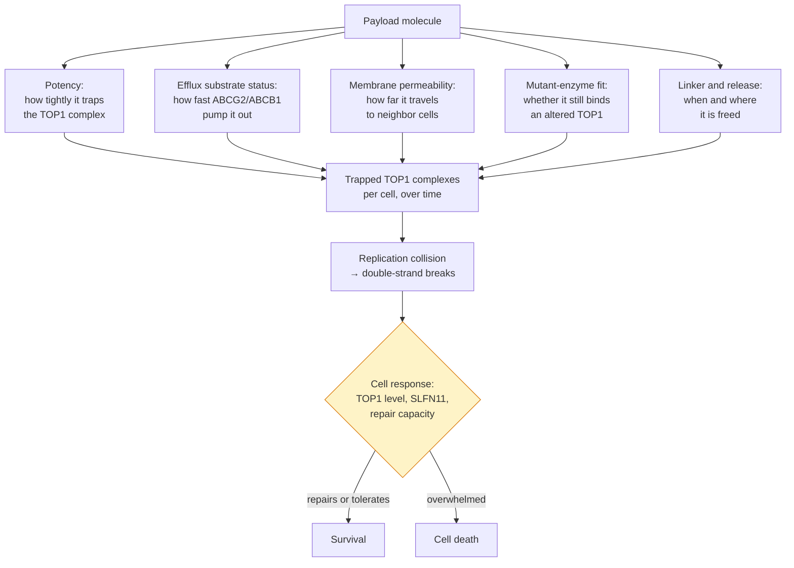

# Next-generation TOP1 payloads

## In one sentence

Next-generation topoisomerase I payloads keep the same killing mechanism as today's ADC drugs but are redesigned for higher potency, poorer handling by efflux pumps, tuned permeability and cleaner release, so the payload works where the first one failed.

## The intuition

If a key stops turning in a lock, you can try a different door or you can file a better key. Every [antibody-drug conjugate (ADC)](/wiki/education/concepts/therapeutics/antibody-based/antibody-drug-conjugate) approved for triple-negative breast cancer delivers the same kind of key: a [topoisomerase I (TOP1) inhibitor](/wiki/education/concepts/therapeutics/chemotherapy/topoisomerase-i-inhibitors). Switching payload class is the "different door" strategy. This page is about the other option: keeping the mechanism and changing the molecule, because the ways the old key fails are now known in chemical terms. The analogy breaks because a filed key cannot also become more dangerous to the locksmith, and a stronger payload usually can.

## How it works

### What the payload does to the cell

TOP1 nicks one DNA strand and holds the cut open so built-up twist can spin out, then reseals it. A camptothecin-class payload wedges into that enzyme–DNA *cleavage complex* and slows resealing, so the trapped complex persists. When a replication fork collides with it, the single-strand nick becomes a double-strand break [1]. That is the whole bet: not switching an enzyme off, but freezing it in an act that the cell's own copying machinery then turns lethal. Everything a medicinal chemist can change is a change to how much trapped complex forms, in which cells, for how long.

*Four of the five levers are chemistry. The last box is cell biology the chemist cannot reach, which is where this strategy runs out.*

### The levers a chemist can turn

**Potency: how hard the molecule traps the enzyme.** The clinically used camptothecins are not equally strong. Exatecan was modeled at the TOP1 cleavage-complex interface and appears to make two molecular contacts that classical camptothecins do not, in addition to the three they share; in matched laboratory comparisons it produced much stronger TOP1 trapping, more DNA damage and more cell death than the clinically approved TOP1 inhibitors [2]. DXd, the payload of trastuzumab deruxtecan, is itself an exatecan derivative released from the deruxtecan drug-linker [3]; datopotamab deruxtecan carries the same payload. So "more potent" is a real, measurable axis, but it buys nothing on its own: the dose is set by what healthy tissue tolerates, and a payload that is ten times stronger is usually loaded or dosed lower to compensate.

**Efflux-pump substrate status.** Cells export many drugs with [ATP-binding cassette transporters](/wiki/education/concepts/therapeutics/how-drugs-work/drug-efflux-transporters), especially breast cancer resistance protein (BCRP, the gene ABCG2) and P-glycoprotein (P-gp, ABCB1). This is the best-documented way a TOP1 payload fails. In breast cancer lines made resistant to trastuzumab deruxtecan or sacituzumab govitecan, resistance was driven mainly by higher efflux-transporter expression rather than by loss of the target protein [4]. In HER2-positive gastric and lung models made resistant to trastuzumab deruxtecan, ABCG2 or ABCB1 was markedly raised, the cells were cross-resistant to free DXd and to SN-38 despite intact HER2 and intact uptake, and either silencing or drug-blocking the transporter restored sensitivity [5]. Payloads differ: a trastuzumab emtansine-resistant line that had raised ABCC2 and ABCG2 was still growth-inhibited by DXd, which the authors read either as DXd being a poorer substrate for those pumps than DM1 or as the higher drug-to-antibody ratio compensating for the pumping [6]. Exatecan is described as less sensitive to multidrug resistance than DXd or SN-38, and antibody–exatecan conjugates built with a traceless self-immolative release element overcame the resistance of the matching DXd and SN-38 conjugates in low-target, large and multidrug-resistance-positive tumors in mice, with tolerability reported in non-human primates [7]. Designing a *poor* pump substrate is therefore the most specifiable goal in this field: the failure mode is defined, measurable and reproducible in models.

**Membrane permeability, which sets the bystander effect.** A freed payload that crosses membranes easily can leave the cell that absorbed the ADC and kill target-negative neighbors — useful, because tumors are mosaics (see [tumor heterogeneity](/wiki/education/concepts/cancer-biology/what-cancer-is/tumor-heterogeneity) and [target expression versus ADC response](/wiki/education/concepts/therapeutics/antibody-based/target-expression-vs-adc-response)). DXd was confirmed to be highly membrane-permeable, whereas trastuzumab emtansine's charged breakdown product Lys-SMCC-DM1 permeated poorly; in co-culture and in mixed-tumor mice, the deruxtecan ADC killed HER2-negative cells alongside HER2-positive ones and a low-permeability DXd construct did not. Critically, the same study found no effect on a HER2-negative tumor implanted on the *opposite* flank, which the authors read as local, not systemic, payload spread [8]. That result frames the design window from both sides: too little permeability and target-negative neighbors survive; too much and the payload behaves more like free chemotherapy, raising systemic exposure and the toxicities in [ADC payload toxicities](/wiki/education/concepts/therapeutics/toxicities-and-supportive-care/adc-payload-toxicity). Permeability is a dial to tune, not a quantity to maximize.

**Activity against mutant TOP1.** After progression on an ADC, plasma genotyping in a small metastatic breast cancer cohort found distinct TOP1 mutations (S57C, R364H, W401C, G359E) in 4 of 31 patients (12.9%), versus 3 of 420 (0.7%) in patients never given an ADC; three of the mutant proteins were made in the laboratory and all showed reduced enzymatic activity, weaker covalent DNA binding and resistance to both SN-38 and deruxtecan. The authors conclude that payload design is one of the things that needs optimizing [9]. **No payload has been verified here as retaining activity against those specific mutants.** This is the cleanest open question in the field: the resistance alleles are known and testable, so a redesigned payload can be screened against them directly. Treat any claim of mutant coverage as unverified until a primary report is checked.

**Linker stability and release.** Payload chemistry only matters if the molecule is freed in the right place and in the right form. The linker decides whether a payload is released inside the cell, in the tumor space or in circulation, and whether it leaves with a chemical stub attached that changes its permeability and pump handling — exactly what distinguishes Lys-SMCC-DM1 from a cleanly released payload. *Traceless* or self-immolative release elements are designed to free the unmodified drug with no residue [7]. See [ADC conjugation chemistry](/wiki/education/concepts/therapeutics/antibody-based/adc-conjugation-chemistry) for linker types and drug-to-antibody ratio.

## Why it matters in cancer

- **Every ADC approved for triple-negative breast cancer carries a TOP1 payload.** (Trastuzumab emtansine, with a microtubule payload, is approved only for HER2-positive disease.) For triple-negative disease there is currently no approved alternative class, so improving the molecule inside the class is one of the few levers available; see [ADC payload classes](/wiki/education/concepts/therapeutics/antibody-based/adc-payload-classes).
- **The failure modes are now defined in chemical terms.** Efflux pumping and payload-target mutation are both measurable, which turns "a better payload" into a testable design goal rather than a slogan.
- **It separates two questions that get confused.** Whether to change the address and whether to change the drug are different decisions; see [cross-resistance between ADCs](/wiki/education/concepts/therapeutics/antibody-based/adc-cross-resistance).
- **It sets the boundary with other strategies.** The parts of resistance that chemistry cannot reach are exactly what the dual-payload and DNA-damage-response designs are aimed at.

## Where redesign cannot reach

A better payload still depends on the cell's response to the damage it causes, and three of those dependencies are untouched by chemistry:

- **Low TOP1.** The payload works by trapping TOP1 on DNA. A cell with less TOP1 presents fewer complexes to trap, so less damage forms however good the molecule is.
- **SLFN11 loss.** SLFN11 expression was the single strongest correlate of response to TOP1 inhibitors across the 60-cell-line NCI panel, and silencing it reduced cell death and cycle arrest after DNA-damaging agents — so it is causal in those models, not just correlated [10]. SLFN11 and homologous-recombination deficiency were also advanced as predictive biomarkers for exatecan specifically [2]. A cell that has lost SLFN11 is less sensitive to the whole class.
- **Repair and checkpoint capacity.** Competent [homologous recombination](/wiki/education/concepts/cancer-biology/genome-instability-and-repair/homologous-recombination-and-hrd) and an intact replication-stress checkpoint let a cell survive breaks it would otherwise die from; see [replication stress](/wiki/education/concepts/cancer-biology/genome-instability-and-repair/replication-stress).

Each of these points away from payload engineering and toward combining TOP1 damage with a block on the response to it — the logic behind [DDR inhibitors](/wiki/education/concepts/therapeutics/targeted-small-molecules/ddr-inhibitors) and behind putting a DNA-damage-response drug on the antibody itself ([DDR-inhibitor payloads](/wiki/education/concepts/therapeutics/antibody-based/ddr-inhibitor-payloads)) or pairing two payloads on one antibody ([dual-payload ADCs](/wiki/education/concepts/therapeutics/antibody-based/dual-payload-adc)). Synergy between exatecan and an ATR inhibitor, and between antibody–exatecan conjugates and PARP or ATR inhibitors, has been reported in laboratory and mouse models [2, 7].

## What could break the bet

- **The failure may not be the payload.** If a given patient's cancer stopped responding because the target fell, uptake slowed or release failed, a better camptothecin changes nothing. That is the delivery level in [cross-resistance between ADCs](/wiki/education/concepts/therapeutics/antibody-based/adc-cross-resistance).
- **Potency without a window is not progress.** More trapped complexes in tumor cells usually means more in bone marrow and gut too. The question is always the [therapeutic index](/wiki/education/concepts/therapeutics/how-drugs-work/therapeutic-index), not the potency.
- **Pumps are also in normal tissue.** A payload engineered to escape ABCG2 escapes it in healthy cells as well, which can change where toxicity lands.
- **Mixed mechanisms in one tumor.** Different cells can carry different resistance changes, so a single redesigned payload need not cover the whole tumor.
- **Model dependence.** Resistance was engineered in these cell lines by continuous drug exposure. Human resistance may be dominated by other causes.

## Evidence so far, and what would settle it

This strategy is **mostly preclinical**. The verified record is: the two failure modes are real (efflux in breast, gastric and lung models [4, 5]; TOP1 mutations in a small patient cohort [9]); exatecan traps TOP1 more strongly than approved TOP1 inhibitors in the laboratory [2]; permeability drives the bystander effect and stays local in mixed-tumor mice [8]; and self-immolative antibody–exatecan conjugates beat matched DXd and SN-38 conjugates in resistant mouse models [7]. One camptothecin payload, PBX-7016, is reported in a peer-reviewed medicinal-chemistry paper whose authors state its ADCs are advancing through phase 1, with no clinical results published [11]. Nothing here is a human efficacy result.

What would settle it, in order: a head-to-head comparison against DXd or SN-38 conjugates in efflux-high and defined TOP1-mutant models; any human pharmacokinetic and tolerability data for a redesigned payload; and ultimately a trial that enrolls people who progressed on a TOP1 ADC and measures response, since that is the population the design is aimed at. A trial in TOP1-ADC-naive patients cannot test this bet, however good its results.

## Common confusions

- **"New payload" can mean two different things.** A different *class* (tubulin, DNA-damage-response, transcription) changes the mechanism. A redesigned TOP1 payload keeps the mechanism and changes the molecule. Only the first escapes a mechanism-level problem such as SLFN11 loss.
- **Exatecan, DXd and SN-38 are not interchangeable names.** SN-38 is irinotecan's active form; DXd is an exatecan derivative released from the deruxtecan drug-linker; exatecan is the parent compound used directly in newer designs.
- **More bystander effect is not automatically better.** It is a permeability setting with a cost on both sides.
- **Preclinical reversal is not clinical benefit.** Restoring activity in a resistant cell line or mouse is a hypothesis about patients.
- **A payload-target mutation is not the same as efflux.** Both are payload-level failures, but they call for different redesigns, and the mutation route has human evidence only in a small cohort.

## How it is measured

Potency is read as cell survival across concentrations, and as TOP1 trapping and DNA-damage markers at matched exposures. Efflux handling is read in transporter-overexpressing lines, with and without a pump inhibitor, and in cells where the transporter has been silenced. Permeability is read in co-culture and mixed-tumor models that pair target-positive with target-negative cells, with a distal implanted tumor as the control for systemic spread. Mutant coverage is read against recombinant mutant enzymes and engineered cell lines carrying the clinically observed alleles. None of these is a clinical test for selecting a payload.

## In Diana's case

How this applies to her is owned by the [drug-panel preferences](/wiki/diagnostics/drug-panel-preferences) page.

## Related concepts

- [Topoisomerase I inhibitors](/wiki/education/concepts/therapeutics/chemotherapy/topoisomerase-i-inhibitors)
- [ADC payload classes](/wiki/education/concepts/therapeutics/antibody-based/adc-payload-classes)
- [Cross-resistance between ADCs](/wiki/education/concepts/therapeutics/antibody-based/adc-cross-resistance)
- [ADC conjugation chemistry](/wiki/education/concepts/therapeutics/antibody-based/adc-conjugation-chemistry)
- [Drug efflux transporters](/wiki/education/concepts/therapeutics/how-drugs-work/drug-efflux-transporters)
- [DDR-inhibitor payloads](/wiki/education/concepts/therapeutics/antibody-based/ddr-inhibitor-payloads)
- [Dual-payload ADCs](/wiki/education/concepts/therapeutics/antibody-based/dual-payload-adc)
- [DDR inhibitors](/wiki/education/concepts/therapeutics/targeted-small-molecules/ddr-inhibitors)
- [ADC payload toxicities](/wiki/education/concepts/therapeutics/toxicities-and-supportive-care/adc-payload-toxicity)
- [Therapeutic index](/wiki/education/concepts/therapeutics/how-drugs-work/therapeutic-index)

## Sources and scope

Source check: November 7, 2026. Established payload mechanism plus named laboratory and mouse studies, each limited to its models, and one small patient cohort. No human efficacy evidence exists for a redesigned TOP1 payload. Expert and learner review remain pending. For the development landscape in plain language, see [the plain-language payload summary](/wiki/research/reviews/2026-11-new-adc-payloads-short-version).

1. [Pommier, 2006](https://pubmed.ncbi.nlm.nih.gov/16990856/) — camptothecin mechanism: interfacial trapping of the TOP1 cleavage complex and replication-collision killing.
2. [Jo et al., 2022](https://pubmed.ncbi.nlm.nih.gov/35439320/) — exatecan's modeled extra contacts at the cleavage complex, stronger TOP1 trapping and killing than clinically approved TOP1 inhibitors, SLFN11 and homologous-recombination deficiency as predictive biomarkers, and synergy with an ATR inhibitor.
3. [Ogitani et al., 2016, Clinical Cancer Research](https://pubmed.ncbi.nlm.nih.gov/27026201/) — DXd as an exatecan-derivative TOP1 payload delivered by the deruxtecan drug-linker; preclinical profile.
4. [Rampa et al., 2026](https://pubmed.ncbi.nlm.nih.gov/41591991/) — resistance to trastuzumab deruxtecan and sacituzumab govitecan in breast cancer lines driven mainly by efflux-transporter upregulation, not antigen loss.
5. [Murase et al., 2026](https://pubmed.ncbi.nlm.nih.gov/41548044/) — ABCG2 or ABCB1 upregulation in trastuzumab deruxtecan-resistant gastric and lung models, cross-resistance to free DXd and SN-38 with preserved HER2 and internalization, and restored sensitivity on transporter knockdown or inhibition.
6. [Takegawa et al., 2017](https://pubmed.ncbi.nlm.nih.gov/28677116/) — a T-DM1-resistant line with raised ABCC2 and ABCG2 remained sensitive to DXd, read as poorer pump substrate status or compensation by a higher drug-to-antibody ratio.
7. [Weng et al., 2023](https://pubmed.ncbi.nlm.nih.gov/36693125/) — self-immolative traceless antibody–exatecan conjugates: exatecan described as less multidrug-resistance-sensitive, resistance of matched DXd and SN-38 conjugates overcome in low-target, large and multidrug-resistance-positive tumors, synergy with PARP and ATR inhibitors, tolerability in non-human primates.
8. [Ogitani et al., 2016, Cancer Science](https://pubmed.ncbi.nlm.nih.gov/27166974/) — DXd confirmed highly membrane-permeable versus poorly permeable Lys-SMCC-DM1; bystander killing in co-culture and mixed tumors, absent in a distal target-negative tumor.
9. [Abelman et al., 2025](https://pubmed.ncbi.nlm.nih.gov/39745368/) — TOP1 mutations in 4 of 31 patients after ADC progression versus 3 of 420 without ADC treatment; three mutant proteins resistant to SN-38 and deruxtecan; payload design named as an area needing optimization.
10. [Zoppoli et al., 2012](https://pubmed.ncbi.nlm.nih.gov/22927417/) — SLFN11 expression as the strongest correlate of TOP1-inhibitor response across the NCI-60 panel, causal on silencing.
11. [Chun et al., 2026](https://pubmed.ncbi.nlm.nih.gov/41414896/) — PBX-7016, a methylenedioxy-camptothecin payload; preclinical characterization, with the authors stating its ADCs are advancing through phase 1.

<!-- BEGIN GENERATED USED IN -->
## Used in

- [Read a new payload strategy](/wiki/education/guides/aiming-a-drug-at-a-surface-target/05-read-a-new-payload-strategy)
- [Aiming a drug at a surface target](/wiki/education/guides/aiming-a-drug-at-a-surface-target/index)
<!-- END GENERATED USED IN -->
