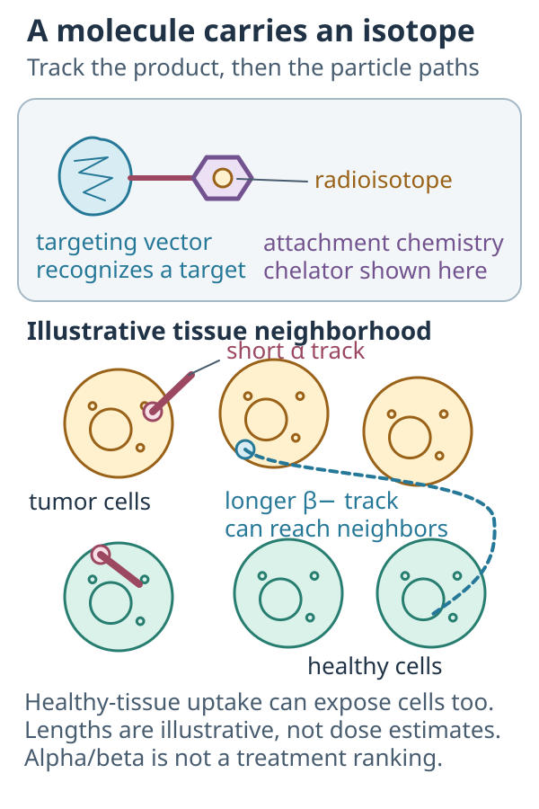

# Radioligand therapy: targeting radiation with a molecule

## In one sentence

Radioligand therapy uses a target-binding molecule carrying a radionuclide to deliver radiation as the product distributes and remains in tissues.

## The intuition

Think of a tiny radioactive source with a homing tag. The tag steers it to cells that carry a matching protein, and the source damages whatever lies within range of its particles for as long as it stays there. It does not need to be opened or taken inside the cell. The analogy breaks because the source also passes through and lingers in healthy organs, such as the kidneys that clear it, and dose builds up wherever it lingers.

**Before you start:** [Radiation therapy basics](/wiki/education/concepts/therapeutics/local-therapies/radiation-therapy-basics) explains energy deposition. [Target PET imaging](/wiki/education/concepts/measurement/imaging/target-pet-and-theranostic-imaging) explains what a positron emission tomography scan can establish about tracer distribution.

## How it works

*Vector, attachment and isotope are different parts. Illustrated particle paths can reach neighboring or healthy cells; they are not dose estimates or an alpha-versus-beta ranking, and chelators are not universal.*

Three design questions help you unpack a product:

| Part | Job | Question to ask |
|---|---|---|
| Targeting vector | A small molecule, peptide or other binder recognizes a target. | Can it reach an accessible target in the intended tissue? |
| Attachment chemistry | Often a **chelator**, a molecule that holds a radioactive metal, connects it to the vector. | Does the labeled product remain sufficiently stable? |
| Radionuclide | An unstable isotope releases radiation as it decays. | Which particles, energies and decay products determine exposure? |

Many products called radioligand therapy use small molecules or peptides. A labeled [monoclonal antibody](/wiki/education/concepts/therapeutics/antibody-based/monoclonal-antibodies) is often described as **radioimmunotherapy**, a related format with different distribution and clearance. The broader category *radiopharmaceutical therapy* also includes iodine and radium products that naturally accumulate in particular tissues without a separate targeting ligand. Not every radioactive product requires a chelator; attachment chemistry depends on the isotope and molecule. [FDA's 2019 nonclinical guidance](https://www.fda.gov/media/129547/download) defines the broader category and organ-seeking examples.

**Alpha particles** are helium nuclei. They usually deposit energy densely over a short tissue path. Therapeutic **beta-minus particles** are electrons, typically with longer paths and less dense energy deposition. Their radiation can reach neighboring cells, called *crossfire*. These are physical tendencies, not a rule that one type is always safer or more effective. Distribution, microscopic geometry and radioactive daughter products matter. Actinium-225, for example, decays through a chain of alpha-emitting daughters; each decay kicks the daughter atom free of its chelator (recoil), and daughters not held at the tumor can irradiate healthy organs [4]. [The Medical Internal Radiation Dose committee's alpha-emitter guidance](https://pmc.ncbi.nlm.nih.gov/articles/PMC5680544/) explains why average tissue dose can miss important microscopic differences.

The [pharmacokinetics](/wiki/education/concepts/therapeutics/how-drugs-work/pharmacokinetics-and-half-life) of the vector and the isotope's physical decay jointly determine how radioactivity changes over time. A target can be present on cancer cells, supporting tissue or healthy organs. Targeting is selective to a degree; it does not mean radiation visits only cancer.

## Why it matters in cancer

The payload can damage nearby cells without requiring the target itself to drive cancer growth. But the product must deliver useful tumor exposure while limiting normal-tissue exposure.

Two small-ligand products show what success looks like, both outside breast cancer:

- **Lutetium-177 (¹⁷⁷Lu)-PSMA-617**, aimed at prostate-specific membrane antigen (PSMA): in VISION, 831 men with metastatic castration-resistant prostate cancer selected by a positive PSMA PET scan lived longer with it added to standard care (median overall survival 15.3 versus 11.3 months; hazard ratio 0.62) [5].
- **¹⁷⁷Lu-dotatate**, aimed at somatostatin receptors: in NETTER-1, 229 people with metastatic midgut neuroendocrine tumors had an estimated 20-month progression-free survival of 65.2% versus 10.8% with high-dose octreotide alone [6].

VISION selected patients by imaging the target first, the [theranostic](/wiki/education/concepts/therapeutics/local-therapies/theranostics) pattern. Neither result is evidence in breast cancer.

Antibodies are not universally imaging-only. A phase II study investigated the therapeutic radioantibody lutetium-177–J591 in **47 men with progressive metastatic castration-resistant prostate cancer**. It also documented substantial blood-cell toxicity. That is a historical, disease-specific clinical example, not evidence of present approval or benefit in breast cancer. [Tagawa and colleagues' primary report](https://pmc.ncbi.nlm.nih.gov/articles/PMC3778101/) supports both sides of that distinction.

## How it is measured

- **Administered activity:** radioactive decays per second, reported in becquerels, commonly megabecquerels or gigabecquerels. It differs from the mass of targeting molecule.
- **Distribution and retention:** calibrated imaging at appropriate times can estimate activity in tissues. One bright scan is one time point.
- **Absorbed dose:** deposited energy per tissue mass, reported in gray. Estimating it is **dosimetry**; tissue size, time and radiation type affect interpretation.

There is no universal scan-uptake cutoff, cycle schedule or organ-dose limit for every product. Product-specific evidence and the clinical setting establish those boundaries.

## Common confusions

- **Uptake is not dose or benefit.** Uptake, persistence, energy deposition and clinical outcomes are separate questions.
- **Small ligands and antibodies are not interchangeable.** Their body distribution can differ even when they recognize the same target.
- **Alpha versus beta is not a treatment ranking.** A short particle path still harms healthy tissue if the product deposits there.
- **Radiation is not guaranteed immune priming.** An immune mechanism hypothesis needs its own measurements and clinical tests.

## Try it

**Fictional example:** Tracers A and B have equal tumor uptake on an early scan. A clears quickly; B remains longer. Have they delivered equal tumor radiation dose?

**Answer:** We cannot say. Equal early uptake does not establish equal time-integrated activity, particle emissions or absorbed dose. We would also need normal-tissue exposure and clinical evidence to compare treatments.

## Explain it back

“A radioligand's effect depends on its vehicle, its isotope and ______.”

One possible answer: “where and how long the complete product remains, and what radiation reaches each tissue.”

## Takeaway

**The complete radioactive product, its tissue journey and its evidence matter more than the target name alone.**

## Related concepts

- [Theranostics](/wiki/education/concepts/therapeutics/local-therapies/theranostics)
- [Immuno-PET](/wiki/education/concepts/measurement/imaging/immuno-pet)
- [Therapeutic index](/wiki/education/concepts/therapeutics/how-drugs-work/therapeutic-index)
- [ADC versus radioligand therapy](/wiki/education/concepts/therapeutics/antibody-based/adc-vs-radioligand-therapy), comparing antibody-drug conjugate (ADC) chemistry with radiation
- [ADC payload classes](/wiki/education/concepts/therapeutics/antibody-based/adc-payload-classes), the chemical cargoes radiation is compared with

## Sources and scope

Source-checked November 7, 2026 (approved examples, daughter recoil and intuition); remaining content checked October 10, 2026. Expert and learner review remain pending. No general dosing or breast-cancer efficacy claim is made.

1. [FDA: Oncology therapeutic radiopharmaceuticals, August 2019](https://www.fda.gov/media/129547/download). Background, biodistribution and glossary checked; nonclinical development guidance, not a clinical dosing protocol.
2. [Sgouros et al.: Medical Internal Radiation Dose pamphlet 22, 2010](https://pmc.ncbi.nlm.nih.gov/articles/PMC5680544/). Full author manuscript retrieved through the official NCBI text service; targeted particle-physics and microscopic-dosimetry sections checked.
3. [Tagawa et al.: Phase II lutetium-177–J591 study, 2013](https://pmc.ncbi.nlm.nih.gov/articles/PMC3778101/). Full primary author manuscript checked for the prostate-cancer population, therapeutic antibody use and hematologic toxicity.
4. [de Kruijff, Wolterbeek and Denkova, 2015](https://pubmed.ncbi.nlm.nih.gov/26066613/) — recoiling daughters of actinium-225 and radium isotopes and healthy-tissue dose.
5. [Sartor et al., 2021: VISION](https://pubmed.ncbi.nlm.nih.gov/34161051/) — ¹⁷⁷Lu-PSMA-617 in metastatic castration-resistant prostate cancer.
6. [Strosberg et al., 2017: NETTER-1](https://pubmed.ncbi.nlm.nih.gov/28076709/) — ¹⁷⁷Lu-dotatate in midgut neuroendocrine tumors.

<!-- BEGIN GENERATED USED IN -->
## Used in

- [Aiming a drug at a surface target](/wiki/education/guides/aiming-a-drug-at-a-surface-target/index)
- [Read a proposal through five questions](/wiki/education/local-treatment-modalities/04-decision-questions)
- [Local-treatment reference shelf](/wiki/education/local-treatment-modalities/index)
- [Separate the address from the killing mechanism](/wiki/education/targeted-therapy-modalities/01-mechanism)
- [Questions for a targeted-therapy proposal](/wiki/education/targeted-therapy-modalities/04-decision-questions)
<!-- END GENERATED USED IN -->
