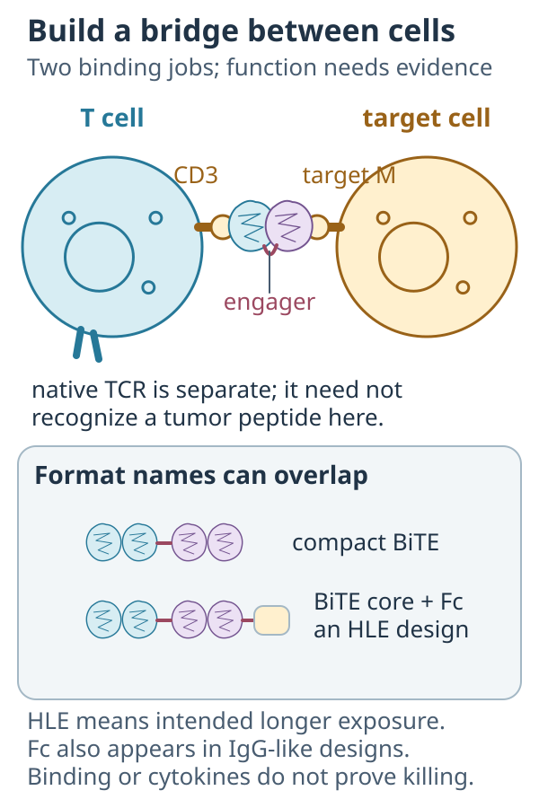
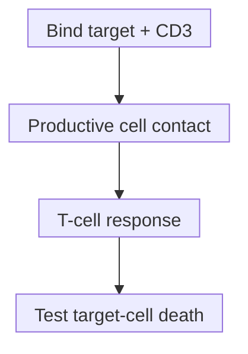

# T-cell engager

## In one sentence

A T-cell engager is a therapeutic molecule that binds a target on another cell and a T-cell activation component to help redirect T-cell attack.

## The intuition

Imagine a temporary bridge between a target-bearing cell and a T cell capable of attacking it. One end finds the target; the other helps trigger the T cell. A bridge is useful only if both sides are reachable and the attack machinery works. Geometry and signaling determine whether contact becomes activation and killing.

## How it works

Many engagers are **bispecific** proteins: they recognize two molecular features. One part recognizes a chosen target; another commonly binds [cluster of differentiation 3 (CD3)](/wiki/education/concepts/immunology/t-cells/t-cell-receptor), the receptor-associated T-cell signaling complex. Some have additional binding parts. “Bispecific” alone does not mean T-cell engagement: two targets can serve other purposes.

A surface-target engager can redirect T cells without their native [T-cell receptor (TCR)](/wiki/education/concepts/immunology/t-cells/t-cell-receptor) recognizing a tumor peptide. CD3 signaling still matters. Target-bearing cells and functional T cells need productive contact. Bypassing native antigen specificity for recognition does not bypass immune-cell availability or function.

### Format labels answer different questions

*The bridge makes two contacts, but function needs its own measurements. CD3 is separate from native TCR specificity; Fc-containing BiTE-derived and IgG-like designs can both carry half-life-extension features.*

| Label | What it describes | What it does not settle |
|---|---|---|
| Compact BiTE (bispecific T-cell engager) | A familiar tandem design with two linked [single-chain variable fragments (scFvs)](/wiki/education/concepts/engineering-and-manufacturing/binders/scfv-and-vhh-nanobodies), without an Fc region | Tissue access, killing or safe exposure |
| Immunoglobulin G (IgG)-like | An antibody-like assembly with an [Fc region](/wiki/education/concepts/immunology/antibodies-and-b-cells/antibody-structure); binding-domain numbers/layouts vary | Equivalent geometry or preserved Fc effector activity |
| Half-life-extended (HLE) | Engineering intended to prolong exposure, which can include an added Fc region | A distinct, mutually exclusive architecture or a universal dosing interval |

These labels overlap. Giffin's 2021 AMG 757 study added an effector-functionless Fc region to a BiTE core and assessed exposure in nonhuman primates. It illustrates an HLE BiTE, not a rule that all Fc-containing engagers are identical or safer. [Pharmacokinetics](/wiki/education/concepts/therapeutics/how-drugs-work/pharmacokinetics-and-half-life) belongs to the actual product and population.

A neighboring route targets peptide displayed by [human leukocyte antigen (HLA)](/wiki/education/concepts/immunology/antigen-presentation/hla). [TCR mimics and soluble TCR/CD3 engagers](/wiki/education/concepts/therapeutics/antibody-based/tcr-mimics-and-tcr-engagers) still require the matching peptide–HLA target, even when recruited T cells need no native specificity for it.

Recognition, contact, activation and death are separate experimental questions. The arrows do not guarantee success.

After productive engagement, T cells can release cytotoxic molecules and inflammatory signals. Primary geometry experiments found different killing potency despite similar target affinity. A dosed engager does not itself insert a receptor gene into T cells. [Living TCR-T products](/wiki/education/concepts/therapeutics/cell-therapies/tcr-t) raise additional persistence and cell-behavior questions.

## Why it matters in cancer

Engagers face target heterogeneity, tissue access, [T-cell state](/wiki/education/concepts/immunology/t-cells/t-cell-states) and healthy-tissue recognition. Safety includes [on-target, off-tumor injury](/wiki/education/concepts/therapeutics/toxicities-and-supportive-care/on-target-off-tumor-toxicity) and inflammatory syndromes such as [cytokine release syndrome](/wiki/education/concepts/therapeutics/toxicities-and-supportive-care/cytokine-release-syndrome). Dish cytokines do not diagnose that syndrome.

## How it is measured

| Observation card | Record and interpret |
|---|---|
| Input | Actual protein, target-bearing cells and T-cell source; culture aliquots are consumed |
| Conditions | Concentration (such as ng/mL), time, target density and effector-to-target cell ratio |
| Output | Binding, activation, cytokine concentration and timed target-cell death, separately |
| Controls and limits | Target-negative, no-T-cell and appropriate protein controls; healthy-cell testing adds a safety question; no universal format cutoff or model-to-patient conversion |

## Worked example

A fictional protein binds target M and CD3. A coculture of M-positive cells and T cells shows target-cell killing. Matched cultures without T cells or without M show much less killing. These controls support target- and T-cell-dependent model activity, not access throughout a tumor, healthy-tissue safety or benefit in people.

## Common confusions

- **Not every bispecific is an engager.** Two binding targets need not recruit T cells.
- **HLE is not a third exclusive shape.** A BiTE-derived or IgG-like product can have extended exposure.
- **Surface recognition is not peptide–HLA recognition.** Their target requirements differ.
- **An engager is not a checkpoint inhibitor or living cell product.** Redirection, inhibitory-signal modulation and receptor engineering are different mechanisms.
- **Stopping dosing need not reverse injury.** Exposure and biological effects have different clocks.

## Try it

A fictional HLE construct binds both targets but produces cytokines without measurable target-cell death. Has killing been shown?

**Answer:** No. Binding and activation are supported observations. Check target-cell attribution, time-dependent death and matched controls. “HLE” supplies neither missing function nor a clinical safety claim.

## Explain it back

“Format tells me ___; functional testing tells me ___.”

**One answer:** how the molecule is assembled; what that complete molecule does under measured conditions.

## Takeaway

**Name the recognition route and architecture, then test contact, function and exposure rather than ranking formats by name.**

## Related concepts

- [Antibody structure](/wiki/education/concepts/immunology/antibodies-and-b-cells/antibody-structure)
- [T-cell receptor](/wiki/education/concepts/immunology/t-cells/t-cell-receptor)

## Sources and scope

Source check: October 10, 2026. Mechanism examples are construct/model-specific, with no indication, format or toxicity ranking. Practice is fictional; expert and learner review remain pending.

- [FDA, 2021: bispecific antibody development](https://www.fda.gov/media/123313/download) — format diversity and bridging versus other bispecific functions.
- [Mack et al., 1995](https://pubmed.ncbi.nlm.nih.gov/7624362/) — linked scFv redirection in laboratory models.
- [Bluemel et al., 2010](https://pubmed.ncbi.nlm.nih.gov/20309546/) — geometry in defined preclinical comparisons.
- [Giffin et al., 2021](https://pubmed.ncbi.nlm.nih.gov/33203642/) — Fc-extended BiTE structure, model activity and nonhuman-primate exposure.
- [Solitomab phase 1 study, 2018](https://pubmed.ncbi.nlm.nih.gov/30221040/) — clinical exposure and injury limits for one surface-target engager.

<!-- BEGIN GENERATED USED IN -->
## Used in

- [Aiming a drug at a surface target](/wiki/education/guides/aiming-a-drug-at-a-surface-target/index)
- [Separate the address from the killing mechanism](/wiki/education/targeted-therapy-modalities/01-mechanism)
- [Follow delivery, exposure, and the treatment clock](/wiki/education/targeted-therapy-modalities/02-timing)
- [Questions for a targeted-therapy proposal](/wiki/education/targeted-therapy-modalities/04-decision-questions)
- [Compare formats with evidence and normal-tissue risk](/wiki/education/targeted-therapy-modalities/06-comparisons)
- [Targeted therapy mechanisms and comparisons](/wiki/education/targeted-therapy-modalities/index)
<!-- END GENERATED USED IN -->
