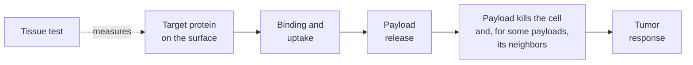

# Target expression versus ADC response

## In one sentence

For antibody-drug conjugates, the amount of target protein measured in a tumor sample predicts benefit only weakly, because delivery, payload potency, spread to neighboring cells and the limits of the test all sit between expression and response.

## The intuition

A mail carrier needs a mailbox to deliver a parcel, but one small mailbox is enough if the parcel holds something powerful. Counting mailboxes on a street tells you whether delivery is possible, not whether the parcel will do its job once inside. If parcels can also leak into the house next door, even houses without a mailbox are affected. The analogy breaks because tumors are not streets of identical houses: a biopsy counts mailboxes on one block, at one time.

## How it works

An [antibody-drug conjugate (ADC)](/wiki/education/concepts/therapeutics/antibody-based/antibody-drug-conjugate) response depends on a chain of steps. Target expression measures only the first:

*Immunohistochemistry sees the first box; everything after it can raise or lower response independently.*

Five reasons the link is loose:

1. **A little target can be enough.** Payloads are potent and some ADCs carry about eight per antibody, so modest uptake can deliver a lethal dose.
2. **Payload can spread.** Membrane-permeable payloads kill nearby cells that lack the target (the bystander effect), so target-negative patches are not necessarily spared.
3. **The test is built for a different job.** HER2 [immunohistochemistry](/wiki/education/concepts/measurement/pathology-readouts/immunohistochemistry) was designed to find very high HER2 (score 3+). At the low end it is unreliable: when 18 pathologists scored the same 170 breast biopsies, they agreed on 0 versus 1+ only 26% of the time, versus 58% for 2+ versus 3+ [1].
4. **Tumors vary in space and time.** One core, often from an earlier biopsy, may not represent every metastasis now; see [tumor heterogeneity](/wiki/education/concepts/cancer-biology/what-cancer-is/tumor-heterogeneity).
5. **Resistance can sit after delivery.** A tumor full of target can still pump out or tolerate the payload; see [cross-resistance between ADCs](/wiki/education/concepts/therapeutics/antibody-based/adc-cross-resistance).

## What the trials show

| Study and population | ADC | Expression groups | Result |
|---|---|---|---|
| DESTINY-Breast04: 557 people with previously treated HER2-low metastatic breast cancer [2] | Trastuzumab deruxtecan versus chemotherapy | HER2-low: IHC 1+, or 2+ without gene amplification | Median progression-free survival 9.9 versus 5.1 months (hazard ratio 0.50); overall survival 23.4 versus 16.8 months (hazard ratio 0.64) |
| DESTINY-Breast06: 866 people with hormone-receptor-positive metastatic breast cancer after endocrine therapy and with no prior chemotherapy for metastatic disease [3] | Trastuzumab deruxtecan versus chemotherapy | 713 HER2-low; 153 HER2-ultralow (IHC 0 with membrane staining) | HER2-low: 13.2 versus 8.1 months (hazard ratio 0.62); ultralow results consistent, but exploratory |
| DAISY: 177 people with metastatic breast cancer, single-arm phase 2 [4] | Trastuzumab deruxtecan | HER2-overexpressing, HER2-low, HER2-zero | Response in 70.6%, 37.5% and 29.7% |
| ASCENT biomarker analysis: 290 people with previously treated metastatic triple-negative breast cancer and a TROP2 result [5] | Sacituzumab govitecan versus chemotherapy | TROP2 high, medium, low (H-score) | Median progression-free survival 6.9, 5.6 and 2.7 months versus 2.5, 2.2 and 1.6; response 44%, 38% and 22% versus 1%, 11% and 6%; the low group was small |

Two lessons follow. **There is a gradient:** more target goes with more response on average (DAISY, ASCENT). **There is no clean floor:** benefit or response appeared in the lowest groups tested, and DAISY found responses even in HER2-zero tumors, where it also saw that HER2 staining and drug uptake went together in a few biopsies [4]. The labels reflect this. Sacituzumab govitecan and datopotamab deruxtecan are used in triple-negative disease without a TROP2 test, while trastuzumab deruxtecan requires an authorized HER2 test to place a tumor in the low or ultralow category [6].

## Why it matters in cancer

- **"Low" stopped meaning "negative."** HER2-low and HER2-ultralow are treatment-eligibility categories created by these trials. They are defined by a test score; whether they form a distinct biological group is debated. See [HER2](/wiki/education/concepts/breast-cancer/receptors-and-subtypes/her2).
- **Retesting can change eligibility.** Because 0 versus 1+ is hard to read, a second biopsy or a second reading can move a tumor across the line.
- **New ADCs need their own evidence.** A gradient seen for one drug does not set a cutoff for another; that requires a validated [companion diagnostic](/wiki/education/concepts/access-and-regulation/approval/companion-diagnostics).

## Common confusions

- **Weakly predictive is not irrelevant.** On average, more target goes with more response; the measurement just cannot sort individuals well.
- **No test required does not mean the target does not matter.** It means trials did not find a group in which the drug failed to help.
- **Prognostic is not predictive.** A marker can track outcome with any treatment without telling you who benefits from this one; see [prognostic versus predictive](/wiki/education/concepts/evidence-and-statistics/biomarkers/prognostic-vs-predictive).
- **A response rate in a single-arm cohort is not a comparison.** DAISY shows activity across HER2 levels but has no control arm.

## How it is measured

HER2 is scored by immunohistochemistry on a 0 to 3+ scale, with in situ hybridization for gene amplification at 2+. HER2-ultralow means IHC 0 with some membrane staining, as defined in DESTINY-Breast06 [3]. TROP2 has been scored in research by H-score, which combines staining intensity and the percentage of stained cells. Computer-based scoring of membrane staining is a research method for some ADCs, not a validated selection test for breast-cancer ADCs.

## In Diana's case

How her tumor's HER2 and TROP2 results bear on ADC options is owned by [the ADC therapies page](/wiki/treatment/therapeutics/adc-therapies).

## Related concepts

- [HER2](/wiki/education/concepts/breast-cancer/receptors-and-subtypes/her2)
- [Immunohistochemistry](/wiki/education/concepts/measurement/pathology-readouts/immunohistochemistry)
- [Companion diagnostics](/wiki/education/concepts/access-and-regulation/approval/companion-diagnostics)
- [ADC conjugation chemistry](/wiki/education/concepts/therapeutics/antibody-based/adc-conjugation-chemistry)
- [Prognostic versus predictive](/wiki/education/concepts/evidence-and-statistics/biomarkers/prognostic-vs-predictive)

## Sources and scope

Source check: November 7, 2026. Randomized and single-arm trial results limited to their populations; subgroup and biomarker analyses are exploratory. Expert and learner review remain pending.

1. [Fernandez et al., 2022](https://pubmed.ncbi.nlm.nih.gov/35113160/) — concordance of HER2 immunohistochemistry scoring in the low range.
2. [Modi et al., 2022: DESTINY-Breast04](https://pubmed.ncbi.nlm.nih.gov/35665782/) — trastuzumab deruxtecan in previously treated HER2-low metastatic breast cancer.
3. [Bardia et al., 2024: DESTINY-Breast06](https://pubmed.ncbi.nlm.nih.gov/39282896/) — trastuzumab deruxtecan in HER2-low and HER2-ultralow hormone-receptor-positive metastatic breast cancer.
4. [Mosele et al., 2023: DAISY](https://pubmed.ncbi.nlm.nih.gov/37488289/) — trastuzumab deruxtecan across HER2 expression levels.
5. [Bardia et al., 2021: ASCENT biomarker analyses](https://pubmed.ncbi.nlm.nih.gov/34116144/) — sacituzumab govitecan outcomes by TROP2 expression.
6. US prescribing information (DailyMed), section 1: [trastuzumab deruxtecan](https://dailymed.nlm.nih.gov/dailymed/drugInfo.cfm?setid=7e67e73e-ddf4-4e4d-8b50-09d7514910b6), [sacituzumab govitecan](https://dailymed.nlm.nih.gov/dailymed/drugInfo.cfm?setid=57a597d2-03f0-472e-b148-016d7169169d), [datopotamab deruxtecan](https://dailymed.nlm.nih.gov/dailymed/drugInfo.cfm?setid=2950227c-6230-4ca4-a135-46e44d9424a0).

<!-- BEGIN GENERATED USED IN -->
## Used in

- [Compare related ideas](/wiki/education/comparisons/index)
- [Match the payload to the failure](/wiki/education/guides/aiming-a-drug-at-a-surface-target/04-match-the-payload-to-the-failure)
- [Choose a target worth aiming at](/wiki/education/guides/aiming-a-drug-at-a-surface-target/06-choose-a-target)
- [Aiming a drug at a surface target](/wiki/education/guides/aiming-a-drug-at-a-surface-target/index)
<!-- END GENERATED USED IN -->
