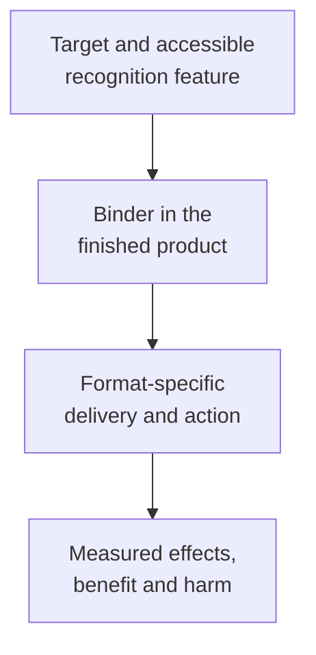

# Target versus therapeutic format

## In one sentence

In a surface-target therapy, the target names what is recognized, while the chassis is the product format that connects recognition to an action.

## The intuition

Imagine a destination served by different vehicles. Sharing the destination does not tell you what each vehicle carries or how it unloads. “Chassis” is an engineering metaphor for the therapeutic format, rather than a formal clinical category. The analogy stops at recognition: biological products change during delivery and can encounter the same target on healthy cells.

## How it works

Keep three questions separate:

| Question | What answers it? | What remains open? |
|---|---|---|
| What is recognized? | An accessible target, such as a surface protein | Where it occurs, and which cells can be reached |
| What makes contact? | A [binder](/wiki/education/concepts/engineering-and-manufacturing/binders/binder-as-a-targeting-module) recognizing a particular [epitope](/wiki/education/concepts/immunology/antigen-presentation/antigen-and-epitope) | Whether the finished product still binds under relevant conditions |
| What acts after contact? | The therapeutic format and its mechanism | Whether that action produces useful effects and acceptable harm |

Two products aimed at one protein can recognize different epitopes. Conversely, a binder sequence can be reused in different formats. Neither a shared target nor a shared sequence establishes an interchangeable product.

| Format | What can happen after recognition? | A separate requirement |
|---|---|---|
| [Unconjugated antibody](/wiki/education/concepts/therapeutics/antibody-based/monoclonal-antibodies) | Block a signal or recruit immune effectors, depending on design | Binding must lead to the intended biological effect |
| [Antibody-drug conjugate (ADC)](/wiki/education/concepts/therapeutics/antibody-based/antibody-drug-conjugate) | Deliver chemical cargo | Delivery, processing and payload sensitivity |
| [T-cell engager](/wiki/education/concepts/therapeutics/antibody-based/t-cell-engager) | Bring a target cell into contact with a T cell | Productive contact and functioning immune cells |
| [Chimeric antigen receptor (CAR) T cells](/wiki/education/concepts/therapeutics/cell-therapies/car-anatomy) | Activate receptor-engineered living cells | Cell access, receptor signaling and cellular function |
| [Targeted radiopharmaceutical](/wiki/education/concepts/therapeutics/antibody-based/radioligand-therapy) | Deliver radiation from a radioactive atom | Distribution over time and absorbed dose in relevant tissues |

These are mechanism comparisons. They do not rank efficacy or safety. A delivery address also need not be a [growth dependency](/wiki/education/concepts/therapeutics/how-drugs-work/drug-target-and-mechanism): blocking a protein and delivering cargo through it ask different questions.

*The target name leaves delivery, action and outcomes to be tested.*

## Why it matters in cancer

Changing formats may change a resistance problem, but does not automatically solve it. Target loss can affect several products using that target. A processing defect might matter to one conjugate while a proposed engager faces a different immune-access problem.

The format also changes the consequences of healthy-tissue recognition. [On-target, off-tumor toxicity](/wiki/education/concepts/therapeutics/toxicities-and-supportive-care/on-target-off-tumor-toxicity) remains possible even when binding is accurate. One product's tolerability cannot establish another's safety.

## How it is measured

Measure the complete construct, relevant cells and conditions. Binding assays examine recognition; delivery and functional assays examine later steps. Conjugate studies distinguish intact product and constituent parts. Cell studies examine activation and persistence; radiopharmaceutical studies examine distribution and absorbed dose. Clinical comparisons test outcomes in a defined population. A target stain alone answers none of those complete-product questions.

## Common confusions

- The target is not the binder or the finished therapy.
- The same protein name does not establish the same epitope.
- A different format does not guarantee resistance bypass.
- A targeting label does not establish tumor-exclusive activity.

## Try it

A fictional tumor retains target M after an ADC stops controlling it. A proposed M-targeted engager is called “proven to work because it uses a new chassis.” What is supported?

**Answer:** Target retention is an observation with assay and sampling limits. Different action creates a hypothesis. The engager still needs evidence for binding, immune contact, function, safety and benefit in the intended setting.

## Explain it back

“The target tells me ___; the binder tells me ___; the format tells me ___.”

**One possible answer:** What is recognized; how contact is made; which action and additional requirements follow.

## Takeaway

**Compare the target, binder and complete product separately before borrowing evidence between therapies.**

## Related concepts

- [Format constraints on binders](/wiki/education/concepts/engineering-and-manufacturing/binders/format-constraints-on-binders)
- [Drug resistance](/wiki/education/concepts/therapeutics/how-drugs-work/drug-resistance)

## Sources and scope

Source check: October 10, 2026. Surface-target formats and a fictional exercise; this is not a treatment ranking or an approval inventory. Expert and learner review remain pending.

- [NCI: monoclonal antibodies](https://www.cancer.gov/about-cancer/treatment/types/immunotherapy/monoclonal-antibodies) — different actions following recognition, including immune recruitment.
- [FDA, March 2024: clinical pharmacology considerations for ADCs](https://www.fda.gov/media/155997/download) — components, processing and separate exposure measurements.
- [NCI: CAR T cells](https://www.cancer.gov/about-cancer/treatment/research/car-t-cells) — receptor design, living-cell behavior and solid-tumor barriers.
- [FDA, August 2019: therapeutic radiopharmaceutical development](https://www.fda.gov/media/129547/download) — ligand, radiation, biodistribution and absorbed-dose questions.

<!-- BEGIN GENERATED USED IN -->
## Used in

- [Aiming a drug at a surface target](/wiki/education/guides/aiming-a-drug-at-a-surface-target/index)
- [Separate the address from the killing mechanism](/wiki/education/targeted-therapy-modalities/01-mechanism)
- [Compare formats with evidence and normal-tissue risk](/wiki/education/targeted-therapy-modalities/06-comparisons)
<!-- END GENERATED USED IN -->
