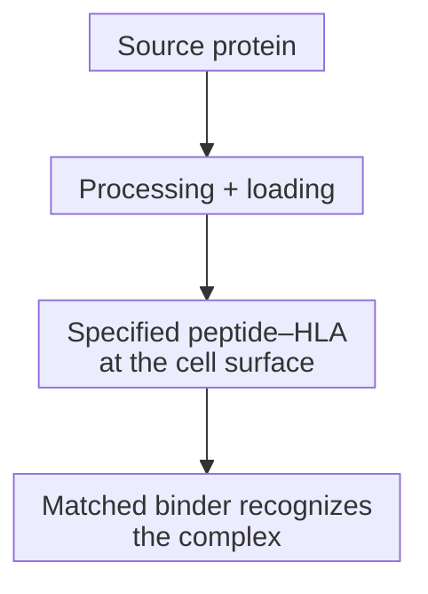

# TCR mimics and soluble TCR engagers

## In one sentence

T-cell receptor (TCR)-mimic antibodies and soluble TCR engagers recognize specific peptide–human leukocyte antigen (HLA) complexes using different protein scaffolds.

## The intuition

An ordinary surface-protein binder reads an exposed feature on a cell. A peptide–HLA binder reads a particular fragment held in a particular display frame. Both the fragment and frame matter. This analogy helps explain allele restriction, but a real cell has changing processing, surface density and mixed peptide displays; knowing a protein's name does not show that its fragment is displayed.

## How it works

[Antigen processing](/wiki/education/concepts/immunology/antigen-presentation/antigen-processing-machinery) can turn an intracellular source protein into peptides. Some reach [HLA](/wiki/education/concepts/immunology/antigen-presentation/hla) at the surface. A selected receptor or antibody recognizes a defined peptide–HLA complex, not simply the intact source protein inside the cell.

**HLA restriction** means recognition depends on the specified HLA molecule with the appropriate peptide. A different allele is not a substitute just because it belongs to the same broad HLA family. A compatible genotype alone does not establish tumor display: processing, HLA expression and target-complex abundance also matter.

Each transition needs evidence. Source-protein abundance does not prove that the required surface complex exists.

Related recognition can serve different treatments:

| Format | What recognizes peptide–HLA? | How action is connected |
|---|---|---|
| TCR-mimic antibody | An antibody-derived binding region that mimics TCR recognition; it is not a TCR | Depends on the full product: an [Fc region](/wiki/education/concepts/immunology/antibodies-and-b-cells/antibody-structure), cargo or added immune-binding arm can supply different actions |
| Soluble TCR/CD3 engager | An engineered soluble TCR | An attached [cluster of differentiation 3 (CD3)](/wiki/education/concepts/immunology/t-cells/t-cell-receptor)-binding arm recruits and activates T cells |
| [Living TCR-T](/wiki/education/concepts/therapeutics/cell-therapies/tcr-t) | A receptor expressed on engineered T cells | Receptor-associated signaling occurs within those administered or engineered living cells |

A TCR-mimic antibody can itself be built into a [T-cell engager](/wiki/education/concepts/therapeutics/antibody-based/t-cell-engager). Dao's 2015 ESK1-BiTE joined an antibody-derived peptide–HLA binding fragment to a CD3-binding fragment and tested redirection in cultures and mice. Liddy's 2012 experiments instead used engineered soluble TCRs joined to CD3-binding fragments. These are two scaffolds, not two names for the same molecule.

*An antibody-derived T-cell receptor (TCR) mimic and an engineered soluble TCR can each be joined to a CD3-binding arm in a dosed protein. A living TCR-T cell instead carries a receptor with associated signaling. All require the specified peptide–human leukocyte antigen (HLA) target; matching recognition requirements does not establish activity, safety or clinical benefit. Shapes and sizes are schematic.*

For a peptide–HLA/CD3 protein, the recruited T cell need not have a native TCR specific for that peptide. The target cell still needs the recognized complex. Bypassing the effector's native specificity does not bypass target HLA restriction or the need for functional T cells.

## Why it matters in cancer

Intracellular proteins offer potential target fragments, but recognition requires actual display. Healthy cells may also present the intended complex; unintended peptide recognition is another safety question. A higher binding affinity or a matched allele cannot establish a safety window or clinical benefit.

### A scoped clinical example

Tebentafusp is a soluble gp100 peptide–HLA-A*02:01 TCR/CD3 protein. Its August 2026 label specifies HLA-A*02:01-positive adults with unresectable or metastatic uveal melanoma. This illustrates an allele-restricted product and defined clinical context, not transferable breast-cancer benefit.

## How it is measured

| Observation card | Record and interpret |
|---|---|
| Inputs | Actual protein/cellular product, HLA-typed target cells and relevant T-cell source; culture and binding aliquots are consumed |
| Target evidence | Exact peptide sequence, allele, surface-complex detection and recovery limits; source-protein or [ribonucleic acid (RNA)](/wiki/education/concepts/biology-basics/molecules/rna-and-mrna) abundance is different |
| Function | Concentration, duration, effector-to-target ratio, target-cell death and activation separately; percentages require a defined cell denominator |
| Controls and limits | Wrong-allele, peptide/target-negative, no-effector and relevant healthy-cell controls; peptide loading can bypass natural processing; no universal display cutoff or model-to-clinical conversion |

## Common confusions

- **TCR mimic does not mean engineered TCR.** The recognizing scaffold is antibody-derived.
- **Source protein does not mean presented target.** The peptide–HLA complex needs its own evidence.
- **Soluble receptor does not mean living cells.** Product persistence and control differ.
- **Compatible HLA is necessary for a specified route, not sufficient for activity.** Display, exposure and immune function remain to test.

## Try it

Fictional Cells A and B make source protein Q. A displays the recognized Q–HLA complex; B has a different HLA allele. A third cell has the compatible allele, but no display assay. Can all three be assumed to respond to the same peptide–HLA/CD3 protein?

**Answer:** No. A has target-display evidence, but still needs functional and safety testing. B lacks the specified recognition frame. The third has genotype evidence without display evidence. Protein Q abundance supplies neither missing result.

## Explain it back

“The recognition route is shared, but the administered products differ because ___.”

**One answer:** an antibody scaffold, a soluble TCR/CD3 protein and receptor-bearing living T cells connect recognition to action differently.

## Takeaway

**Keep the exact peptide–HLA target, recognition scaffold and administered product visible in every claim.**

## Related concepts

- [T-cell receptor](/wiki/education/concepts/immunology/t-cells/t-cell-receptor)
- [HLA](/wiki/education/concepts/immunology/antigen-presentation/hla)

## Sources and scope

Source check: October 10, 2026. Mechanism studies are limited to their constructs/models; the label example is product-, allele- and disease-specific. Practice is fictional; expert and learner review remain pending.

- [Dao et al., 2015](https://pubmed.ncbi.nlm.nih.gov/26389576/) — antibody-derived peptide–HLA/CD3 construct in preclinical studies.
- [Liddy et al., 2012](https://pubmed.ncbi.nlm.nih.gov/22561687/) — engineered soluble TCR/CD3 constructs in experimental models.
- [Tebentafusp label, August 2026, sections 1, 2.1 and 11–12.1](https://dailymed.nlm.nih.gov/dailymed/fda/fdaDrugXsl.cfm?setid=24a49f57-d2fc-4ffe-9eb1-fe0460c6b067) — administered protein, exact target and defined indication.
- [Morgan et al., 2006](https://pubmed.ncbi.nlm.nih.gov/16946036/) — transfer of receptor-engineered lymphocytes in a defined melanoma study, not evidence for all cell/protein formats.

<!-- BEGIN GENERATED USED IN -->
## Used in

- [Separate the address from the killing mechanism](/wiki/education/targeted-therapy-modalities/01-mechanism)
- [Compare formats with evidence and normal-tissue risk](/wiki/education/targeted-therapy-modalities/06-comparisons)
<!-- END GENERATED USED IN -->
