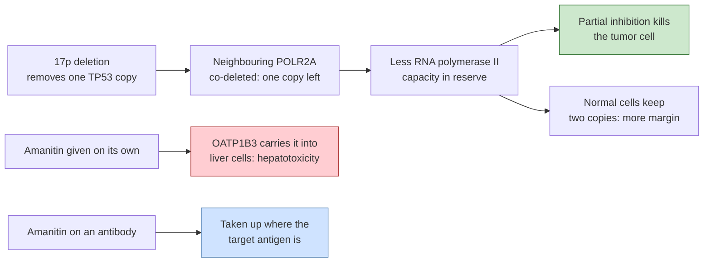

# Transcription-inhibitor payloads

## In one sentence

Transcription-inhibitor payloads are ADC cargoes that block RNA polymerase II, the enzyme every cell uses to read its genes, so they can kill a cell whether or not it is dividing.

## The intuition

A cell's DNA is a library. **Copying DNA** is making a second library, which happens only when a cell divides. **Transcription** is reading a book aloud so the cell can build the protein described in it, which happens every minute of a cell's life. Most [antibody-drug conjugate (ADC)](/wiki/education/concepts/therapeutics/antibody-based/antibody-drug-conjugate) payloads sabotage the copying: microtubule inhibitors stop the cell pulling its chromosomes apart, and [topoisomerase I (TOP1) inhibitors](/wiki/education/concepts/therapeutics/chemotherapy/topoisomerase-i-inhibitors) turn an unwinding enzyme into a DNA-breaking one when the copying machinery runs into it. Both work best on cells busy dividing — the reason [chemotherapy hits dividing cells hardest](/wiki/education/concepts/biology-basics/cells/cell-division-and-why-chemo-hits-dividing-cells). A transcription poison instead shuts the reading room, and a resting cell still needs to read its genes.

Where the analogy breaks: healthy resting cells read their genes too, so there is no built-in sparing of normal tissue. Everything depends on the antibody delivering the payload only where it should.

## How it works

**The enzyme.** RNA polymerase II transcribes all protein-coding genes; its largest, catalytic subunit is encoded by *POLR2A*. Alpha-amanitin, the principal toxin of the death cap mushroom, binds and specifically inhibits the complex, and the two have been co-crystallized [1]. Without new messenger RNA, short-lived proteins are not replaced and the cell dies, by a route that does not require it to be in [the cell cycle](/wiki/education/concepts/biology-basics/cells/cell-cycle).

**Killing cells that are not dividing.** RNA polymerase II was pursued as a target precisely because proliferating and dormant cancer cells both need it. An amanitin conjugate against a myeloma surface antigen killed proliferating and resting myeloma cells in the laboratory while sparing antigen-negative cells, and single low doses produced durable complete remissions in mice [2]. That matters wherever slow-cycling or [dormant](/wiki/education/concepts/cancer-biology/what-cancer-is/metastasis-and-dormancy) cells are suspected of surviving treatment — as biology, not demonstrated clinical benefit.

**The collateral-vulnerability bet.** *POLR2A* sits on chromosome 17p next to *TP53*, the most frequently inactivated [tumor suppressor](/wiki/education/concepts/cancer-biology/what-cancer-is/oncogene-and-tumor-suppressor) in human cancer. Deleting one copy of the *TP53* region usually takes the neighbours with it, so cells with hemizygous *TP53* deletion carry only one copy of *POLR2A*; see [copy number and loss of heterozygosity](/wiki/education/concepts/measurement/sequencing-basics/copy-number-and-loh). In colorectal cancer, *POLR2A* expression tracked its copy number, and partly suppressing the enzyme — with amanitin or with small interfering RNA — selectively inhibited cells with hemizygous *TP53* loss, independently of p53 itself; low doses of an amanitin conjugate caused complete regressions in mouse models carrying that deletion [3]. The gene is not a driver; it is a bystander whose single remaining copy leaves less margin, which makes this [synthetic lethality](/wiki/education/concepts/therapeutics/how-drugs-work/synthetic-lethality) applied to a deletion rather than a mutation. The same reasoning named *POLR2A* a collateral vulnerability in triple-negative breast cancer, where small interfering RNA against it slowed tumors with hemizygous loss [4].

*Two independent reasons for this payload: a dosage window created by co-deletion (top) and a toxin that only antibody delivery makes usable (bottom).*

**Why it cannot be given as a drug.** Amanitin harms the liver and kidneys [5], and liver cells take it up through a specific transporter, OATP1B3 [6]. It therefore needs a vehicle that directs it to chosen tumor cells, which is why its clinical development has been as an ADC payload [7].

## Why it matters in cancer: which failure it addresses

In the three-level frame on [cross-resistance between ADCs](/wiki/education/concepts/therapeutics/antibody-based/adc-cross-resistance), this is a deliberately distant **payload-level** switch: a cell that mutated topoisomerase I, or raised an [efflux pump](/wiki/education/concepts/therapeutics/how-drugs-work/drug-efflux-transporters) suited to a TOP1 payload, has changed nothing about RNA polymerase II. The class also claims reach into non-dividing cells, which tubulin and TOP1 payloads kill poorly. It does nothing about **delivery** failure: if the antibody never reaches or enters the cell, the payload is irrelevant.

## What could break the bet

- **Liver and kidney toxicity.** The organ damage of amatoxin poisoning sets the floor on tolerability, and any payload released in blood or taken up through OATP1B3 points the toxin at the liver. The nonclinical reports of a promising [therapeutic index](/wiki/education/concepts/therapeutics/how-drugs-work/therapeutic-index) [2] are laboratory claims; see also [ADC payload toxicity](/wiki/education/concepts/therapeutics/toxicities-and-supportive-care/adc-payload-toxicity).
- **Potency forces a narrow design.** Because so little toxin suffices, these conjugates carry few payload molecules per antibody and need a linker that does not release the drug in circulation; the published conjugates report long half-lives without premature release in serum [8]. A leaking linker turns a delivery vehicle into a poison infusion; see [ADC conjugation chemistry](/wiki/education/concepts/therapeutics/antibody-based/adc-conjugation-chemistry).
- **Little help for antigen-negative neighbours.** Amanitin enters liver cells through a transporter rather than by passive diffusion [6], so it is not an obvious candidate for the bystander killing that helps deruxtecan payloads in tumors with uneven [target expression](/wiki/education/concepts/therapeutics/antibody-based/target-expression-vs-adc-response).
- **The collateral-vulnerability window may be too narrow.** The bet is that one gene copy rather than two changes sensitivity enough to matter in a patient. The published work measured copy number and expression in cell lines and models, not in treated people [3, 4].
- **One supporting report has been retracted.** A 2021 study of an amanitin-conjugated HER2 antibody in HER2-low breast cancer with 17p loss was retracted in 2026; it is not evidence and is not relied on here.

## Evidence so far, graded honestly

| Rung | What has been shown | What it does not show |
|---|---|---|
| Laboratory and animal | Specific inhibition of RNA polymerase II; killing of resting as well as dividing cells; selective activity with hemizygous *TP53*/*POLR2A* loss; complete regressions in mice, including a TROP2-directed amanitin conjugate that outperformed an approved TOP1 ADC in pancreatic and triple-negative breast cancer xenografts [2, 3, 8] | Activity in human breast cancer; that xenograft superiority predicts clinical superiority |
| Phase 1 | A BCMA-directed amanitin conjugate is in dose-finding in relapsed or refractory multiple myeloma, with a second early study in China. The sponsor reports responses in about 4 in 10 evaluable patients pooled across higher-dose groups, but fewer at the chosen dose (2 of 5); no peer-reviewed results are published [9] | Any confirmed response rate, dose-limiting toxicity profile, or test of the 17p hypothesis in patients |
| Randomized | None identified | — |

**No human breast cancer data of any kind exist for this payload class.** One preclinical preprint describes enhanced activity in myeloma models engineered to mimic 17p deletion [10].

## What evidence would settle it

A phase 1 study reporting liver enzymes and dose-limiting toxicities against the delivered payload dose, with *POLR2A* copy number or 17p status pre-specified as a stratifying factor. Without that stratification, a response in an unselected group can neither confirm nor refute the collateral-vulnerability idea, and a signal in myeloma says little about a solid tumor the antibody must first penetrate.

## Common confusions

- **Transcription is not DNA copying.** Blocking transcription stops the cell making messenger RNA; blocking replication stops it making a second genome. Only the second is confined to dividing cells.
- **"Kills resting cells" is not "kills only cancer cells".** Resting normal cells transcribe too. The selectivity comes from the antibody and, hypothetically, from gene dosage — never from the payload alone.
- ***POLR2A* loss is not a driver.** It is a passenger deletion. Nothing about it helps the tumor; it is a side effect of deleting *TP53*.
- **Hemizygous is not homozygous.** The bet needs one working copy. A cell with no copies of *POLR2A* is not viable, and a cell with two copies has normal margin.
- **Amanitin is not a conventional cytotoxic drug that happens to be strong.** It has no stand-alone clinical use at all, for the transporter-driven liver reason above.

## In Diana's case

How this applies to her is owned by the [drug-panel preferences](/wiki/diagnostics/drug-panel-preferences) page.

## Related concepts

- [ADC payload classes](/wiki/education/concepts/therapeutics/antibody-based/adc-payload-classes)
- [Cross-resistance between ADCs](/wiki/education/concepts/therapeutics/antibody-based/adc-cross-resistance)
- [DNA-damage-response inhibitor payloads](/wiki/education/concepts/therapeutics/antibody-based/ddr-inhibitor-payloads)
- [Next-generation TOP1 payloads](/wiki/education/concepts/therapeutics/antibody-based/next-generation-top1-payloads)
- [Central dogma](/wiki/education/concepts/biology-basics/genetics/central-dogma)
- [Copy number and loss of heterozygosity](/wiki/education/concepts/measurement/sequencing-basics/copy-number-and-loh)
- [Synthetic lethality](/wiki/education/concepts/therapeutics/how-drugs-work/synthetic-lethality)
- [Oncogene addiction versus synthetic lethality](/wiki/education/concepts/cancer-biology/what-cancer-is/oncogene-addiction-vs-synthetic-lethality)
- [Metastasis and dormancy](/wiki/education/concepts/cancer-biology/what-cancer-is/metastasis-and-dormancy)
- [ADC conjugation chemistry](/wiki/education/concepts/therapeutics/antibody-based/adc-conjugation-chemistry)

## Sources and scope

Source check: November 8, 2026. Mechanism and preclinical claims from primary papers; clinical status from trial registry records read on that date. One frequently cited breast cancer report in this area has been retracted and is excluded. A different transcription-directed design, a TROP2 dual-payload conjugate pairing exatecan with the transcription inhibitor triptolide, has laboratory work [11] and an unquantified early human report; see [the plain-language payload summary](/wiki/research/reviews/2026-11-new-adc-payloads-short-version).

1. [Bushnell et al., 2002](https://pubmed.ncbi.nlm.nih.gov/11805306/) — structural basis of transcription: the alpha-amanitin-RNA polymerase II co-crystal.
2. [Figueroa-Vazquez et al., 2021](https://pubmed.ncbi.nlm.nih.gov/33298585/) — an anti-BCMA amanitin conjugate kills proliferating and resting myeloma cells, spares antigen-negative cells and causes regressions in mice.
3. [Liu et al., 2015](https://pubmed.ncbi.nlm.nih.gov/25901683/) — *POLR2A* co-deleted with *TP53*; hemizygous loss creates sensitivity to *POLR2A* suppression, with complete regressions in colorectal models. An erratum was published in 2021.
4. [Xu et al., 2019](https://pubmed.ncbi.nlm.nih.gov/30804480/) — *POLR2A* as a collateral vulnerability in triple-negative breast cancer. Two errata were published.
5. [Liu et al., 2020](https://pubmed.ncbi.nlm.nih.gov/32609548/) — systematic review of amatoxin poisoning: liver and renal failure across 506 reported patients.
6. [Letschert et al., 2006](https://pubmed.ncbi.nlm.nih.gov/16495352/) — OATP1B3 as the human liver uptake transporter for amatoxins.
7. [Pahl, Lutz and Hechler, 2018](https://pubmed.ncbi.nlm.nih.gov/30553524/) — review of amanitins as an ADC payload.
8. [Papacharisi et al., 2025](https://pubmed.ncbi.nlm.nih.gov/39564769/) — TROP2-directed amanitin conjugates: picomolar potency, about 10-day half-life without premature release in serum, and tumor eradication in pancreatic and triple-negative breast cancer xenografts at tolerated doses.
9. ClinicalTrials.gov: [the BCMA-directed amanitin conjugate dose-finding study](https://clinicaltrials.gov/study/NCT04879043) and [a second early study](https://clinicaltrials.gov/study/NCT07529782). Response counts from the [sponsor's nine-month 2026 report](https://heidelberg-pharma.com/en/press-investors/announcements/press-releases-and-ad-hoc-announcements/pr-heidelberg-pharma-reports-on-the-first-nine-months-of-financial-year-2026) (not peer-reviewed; 13 of 31 evaluable pooled across dose groups 5–9).
10. [Singh et al., 2024](https://pubmed.ncbi.nlm.nih.gov/38260385/) — preprint: enhanced activity of the same conjugate in models mimicking 17p deletion.
11. [Ren et al., 2026](https://pubmed.ncbi.nlm.nih.gov/41121984/) — a dual-payload ADC platform integrating exatecan and triptolide; preclinical.

<!-- BEGIN GENERATED USED IN -->
## Used in

- [Read a new payload strategy](/wiki/education/guides/aiming-a-drug-at-a-surface-target/05-read-a-new-payload-strategy)
- [Aiming a drug at a surface target](/wiki/education/guides/aiming-a-drug-at-a-surface-target/index)
<!-- END GENERATED USED IN -->
