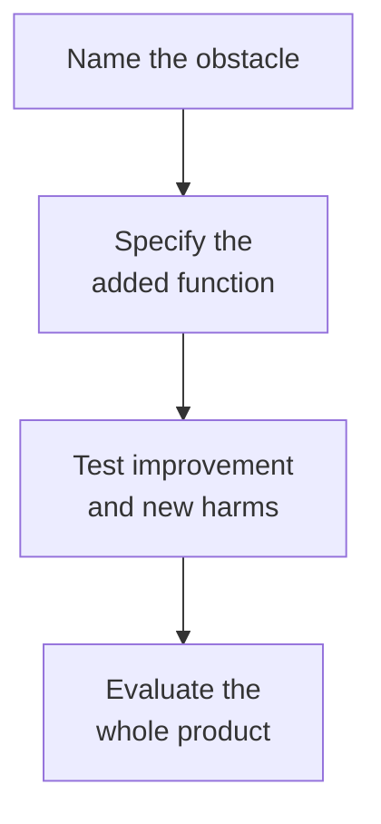

# Armoring an immune-cell therapy

## In one sentence

Armoring adds engineered functions to an immune-cell therapy to help it act or survive in a difficult environment, beyond its basic target-recognition receptor.

## The intuition

Think of adding a tool for one obstacle: a better signal receiver or a way to resist one suppressive message. “Armor” is a hopeful metaphor, not a shield against every hazard. An added function can protect useful activity while also making harmful activity stronger or harder to stop.

## How it works

A basic [chimeric antigen receptor (CAR)](/wiki/education/concepts/therapeutics/cell-therapies/car-anatomy) connects recognition to signaling. **Armoring** usually describes additional functions, such as cytokine production or resistance to a suppressive pathway. Usage varies across studies, so read the actual engineered change rather than relying on the label.

One approach adds support from [cytokines](/wiki/education/concepts/immunology/immune-regulation/cytokine-and-chemokine), signaling proteins that influence immune behavior. Interleukin-15 support was included in one engineered [natural killer (NK)-cell](/wiki/education/concepts/immunology/innate-and-unconventional-cells/nk-cell-and-missing-self) clinical construct. The construct had several features; its outcomes do not isolate the contribution of the cytokine component. [The primary study](https://pubmed.ncbi.nlm.nih.gov/32023374/) makes the combined design explicit.

Another approach changes a response to **transforming growth factor beta (TGF-β)**, a signaling protein with context-dependent effects, including suppression of some T-cell functions. A **dominant-negative TGF-β receptor II (dnTGFβRII)** adds a receptor variant that interferes with normal TGF-β signaling. This differs from deleting the receptor gene; neither change blocks every suppressive pathway. A prostate-cancer phase 1 study tested T cells with such a receptor alongside a CAR. It established human feasibility for that design and reported serious harms, including a fatal event with severe inflammation and concurrent sepsis. [The trial](https://pubmed.ncbi.nlm.nih.gov/35314843/) does not show that all suppression was overcome.

**TRUCKs**, commonly expanded as **T cells redirected for universal cytokine-mediated killing**, are a cytokine-payload approach to armoring. In an early design, CAR engagement activated a promoter responsive to **nuclear factor of activated T cells (NFAT)**, increasing interleukin-12 production. A promoter controls when a gene is transcribed. In the tested tumor models, released cytokine recruited macrophage activity against antigen-loss cells. That indirect effect did not change what the CAR itself recognized. “Universal” is part of the name, not proof of universal cancer killing. [Primary experiment](https://pubmed.ncbi.nlm.nih.gov/21742772/), [framework terminology](https://pubmed.ncbi.nlm.nih.gov/22274776/).

Payload control matters. A cytokine may be secreted continuously, induced by activation or held near the cell surface. “Tumor-triggered” production does not automatically mean effects stay inside the tumor. A secreted protein can spread and affect other cells. A melanoma study of inducible interleukin-12-producing cells reported tumor responses alongside serious systemic toxicity. [That study](https://pubmed.ncbi.nlm.nih.gov/25695689/) is a reminder to measure distribution and harm alongside activity.

Useful evaluation compares otherwise matched cells with and without the added feature. It measures behavior with relevant suppressive signals, repeated stimulation and healthy-tissue targets. Whole-product clinical results then ask about benefit and safety. An increase in cell number alone cannot establish either.

*An added function introduces a new benefit hypothesis and a new safety question.*

## Why it matters in cancer

Solid tumors can suppress cells that recognize them correctly. Armoring tries to address a particular barrier. It does not restore a missing antigen, guarantee entry into every lesion or create a safe target on healthy tissue.

## Read the added function as a test card

| Field | Keep visible |
|---|---|
| Design | Exact cytokine, receptor variant or other payload; continuous versus induced expression |
| Input and cost | Viable engineered cells and relevant target/control cells; repeated testing consumes cells |
| Readouts | Secreted cytokine concentration, for example picograms/mL; viable cell counts; target-cell killing at a named time |
| Comparison | Otherwise matched cells without the armor, tested with and without the proposed inhibitory signal |
| Limits | Blood accumulation does not establish tumor entry, useful function or whole-product safety |

There is no universal “enough armor” cutoff. A result depends on the cell source, construct, stimulation and assay. Cytokine concentration in a culture is not the same as exposure throughout a body.

## Worked example and practice

A fictional armored CAR-T cell resists one inhibitory message. It kills more X-positive cancer cells in a suppressive culture. Healthy organ cells also display X.

**Try it:** Does the improvement establish a wider safety window?

**Answer:** No. The same resistance may increase healthy-tissue killing. Compare antitumor activity and normal-tissue injury under matched conditions, then evaluate the full product in an appropriate clinical setting.

## Common confusions

- Armoring is not one standardized modification.
- Cytokine secretion differs from changing only an intracellular signaling response.
- Local triggering does not prove local-only exposure.
- Resistance to one pathway is not resistance to the entire tumor environment.

## Explain it back

“This armor changes ___, while ___ still needs evidence.” One answer: “one specified signaling response; tumor access, target coverage and whole-product safety.”

## Takeaway

**Name the obstacle and the added function, then test intended improvement and new harms separately.**

## Related concepts

- [CAR anatomy](/wiki/education/concepts/therapeutics/cell-therapies/car-anatomy)
- [Cytokine and chemokine](/wiki/education/concepts/immunology/immune-regulation/cytokine-and-chemokine)
- [T cell states](/wiki/education/concepts/immunology/t-cells/t-cell-states)

## Sources and scope

Source check: October 10, 2026; expert and learner review pending. This is foundational teaching, not a treatment recommendation. Worked examples are fictional.

- [Chmielewski et al., 2011](https://pubmed.ncbi.nlm.nih.gov/21742772/) and [Chmielewski and Abken, 2012](https://pubmed.ncbi.nlm.nih.gov/22274776/) — inducible IL-12 primary tumor-model experiment and the TRUCK framework; not universal clinical killing.
- [Narayan et al., 2022](https://pubmed.ncbi.nlm.nih.gov/35314843/) — TGF-β-insensitive armored cells in metastatic castration-resistant prostate cancer.
- [Zhang et al., 2015](https://pubmed.ncbi.nlm.nih.gov/25695689/) — inducible interleukin-12-producing TILs in metastatic melanoma, with systemic toxicity.
- [Liu et al., 2020](https://pubmed.ncbi.nlm.nih.gov/32023374/) — combined CAR, interleukin-15 and safety-switch construct in lymphoid cancers.

<!-- BEGIN GENERATED USED IN -->
## Used in

- [Building an engineered T cell](/wiki/education/cellular-therapies/05-engineered-t-cell-building-blocks)
- [Cytokines and programmable receptors](/wiki/education/cellular-therapies/07-cytokines-and-programmable-receptors)
- [The journey through a solid tumor](/wiki/education/cellular-therapies/08-solid-tumor-barriers)
- [How engineered immune cells can attack a solid tumor](/wiki/education/guides/engineered-cell-therapy/index)
<!-- END GENERATED USED IN -->
