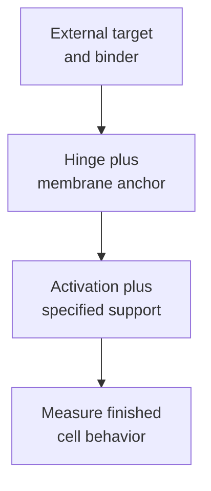

# CAR (chimeric antigen receptor) anatomy

## In one sentence

A chimeric antigen receptor connects an external antigen-binding region to internal signaling machinery in an engineered immune cell.

## The intuition

Imagine fitting a sensor to a living responder. The sensor supplies a new contact rule; the responder still has its own machinery, history and surroundings. A **chimeric antigen receptor (CAR)** joins parts that normally have different jobs. “Chimeric” describes that combination, not a special kind of cancer cell.

The analogy breaks if the sensor sounds like a guaranteed command. Contact can trigger signals, but binding, activation and target-cell death are separate measurements.

## How it works

**CAR-T** means a T cell carrying a CAR. The receptor is a protein; the cell is the living treatment component. A CAR can also be installed in other immune-cell families. Cell family, receptor architecture and [engineering location](/wiki/education/concepts/engineering-and-manufacturing/cell-manufacturing/ex-vivo-vs-in-vivo-engineering) answer different questions.

A common antibody-derived CAR has four connected parts:

| Part | What it contributes | A useful design question |
|---|---|---|
| Binding region | Recognition of an accessible molecular feature | Which [epitope](/wiki/education/concepts/immunology/antigen-presentation/antigen-and-epitope), on cancer and healthy cells? |
| Hinge or spacer | Reach and flexibility | Can the binder make the right membrane-to-membrane contact? |
| Transmembrane region | Anchoring, assembly and interactions | Does a functional receptor reach the cell surface? |
| Intracellular domains | Signals after contact | What activity follows, including unwanted baseline signaling? |

A [single-chain variable fragment (scFv)](/wiki/education/concepts/engineering-and-manufacturing/binders/scfv-and-vhh-nanobodies) is one binding format. Spacer length is not a “longer wins” choice. Hudecek and colleagues found that specific antibody-derived spacers could interact with immune-cell receptors and impair activity in mouse models, despite useful killing in a dish.

A conventional surface-target CAR can recognize an accessible antigen without conventional peptide–[human leukocyte antigen (HLA)](/wiki/education/concepts/immunology/antigen-presentation/hla) presentation. A conventional [T-cell receptor (TCR)](/wiki/education/concepts/immunology/t-cells/t-cell-receptor) instead reads peptide and HLA together. Specialized CAR binders can recognize peptide–HLA targets, so identify the actual target before calling a construct HLA-independent.

### Generations describe architecture, not a league table

In common usage, a **first-generation** CAR has an activation-signaling region, often the zeta chain of the **cluster of differentiation 3 (CD3)** complex. A **second-generation** CAR adds one intracellular [costimulatory](/wiki/education/concepts/immunology/t-cells/costimulation) region; a **third-generation** CAR incorporates two. The early single-chain experiments and Ramos comparison illustrate these architectures.

Frequently borrowed regions come from **CD28 (cluster of differentiation 28)** or **4-1BB**, also called CD137. These are signaling regions within the engineered receptor, rather than separate injected receptors. Kawalekar's defined human-cell experiments associated these designs with different metabolic and memory features. They did not establish a universal persistence, speed, safety or patient-benefit ranking.

Some authors call designs with inducible cytokine release **fourth-generation** or **TRUCKs**: T cells redirected for antigen-unrestricted cytokine-initiated killing. The [armoring concept](/wiki/education/concepts/therapeutics/cell-therapies/armoring) explains the added program and its research limits. Later generation labels vary: ask for actual domains and genes rather than assuming a standardized product or improvement.

*Component choices meet in one receptor; the finished cell still needs testing.*

## Why it matters in cancer

The intended antigen can be shared with healthy tissue, causing [on-target, off-tumor toxicity](/wiki/education/concepts/therapeutics/toxicities-and-supportive-care/on-target-off-tumor-toxicity). Greater affinity might alter recognition of both cancer and normal cells. Receptor architecture also cannot solve absent antigen, poor tumor access or every inhibitory signal.

## How it is measured

[Flow cytometry](/wiki/education/concepts/measurement/immune-monitoring/flow-cytometry) can assess viable receptor-positive cells and target abundance under defined gates. Binding assays test interaction; stimulation and [cytotoxicity assays](/wiki/education/concepts/measurement/immune-monitoring/functional-cytotoxicity-assays) test downstream responses. Include target-negative cells, relevant healthy cells, unmodified-cell controls and unstimulated baseline activity. Report cell preparation, antigen levels and assay conditions. None is a clinical-benefit test by itself.

## Common confusions

- A CAR, its encoding instructions and a CAR-bearing cell are different objects.
- Two costimulatory domains do not guarantee twice the activity or better outcomes.
- A matching surface target does not establish an acceptable safety window.
- Delivery targeting and cancer targeting are separate jobs.

## Try it

A fictional third-generation CAR kills more targets than a second-generation CAR. Its binder, hinge and cell preparation also differ. Has the extra signaling domain caused the difference?

**Answer:** The comparison cannot isolate that cause. Use matched constructs and preparations, then test function and harms. The generation labels alone do not identify which change mattered.

## Explain it back

“The generation describes ___; useful therapy still requires ___.” One answer: “signaling architecture; evidence for the complete receptor, cells, target and clinical setting.”

## Takeaway

**Read the parts and the experiments before judging a CAR by its generation.**

## Related concepts

- [DNA, RNA and protein](/wiki/education/concepts/biology-basics/genetics/central-dogma)
- [Cell therapy as a living drug](/wiki/education/concepts/therapeutics/cell-therapies/cell-therapy-as-a-living-drug)
- [TCR-T](/wiki/education/concepts/therapeutics/cell-therapies/tcr-t)
- [Immune escape](/wiki/education/concepts/immunology/tumor-immunology/immune-escape)

## Sources and scope

Source check: October 10, 2026; expert and learner review pending. Architectural vocabulary and bounded experiments, not a product ranking or treatment recommendation. The exercise is fictional.

- [Eshhar et al., 1993](https://pubmed.ncbi.nlm.nih.gov/8421711/) — single-chain binding/signaling constructs in experimental lymphocytes.
- [Hudecek et al., 2015](https://pubmed.ncbi.nlm.nih.gov/25212991/) — spacer composition and geometry in specified constructs and mouse models.
- [Kawalekar et al., 2016](https://pubmed.ncbi.nlm.nih.gov/26885860/) — human-cell metabolic and memory comparisons.
- [Ramos et al., 2018](https://pubmed.ncbi.nlm.nih.gov/30309819/) — two specified products co-infused in non-Hodgkin lymphoma; expansion/persistence differences do not isolate comparative clinical benefit.
- [FDA CAR T-cell product-development guidance](https://www.fda.gov/regulatory-information/search-fda-guidance-documents/considerations-development-chimeric-antigen-receptor-car-t-cell-products) — product-specific characterization and nonclinical safety/function tests.

<!-- BEGIN GENERATED USED IN -->
## Used in

- [Cell therapies as living drugs](/wiki/education/cellular-therapies/01-cell-therapy-primer)
- [Compare immune-cell recognition systems](/wiki/education/cellular-therapies/02-car-tcr-til-comparison)
- [Building an engineered T cell](/wiki/education/cellular-therapies/05-engineered-t-cell-building-blocks)
- [How to engineer T cells inside the body](/wiki/education/cellular-therapies/06-in-vivo-delivery)
- [Cytokines and programmable receptors](/wiki/education/cellular-therapies/07-cytokines-and-programmable-receptors)
- [The journey through a solid tumor](/wiki/education/cellular-therapies/08-solid-tumor-barriers)
- [Reading cell-therapy evidence](/wiki/education/cellular-therapies/09-reading-cell-therapy-evidence)
- [HLA and antigen presentation in vaccine design](/wiki/education/designing-a-vaccine/02-hla-and-antigen-presentation)
- [Aiming a drug at a surface target](/wiki/education/guides/aiming-a-drug-at-a-surface-target/index)
- [Choose a target with a usable safety window](/wiki/education/guides/engineered-cell-therapy/02-choosing-a-target)
- [Read the safety plan for engineered cells](/wiki/education/guides/engineered-cell-therapy/07-reading-the-safety-plan)
- [How engineered immune cells can attack a solid tumor](/wiki/education/guides/engineered-cell-therapy/index)
- [Why a T-cell count does not tell the whole story](/wiki/education/oncology-101/3-t-cell-states)
- [Find the step an immune response can lose](/wiki/education/oncology-101/4-escape-mechanisms)
- [Separate the address from the killing mechanism](/wiki/education/targeted-therapy-modalities/01-mechanism)
- [Follow delivery, exposure, and the treatment clock](/wiki/education/targeted-therapy-modalities/02-timing)
- [Questions for a targeted-therapy proposal](/wiki/education/targeted-therapy-modalities/04-decision-questions)
- [Compare formats with evidence and normal-tissue risk](/wiki/education/targeted-therapy-modalities/06-comparisons)
- [Targeted therapy mechanisms and comparisons](/wiki/education/targeted-therapy-modalities/index)
- [CAR-T learning lab](/wiki/education/tools/in-vivo-car-t-learning-lab)
<!-- END GENERATED USED IN -->
