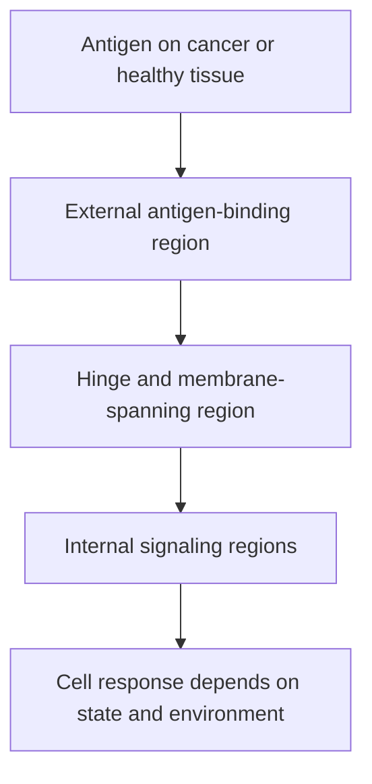

# CAR (chimeric antigen receptor) anatomy

## In one sentence

A chimeric antigen receptor connects an external antigen-binding region to internal signaling machinery in an engineered immune cell.

## The intuition

A sensor attached to a living responder is different from a free-floating drug. The chimeric antigen receptor (CAR) binds a target and can trigger cellular activity. Its behavior still depends on the cell, the target and the surrounding tissue.

## How it works

A typical CAR contains a binding region outside the cell, a hinge and membrane-spanning region, and signaling regions inside. Many designs use antibody-derived binding elements. Common signaling designs combine CD3-zeta with a costimulatory region, such as CD28 or 4-1BB.

A conventional surface-antigen CAR can recognize an accessible antigen without a peptide being presented by human leukocyte antigen ([HLA](/wiki/education/concepts/immunology/antigen-presentation/hla)). This differs from a conventional T-cell receptor, which reads peptide and HLA together. Specialized designs can depart from these common formats.

Antigen density, geometry, binding strength and cell state influence response. Engineering instructions must first yield a correctly expressed receptor. Receptor presence then needs to be distinguished from binding, signaling, killing and durable benefit.

*The same intended antigen can trigger useful recognition or healthy-tissue injury.*

## Why it matters in cancer

A CAR may avoid one presentation dependency while creating target-distribution and healthy-tissue risks. A target on normal tissue can cause on-target, off-tumor injury: the intended binding occurs in an unwanted place.

## Worked example

A fictional CAR recognizes target X. Some cancer cells lack X, while a healthy tissue expresses it. Increasing receptor affinity may change recognition thresholds for both. “Stronger binding” alone cannot decide whether the finished therapy has a better therapeutic window.

## Common confusions

- A CAR is a protein, not the engineered cell or the delivered gene.
- HLA-independent recognition does not guarantee safe tumor coverage.
- Delivery targeting and cancer targeting are separate jobs.

## Related concepts

- [DNA, RNA and protein](/wiki/education/concepts/biology-basics/genetics/central-dogma)
- [[TCR](/wiki/education/concepts/immunology/t-cells/t-cell-receptor)](/wiki/education/concepts/immunology/t-cells/t-cell-receptor)
- [Lipid nanoparticles](/wiki/education/concepts/engineering-and-manufacturing/delivery-vehicles/lipid-nanoparticle)
- [immune escape](/wiki/education/concepts/immunology/tumor-immunology/immune-escape)

## Sources and scope

Source check: October 8, 2026. This is a mechanism explanation, not a treatment recommendation. Expert and learner review remain pending.

- [NCI CAR design overview](https://www.cancer.gov/about-cancer/treatment/research/car-t-cells).
- [FDA CAR T-cell product-development guidance](https://www.fda.gov/regulatory-information/search-fda-guidance-documents/considerations-development-chimeric-antigen-receptor-car-t-cell-products).

<!-- BEGIN GENERATED USED IN -->
## Used in

- [Cell therapies as living drugs](/wiki/education/cellular-therapies/01-cell-therapy-primer)
- [Compare immune-cell recognition systems](/wiki/education/cellular-therapies/02-car-tcr-til-comparison)
- [Building an engineered T cell](/wiki/education/cellular-therapies/05-engineered-t-cell-building-blocks)
- [How to engineer T cells inside the body](/wiki/education/cellular-therapies/06-in-vivo-delivery)
- [Cytokines and programmable receptors](/wiki/education/cellular-therapies/07-cytokines-and-programmable-receptors)
- [The journey through a solid tumor](/wiki/education/cellular-therapies/08-solid-tumor-barriers)
- [Reading cell-therapy evidence](/wiki/education/cellular-therapies/09-reading-cell-therapy-evidence)
- [HLA and antigen presentation in vaccine design](/wiki/education/designing-a-vaccine/02-hla-and-antigen-presentation)
- [Choose a target with a usable safety window](/wiki/education/guides/engineered-cell-therapy/02-choosing-a-target)
- [Read the safety plan for engineered cells](/wiki/education/guides/engineered-cell-therapy/07-reading-the-safety-plan)
- [How engineered immune cells can attack a solid tumor](/wiki/education/guides/engineered-cell-therapy/index)
- [Understand how the immune system recognizes cancer](/wiki/education/guides/how-the-immune-system-fights-cancer/index)
<!-- END GENERATED USED IN -->
