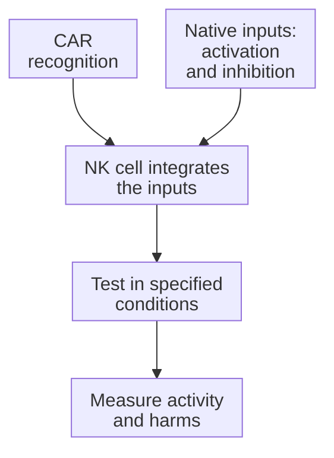

# Chimeric antigen receptor natural killer (CAR-NK) cells

## In one sentence

Chimeric antigen receptor natural killer cells combine an engineered recognition receptor with the activating and inhibitory machinery of a natural killer cell.

## The intuition

Adding a sensor does not replace the whole responder. A natural killer cell can receive a new target-recognition tool while retaining its own biological inputs. The useful question is how those inputs combine, not whether the new sensor turns the cell into a T cell.

## How it works

**Natural killer (NK)** cells integrate native activating and inhibitory signals. A [chimeric antigen receptor (CAR)](/wiki/education/concepts/therapeutics/cell-therapies/car-anatomy) adds another recognition route, commonly for an accessible surface antigen. The resulting cell is called a CAR-NK cell. Its response depends on the complete construct and the NK cell that carries it.

Some inhibitory NK receptors recognize particular [human leukocyte antigen (HLA)](/wiki/education/concepts/immunology/antigen-presentation/hla) class I molecules. Reduced self-display can weaken inhibition: [missing-self recognition](/wiki/education/concepts/immunology/innate-and-unconventional-cells/nk-cell-and-missing-self). Activating signals, prior NK education and the environment still matter. HLA loss does not guarantee killing by any NK product.

Cell sources include donor blood, umbilical cord blood and cells derived from induced pluripotent stem cells. These are different starting materials with different manufacturing and quality questions. Donor-derived products face host immune rejection; the absence of a conventional T-cell receptor does not remove every compatibility or contamination risk.

Engineering can add [supportive signaling](/wiki/education/concepts/therapeutics/cell-therapies/armoring) or a [cell-elimination switch](/wiki/education/concepts/therapeutics/cell-therapies/safety-switches). Those features may change expansion and persistence, so a short lifespan should not be assigned to every CAR-NK product. [One cord-blood CAR-NK study](https://pubmed.ncbi.nlm.nih.gov/32023374/) combined a CAR with interleukin-15 support and inducible caspase-9. Its observed behavior belongs to that construct and treated population.

The living cells must reach the tumor, recognize enough cells and function under local inhibition. An endogenous recognition route might complement CAR binding, but that contribution needs measurement. A laboratory result against a target-negative cell cannot by itself establish durable control of mixed solid tumors.

*A CAR adds an input to an NK cell; it does not erase the cell's other regulatory machinery.*

## Why it matters in cancer

CAR-NK therapy explores engineered recognition in a different effector family. That motivates comparisons of manufacture, persistence, tumor access and toxicity. It does not justify ranking all NK products as safer than all T-cell products.

A small blood-cancer study with favorable observations cannot establish that a new construct has no inflammatory or neurologic risk. Nor can it establish efficacy against a solid tumor with different access and target conditions.

## How it is measured

To separate the added CAR from native NK activity, compare engineered and matched unmodified cells against otherwise matched target-positive and target-negative cells. Perturbing the target or a native receptor can help attribute an effect, but changed target viability and other ligand changes need controls. [Flow cytometry](/wiki/education/concepts/measurement/immune-monitoring/flow-cytometry) can establish identity, viable-cell counts and CAR expression; a [cytotoxicity assay](/wiki/education/concepts/measurement/immune-monitoring/functional-cytotoxicity-assays) measures target death under stated conditions.

Keep cell source, engineering, culture history, effector-to-target ratio and observation time attached to the result. Cytokine release or granule release is not the same endpoint as completed target killing. Neither proves tumor entry or clinical benefit.

## Worked example and practice

A fictional tumor loses a presenting HLA allele but retains surface antigen X. A CAR-NK product recognizes X in culture.

**Try it:** Has HLA loss established that the product will work better in the patient?

**Answer:** No. The CAR route may retain recognition, and changed native inhibition may matter. Investigators still need evidence for the actual cell–target pair, access, persistence, healthy-tissue recognition and clinical effect.

## Common confusions

- NK cells and natural killer T cells are distinct families.
- CAR binding and missing-self recognition are different inputs.
- Donor-derived does not mean universally compatible.
- A product with engineered cytokine support need not behave like an unmodified NK cell.

## Explain it back

“CAR-NK names ___ plus ___.” One answer: “an engineered recognition tool; an NK-cell effector with its own regulatory inputs.”

## Takeaway

**Test the added CAR route and the NK cell's native regulation in the same product context.**

## Related concepts

- [CAR anatomy](/wiki/education/concepts/therapeutics/cell-therapies/car-anatomy)
- [Natural killer cells and missing self](/wiki/education/concepts/immunology/innate-and-unconventional-cells/nk-cell-and-missing-self)
- [Cell therapy as a living drug](/wiki/education/concepts/therapeutics/cell-therapies/cell-therapy-as-a-living-drug)

## Sources and scope

Source check: October 10, 2026; expert and learner review pending. This is foundational teaching, not a treatment recommendation. Worked examples are fictional.

- [Liu et al., 2020](https://pubmed.ncbi.nlm.nih.gov/32023374/) — one cord-blood construct in relapsed or refractory CD19-positive lymphoid cancers.
- [Kärre et al., 1986](https://pubmed.ncbi.nlm.nih.gov/3951539/) — missing-self recognition in mouse lymphoma experiments.
- [FDA lymphocyte-product guidance](https://www.fda.gov/regulatory-information/search-fda-guidance-documents/considerations-development-chimeric-antigen-receptor-car-t-cell-products) — related engineered NK products require their own evaluation.

<!-- BEGIN GENERATED USED IN -->
## Used in

- [Compare immune-cell recognition systems](/wiki/education/cellular-therapies/02-car-tcr-til-comparison)
- [How engineered immune cells can attack a solid tumor](/wiki/education/guides/engineered-cell-therapy/index)
<!-- END GENERATED USED IN -->
