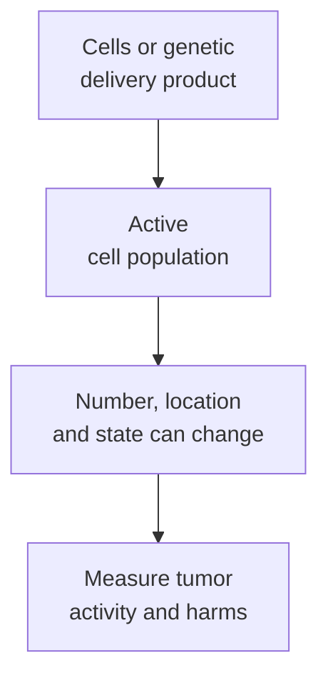
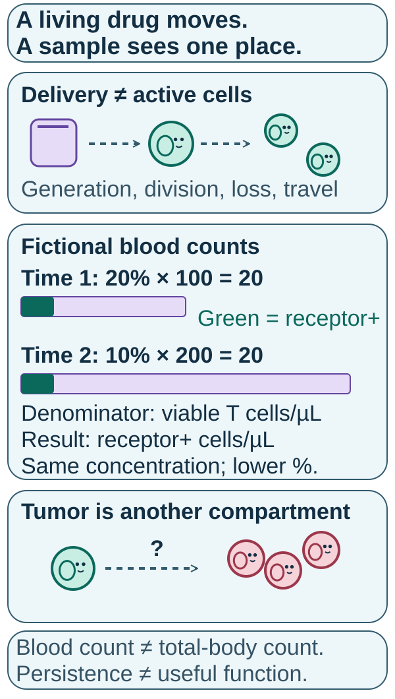

# Cell therapy as a living drug

## In one sentence

A cell therapy is a living drug when the administered or newly engineered cells can change their number, location and behavior after treatment.

## The intuition

Think of the administered dose as a starting team, not a fixed pile of molecules. Some cells may divide, some may die, and others may move into tissue. The team analogy stops at intention: cells respond to molecular signals rather than making conscious plans.

## How it works

An infused cell dose names a population at administration. Later abundance reflects division, survival and distribution. For in vivo engineering, continued generation of newly engineered cells may also contribute. A change in blood concentration cannot separate these mechanisms by itself. A blood sample sees one compartment at one time. It cannot count every cell in the body or establish entry into a tumor. The original [engineered natural killer-cell study](https://pubmed.ncbi.nlm.nih.gov/32023374/) measured expansion and persistence in a defined blood-cancer setting.

Cells also change state. Activation, inhibition and [cytokines](/wiki/education/concepts/immunology/immune-regulation/cytokine-and-chemokine) can alter growth and function. A cell that remains detectable may no longer kill effectively. Conversely, a small sampled population may miss activity elsewhere. Persistence, location and useful function therefore need separate measurements.

The active cell and the administered product are not always the same thing. In ex vivo engineering, cells are changed outside the body and then administered. In in vivo engineering, a delivery product carries instructions into cells inside the body. Its dose does not directly specify the final number of engineered cells.

Cell source is another axis. [**Autologous** means the person's own cells; **allogeneic** means cells from another person](/wiki/education/concepts/engineering-and-manufacturing/cell-manufacturing/autologous-vs-allogeneic-cell-therapy). An off-the-shelf carrier can engineer autologous cells. A donor-derived cell product can be prepared in advance. Availability of the vial does not tell us whose cells perform the work.

*The starting dose is an input; downstream cell behavior is an outcome to measure.*

## Why it matters in cancer

Expansion and persistence can support prolonged activity. They can also extend harmful recognition or inflammation. Stopping further administration does not instantly remove cells, receptors or effects already triggered. [Safety switches](/wiki/education/concepts/therapeutics/cell-therapies/safety-switches) address specified control mechanisms; they are not automatic antidotes to every injury.

Manufacturing identity, viability and potency are needed before administration. Follow-up then asks where cells go, how they behave and whether patients benefit. A high cell count answers only part of that sequence.

## How it is measured

Specify the denominator. [Flow cytometry](/wiki/education/concepts/measurement/immune-monitoring/flow-cytometry) may report receptor-positive cells as a percentage of viable T cells. An absolute count adds a number per volume, such as cells per microliter. A genetic assay may count receptor-encoding sequences; that is not automatically a count of viable, surface-expressing, functional cells.

Compare the same compartment and method at stated times. Persistence of a detectable marker, functional potency and patient outcome answer different questions. The [FDA guidance](https://www.fda.gov/regulatory-information/search-fda-guidance-documents/considerations-development-chimeric-antigen-receptor-car-t-cell-products) treats identity, viability and activity as distinct characterization needs.

## Worked example and practice

*Fictional blood counts: 20% of 100 and 10% of 200 viable T cells per microliter both give 20 receptor-positive cells per microliter. These are concentrations in sampled blood, not total-body cell counts, tumor entry or useful function. The two bars share a scale; their equal green segments show the same receptor-positive concentration.*

A fictional carrier creates receptor-positive T cells inside the patient. The blood count rises, but a tumor sample contains few engineered cells.

**Try it:** Does the rising count establish successful tumor treatment?

**Answer:** It supports generation or accumulation in the sampled blood compartment. Tumor access, recognition, function, safety and benefit remain separate questions. Check sampling time and whether the biopsy represents the disease.

**A denominator check:** In another fictional blood sample, receptor-positive cells are 20% of 100 viable T cells per microliter. Later they are 10% of 200. Both estimates are **20 receptor-positive cells per microliter**. The percentage halved while the absolute concentration stayed the same. This does not prove unchanged total-body cell number or unchanged tumor activity.

## Common confusions

- A cell dose and a later cell count are different measurements.
- Detectable cells are not necessarily functional cells.
- In vivo engineering does not mean donor-derived cells.
- More expansion can increase useful activity or harmful activity.

## Explain it back

“A living drug changes ___ after administration, so I need to measure ___.” One answer: “number, location and state; activity and harms in the relevant tissues.”

## Takeaway

**A living drug's starting dose, sampled abundance and useful function must be described separately.**

## Related concepts

- [Immune cell roster](/wiki/education/concepts/immunology/the-immune-system/immune-cell-roster)
- [Central dogma](/wiki/education/concepts/biology-basics/genetics/central-dogma)

## Sources and scope

Source check: October 10, 2026; expert and learner review pending. This is foundational teaching, not a treatment recommendation. Worked examples are fictional.

- [NCI T-cell transfer therapy](https://www.cancer.gov/about-cancer/treatment/types/immunotherapy/t-cell-transfer-therapy) — collection, expansion and transfer of immune cells.
- [Liu et al., 2020](https://pubmed.ncbi.nlm.nih.gov/32023374/) — expansion and persistence of one engineered natural killer-cell construct in relapsed or refractory CD19-positive lymphoid cancers.
- [FDA cell-product development guidance](https://www.fda.gov/regulatory-information/search-fda-guidance-documents/considerations-development-chimeric-antigen-receptor-car-t-cell-products) — characterization and evaluation of the complete product.

<!-- BEGIN GENERATED USED IN -->
## Used in

- [Cell therapies as living drugs](/wiki/education/cellular-therapies/01-cell-therapy-primer)
- [Read the safety plan for engineered cells](/wiki/education/guides/engineered-cell-therapy/07-reading-the-safety-plan)
- [How engineered immune cells can attack a solid tumor](/wiki/education/guides/engineered-cell-therapy/index)
<!-- END GENERATED USED IN -->
