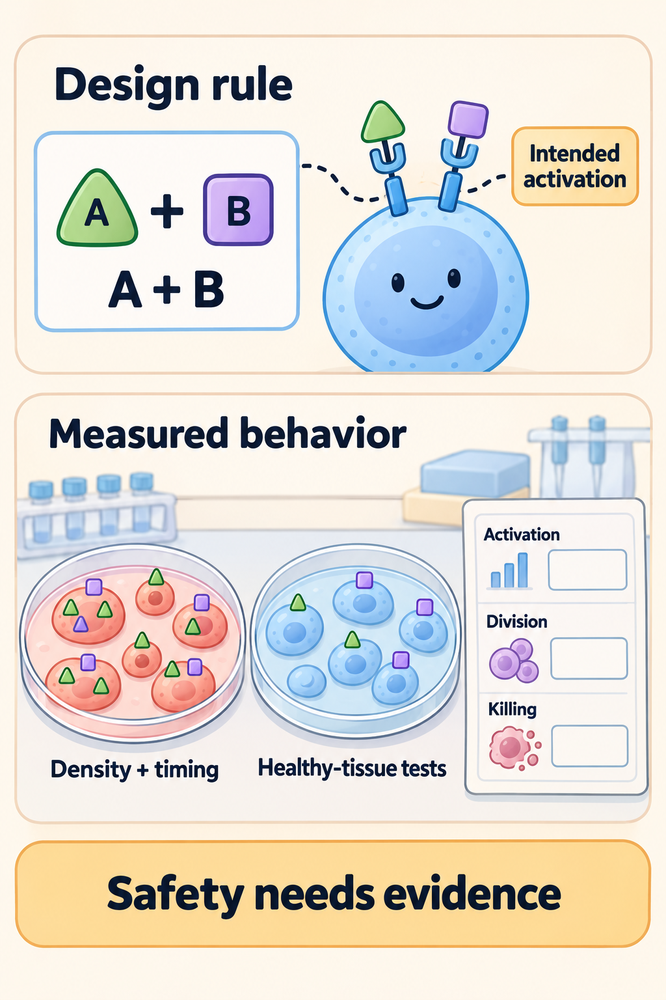
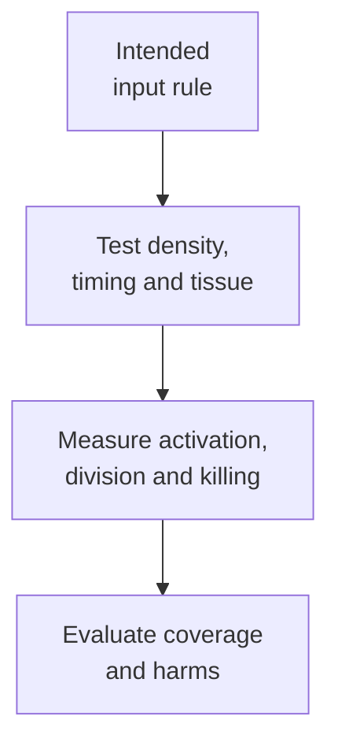

# Logic-gated chimeric antigen receptors

## In one sentence

Logic-gated chimeric antigen receptor systems combine multiple recognition inputs to broaden coverage or restrict when an engineered cell becomes active.

## The intuition

“Respond when A and B are present” is a useful starting rule. Biology adds thresholds, timing and imperfect expression. A logic diagram describes the intended behavior; it is not proof that cells obey a perfect digital truth table in every tissue.

*Fictional A/B design: the card states an intended rule. The assay pictures illustrate separate readouts, with empty result fields. Antigen density, timing and healthy-tissue function need measurements; this picture supplies no safety or clinical-benefit result.*

## How it works

A [chimeric antigen receptor (CAR)](/wiki/education/concepts/therapeutics/cell-therapies/car-anatomy) can recognize a target also found on healthy tissue. Combining recognition inputs aims to distinguish a useful tumor pattern from less useful or harmful patterns. Different designs implement those combinations differently.

An **AND-like system** aims to require two inputs. One implementation splits activation and costimulation between receptors, with signaling tuned so either input alone is insufficient under tested conditions. A [primary engineered-cell study](https://pubmed.ncbi.nlm.nih.gov/23242161/) demonstrated this principle in tumor models. Simply coexpressing two fully activating CARs does not create an AND requirement.

An **OR-like system** can respond to either target. A CD19/CD20 bispecific CAR study tested this coverage strategy in B-cell tumor models, with an addendum providing further experiments. It does not establish clinical protection from escape. An OR rule can also add healthy-tissue recognition routes. Broadening coverage and restricting activation are different goals. [Study and addendum](https://pubmed.ncbi.nlm.nih.gov/27059623/).

A **NOT-like system** uses an inhibitory input intended to restrain activation when a protective marker is present. Experimental inhibitory receptors have limited cell responses in defined settings. The balance of activation and inhibition still depends on receptor expression and antigen density. [The inhibitory-receptor study](https://pubmed.ncbi.nlm.nih.gov/24337479/) established a mechanism, not universal protection of normal tissue.

A **synthetic Notch (synNotch)** circuit adds a sequence in time. Recognition of A induces expression of a CAR for B. The cell can then recognize B while that CAR remains present. This differs from requiring A and B to be on the same target at exactly the same moment. Time to turn on, decay after priming and movement between tissues matter. [The original circuit study](https://pubmed.ncbi.nlm.nih.gov/26830879/) tested specified antigen combinations in preclinical models.

Test the positive combination and every relevant missing-input combination. Include low antigen density, mixed cells, separated tissues, repeated encounters and residual activity after the trigger disappears. These are part of the recognition claim, not optional extras after a positive tumor result.

*The names describe intended input rules. Their reliability must be tested in the actual circuit.*

## Why it matters in cancer

Tumors differ within and between lesions. A stricter gate can miss cancer cells lacking an input. A broader gate can recognize additional normal cells. The useful tradeoff requires tumor and healthy-tissue distributions, rather than a list of target names alone.

## What to measure beyond the rule

Record antigen amount on each target population and expression of both engineered receptors. Test A-only, B-only, both and neither, with healthy-tissue controls. **Activation**, such as a signaling or cytokine readout, is not **proliferation**, an increase through cell division, or target-cell **killing**.

Report output units: cytokine concentration, viable cell counts or percent target-cell killing at a stated time. These tests consume viable cells and depend on donor, receptor expression, cell ratios and assay duration. A chosen threshold belongs to that test; it is not a universal binary boundary between safe and unsafe tissue.

## Worked example and practice

An entirely fictional sequential circuit is intended to use A as its priming signal and B as its killing target. In one 24-hour culture, A-plus-B targets yield 70% killing and B-only targets yield 2%. In another experiment, engineered cells first encounter A, then move to a fresh B-only culture; 40% of those targets are killed. The percentages refer to target cells killed in each assay, not people helped.

**Try it:** Is the third result inconsistent with a sequential circuit? Does the first experiment establish healthy-tissue safety?

**Answer:** The third result may reflect persistence of the induced B receptor after priming. It shows why timing and movement matter. The first experiment tests only its specified culture conditions. B-only healthy cells encountered after priming, low input density and other tissues still require testing. A rule printed on a card cannot replace those measurements.

## Common confusions

- Two targets do not automatically mean AND logic.
- OR coverage is not the same as greater tumor selectivity.
- A sequential circuit can retain activity after its first trigger.
- A NOT-like receptor is not an externally activated cell-elimination switch.

## Explain it back

“The intended rule is ___; the crucial failure test is ___.” One answer: “A and B; activity when one input is absent.”

## Takeaway

**A design rule is a hypothesis about recognition; measured behavior and clinical safety are separate evidence.**

## Related concepts

- [CAR anatomy](/wiki/education/concepts/therapeutics/cell-therapies/car-anatomy)
- [On target off tumor toxicity](/wiki/education/concepts/therapeutics/toxicities-and-supportive-care/on-target-off-tumor-toxicity)

## Sources and scope

Source check: October 10, 2026; expert and learner review pending. This is foundational teaching, not a treatment recommendation. Worked examples are fictional.

- [Zah et al., 2016](https://pubmed.ncbi.nlm.nih.gov/27059623/) and [the experimental addendum](https://pubmed.ncbi.nlm.nih.gov/27371639/) — CD19/CD20 OR-like recognition in B-cell tumor models.
- [Kloss et al., 2013](https://pubmed.ncbi.nlm.nih.gov/23242161/) — tuned activation and costimulation for combined antigen recognition.
- [Roybal et al., 2016](https://pubmed.ncbi.nlm.nih.gov/26830879/) — sequential synNotch-to-CAR recognition in preclinical models.
- [Fedorov et al., 2013](https://pubmed.ncbi.nlm.nih.gov/24337479/) — antigen-triggered inhibitory receptors under defined experimental conditions.

<!-- BEGIN GENERATED USED IN -->
## Used in

- [Cytokines and programmable receptors](/wiki/education/cellular-therapies/07-cytokines-and-programmable-receptors)
- [The journey through a solid tumor](/wiki/education/cellular-therapies/08-solid-tumor-barriers)
- [Choose a target with a usable safety window](/wiki/education/guides/engineered-cell-therapy/02-choosing-a-target)
- [How engineered immune cells can attack a solid tumor](/wiki/education/guides/engineered-cell-therapy/index)
<!-- END GENERATED USED IN -->
