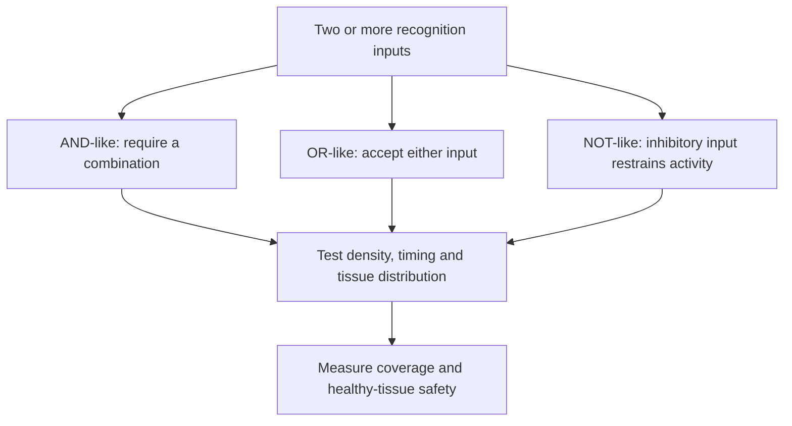

# Logic-gated chimeric antigen receptors

## In one sentence

Logic-gated chimeric antigen receptor systems combine multiple recognition inputs to broaden coverage or restrict when an engineered cell becomes active.

## The intuition

“Respond when A and B are present” is a useful starting rule. Biology adds thresholds, timing and imperfect expression. A logic diagram describes the intended behavior; it is not proof that cells obey a perfect digital truth table in every tissue.

## How it works

A [chimeric antigen receptor (CAR)](/wiki/education/concepts/therapeutics/cell-therapies/car-anatomy) can recognize a target also found on healthy tissue. Combining recognition inputs aims to distinguish a useful tumor pattern from less useful or harmful patterns. Different designs implement those combinations differently.

An **AND-like system** aims to require two inputs. One implementation splits activation and costimulation between receptors, with signaling tuned so either input alone is insufficient under tested conditions. A [primary engineered-cell study](https://pubmed.ncbi.nlm.nih.gov/23242161/) demonstrated this principle in tumor models. Simply coexpressing two fully activating CARs does not create an AND requirement.

An **OR-like system** can respond to either target. This may address tumor populations that differ in target expression. It also adds healthy-tissue recognition routes. Broadening coverage and restricting activation are different goals, even though both involve more than one antigen.

A **NOT-like system** uses an inhibitory input intended to restrain activation when a protective marker is present. Experimental inhibitory receptors have limited cell responses in defined settings. The balance of activation and inhibition still depends on receptor expression and antigen density. [The inhibitory-receptor study](https://pubmed.ncbi.nlm.nih.gov/24337479/) established a mechanism, not universal protection of normal tissue.

A **synthetic Notch (synNotch)** circuit adds a sequence in time. Recognition of A induces expression of a CAR for B. The cell can then recognize B while that CAR remains present. This differs from requiring A and B to be on the same target at exactly the same moment. Time to turn on, decay after priming and movement between tissues matter. [The original circuit study](https://pubmed.ncbi.nlm.nih.gov/26830879/) tested specified antigen combinations in preclinical models.

Test the positive combination and every relevant missing-input combination. Include low antigen density, mixed cells, separated tissues, repeated encounters and residual activity after the trigger disappears. These are part of the recognition claim, not optional extras after a positive tumor result.

*The names describe intended input rules. Their reliability must be tested in the actual circuit.*

## Why it matters in cancer

Tumors differ within and between lesions. A stricter gate can miss cancer cells lacking an input. A broader gate can recognize additional normal cells. The useful tradeoff requires tumor and healthy-tissue distributions, rather than a list of target names alone.

## Worked example and practice

A fictional tumor has A-plus-B cells and B-only cells. Healthy tissue is B-only. An AND-like design kills the A-plus-B population in a dish.

**Try it:** What can the design miss, and what needs a separate safety test?

**Answer:** It may miss B-only tumor cells. Investigators also need to test B-only healthy tissue, including after cells have been primed elsewhere. Success against the intended combination does not establish behavior against the missing-input combinations.

## Common confusions

- Two targets do not automatically mean AND logic.
- OR coverage is not the same as greater tumor selectivity.
- A sequential circuit can retain activity after its first trigger.
- A NOT-like receptor is not an externally activated cell-elimination switch.

## Explain it back

“The intended rule is ___; the crucial failure test is ___.” One answer: “A and B; activity when one input is absent.”

## Related concepts

- [CAR anatomy](/wiki/education/concepts/therapeutics/cell-therapies/car-anatomy)
- [On target off tumor toxicity](/wiki/education/concepts/therapeutics/toxicities-and-supportive-care/on-target-off-tumor-toxicity)

## Sources and scope

Source check: October 9, 2026; expert and learner review pending. This is foundational teaching, not a treatment recommendation. Worked examples are fictional.

- [Kloss et al., 2013](https://pubmed.ncbi.nlm.nih.gov/23242161/) — tuned activation and costimulation for combined antigen recognition.
- [Roybal et al., 2016](https://pubmed.ncbi.nlm.nih.gov/26830879/) — sequential synNotch-to-CAR recognition in preclinical models.
- [Fedorov et al., 2013](https://pubmed.ncbi.nlm.nih.gov/24337479/) — antigen-triggered inhibitory receptors under defined experimental conditions.

<!-- BEGIN GENERATED USED IN -->
## Used in

- [Cytokines and programmable receptors](/wiki/education/cellular-therapies/07-cytokines-and-programmable-receptors)
- [The journey through a solid tumor](/wiki/education/cellular-therapies/08-solid-tumor-barriers)
- [Choose a target with a usable safety window](/wiki/education/guides/engineered-cell-therapy/02-choosing-a-target)
- [How engineered immune cells can attack a solid tumor](/wiki/education/guides/engineered-cell-therapy/index)
<!-- END GENERATED USED IN -->
