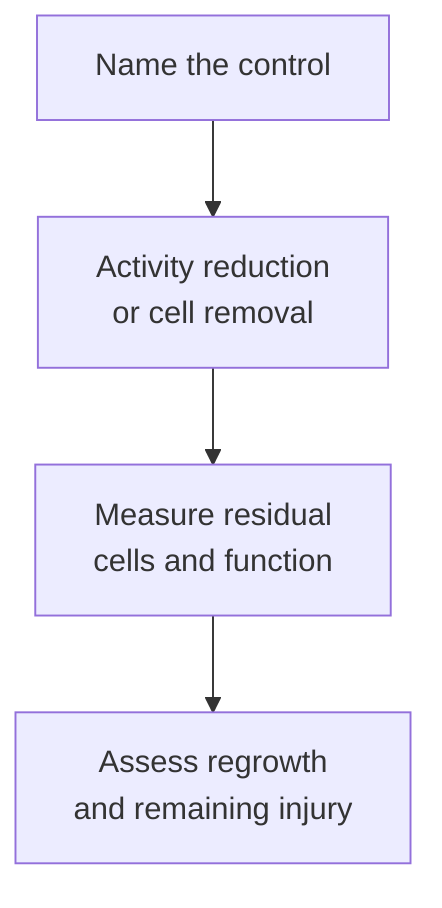

# Safety switches in cell therapy

## In one sentence

A cell-therapy safety switch is an engineered mechanism intended to reduce specified cell activity or eliminate engineered cells when a control input is applied.

## The intuition

Turning down a machine and removing it are different actions. The distinction is even sharper for living cells: their other receptors, secreted signals and prior effects can outlast one controlled input. A switch offers control over a named mechanism, not a promise that all harm can be undone.

## How it works

An **activity switch** changes what cells can do. A drug-gated [chimeric antigen receptor (CAR)](/wiki/education/concepts/therapeutics/cell-therapies/car-anatomy) may require a supplied molecule to assemble or activate its signaling machinery. Removing that input can reduce the controlled pathway as the drug clears. [Primary drug-gated receptor experiments](https://pubmed.ncbi.nlm.nih.gov/26405231/) demonstrated control in defined preclinical systems. They do not establish instantaneous removal of the cells.

A **cell-elimination switch** aims to remove engineered cells. **Inducible caspase-9** links a drug-responsive component to a protein involved in [apoptosis](/wiki/education/concepts/cancer-biology/cell-death-and-survival/apoptosis-and-bcl2-family), a regulated cell-death process. A dimerizing drug brings components together and triggers the death pathway in cells expressing the switch.

The [original clinical switch study](https://pubmed.ncbi.nlm.nih.gov/22047558/) tested genetically modified donor T cells after stem-cell transplantation. It demonstrated rapid reduction of those cells and control of graft-versus-host disease in that setting. This was not a trial proving reversal of every form of CAR-T toxicity. The disease, cells, trigger and measured harms matter.

Other removal designs give cells a marker that can be targeted by another treatment. Their effectiveness depends on expression, drug access and the mechanism needed for clearance. A trigger that works in culture may behave differently in tissue or in an immunosuppressed patient.

Every switch needs evidence for baseline leakage, speed, completeness and remaining effects. Does every dangerous cell express it? Can the trigger reach relevant compartments? Do surviving cells regrow? Removing cells can also sacrifice useful antitumor activity. Previously released inflammatory signals and tissue damage may still need clinical treatment.

*Signal reduction, cell removal and reversal of injury are three different outcomes.*

## Why it matters in cancer

A [cell therapy as a living drug](/wiki/education/concepts/therapeutics/cell-therapies/cell-therapy-as-a-living-drug) can persist after the last administration. Control mechanisms may help manage that persistence or activity. Their presence does not excuse unsafe target selection or replace monitoring and a clinical rescue plan.

Safety evaluation should test the switch within the finished product. The added sequence can itself change cell behavior or manufacturing. A diagram of an off position is not enough.

## Read the control experiment

| Measure | What to record |
|---|---|
| Trigger | Exact molecule, concentration and exposure time; an available trigger is part of the system |
| Input | Viable cells carrying the finished construct, with expressing and nonexpressing controls |
| Activity | Separate receptor signal, cytokine secretion, division and target-cell killing |
| Elimination | Absolute viable engineered-cell counts before and after triggering, plus the remaining fraction |
| Limits | Sampled blood or culture is not every tissue; surviving cells and previously released signals can matter |

Drug concentration may be reported in nanomoles/L or mass/volume, while elimination uses cell counts or percent remaining at a named time. Thresholds are construct- and assay-specific. These functional tests consume cells; a [deoxyribonucleic acid (DNA)](/wiki/education/concepts/biology-basics/molecules/dna) result confirming the switch sequence does not show that the switch works.

## Worked example and practice

A fictional drug controls a growth receptor. After withdrawal, its signaling readout falls to one-fifth of its earlier value. Of 100 viable engineered cells at the start, 80 remain viable at the next measurement, and those survivors still kill targets in a separate assay.

**Try it:** Which claim is supported: reduced signaling, complete cell elimination or reversal of injury?

**Answer:** Reduced signaling in that assay. Eighty viable cells remain; the separate killing result confirms residual function under its conditions. Neither measurement establishes what happens in every tissue or whether earlier inflammation and organ injury resolve. A small signal is not a small number of cells.

## Common confusions

- Stopping administration does not switch off persistent cells.
- An activity switch is not necessarily a cell-elimination mechanism.
- Rapid reduction is not proof that every modified cell was removed.
- A built-in switch does not guarantee reversal of organ damage.

## Explain it back

“This switch controls ___, and its remaining limit is ___.” One answer: “one receptor signal; the cells and downstream effects may persist.”

## Takeaway

**Specify what the switch controls, then measure its speed, completeness and remaining effects.**

## Related concepts

- [Cell therapy as a living drug](/wiki/education/concepts/therapeutics/cell-therapies/cell-therapy-as-a-living-drug)
- [CAR anatomy](/wiki/education/concepts/therapeutics/cell-therapies/car-anatomy)

## Sources and scope

Source check: October 10, 2026; expert and learner review pending. This is foundational teaching, not a treatment recommendation. Worked examples are fictional.

- [Di Stasi et al., 2011](https://pubmed.ncbi.nlm.nih.gov/22047558/) — inducible caspase-9 in donor T cells after stem-cell transplantation.
- [Wu et al., 2015](https://pubmed.ncbi.nlm.nih.gov/26405231/) — drug-gated CAR signaling in preclinical experiments.
- [FDA product-development guidance](https://www.fda.gov/regulatory-information/search-fda-guidance-documents/considerations-development-chimeric-antigen-receptor-car-t-cell-products) — function and trigger dosing require evidence within the actual product.

<!-- BEGIN GENERATED USED IN -->
## Used in

- [Cell therapies as living drugs](/wiki/education/cellular-therapies/01-cell-therapy-primer)
- [Cytokines and programmable receptors](/wiki/education/cellular-therapies/07-cytokines-and-programmable-receptors)
- [The journey through a solid tumor](/wiki/education/cellular-therapies/08-solid-tumor-barriers)
- [Reading cell-therapy evidence](/wiki/education/cellular-therapies/09-reading-cell-therapy-evidence)
- [Read the safety plan for engineered cells](/wiki/education/guides/engineered-cell-therapy/07-reading-the-safety-plan)
- [How engineered immune cells can attack a solid tumor](/wiki/education/guides/engineered-cell-therapy/index)
<!-- END GENERATED USED IN -->
