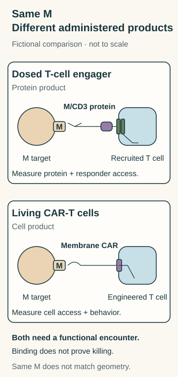

# T-cell engager versus CAR-T

## In one sentence

A surface-target T-cell engager is a dosed protein recruiting T cells, whereas a CAR-T product consists of living T cells carrying a chimeric antigen receptor.

## What they share

Both can connect an accessible target to a T-cell response. Neither target binding nor T-cell activation proves completed killing, healthy-tissue safety or benefit in people.

**Before you start:** [T-cell engagers (TCEs)](/wiki/education/concepts/therapeutics/antibody-based/t-cell-engager) introduce the protein bridge. [Chimeric antigen receptor (CAR) anatomy](/wiki/education/concepts/therapeutics/cell-therapies/car-anatomy) separates the receptor from the cell carrying it. Here, **CAR-T** means administered CAR-bearing T cells; an [in-body engineering carrier](/wiki/education/concepts/engineering-and-manufacturing/cell-manufacturing/ex-vivo-vs-in-vivo-engineering) would be a different administered object.

## The intuition

Imagine connecting an existing responder to a target with a removable bridge, or supplying a responder fitted with a new sensor. That contrast helps you identify the product. “Removable” has a limit: stopping the bridge's supply does not instantly clear it or undo a biological effect. A living responder also needs support and may disappear rather than persist.

## How it works: the axis is which product supplies the connection?

For this comparison, both proposals recognize intact surface feature **M**, a fictional target identifier. The TCE binds M and [cluster of differentiation 3 (CD3)](/wiki/education/concepts/immunology/t-cells/t-cell-receptor) on a recruited T cell. The CAR-T cell carries an M-binding receptor connected to intracellular signaling domains.

*The same fictional target leaves two different products: a protein bridge and a receptor-bearing living cell. Contacts are proposed, not proof of activation or killing; symbol counts, sizes and spacing are schematic.*

Sharing M does not mean matching epitopes, affinity, geometry or tissue exposure. Some engagers and [specialized CARs](https://pubmed.ncbi.nlm.nih.gov/30045840/) recognize peptide–[human leukocyte antigen (HLA)](/wiki/education/concepts/immunology/antigen-presentation/hla) targets instead. That is outside this intact-M example; the actual binder determines the recognition requirement.

## Compare the complete products

| Question | Surface-target TCE | Administered CAR-T cells |
|---|---|---|
| What is supplied? | A finished protein; it does not itself insert receptor instructions | Viable engineered cells expressing the specified CAR |
| Which cells act? | Recruited T cells available at the encounter | The administered CAR-bearing cells, with their measured state and function |
| How is recognition connected? | M-binding and CD3-binding regions create a proposed bridge | The CAR connects external recognition to internal signals |
| What controls exposure? | Dosing, distribution, clearance and active protein concentration | Cell delivery, survival, expansion, trafficking and receptor expression |
| What does a stop mean? | Less new protein supplied; remaining exposure and effects need measurement | No more cells supplied; existing cells may remain. Any control switch needs its own test |
| What needs safety evidence? | Relevant healthy targets, immune activation and actual exposure | Relevant healthy targets, cell/receptor behavior and any control mechanism |

Protein mass or concentration and viable-cell number are different dose descriptions. [Pharmacokinetics](/wiki/education/concepts/therapeutics/how-drugs-work/pharmacokinetics-and-half-life) and cellular persistence cannot be exchanged as if they were the same measurement.

## Worked example: two proposals, one M

These completed cards describe fictional laboratory proposals, not patients:

| Field | Protein P1 | Cell product C1 |
|---|---|---|
| Product identity | M/CD3 protein with specified binding regions | T cells expressing a specified M-binding CAR |
| Effectors | Unmodified model T cells added to the culture | The administered engineered cells |
| Observation | Binding to M-positive targets and CD3 has been measured | Viable CAR-positive cells and M-dependent binding have been measured |
| Still missing | Timed target death, tissue access, exposure and healthy-cell effects | Timed target death, trafficking, persistence and healthy-cell effects |

**Try it:** Which product supplies the responding cells? Which needs available T cells at the encounter? Has either card established killing? Would stopping P1 or detecting persistent C1 cells settle safety or efficacy?

**Answer:** C1 supplies engineered responders; P1 recruits the model T cells. Neither card has measured target-cell death. Test [cytotoxicity](/wiki/education/concepts/measurement/immune-monitoring/functional-cytotoxicity-assays) with M-negative targets and suitable effector/product controls, then examine access and exposure in the relevant model. Healthy M-positive cells need separate testing. Stopping supply does not erase exposure or injury; persistence alone does not show useful function or durable benefit.

## Why it matters in cancer: choose the evidence question

If the question is whether recruited cells are available, investigate their location and function for P1. If it is whether supplied cells reach the target and remain functional, track C1. Neither question selects a universal winner. The existing [scarce-immune-contact card](/wiki/education/targeted-therapy-modalities/06-comparisons#worked-example-three-fictional-evidence-cards) develops the access problem without promising that engineering solves it.

## Common confusions

- A CAR protein, its genetic instructions and a CAR-T product are different objects.
- Recruiting through CD3 does not remove immune-cell functional constraints.
- A shared target name does not establish matched contact geometry.
- Adjustable protein dosing and persistent cells are properties to measure, not safety or benefit rankings.

## Explain it back

“P1 supplies ___; C1 supplies ___; both still need ___.”

**One answer:** a recruiting protein; receptor-bearing living cells; evidence for access, target-dependent function, exposure and harms.

## Takeaway

**One product brings a bridge; the other brings cells carrying a receptor. Compare the complete encounters and evidence.**

## Related concepts

- [Target versus therapeutic format](/wiki/education/concepts/therapeutics/antibody-based/target-vs-chassis)
- [T-cell states](/wiki/education/concepts/immunology/t-cells/t-cell-states)

## Sources and scope

Author source check: October 12, 2026. Fixed fictional surface-target comparison, not clinical selection. Independent scientific/visual review and expert/learner review remain pending.

- [Hudecek et al., 2015](https://pmc.ncbi.nlm.nih.gov/articles/PMC4692801/) — selected full-text construct, function and mouse-persistence sections; geometry and cell behavior depend on the actual design.
- [Giffin et al., 2021](https://pubmed.ncbi.nlm.nih.gov/33203642/) — primary abstract read; defined engager/model and nonhuman-primate exposure findings, without full-text access or transfer to a generic dosing rule.
- [Tebentafusp prescribing information, sections 11–12.3](https://dailymed.nlm.nih.gov/dailymed/fda/fdaDrugXsl.cfm?setid=24a49f57-d2fc-4ffe-9eb1-fe0460c6b067) — selected official primary product/PK text illustrates a dosed CD3-recruiting protein. Its peptide–HLA route is distinct from fictional M; no indication or outcome is transferred.

<!-- BEGIN GENERATED USED IN -->
## Used in

- [Compare related ideas](/wiki/education/comparisons/index)
<!-- END GENERATED USED IN -->
