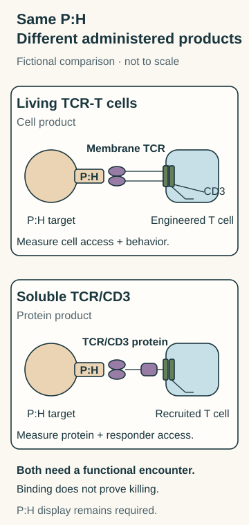

# TCR-T versus a soluble TCR engager

## In one sentence

T-cell receptor therapy supplies engineered living T cells, while a soluble receptor engager supplies a protein recruiting T cells to a specified peptide–human leukocyte antigen complex.

## What they share

Both specified routes recognize a peptide paired with its presenting [human leukocyte antigen (HLA)](/wiki/education/concepts/immunology/antigen-presentation/hla) molecule. Exact peptide, HLA allele and surface display matter; source protein or genotype alone proves neither display nor killing.

**Before you start:** A [T-cell receptor (TCR)](/wiki/education/concepts/immunology/t-cells/t-cell-receptor) recognizes peptide and HLA together. [TCR-engineered T cells (TCR-T)](/wiki/education/concepts/therapeutics/cell-therapies/tcr-t) carry selected receptor instructions. [Soluble TCR/CD3 proteins](/wiki/education/concepts/therapeutics/antibody-based/tcr-mimics-and-tcr-engagers) recruit T cells through cluster of differentiation 3 (CD3), the receptor-associated signaling complex.

## The intuition

The same reading rule can be installed in a responder or supplied in a protein that connects another responder. The analogy locates recognition and signaling; it does not establish matched affinity, geometry, access or outcomes.

## How it works: the axis is where is the receptor, and what is administered?

This pair compares conventional alpha-beta TCR-bearing cells with a soluble TCR/CD3 protein. The fictional tag **P:H** names one exact peptide–HLA complex. P and H are fictional identifiers. Neither product is assumed to recognize every peptide made from the source protein or another HLA allele.

*The P:H requirement is shared; the administered object and location of recognition differ. These schematic cards add exposure/control questions, without demonstrating natural display, killing or benefit.*

The existing [three-format table and illustration](/wiki/education/concepts/therapeutics/antibody-based/tcr-mimics-and-tcr-engagers#how-it-works) separates an **[antibody-derived TCR mimic](https://pubmed.ncbi.nlm.nih.gov/26389576/)** from this pair. Its binder is not a TCR, even when a CD3 arm makes it an engager.

## Compare the complete products

| Question | Administered TCR-T cells | Soluble TCR/CD3 protein |
|---|---|---|
| What is supplied? | Viable cells expressing selected receptor chains | A finished soluble receptor/CD3-binding protein |
| Where is recognition? | TCR at the engineered cell membrane | Soluble TCR binding region on the dosed protein |
| How does signaling connect? | Receptor-associated CD3 machinery in the engineered cell | The protein recruits another T cell through its CD3 |
| Which effectors are required? | Functional supplied cells that reach the target | Functional accessible recruited cells; their native TCR need not recognize P:H |
| What controls exposure? | Cell survival, trafficking, expansion and receptor expression | Protein dosing, distribution, clearance and productive encounters |
| What remains shared? | Actual display of the specified P:H, function and safety | Actual display of the specified P:H, function and safety |

Changing format does not repair an absent required HLA allele.

## Worked example: two P:H product cards

Both fictional proposals bind a supplied P:H reagent in a controlled test:

| Field | Cell product T1 | Protein S1 |
|---|---|---|
| Identity | T cells expressing a specified conventional TCR pair | Soluble TCR recognizing P:H joined to a CD3-binding arm |
| Additional observation | Viable receptor-positive cells detected | CD3 binding measured |
| Exposure record | No trafficking or persistence results | No tissue-distribution or clearance results |
| Target evidence | No naturally presenting tumor-cell test | No naturally presenting tumor-cell test |

**Try it:** Which proposal supplies receptor-bearing responders, and which recruits them? Can either recognize the specified target on a wrong-allele cell by changing product format? Do reagent binding and these cards establish useful killing or controllability?

**Answer:** T1 supplies engineered cells; S1 supplies a recruiting protein. The specified P:H requirement remains for both. A different allele does not supply that complex, although any unintended recognition is a separate cross-reactivity question. Binding to supplied reagent leaves natural processing/display and target-cell function open. Test the finished products with naturally presenting cells, relevant allele/peptide controls, suitable effectors and healthy tissues. Track cell behavior for T1 and protein exposure for S1. Stopping a protein dose does not instantly reverse effects; a cell-control switch, if included, needs evidence for what it actually stops.

## Why it matters in cancer: choose the evidence question

To ask whether surface display is present, use the existing [three-target answered exercise](/wiki/education/concepts/therapeutics/antibody-based/tcr-mimics-and-tcr-engagers#try-it). To ask whether supplied cells reach and remain at a site, follow T1. To ask whether protein and available T cells meet there, follow S1. These evidence plans supply no efficacy ranking or eligibility decision.

## Common confusions

- A soluble TCR protein is not a living cell or a gene-delivery vehicle.
- An antibody-derived mimic is not an engineered TCR scaffold.
- Recruiting through CD3 does not remove the target's HLA requirement.
- Compatible genotype, loaded reagent binding, natural display, killing and benefit are separate findings.
- Protein clearance and cellular persistence are not interchangeable measures of control.

## Explain it back

“Both read ___; T1 carries ___; S1 connects ___.”

**One answer:** the specified peptide–HLA complex; a receptor and signaling machinery on living cells; that target to CD3 on recruited T cells. Neither format supplies missing display or proven safety.

## Takeaway

**Keep the displayed target fixed, then ask whether recognition arrives on living cells or in a recruiting protein.**

## Related concepts

- [Antigen processing](/wiki/education/concepts/immunology/antigen-presentation/antigen-processing-machinery)
- [Functional cytotoxicity assays](/wiki/education/concepts/measurement/immune-monitoring/functional-cytotoxicity-assays)

## Sources and scope

Author source check: October 12, 2026. Fictional conventional-receptor/soluble-TCR comparison; no indication, ranking or eligibility inference. Scientific/visual and expert/learner review pending.

- [Morgan et al., 2006](https://pubmed.ncbi.nlm.nih.gov/16946036/) — primary abstract read: receptor gene transfer into autologous lymphocytes in metastatic melanoma. No new full-text or universal persistence/outcome claim.
- [Liddy et al., 2012](https://pubmed.ncbi.nlm.nih.gov/22561687/) — primary abstract read: soluble TCR/CD3 constructs in experimental models; full Methods and correction bodies not acquired.
- [Tebentafusp prescribing information, sections 11–12.3](https://dailymed.nlm.nih.gov/dailymed/fda/fdaDrugXsl.cfm?setid=24a49f57-d2fc-4ffe-9eb1-fe0460c6b067) — selected official primary description, mechanism and protein-exposure text for one peptide–HLA/CD3 product, with no transfer of its indication or clinical results.

<!-- BEGIN GENERATED USED IN -->
## Used in

- [Compare related ideas](/wiki/education/comparisons/index)
<!-- END GENERATED USED IN -->
