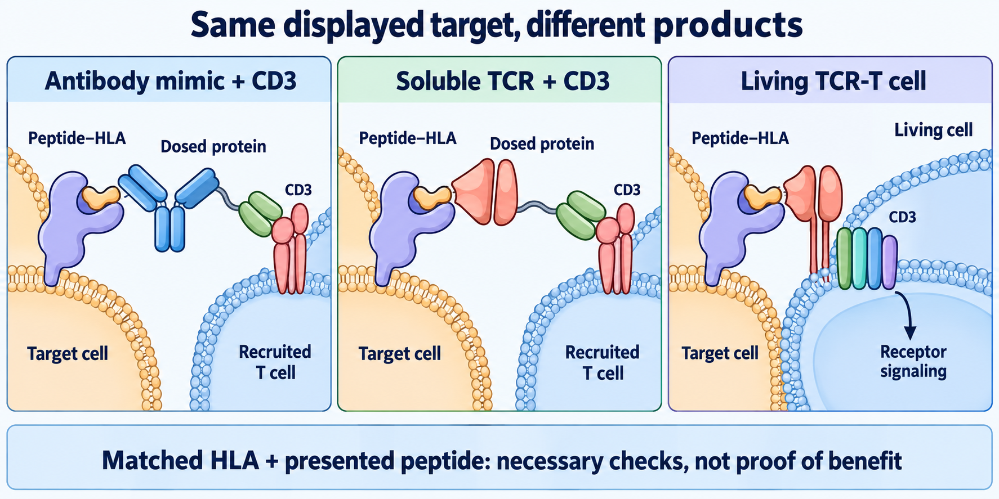
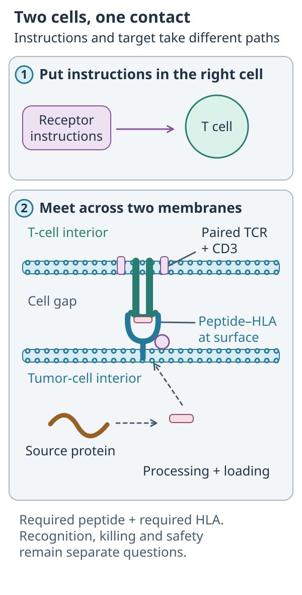
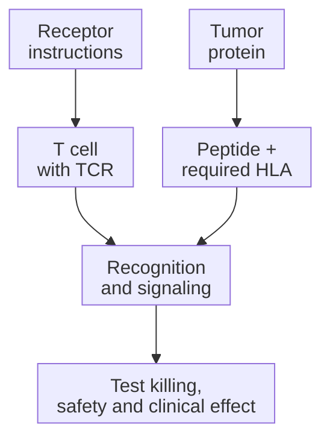

# Engineered T-cell receptor therapy (TCR-T)

## In one sentence

Engineered T-cell receptor therapy installs a selected receptor in T cells so they can recognize a specified peptide together with its presenting human leukocyte antigen molecule.

## The intuition

Instead of searching a mixed crowd for a useful reader, researchers give cells the instructions for a selected reader. That reader checks a protein fragment and its display molecule together. The analogy has a limit: one receptor can cross-react with other fragments, so installing it also creates safety questions.

## How it works

*Reference anatomy from the shared concept. The focused comparison below asks a different question.*

*Receptor instructions belong in the T cell; tumor processing supplies the separate peptide–HLA address across the contact.*

**Read the picture:** Which cell receives the receptor instructions? **Answer:** The T cell. The tumor must separately display the required peptide–HLA target.

For conventional alpha-beta [T-cell receptor (TCR)](/wiki/education/concepts/immunology/t-cells/t-cell-receptor) therapy, researchers select or develop paired alpha and beta receptor chains. Researchers can **clone** the paired coding sequences: make genetic copies of a selected receptor's instructions. Here, cloning a receptor does not mean copying an entire person or proving a receptor's specificity from one sequenced chain.

Genetic engineering introduces those instructions into therapeutic T cells. **Transduction** means transfer using a viral vector; other delivery or gene-editing methods may be used. Receptor engineering is not one universal manufacturing process. This is different from merely expanding naturally reactive cells: the recognition receptor has been installed. [The early receptor-transfer study](https://pubmed.ncbi.nlm.nih.gov/16946036/) demonstrated this principle in metastatic melanoma.

The receptor recognizes a peptide–[human leukocyte antigen (HLA)](/wiki/education/concepts/immunology/antigen-presentation/hla) complex, rather than the source protein alone. The protein may be inside the cancer cell. It must be processed into an appropriate peptide, loaded onto the relevant HLA molecule and displayed where the receptor can encounter it. Protein expression and a compatible HLA type do not independently prove all those steps.

**HLA restriction** names the presenting molecule a receptor requires. Losing the relevant allele or impairing presentation can remove the recognition route. Retaining another HLA allele does not rescue that particular receptor. A different receptor might use the retained allele, but it needs its own target and function evidence.

The introduced receptor must also assemble with the receptor-associated cluster of differentiation 3 (CD3) signaling complex and signal in the recipient cells. The [TCR structure concept](/wiki/education/concepts/immunology/t-cells/t-cell-receptor) separates paired recognition chains from that signaling machinery. Endogenous and introduced chains can create pairing and expression questions; strategies differ between products. The final cell state, tumor access and local inhibition still influence killing.

Safety testing asks about the intended peptide on healthy tissue and unintended peptide cross-reactivity. A primary investigation identified recognition of a heart-muscle peptide by one affinity-enhanced receptor. That finding explains a hazard; it does not establish that every engineered receptor shares that risk. [The cross-reactivity study](https://pubmed.ncbi.nlm.nih.gov/23926201/) also shows why a reassuring early screen is not complete safety proof.

*Recognition requires the displayed complex and a functional receptor, not just the protein's name.*

## Why it matters in cancer

This route can reach targets derived from intracellular proteins that a conventional surface-binding [chimeric antigen receptor (CAR)](/wiki/education/concepts/therapeutics/cell-therapies/car-anatomy) cannot directly see. It trades that broader source-protein space for presentation dependencies. Matching a biomarker is a recognition requirement, not proof of treatment benefit or access.

## How it is measured

Ask for evidence that the intended pair is expressed and the final cells respond to naturally presenting targets. [Peptide–HLA multimers](/wiki/education/concepts/measurement/immune-monitoring/peptide-hla-multimer-staining) test reagent binding; [cytotoxicity assays](/wiki/education/concepts/measurement/immune-monitoring/functional-cytotoxicity-assays) test target-cell death. Relevant HLA or antigen removal/restoration helps test the claimed dependency. Peptide-loaded targets can bypass natural processing and presentation. Controls should include irrelevant peptides, unmodified effectors and relevant healthy tissue.

## Worked example and practice

A fictional tumor expresses protein P and carries HLA allele A. A receptor recognizes a P-derived peptide displayed by A.

**Try it:** Can researchers stop after measuring P [ribonucleic acid (RNA)](/wiki/education/concepts/biology-basics/molecules/rna-and-mrna) and typing A?

**Answer:** No. They still need evidence for processing, presentation and functional tumor recognition, alongside healthy-tissue safety. RNA abundance is upstream of the actual receptor target.

## Common confusions

- Expanding native reactive T cells is not itself receptor engineering.
- “Intracellular target” means recognition of a displayed fragment, not entry of the receptor into the cancer cell.
- HLA type is not a direct presentation assay.
- Stronger binding can change cross-reactivity as well as useful recognition.

## Explain it back

“This receptor needs both ___ and ___.” One answer: “the right peptide; its required presenting HLA molecule.”

## Takeaway

**Installing a receptor does not establish that its target is naturally displayed or safely recognized.**

## Related concepts

- [T cell receptor](/wiki/education/concepts/immunology/t-cells/t-cell-receptor)
- [HLA](/wiki/education/concepts/immunology/antigen-presentation/hla)
- [Antigen-processing machinery](/wiki/education/concepts/immunology/antigen-presentation/antigen-processing-machinery)

## Sources and scope

Source check: October 10, 2026; expert and learner review pending. This is foundational teaching, not a treatment recommendation. Worked examples are fictional.

- [Morgan et al., 2006](https://pubmed.ncbi.nlm.nih.gov/16946036/) — receptor gene transfer into autologous lymphocytes in metastatic melanoma.
- [Cameron et al., 2013](https://pubmed.ncbi.nlm.nih.gov/23926201/) — investigation of titin-peptide cross-reactivity for one affinity-enhanced receptor.
- [FDA lymphocyte-product guidance](https://www.fda.gov/regulatory-information/search-fda-guidance-documents/considerations-development-chimeric-antigen-receptor-car-t-cell-products) — related engineered receptors require product-specific considerations.

<!-- BEGIN GENERATED USED IN -->
## Used in

- [Compare immune-cell recognition systems](/wiki/education/cellular-therapies/02-car-tcr-til-comparison)
- [Choose a target with a usable safety window](/wiki/education/guides/engineered-cell-therapy/02-choosing-a-target)
- [How engineered immune cells can attack a solid tumor](/wiki/education/guides/engineered-cell-therapy/index)
- [T-cell receptors and TCR sequencing](/wiki/education/molecular-profiling/tcr-and-tcr-sequencing)
- [Separate the address from the killing mechanism](/wiki/education/targeted-therapy-modalities/01-mechanism)
<!-- END GENERATED USED IN -->
