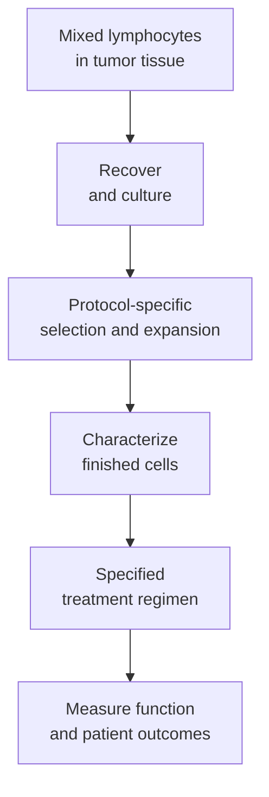

# Tumor-infiltrating lymphocyte (TIL) therapy

## In one sentence

Tumor-infiltrating lymphocyte therapy collects immune cells from a tumor, expands them outside the body and transfers them back to seek useful antitumor activity.

## The intuition

A tumor may already contain some useful immune responders. The idea is to recover them and build a larger working population. Being at the scene is a starting clue, not proof that every cell recognizes the cancer. Some infiltrating cells are bystanders with unrelated specificities.

## How it works

**Tumor-infiltrating lymphocytes (TILs)** are lymphocytes found within tumor tissue. TIL therapy usually works with tumor-derived T cells, using their existing [T-cell receptor (TCR)](/wiki/education/concepts/immunology/t-cells/t-cell-receptor) recognition rather than requiring a new engineered receptor. The word TIL describes where cells were collected; it does not guarantee their antigen specificity.

Researchers obtain tumor material, establish cultures and expand cells. Some methods select for measured tumor recognition; others expand a broader population. These manufacturing choices influence which clones survive and become abundant. A receptor repertoire in the original tissue need not match the final infusion product.

Conventional alpha-beta T cells recognize peptide plus [human leukocyte antigen (HLA)](/wiki/education/concepts/immunology/antigen-presentation/hla). Their targets may include mutation-derived or shared antigens. The product can contain multiple specificities, but useful breadth must be tested. A mixed population is not automatically a solution to every route of tumor escape.

In many protocols, [lymphodepletion](/wiki/education/concepts/therapeutics/toxicities-and-supportive-care/lymphodepletion) precedes infusion and cytokine support follows it. Those treatments have their own biological effects and risks. The regimen, manufacturing method and disease setting belong beside any efficacy claim. The [randomized advanced-melanoma study](https://pubmed.ncbi.nlm.nih.gov/36477031/) evaluated a complete treatment package, not expanded cells in isolation.

Transferred cells must still reach relevant lesions and remain functional. [Expansion](/wiki/education/concepts/engineering-and-manufacturing/cell-manufacturing/ex-vivo-cell-expansion) changes both cell number and the mixture of clones; culture yield and useful recognition are different endpoints. Tumor entry before collection does not guarantee entry after transfer, and culture expansion does not prove durable activity. [Primary human-tumor studies](https://pubmed.ncbi.nlm.nih.gov/29769722/) also show that infiltrating T cells can recognize viral antigens unrelated to the cancer.

*Tumor origin, manufacturing success and useful tumor reactivity are distinct claims.*

## Why it matters in cancer

TIL therapy starts with naturally occurring recognition in the person's tumor. This can offer several recognition routes without selecting one artificial surface receptor. It also depends on obtaining usable tissue, recovering appropriate cells and producing a suitable product.

Clinical evidence from one cancer and protocol cannot establish benefit in another. Feasibility, activity and comparative benefit remain different questions even when the biological idea is attractive.

## How it is measured

A pathology [stromal TIL score](/wiki/education/concepts/measurement/pathology-readouts/stil-scoring) estimates the percentage of tumor stromal area occupied by specified mononuclear inflammatory cells. It does not count the viable cells recovered for manufacture. Product characterization can measure viable-cell yield, identity and receptor repertoire. Functional tests ask which naturally presenting tumor targets the product recognizes, using appropriate HLA, unmodified-effector and target-only controls.

A percentage responding to one test target does not describe every clone or every lesion. Report preparation, target material, readout and conditions. Recognition, target death and clinical outcomes must remain separate.

## Worked example and practice

A fictional culture contains many cells whose receptors recognize a common virus, plus a smaller tumor-reactive population. The virus-reactive cells expand fastest.

**Try it:** Does a large final cell count establish a strong antitumor product?

**Answer:** No. Cell number establishes yield. Investigators need product-specific recognition and function evidence, including which relevant tumor cells the product can recognize.

## Common confusions

- TIL therapy and engineered receptor therapy can overlap experimentally, but neither name implies the other.
- A pathology infiltration score counts tissue features; it is not a manufactured cell product or proof of reactivity.
- Tumor-derived does not mean every cell is tumor-specific.
- A successful culture is not evidence of clinical benefit.

## Explain it back

“TIL describes ___; useful therapy still requires ___.” One answer: “the cells' tissue origin; suitable recognition, function, manufacturing and clinical evidence.”

## Takeaway

**Tumor origin offers a starting population; manufacture, specificity and clinical usefulness require their own evidence.**

## Related concepts

- [T cell receptor](/wiki/education/concepts/immunology/t-cells/t-cell-receptor)
- [T cell repertoire](/wiki/education/concepts/immunology/t-cells/t-cell-repertoire)
- [Cell therapy as a living drug](/wiki/education/concepts/therapeutics/cell-therapies/cell-therapy-as-a-living-drug)

## Sources and scope

Source check: October 10, 2026; expert and learner review pending. This is foundational teaching, not a treatment recommendation. Worked examples are fictional.

- [NCI T-cell transfer therapy](https://www.cancer.gov/about-cancer/treatment/types/immunotherapy/t-cell-transfer-therapy) — basic collection and expansion approach.
- [Simoni et al., 2018](https://pubmed.ncbi.nlm.nih.gov/29769722/) — bystander T cells in human lung and colorectal tumor infiltrates.
- [Rohaan et al., 2022](https://pubmed.ncbi.nlm.nih.gov/36477031/) — randomized comparison of a specified TIL regimen with ipilimumab in advanced melanoma.

<!-- BEGIN GENERATED USED IN -->
## Used in

- [Compare immune-cell recognition systems](/wiki/education/cellular-therapies/02-car-tcr-til-comparison)
- [How engineered immune cells can attack a solid tumor](/wiki/education/guides/engineered-cell-therapy/index)
<!-- END GENERATED USED IN -->
