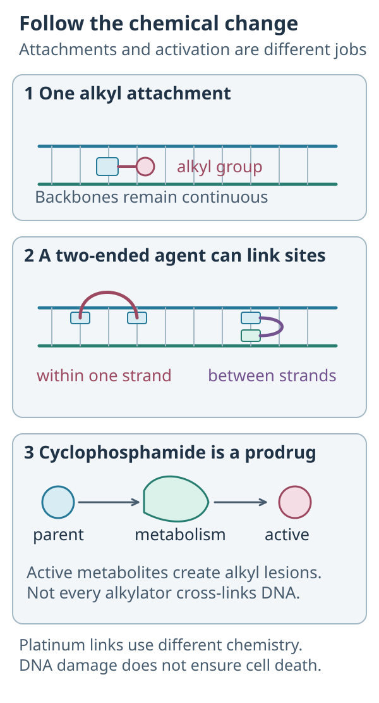

# Alkylating agents

## In one sentence

Classic alkylating agents are chemotherapy drugs that transfer reactive alkyl groups to cellular molecules, including DNA (deoxyribonucleic acid), disrupting functions needed for cell survival.

## The intuition

Imagine attaching sticky tags to an instruction book. A tag may change one word; a two-ended tag may fasten two places together. The book becomes harder to copy correctly.

That picture helps distinguish a chemical attachment from a missing page. Cells have repair and tolerance systems, so adding a tag does not automatically kill a cell. Different chemicals also make different patterns of damage.

## How it works

*Reuse the connectivity comparison, then keep the chemistry clear: platinum does not transfer an alkyl group.*

*Classic alkylation changes a chemical attachment; prodrug activation changes which species can make it.*

**Follow the parent:** Is administered cyclophosphamide the same quantity as active-metabolite exposure? **Answer:** No. Metabolism lies between them. Not every alkylating agent makes the illustrated cross-links, and DNA damage does not guarantee cell death.

An **alkyl group** is a small carbon-containing chemical group. Classic alkylating drugs can transfer reactive groups to molecules in cells. Important targets include [DNA (deoxyribonucleic acid)](/wiki/education/concepts/biology-basics/genetics/central-dogma), which stores genetic information.

A drug or active metabolite with two reactive sites can form **cross-links**, connecting sites within or between DNA strands. These lesions interfere with copying and other DNA functions. Alkylating agents are a varied class: not every member has the same activation pathway, lesion pattern or clinical use.

Cyclophosphamide illustrates the importance of activation. It is a **prodrug**, a substance converted into active forms in the body. Liver enzymes help generate metabolites that lead to phosphoramide mustard, an active alkylating species. Therefore, the amount of parent drug given is not identical to active-metabolite exposure.

Metabolism also produces other substances with different effects. Acrolein contributes to cyclophosphamide-related urinary-tract injury. Saying “the liver activates the medicine” should not obscure the fact that metabolism can generate harmful by-products too.

[Platinum agents](/wiki/education/concepts/therapeutics/chemotherapy/platinum-agents) may be grouped as alkylating-like because they also form DNA attachments and cross-links. They do not transfer an alkyl group. The classification is useful for a broad map, while the chemistry matters for a precise explanation.

## Why it matters in cancer

These drugs can affect cancer cells and susceptible normal tissues. Their usefulness depends on clinical evidence for the actual disease, regimen and treatment goal. The existence of DNA damage does not prove selective cancer killing.

Cyclophosphamide also has immune-suppressing activity. In another context, it may be part of [lymphodepletion](/wiki/education/concepts/therapeutics/toxicities-and-supportive-care/lymphodepletion) before a cell therapy. A shared drug name does not make that protocol equivalent to a breast-cancer chemotherapy regimen.

## How it is measured

Researchers can measure chemical DNA attachments, cross-links, metabolite concentrations and survival after defined exposure. Measuring parent drug alone can miss differences in activation.

Clinical dose records may use milligrams or mg/m², meaning milligrams per square meter of body surface area. Safety assessment follows the product and regimen, including blood counts and organ-specific considerations. Supportive care cannot be selected from the class name alone. Nor does one regimen's use of a protective medicine establish that every cyclophosphamide exposure requires the same approach.

## Common confusions

- **Prodrug versus inactive treatment:** a prodrug can be effective because the body generates active metabolites.
- **Cross-link versus every alkylating lesion:** cross-links are one important damage pattern, not the only chemical modification.
- **Alkylating versus alkylating-like:** platinum has related consequences through different chemistry.
- **Anticancer versus immune effects:** both can occur; the protocol determines the intended role.

## Try it

A fictional lab exposes tumor cells to parent cyclophosphamide without an activation system and sees little killing. Has it proved clinical resistance?

**Answer:** No. The experiment may not reproduce the generation of active metabolites. Its exposure design must be examined before interpreting resistance.

## Explain it back

“For a prodrug, I need to distinguish the administered ___ from the active ___.”

**One possible answer:** “Parent compound; metabolites.”

## Related concepts

- [Pharmacokinetics and half-life](/wiki/education/concepts/therapeutics/how-drugs-work/pharmacokinetics-and-half-life)
- [Therapeutic index](/wiki/education/concepts/therapeutics/how-drugs-work/therapeutic-index)

## Sources and scope

Source-checked October 9, 2026; expert and learner review pending. Class chemistry with cyclophosphamide as one example; no supportive-care or dosing rule.

- [NCI: alkylating agent](https://www.cancer.gov/publications/dictionaries/cancer-terms/def/alkylating-agent) — class-level DNA effects.
- [NCI Drug Dictionary: cyclophosphamide](https://www.cancer.gov/publications/dictionaries/cancer-drug/def/cyclophosphamide) — prodrug metabolism and anticancer/immune-suppressing roles.
- [FDA cyclophosphamide injection label, 2023 version](https://www.accessdata.fda.gov/drugsatfda_docs/label/2023/210735s002lbl.pdf) — sections 5.2 and 12; urinary toxicity, activation and metabolites. Dated mechanism source, not current individualized instructions.
- [Kurt Kohn's NCI book, chapter 3](https://discover.nci.nih.gov/kohn/book/drugs_against_cancer_chapter3_v221004be3.pdf) — nitrogen-mustard cross-link chemistry contrasted with platinum.

<!-- BEGIN GENERATED USED IN -->
## Used in

- [Read the jobs in the treatment plan](/wiki/education/guides/treating-early-tnbc/01-read-the-jobs-in-the-plan)
<!-- END GENERATED USED IN -->
