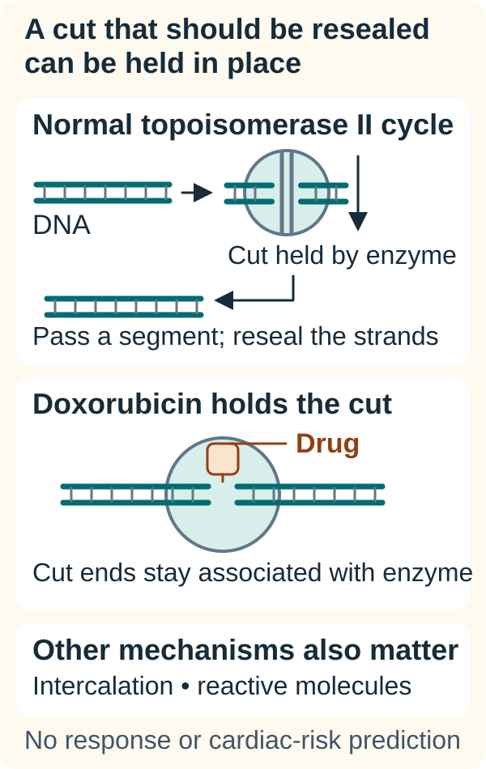

# Anthracyclines

## In one sentence

Anthracyclines are chemotherapy drugs that interact with DNA (deoxyribonucleic acid) and enzymes such as topoisomerase II, producing cellular injury through several mechanisms.

## The intuition

Think of a repair worker who briefly cuts a tangled cable, untwists it and joins it again. One way an anthracycline causes trouble is by stabilizing the worker's cut-and-hold stage.

The analogy describes an enzyme–DNA interaction, not a complete account of the drug. Anthracyclines also interact with other cellular structures. Nor is a temporary enzymatic cut the same as an accidental break that cannot be repaired.

## How it works

*Doxorubicin can hold an enzyme-associated DNA cut in a damaging intermediate; it does more than switch the enzyme off.*

The two teal lines are DNA strands, and the surrounding shape is topoisomerase II. The upper sequence returns to joined strands after a temporary enzyme-held cut. The lower scene holds the cut stage in a drug-stabilized complex. This is one mechanism: intercalation and reactive molecules also matter. The drawing predicts neither benefit nor heart injury for an individual.

Doxorubicin and epirubicin are members of this [chemotherapy](/wiki/education/concepts/therapeutics/chemotherapy/chemotherapy) family. Doxorubicin is a useful example, rather than a substitute for every product's evidence.

[DNA (deoxyribonucleic acid)](/wiki/education/concepts/biology-basics/genetics/central-dogma) must be managed as it is copied and used. **Topoisomerase II** is an enzyme that temporarily cuts both DNA strands, passes another DNA segment through the opening and reseals the cut. This helps resolve twisting and tangling.

Doxorubicin can stabilize enzyme–DNA complexes associated with these cuts, interfering with resealing and promoting damage. Calling it a topoisomerase II inhibitor is common. “Poisoning the cut-and-reseal process” explains more than imagining that the enzyme simply switches off.

Anthracyclines also **intercalate**, meaning that part of the molecule fits between DNA base pairs. Doxorubicin can generate reactive molecules and interact with membranes. These effects contribute to a complex injury picture; no single arrow explains every tumor response or normal-tissue toxicity.

Cancer cells and normal cells share these biological processes. Anthracycline activity is therefore not a cancer-only interaction. The [therapeutic index](/wiki/education/concepts/therapeutics/how-drugs-work/therapeutic-index) concerns the relationship between useful effects and harm, rather than whether the molecule has a plausible target.

## Why it matters in cancer

Anthracyclines occur in several combination regimens. Mechanism explains a rationale for a drug's role, but clinical evidence must match the cancer type, setting, formulation and partners.

Doxorubicin can injure the heart, and cumulative exposure matters to its risk assessment. Heart injury can also become evident after treatment ends. This is one reason clinicians track previous anthracycline treatment and other relevant exposures. A symptom-free infusion is not proof that future risk is absent.

## How it is measured

Mechanism experiments examine enzyme–DNA complexes, DNA breaks and survival under controlled exposure. Those are different readouts. A break count alone does not determine clinical benefit.

Clinical records distinguish the dose per administration from the cumulative amount. Body-surface-area-normalized amounts may be expressed in mg/m². Cardiac assessment may include **left ventricular ejection fraction**, the proportion of blood the main pumping chamber ejects with a beat. That percentage describes heart function; it is not a cancer-response score or a guarantee against later toxicity.

## Common confusions

- **“Antibiotic” versus infection treatment:** anthracyclines are called antitumor antibiotics because of their origin/classification; that does not make them routine infection medicines.
- **Inhibitor versus topoisomerase poison:** stabilizing a damaging intermediate differs from simply preventing all enzyme activity.
- **One dose versus cumulative exposure:** previous treatment can remain relevant.
- **Same active drug versus same formulation:** liposomal and conventional products require their own instructions and evidence.

## Try it

In a fictional experiment, doxorubicin increases enzyme-associated DNA breaks. A second report shows normal heart imaging before treatment. Do these establish effective treatment without cardiac risk?

**Answer:** No. One supports a mechanism in the experiment. The other supplies a baseline measurement. Neither establishes individual benefit or excludes later harm.

## Explain it back

“An anthracycline can disturb DNA handling, but its cancer effect and ___ must be assessed separately.”

**One possible answer:** “Its effects on normal tissues, including the heart.”

## Related concepts

- [Dose and dose intensity](/wiki/education/concepts/therapeutics/how-drugs-work/dose-and-dose-intensity)
- [Platinum agents](/wiki/education/concepts/therapeutics/chemotherapy/platinum-agents)

## Sources and scope

Source-checked October 9, 2026; expert and learner review pending. Mechanism examples and monitoring vocabulary; no cumulative-dose limit or treatment recommendation.

- [NCI Drug Dictionary: doxorubicin hydrochloride](https://www.cancer.gov/publications/dictionaries/cancer-drug/def/doxorubicin-hydrochloride) — intercalation, topoisomerase II and reactive-molecule mechanisms.
- [NCI Drug Dictionary: epirubicin hydrochloride](https://www.cancer.gov/publications/dictionaries/cancer-drug/def/epirubicin-hydrochloride) — confirms the second family example; no interchangeable dosing or toxicity inferred.
- [Tewey and colleagues, 1984](https://pubmed.ncbi.nlm.nih.gov/6093249/) — primary in vitro topoisomerase-associated damage experiment.
- [FDA doxorubicin prescribing information, 2019 version](https://www.accessdata.fda.gov/drugsatfda_docs/label/2019/050467s077lbl.pdf) — sections 5.1 and 12.1; cumulative/delayed cardiac risk and mechanism. A dated label, not a claim of the latest complete prescribing instructions.

<!-- BEGIN GENERATED USED IN -->
## Used in

- [Read the jobs in the treatment plan](/wiki/education/guides/treating-early-tnbc/01-read-the-jobs-in-the-plan)
<!-- END GENERATED USED IN -->
